# Celeris Edge

**Plataforma agnóstica de caché y aceleración segura de contenido web para redes institucionales con enlaces limitados**

> Documento maestro (guía) del proyecto de Evaluación de Perfil de Egreso (EPE). Define el producto, sus módulos, la arquitectura de cada área de revisión, el software recomendado y cómo se demuestra. **No es un entregable**: cada informe de las rúbricas se construye a partir de una sección de este documento.

## Registro de cambios

| Versión | Fecha | Cambios principales |
| --- | --- | --- |
| 0.1 | 2026-11-17 | Borrador de arquitectura de las tres líneas |
| 0.2 | 2026-11-18 | **Parte D reestructurada** en las 15 secciones oficiales de CE0311. DMZ dividida en servicios (portal de transparencia protegido con WAF) y señuelos. Nuevas VLAN 31 LAB-TEST y 71 BACKUP. Matriz de protección de datos en tránsito por flujo. Modelo de amenazas STRIDE y detección mapeada a MITRE ATT&CK. VPN corregida a activo/pasivo con MTU/MSS. Servicios base (DHCP, DNS secundario, NTS, postura IPv6). Pruebas T15–T28. **Nueva Parte F: laboratorio demostrable y despliegue efímero** (emulación local, AWS efímero, imagen de despliegue). Correcciones de coherencia en B2.4, B3.3, D2 y E1 |

## Cómo usar este documento

| Si vas a preparar… | Ve a | Entregable / código |
| --- | --- | --- |
| Diagnóstico, business case, plan del proyecto o procesos | Parte B — CE01 Gestión de TI | E1 a E4 (CE0111–CE0135) |
| SRS, prototipo, C4, ADR y UML | Parte C — CE02 Ingeniería de Software | E1 (CE0211–CE0214) |
| Diseño de red y diseño de centro de datos híbrido | Parte D — CE03 Infraestructura | E1 (CE0311) y E2 (CE0331) |
| Demostración, laboratorio, despliegue en AWS o local | **Parte F — Laboratorio demostrable** | Sustentación S1; CE0312–13 y CE0332–33 en S2 |
| Repositorio, cronograma, riesgos, estado del código | Parte E — Transversal | Todos |

Convenciones:

- **[S-xx]**: supuesto. Está en el registro de supuestos (A6) y debe validarse o reemplazarse antes de entregar.
- **[D-xx]**: decisión de arquitectura, desarrollada como ADR en la Parte C.
- **REQ-x-nn**: requisito trazable (RF, RNF, RN). Aparece en el SRS, en el diseño, en las pruebas y en el código.
- **F-nn**: flujo de red (D1.11). **T-nn**: prueba planeada (D1.16).
- **Para el informe:** marca lo que se copia tal cual al documento que se entrega.
- Las direcciones IP públicas usan rangos de documentación (RFC 5737). Ningún valor de este documento es un secreto.

---

# Parte A — Marco común

## A1. Glosario

Los términos están agrupados por área. Los de uso general van primero.

### General y arquitectura

| Término | Significado en este proyecto |
| --- | --- |
| **Agnóstico** | El sistema no depende de un proveedor concreto. Cada dependencia externa (hipervisor, nube, SIEM, almacenamiento, identidad) se usa a través de una interfaz estándar y se puede reemplazar sin reescribir el núcleo. |
| **Arquitectura hexagonal (puertos y adaptadores)** | El núcleo define *puertos* (interfaces: "guardar objeto", "emitir evento de seguridad"). Cada tecnología concreta es un *adaptador* que implementa un puerto. Es la técnica que hace al sistema agnóstico. |
| **Plano de datos** | La parte que atiende el tráfico de los usuarios en tiempo real (los nodos de caché). |
| **Plano de control** | La parte que configura, registra y vigila a los nodos. No toca el tráfico de los usuarios. |
| **Nodo edge** | Servidor de caché ubicado dentro de la red de la organización, cerca de los usuarios. |
| **Shield (escudo) / caché por niveles** | Un segundo nivel de caché, regional, al que los nodos edge consultan antes de ir al origen. Reduce las descargas repetidas entre sedes. |
| **Origen** | El servidor real que publica el contenido (un CDN, un sitio de actualizaciones, la plataforma virtual de la universidad). |
| **Publisher aliado** | Un origen que coopera con Celeris publicando manifiestos firmados de su contenido cacheable. |
| **IaC (Infraestructura como código)** | Describir servidores, redes y nube en archivos de texto versionados, que una herramienta aplica de forma repetible. |
| **GitOps** | Todo cambio de configuración pasa por un repositorio Git con revisión; un proceso automático lo aplica. |
| **mTLS** | TLS en el que ambos extremos presentan certificado. Se usa para que los nodos y el plano de control se autentiquen entre sí. |
| **Infraestructura efímera** | Entorno que se crea desde código al empezar una sesión y se destruye al terminar. Lo que importa no es la máquina sino el código que la recrea. |
| **Imagen OCI** | Formato estándar de imagen de contenedor (Docker, Podman, containerd). Una misma imagen corre en una laptop, en EC2 o en una VM del campus. |
| **cloud-init** | Estándar para configurar una VM en su primer arranque (paquetes, archivos, contenedores) a partir de un texto *user-data*. Lo soportan AWS, Proxmox y ESXi. |

### Caché y protocolos web

| Término | Significado |
| --- | --- |
| **Proxy explícito** | El navegador o el sistema operativo sabe que existe el proxy y le envía las peticiones (`CONNECT host:443`). |
| **Proxy transparente** | La red redirige el tráfico al proxy sin que el cliente lo sepa. |
| **PAC / WPAD** | Archivo JavaScript (`wpad.dat`) que le dice al cliente qué proxy usar para cada URL. Permite listar varios proxies y un `DIRECT` de respaldo. WPAD es el mecanismo de *autodescubrimiento* de ese archivo. |
| **Secuestro de WPAD** | Si el cliente busca el PAC por autodescubrimiento (DNS o DHCP), un atacante de la misma red puede responder primero y redirigir todo el tráfico hacia él. Se evita fijando la URL del PAC por política. |
| **MITM con CA local** | El proxy descifra TLS presentando certificados firmados por una CA que la organización instaló con consentimiento en sus equipos. |
| **CA / Name Constraints** | Autoridad de certificación. *Name Constraints* es una extensión X.509 que limita los dominios para los que esa CA puede firmar. |
| **SNI** | Nombre del servidor que el cliente envía en claro al iniciar TLS. |
| **ECH (Encrypted Client Hello)** | Extensión de TLS, publicada como RFC 9849 en noviembre de 2025, que cifra el ClientHello y con él el SNI. Reduce lo que un proxy transparente puede ver. |
| **QUIC / HTTP/3** | Transporte cifrado sobre UDP. Un proxy TCP no lo procesa, por eso se bloquea UDP/443 para que el tráfico use TCP. |
| **DoH / DoT** | DNS cifrado sobre HTTPS / sobre TLS (puerto 853). Si un cliente lo usa por su cuenta, se salta el DNS institucional. |
| **Passthrough** | Túnel cifrado que el proxy reenvía sin descifrar. |
| **HIT / MISS / REVALIDATED** | Servido desde caché / descargado del origen / confirmado por el origen con un `304 Not Modified`. |
| **Byte hit ratio (BHR)** | Bytes servidos desde caché ÷ bytes totales servidos. Es el indicador que se traduce en ancho de banda ahorrado. |
| **Coalescencia** | Si muchos clientes piden a la vez un objeto que no está, solo uno va al origen y los demás esperan esa misma respuesta. |
| **CAS (almacenamiento direccionado por contenido)** | Cada objeto se guarda con el nombre de su hash SHA-256. El mismo contenido en dos URLs ocupa espacio una sola vez. |
| **FastCDC** | Algoritmo que corta un archivo en trozos según su contenido. Dos versiones de un instalador comparten la mayoría de trozos, así que solo se descarga lo que cambió. |
| **MRC (Miss Ratio Curve)** | Curva que indica qué tasa de fallos tendría la caché para cada tamaño posible. Se calcula a partir de los registros con el algoritmo SHARDS y sirve para dimensionar el disco con datos. |
| **Store-ID** | Regla que hace que URLs distintas del mismo contenido compartan una clave de caché. |
| **Hash consistente (rendezvous)** | Forma de repartir objetos entre varios nodos de modo que, si se agrega o quita un nodo, se reubique solo una fracción pequeña. |
| **RFC 9111** | Estándar actual de caché HTTP. **RFC 9211** define la cabecera `Cache-Status`. **RFC 9530** define cabeceras de *digest* (hash del cuerpo). **RFC 9421** define firmas de mensajes HTTP. **RFC 9842** define la compresión con diccionarios. |
| **ML-KEM / X25519MLKEM768** | Intercambio de claves híbrido, clásico + post-cuántico. rustls lo ofrece con el proveedor aws-lc-rs. |
| **HSTS / CSP** | Cabeceras HTTP de seguridad. HSTS obliga al navegador a usar siempre HTTPS con ese sitio. CSP limita de dónde puede cargar scripts y recursos la página. |
| **ACME** | Protocolo para obtener y renovar certificados públicos automáticamente (Let's Encrypt). |

### Gestión (CE01)

| Término | Significado |
| --- | --- |
| **Cadena de valor** | Actividades primarias y de apoyo con las que la organización genera valor (modelo de Porter adaptado a una universidad). |
| **FODA / PESTEL** | Análisis interno-externo (fortalezas, oportunidades, debilidades, amenazas) y del entorno (político, económico, social, tecnológico, ecológico, legal). |
| **COBIT 2019** | Marco de gobierno de TI de ISACA. Se usan sus objetivos de gobierno y gestión y su escala de capacidad 0–5 para medir madurez. |
| **ITIL (Version 5)** | Marco de gestión de productos y servicios digitales. PeopleCert lo lanzó en enero de 2026 y coexiste con ITIL 4. |
| **PMBOK 8** | Guía del PMI publicada en noviembre de 2025. Retoma estructura de procesos junto a principios y dominios. |
| **Business case** | Documento que justifica la inversión: problema, alternativas, beneficios, costos y riesgos. |
| **TCO** | Costo total de propiedad: inversión + operación + mantenimiento durante el horizonte de evaluación. |
| **VAN / TIR / Payback / B/C** | Valor actual neto, tasa interna de retorno, periodo de recuperación y relación beneficio/costo. |
| **COK** | Costo de oportunidad del capital: tasa de descuento usada en el VAN. |
| **EDT / WBS** | Estructura de desglose del trabajo orientada a entregables. Cumple la regla del 100 %: todo el alcance está en ella y nada fuera de ella. |
| **Línea base** | Versión aprobada del alcance, cronograma o costo contra la que se mide el avance. |
| **EVM** | Gestión del valor ganado: compara lo planificado, lo ejecutado y lo gastado (PV, EV, AC). |
| **RACI** | Matriz de responsabilidades: Responsable, Aprobador, Consultado, Informado. |
| **BPMN 2.0** | Notación estándar para modelar procesos de negocio. |
| **AS-IS / TO-BE** | Proceso como es hoy / proceso como debería ser. |
| **Minería de procesos** | Reconstruir el proceso real a partir de registros con marca de tiempo, en lugar de suponerlo. |
| **MTTD / MTTR** | Tiempo medio hasta detectar / hasta resolver un incidente. |

### Software (CE02)

| Término | Significado |
| --- | --- |
| **SRS** | Especificación de requisitos de software. Se estructura según ISO/IEC/IEEE 29148. |
| **RF / RNF / RN** | Requisito funcional, no funcional y regla de negocio. |
| **ISO/IEC 25010:2023** | Modelo de calidad de producto. Tiene 9 características, entre ellas *seguridad*, *flexibilidad* y *safety* (seguridad física y funcional, nueva en 2023). |
| **MoSCoW** | Priorización: Must, Should, Could, Won't (por ahora). |
| **Gherkin** | Formato *Dado / Cuando / Entonces* para criterios de aceptación. Se puede ejecutar como prueba automática. |
| **C4 (C1, C2, C3)** | Vistas de arquitectura: contexto, contenedores y componentes. |
| **ADR** | Registro de una decisión de arquitectura: contexto, opciones, decisión y consecuencias. |
| **Matriz de trazabilidad** | Tabla que une cada requisito con su diseño, su código y su prueba. |
| **SUS** | Cuestionario estándar de usabilidad de 10 preguntas. Da un puntaje de 0 a 100; 68 es el promedio. |

### Infraestructura (CE03)

| Término | Significado |
| --- | --- |
| **VLAN / Trunk 802.1Q** | Red virtual de capa 2 / enlace que transporta varias VLAN etiquetadas. |
| **DMZ** | Zona para servicios expuestos a Internet, separada de la red interna. En este diseño hay dos: una para servicios reales y otra para señuelos. |
| **VPC / Subred pública y privada** | Red virtual en AWS. Una subred es pública si su tabla de rutas apunta a un Internet Gateway. |
| **VGW** | Virtual Private Gateway: extremo AWS de una VPN site-to-site. Trabaja en activo/pasivo: no reparte tráfico entre túneles (ECMP). |
| **IPsec IKEv2 / BGP** | Protocolo del túnel cifrado / protocolo de ruteo dinámico que anuncia las redes por el túnel. |
| **MTU / MSS clamping** | Tamaño máximo de paquete / ajuste del tamaño de segmento TCP para que, sumando la cabecera IPsec, el paquete quepa sin fragmentarse. |
| **Security Group / NACL** | Firewall con estado por instancia / filtro sin estado por subred. |
| **WAF** | Firewall de aplicación web. Va delante del sitio e inspecciona HTTP: bloquea inyección SQL, XSS, escaneos. |
| **OWASP CRS** | Conjunto libre de reglas para WAF (ModSecurity, Coraza). |
| **IDS / IPS** | Detecta intrusiones / además las bloquea. Se usa Suricata. |
| **Honeypot / Canary** | Señuelo que no ofrece servicio real: cualquier contacto con él es sospechoso. |
| **SIEM** | Plataforma que reúne y correlaciona eventos de seguridad. Se usa Wazuh. |
| **OCSF** | Esquema abierto y neutral para eventos de seguridad. Amazon Security Lake lo adoptó y Wazuh puede convertir sus eventos a OCSF. |
| **Defensa en profundidad** | Varias capas de protección independientes (perímetro, zona, host, aplicación, datos, detección, respuesta). Si una falla, quedan las demás. |
| **Cifrado en tránsito** | Proteger los datos mientras viajan entre dos equipos (TLS, mTLS, IPsec, SSH). |
| **DNSSEC / NTS** | Validación criptográfica de respuestas DNS / NTP con autenticación (Network Time Security; chrony lo soporta). |
| **RA guard / DHCP snooping / DAI** | Controles de capa 2 del switch: bloquean anuncios IPv6 falsos, servidores DHCP falsos y suplantación ARP. |
| **STRIDE** | Modelo de amenazas: suplantación, manipulación, repudio, fuga de información, denegación de servicio, elevación de privilegios. |
| **MITRE ATT&CK** | Catálogo estándar de técnicas de atacantes (p. ej. T1046, escaneo de servicios de red). |
| **Break-glass** | Acceso de emergencia que funciona aunque caiga el firewall. |
| **vSwitch / Port group / NIC teaming** | Switch virtual del hipervisor / grupo de puertos con una VLAN / varias tarjetas físicas para redundancia. |
| **RTO / RPO** | Tiempo máximo para recuperar un servicio / pérdida máxima de datos aceptable, medida en tiempo. |
| **Local Zone** | Extensión de una región AWS en una ciudad. Lima tiene una (`us-east-1-lim-1a`), cuya región padre es `us-east-1`. |
| **containerlab** | Herramienta libre que levanta topologías de red con contenedores a partir de un archivo YAML. Se usa para emular la red del diseño en una laptop. |

## A2. Visión del proyecto

### El problema

Las redes institucionales del altiplano descargan muchas veces el mismo contenido por un enlace caro y limitado: actualizaciones de sistemas operativos, instaladores, recursos de CDN y material de la plataforma virtual. Las soluciones clásicas de caché dejaron de funcionar cuando casi todo el tráfico pasó a HTTPS. Las que lo resolvieron, como el *HTTPS Reflector* de ThunderCache, lo hicieron rebajando HTTPS a HTTP, lo que expone el tráfico de los usuarios.

### La propuesta

Celeris Edge es una plataforma de caché **con consentimiento y verificable**:

1. Descifra TLS **solo** para los dominios públicos que la organización elige, con una CA limitada por *Name Constraints* e instalada en equipos institucionales con aviso previo.
2. Todo lo demás (bancos, inicios de sesión, sitios no listados) pasa cifrado.
3. Cada usuario puede comprobar qué se descifra en un **portal de transparencia** generado desde la configuración real, que puede consultar **antes** de que su tráfico pase por el proxy.
4. Funciona igual en un laboratorio, un campus con varias sedes o un ISP regional, porque ninguna pieza depende de un proveedor concreto.

### Por qué es diferente

| Capacidad | Squid / Varnish | LanCache | Appliance tipo reflector | **Celeris Edge** |
| --- | --- | --- | --- | --- |
| Caché de HTTPS sin rebajar a HTTP | Sí (SSL-Bump, configuración manual) | No (solo deja pasar) | No (rebaja a HTTP) | **Sí, por política declarativa** |
| CA limitada a dominios | No por defecto | No aplica | No aplica | **Sí (Name Constraints por nodo)** |
| Transparencia para el usuario | No | No | No | **Portal generado de la config real** |
| Deduplicación por contenido | No | No | Parcial (v7.1) | **CAS + trozos FastCDC** |
| Coalescencia de peticiones | Sí (collapsed forwarding) | Sí | Desconocido | **Sí** |
| Dimensionamiento con datos (MRC) | No | No | No | **Sí, desde los registros** |
| Eventos de seguridad estándar | Logs propios | Logs propios | Desconocido | **OCSF + Wazuh** |
| TLS post-cuántico híbrido | Depende de OpenSSL | No aplica | No | **X25519MLKEM768 (rustls)** |
| Modo sin MITM con publishers | No | No | No | **Manifiestos firmados (RFC 9421 + 9530)** |

> Pensamiento lateral: ninguna de estas columnas es "la mejor" en todo. Squid es más maduro y tiene más documentación; LanCache es más simple y no toca la privacidad. Celeris gana en seguridad, transparencia y escalamiento, pero depende de un equipo de dos personas para su mantenimiento. Ese riesgo se trata en la matriz de riesgos estratégicos (B1.8, RE-01).

### Alcance de la organización de referencia

- **Escenario:** red de laboratorios del Campus Juliaca de la UPeU, con equipos administrados por la institución [S-01].
- **Incluye:** equipos de laboratorio, servicios de la DTI necesarios para operar la caché, conexión híbrida con AWS.
- **Excluye:** dispositivos personales (BYOD). Justificación: no se puede garantizar el consentimiento informado ni la instalación controlada de la CA en equipos que la institución no administra.

## A3. Principios de diseño

1. **Consentimiento antes que capacidad.** Si una función obliga a descifrar algo que el usuario no aceptó, no se implementa.
2. **Fallo seguro en dos sentidos.** Ante un error de política, el nodo **no** intercepta (*fail-closed* para el descifrado). Ante la caída de un nodo, el usuario sigue navegando por el `DIRECT` del PAC (*fail-open* para la conectividad).
3. **Escalar hacia afuera, no hacia arriba.** Más nodos pequeños en lugar de uno grande. Coincide con el límite de 8 vCPU por VM de ESXi gratuito.
4. **Todo es texto versionado.** Configuración, políticas, diagramas, infraestructura y documentación viven en Git.
5. **Puertos estables, adaptadores reemplazables.** El núcleo nunca importa un SDK de proveedor directamente.
6. **Medir antes de afirmar.** Los indicadores del business case y de los procesos se toman de los registros del propio sistema.
7. **Cada flujo tiene dueño, puerto y protección.** Ningún tráfico entre zonas existe sin una fila en la matriz de flujos que diga cómo viaja protegido o por qué se acepta el riesgo.
8. **El laboratorio se recrea, no se conserva.** Todo entorno de demostración se levanta desde la misma imagen y el mismo código (Parte F).

## A4. Arquitectura global

### Vista por planos

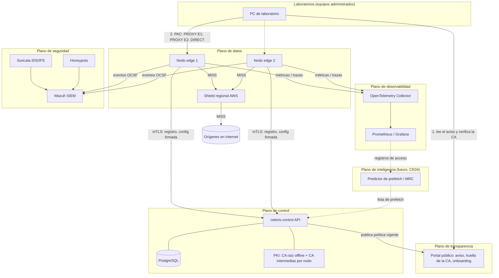

| Plano | Responsabilidad | Componentes | Estado actual (repositorio) |
| --- | --- | --- | --- |
| Datos | Atender, descifrar con política, cachear, deduplicar | `celeris-node` | **Existe** como `celeris-cache` (un nodo, Rust, Hudsucker) |
| Control | Registrar nodos, firmar y distribuir configuración, gestionar la PKI, purgas | `celeris-control` + PostgreSQL | No existe. Hoy la configuración es un `config.toml` local |
| Observabilidad | Métricas, trazas, registros, indicadores de ahorro | OTel Collector, Prometheus, Grafana | **Parcial**: `/metrics` Prometheus y panel propio |
| Seguridad | Detección, correlación y respuesta | Suricata, Wazuh, honeypots, detecciones de Celeris | **Parcial**: detecciones, log de seguridad JSONL, demo Wazuh con reglas |
| Transparencia | Aviso al usuario, huella de la CA, onboarding | Página `celeris.aviso` (hoy) → portal estático en DMZ-SVC (D-15) | **Parcial**: `notice.rs` sirve el aviso a través del proxy; falta el portal independiente |
| Inteligencia | Prefetch predictivo, dimensionamiento por MRC | Notebook / servicio Python | No existe |

### Matriz de agnosticismo

Cada fila es un puerto. El núcleo solo conoce la columna "Interfaz estándar".

| Capa | Interfaz estándar (puerto) | Adaptador de referencia | Adaptadores alternativos |
| --- | --- | --- | --- |
| Hipervisor | Imagen de VM (OVA/qcow2) + cloud-init | VMware ESXi 8.0U3e | Proxmox VE, KVM/libvirt, Hyper-V |
| Nube | Módulos OpenTofu con variables comunes (región incluida) | AWS | Cualquier proveedor con IPsec IKEv2 y VM Linux |
| Entorno de laboratorio | Topología declarativa + imagen OCI + IaC | containerlab local (Modo L) | AWS efímero (Modo A), ESXi del campus (Modo H) |
| Sistema operativo / arquitectura | Binario estático por *target* + imagen OCI | Linux x86_64 | Linux aarch64 (Graviton, Raspberry Pi 5), Windows x86_64 |
| Ejecución | systemd / contenedor OCI | systemd | Docker/Podman, Kubernetes (K3s DaemonSet), Nomad |
| Almacenamiento de caché | `ObjectStore` (get/put/delete por hash) | Disco local (CAS actual) | Foyer híbrido memoria+disco, S3-compatible (MinIO, Ceph RGW, AWS S3) como nivel 2 |
| Política de intercepción | `PolicyEngine::decide(request)` | TOML actual | Cedar (formalmente verificado), plugins Wasm |
| Métricas y trazas | Exposición Prometheus + OTLP | Prometheus | VictoriaMetrics, Grafana Cloud, CloudWatch vía OTel |
| Eventos de seguridad | OCSF 1.x en JSONL / syslog RFC 5424 | Wazuh | Elastic, Splunk, Amazon Security Lake, Graylog |
| Identidad de operadores | OIDC | Token local (actual) → Keycloak | Entra ID, Google Workspace, Authentik |
| Identidad de nodos | X.509 mTLS | step-ca | AWS Private CA, HashiCorp Vault/OpenBao PKI |
| Secretos | Archivo cifrado (SOPS + age) | SOPS + age | OpenBao/Vault, AWS Secrets Manager |
| Clientes | PAC por URL fija + almacén de confianza del SO | Windows, Linux, Firefox | macOS, Android administrado, ChromeOS |
| Organización | Modelo de *tenant* + sitios | Un campus | Multi-sede, ISP regional, municipalidad |

## A5. Catálogo de módulos

Los módulos se agrupan en *crates* Rust (plano de datos y control) y en artefactos de operación. La columna "Hito" indica cuándo se construye: **H1** diseño S1 con prueba de concepto, **H2** implementación S2, **H3** escalamiento posterior.

### A5.1 Plano de datos: `celeris-node`

| Módulo | Responsabilidad | Hoy en el repo | Mejora propuesta | Hito |
| --- | --- | --- | --- | --- |
| `ingress` | Escuchar, aplicar ACL por CIDR y límite por IP | `access.rs`, `clients.rs` | Modo transparente con SO_ORIGINAL_DST, PROXY protocol v2 | H2 |
| `tls` | Decidir intercepción, emitir certificados, TLS hacia el origen | `ca.rs`, `secure.rs`, `upstream.rs` | CA intermedia por nodo, rotación automática, X25519MLKEM768 preferido | H1–H2 |
| `policy` | Normalizar claves, reglas de caché RFC 9111 | `policy.rs`, `config.rs` | Motor Cedar + simulador "qué pasaría si"; plugins Wasm para Store-ID | H2–H3 |
| `cache.index` | Índice caliente en memoria | `store.rs` (moka) | Foyer híbrido con S3-FIFO | H2 |
| `cache.store` | CAS en disco, verificación SHA-256, escrituras atómicas | `store.rs` | Trozos FastCDC para deduplicar versiones | H3 |
| `cache.coalesce` | Una sola descarga por objeto concurrente | `coalesce.rs` | Sin cambios de fondo | — |
| `cache.range` | Servir `Range`/206 desde el objeto completo | No existe | Nuevo | H2 |
| `privacy` | Quitar cabeceras que identifican al cliente antes de salir (`X-Forwarded-For`, `Via`, `Forwarded`) | Implícito (Hudsucker no las agrega) | Eliminación explícita + prueba automática (REQ-F-28) | H2 |
| `upstream.parent` | Enviar los MISS a un proxy padre (shield) | No existe | Nuevo (REQ-F-29) | H2 |
| `peering` | Repartir objetos entre nodos y consultar al shield | No existe | Hash rendezvous + resumen Bloom de contenido | H3 |
| `prefetch` | Descargar en horario valle una lista firmada | No existe | Nuevo, consume la lista del plano de control | H3 |
| `coop` | Validar manifiestos firmados de publishers aliados | No existe | RFC 9421 (firmas) + RFC 9530 (digest) | H3 |
| `security` | Detecciones y log de seguridad | `detect.rs`, `security.rs` | Emitir OCSF (clases *Network Activity*, *Detection Finding*) | H2 |
| `telemetry` | Métricas, registro de acceso, alertas | `stats.rs`, `access_log.rs`, `monitor.rs`, `live.rs` | Exportar OTLP, cabecera `Cache-Status` (RFC 9211) | H2 |
| `admin` | API y panel local | `admin.rs`, `panel/` | TLS en el puerto de administración (REQ-NF-14), autenticación OIDC; el panel se mueve al plano de control | H2 |
| `notice` | Página de transparencia | `notice.rs` | Exportar el aviso como sitio estático firmado para el portal (D-15) | H1–H2 |
| `agent` | Cliente del plano de control | No existe | Enrolamiento mTLS, descarga de bundles firmados, *heartbeat* | H2 |

### A5.2 Plano de control: `celeris-control`

| Módulo | Responsabilidad | Hito |
| --- | --- | --- |
| `fleet` | Inventario de nodos, enrolamiento, estado y versiones | H2 |
| `config` | Bundles de configuración versionados y firmados (ed25519); despliegue gradual y reversión | H2 |
| `pki` | Emitir y rotar CA intermedias por nodo con Name Constraints; revocación | H2 |
| `policy` | Edición y validación de políticas; simulador | H2 |
| `purge` | Purgas por URL, prefijo o etiqueta, propagadas a la flota | H2 |
| `reports` | Indicadores de ahorro y de servicio para GTI (CSV/JSON) | H2 |
| `audit` | Quién cambió qué y cuándo; exportable al SIEM | H2 |
| `portal` | Generar y publicar el sitio estático del portal de transparencia | H2 |
| `tenancy` | Organizaciones y sitios (campus, sedes, ISP) | H3 |
| `coop-registry` | Alta de publishers aliados y sus llaves públicas | H3 |

### A5.3 Artefactos de operación y extras

| Artefacto | Contenido | Hito |
| --- | --- | --- |
| `infra/inventory.yaml` | **Fuente única** de VLAN, IP, componentes y flujos. Genera las matrices del informe | H1 |
| `deploy/opentofu` | Módulos `aws-vpc`, `aws-vpn`, `aws-shield`, `onprem-sim`, `vsphere-vm`, `proxmox-vm`; entornos `envs/demo` y `envs/prod` | H1 (AWS) / H2 |
| `deploy/image` | `Dockerfile` multi-etapa de `celeris-node`, imagen OCI multi-arquitectura firmada | H1–H2 |
| `deploy/cloud-init` | *user-data* por rol (shield, cgw-sim, nat) | H1–H2 |
| `deploy/ansible` | Roles: `celeris-node`, `wazuh-agent`, `suricata`, `opnsense`, `hardening-cis` | H2 |
| `deploy/packer` | Imagen base Linux endurecida (OVA y AMI desde la misma plantilla) | H2 |
| `lab/` | Topología containerlab del Modo L y sus imágenes de apoyo | H1–H2 |
| `siem/` | Reglas Wazuh (ya existen), reglas Suricata propias, decodificador OCSF | H1–H2 |
| `pac/` | Generador de `wpad.dat` con varios nodos y `DIRECT`, a partir del inventario | H1 |
| `docs/` | Este documento y los entregables en docs-as-code | H1 |
| `tests/` | e2e (existe), Gherkin ejecutable, carga con k6, **pruebas de red T01–T28** | H1–H2 |
| `analytics/` | Cálculo de MRC (SHARDS), análisis de popularidad, prefetch | H2–H3 |
| **Honey-URLs** | URLs señuelo que solo un escáner pediría; cualquier petición genera una alerta | H2 |
| **Onboarding** | Página con QR para descargar la CA y verificar su huella antes de instalarla (parte del portal) | H2 |

## A6. Registro de supuestos

| ID | Supuesto | Valor usado | Cómo validarlo | Responsable |
| --- | --- | --- | --- | --- |
| S-01 | Equipos de laboratorio en alcance | 400 PCs | Inventario de la DTI | Henyelrey |
| S-02 | Enlace a Internet del campus | 300 Mbps simétricos | Contrato con el ISP / medición | Henyelrey |
| S-03 | Costo de 1 Mbps adicional | US$ 8 por Mbps-mes | Cotización del ISP | Henyelrey |
| S-04 | Byte hit ratio alcanzable | 30 % | MRC desde registros de acceso (H2) | Nick |
| S-05 | Tráfico mensual de laboratorios | ≈ 19,4 TB (300 Mbps × 40 % × 12 h × 30 días) | Contadores del firewall | Henyelrey |
| S-06 | Ciclos de actualización masiva por año | 2 por PC | Calendario de la DTI | Henyelrey |
| S-07 | Horas técnicas ahorradas por PC y ciclo | 0,25 h a US$ 5/h | Entrevista a técnicos | Henyelrey |
| S-08 | Servidor físico disponible o a adquirir | US$ 4 500 si se compra | Inventario / cotización | Nick |
| S-09 | Tarifa eléctrica | US$ 0,15 por kWh | Recibo del campus | Nick |
| S-10 | COK para el VAN | 12 % anual | Área de finanzas | Henyelrey |
| S-11 | Región AWS de producción | sa-east-1 (São Paulo) **a confirmar**; us-east-1 suele tener menor latencia desde Perú y es la región del laboratorio | Medición de latencia desde Juliaca (mtr a ambas) | Nick |
| S-12 | Precios AWS | Lista pública a noviembre de 2026 | AWS Pricing Calculator | Nick |
| S-13 | Cuenta AWS para el laboratorio | AWS Academy Learner Lab (volátil) o cuenta nueva con plan gratuito y créditos | Confirmar con el docente cuál existe y qué servicios habilita (ver F2) | Nick |
| S-14 | Capa de acceso y DHCP | Switches de acceso y DHCP existentes de la DTI, con soporte 802.1Q | Levantamiento AS-IS con la DTI | Henyelrey |
| S-15 | IP pública fija del campus para la VPN | 1 IP estática en el firewall perimetral | Contrato con el ISP | Henyelrey |

> Regla: un supuesto que no se valida se declara como limitación en el informe. Nunca se presenta como dato.

---

# Parte B — CE01 Gestión de Tecnologías de Información

**Pregunta que debe responder esta línea:** ¿por qué la organización debe invertir en Celeris, cuánto vale, cómo se gestiona y qué procesos mejora?

## B0. Arquitectura de la gestión

Los cuatro entregables forman una cadena. Cada uno toma como entrada la salida del anterior, y esa dependencia es la trazabilidad que pide la rúbrica de alineamiento.

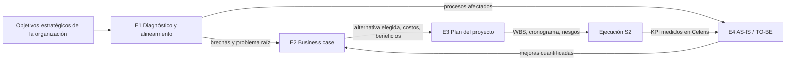

Modelo de gobierno usado como referencia:

| Marco | Para qué se usa aquí | Versión |
| --- | --- | --- |
| COBIT 2019 | Medir madurez (capacidad 0–5) y elegir objetivos: APO02 Estrategia, APO12 Riesgo, BAI03 Soluciones, DSS01 Operaciones, DSS05 Seguridad, MEA01 Desempeño | 2019 |
| ISO/IEC 38500 | Principios de gobierno para justificar la decisión ante la dirección | 2024 |
| PMBOK | Plan de gestión, EDT, cronograma, costos, riesgos | 8.ª ed. (nov. 2025) |
| ITIL | Catálogo del servicio "Caché segura" y gestión de cambios e incidentes | Version 5 (2026); ITIL 4 sigue vigente |
| ArchiMate 3.2 | Capa de motivación: objetivo → requisito → componente | 3.2 |

## B1. Entregable 1 — Diagnóstico Organizacional y Alineamiento Estratégico (CE0111–CE0115)

### B1.1 Qué evidencia cada código

| Código | Evidencia | Producto concreto |
| --- | --- | --- |
| CE0111 | Diagnóstico organizacional | Contexto, cadena de valor, stakeholders, FODA/PESTEL, diagnóstico digital |
| CE0112 | Alineamiento estratégico | Matriz objetivos estratégicos × capacidades × proyecto |
| CE0113 | Caso de negocio (resumen) | Ver E2 |
| CE0114 | Roadmap de tecnología | Hoja de ruta en tres horizontes |
| CE0115 | Matriz de riesgos estratégicos | Riesgos con probabilidad, impacto y respuesta |

### B1.2 Contexto organizacional (1.1)

**Sector y entorno.** Educación superior privada en una región de altitud con conectividad más cara y con menos oferta que en Lima. Competencia por calidad académica y acreditación.

**Estructura.** Organigrama simplificado: Dirección de campus → Facultades → EP Ingeniería de Sistemas; Dirección de Tecnologías de Información (DTI) → Infraestructura, Soporte, Sistemas. Se levanta con la DTI [S-01].

**Cadena de valor (Porter adaptado):**

| Tipo | Actividad | Dependencia de la red |
| --- | --- | --- |
| Primaria | Admisión y matrícula | Media |
| Primaria | Enseñanza en laboratorios | **Alta** (software, actualizaciones, plataforma virtual) |
| Primaria | Investigación | Alta (descargas de datasets, modelos, bibliotecas) |
| Primaria | Extensión y proyección | Baja |
| Apoyo | Infraestructura de TI | **Alta** |
| Apoyo | Gestión administrativa y financiera | Media |

**Mapa de stakeholders** (poder × interés):

| Stakeholder | Poder | Interés | Estrategia | Qué espera |
| --- | --- | --- | --- | --- |
| Dirección del campus | Alto | Medio | Mantener satisfecho | Ahorro, imagen institucional |
| DTI | Alto | Alto | Gestionar de cerca | Menos saturación, visibilidad, menos trabajo manual |
| Docentes de laboratorio | Medio | Alto | Mantener informado | Clases sin cortes por descargas |
| Estudiantes | Bajo | Alto | Mantener informado | Velocidad, privacidad |
| Oficial de datos personales | Medio | Medio | Consultar | Cumplimiento de la Ley 29733 |
| ISP | Medio | Bajo | Monitorear | Contrato estable |
| AWS | Bajo | Bajo | Monitorear | Uso dentro de los términos |
| Jurado EPE | Alto | Alto | Gestionar de cerca | Evidencia, coherencia, dominio técnico, **seguridad demostrable** |

### B1.3 Análisis estratégico (1.2)

**Misión, visión y objetivos estratégicos.** Se toman del plan estratégico institucional vigente. Solo se citan los objetivos que la propuesta afecta. Ejemplo de redacción: "OE-3: Fortalecer la infraestructura tecnológica para la enseñanza y la investigación" [a confirmar con el documento oficial].

**FODA (borrador a validar con la DTI):**

| | Positivo | Negativo |
| --- | --- | --- |
| **Interno** | F1 Equipos de laboratorio administrados centralmente. F2 Personal técnico propio. F3 Línea académica de infraestructura y seguridad. | D1 Enlace limitado y caro. D2 Descargas repetidas sin control. D3 Poca visibilidad de eventos de seguridad. D4 Procesos de actualización manuales. |
| **Externo** | O1 Herramientas open source maduras (Wazuh, Suricata, OPNsense). O2 AWS Local Zone en Lima y región anunciada en Chile. O3 ESXi gratuito disponible de nuevo desde abril de 2025. O4 Emuladores locales de AWS gratuitos (AWS Emulator, nov. 2026). | A1 Adopción de ECH y QUIC, que reduce lo que se puede cachear. A2 Cambios de licenciamiento de proveedores (p. ej. LocalStack Community, discontinuado en marzo de 2026). A3 Exigencias del nuevo reglamento de datos personales. A4 Ataques automatizados contra servicios expuestos. |

**PESTEL (los factores con efecto real):**

| Factor | Hecho | Efecto en el proyecto |
| --- | --- | --- |
| Legal | El nuevo Reglamento de la Ley 29733 (D.S. 016-2024-JUS) rige desde marzo de 2025 | Aviso previo, consentimiento, minimización de datos, evaluación de impacto |
| Legal | Ley de Gobierno Digital (D.L. 1412) y Marco de Confianza Digital (D.U. 007-2020) | Referencias para seguridad digital institucional |
| Tecnológico | ECH publicado como RFC 9849 (nov. 2025); HTTP/3 extendido | Preferir proxy explícito; bloquear UDP/443 en laboratorios |
| Tecnológico | Criptografía post-cuántica híbrida ya disponible en rustls | Diferenciador a bajo costo |
| Económico | Costo por Mbps mayor que en la costa [S-03] | Base del beneficio económico |
| Económico | Plan gratuito de AWS con créditos para cuentas nuevas | Laboratorio en la nube a costo casi nulo si se destruye al terminar (Parte F) |
| Ecológico | Menos tráfico repetido = menos energía de red | Indicador complementario, no central |

**Factores críticos de éxito:** aprobación de la DTI, consentimiento de usuarios, hit ratio ≥ 20 %, cero incidentes de privacidad, operación por personal que no sea el equipo autor.

### B1.4 Diagnóstico digital / TI (1.3)

**Inventario de sistemas:** tabla con sistema, propietario, usuarios, dependencia de Internet, criticidad. Se levanta con la DTI.

**Madurez (COBIT 2019, capacidad 0–5)** — instrumento: entrevista estructurada + evidencia documental:

| Objetivo COBIT | Pregunta guía | Nivel actual (a medir) | Nivel objetivo |
| --- | --- | --- | --- |
| APO02 Estrategia | ¿Existe un plan de TI alineado al plan institucional? | ? | 3 |
| BAI03 Soluciones | ¿Las soluciones se diseñan con requisitos y pruebas? | ? | 3 |
| DSS01 Operaciones | ¿Hay monitoreo de capacidad del enlace? | ? | 3 |
| DSS05 Seguridad | ¿Hay detección y respuesta a incidentes? | ? | 3 |
| APO12 Riesgo | ¿Existe registro de riesgos de TI? | ? | 2 |
| MEA01 Desempeño | ¿Se miden indicadores de servicio de TI? | ? | 3 |

**Brechas** = nivel objetivo − nivel actual. Se grafica en radar.

**Problemas operativos asociados a TI** (a confirmar con datos): saturación del enlace en horas de clase, actualizaciones que no terminan en una sesión, incidentes de seguridad detectados por quejas de usuarios.

### B1.5 Identificación del problema (1.4)

**Enunciado:** "Los laboratorios del campus consumen ancho de banda en descargas repetidas de contenido público que hoy no se puede cachear por estar cifrado, lo que degrada las clases y eleva el costo de conectividad, sin visibilidad sobre los eventos de seguridad de esa red."

**Causas raíz** (Ishikawa + 5 porqués):

| Categoría | Causa | Evidencia que se presenta |
| --- | --- | --- |
| Tecnología | Más del 90 % del tráfico web es HTTPS, la caché clásica no aplica | Muestra de tráfico por protocolo del firewall |
| Proceso | Cada PC descarga sus actualizaciones por separado | Registro de descargas por lab |
| Personas | No hay rol asignado al monitoreo de seguridad de red | Organigrama de la DTI |
| Recursos | Ampliar el enlace es un costo recurrente | Cotizaciones |

**Impacto estratégico:** afecta al OE de infraestructura para la enseñanza y al de calidad del servicio.

**Justificación de intervención:** costo de no actuar (más Mbps cada año) frente a una solución de inversión única y costo operativo bajo.

### B1.6 Alineamiento estratégico (CE0112)

| Objetivo estratégico | Capacidad requerida | Brecha (E1) | Componente Celeris | KPI |
| --- | --- | --- | --- | --- |
| OE infraestructura | Uso eficiente del enlace | D1, D2 | Caché + coalescencia + prefetch | Byte hit ratio, GB evitados/mes |
| OE calidad académica | Laboratorios disponibles | D4 | Distribución de actualizaciones por caché | Tiempo para actualizar un lab |
| OE seguridad / cumplimiento | Detección y transparencia | D3, A3 | Wazuh + Suricata + portal de transparencia | MTTD, % usuarios con aviso firmado |
| OE innovación / investigación | Proyectos aplicados | — | Plataforma propia | Publicaciones, registro de software |

Esta matriz se modela en **Archi** (capa de motivación ArchiMate) para mostrar la cadena objetivo → resultado → requisito → componente.

### B1.7 Roadmap de tecnología (CE0114)

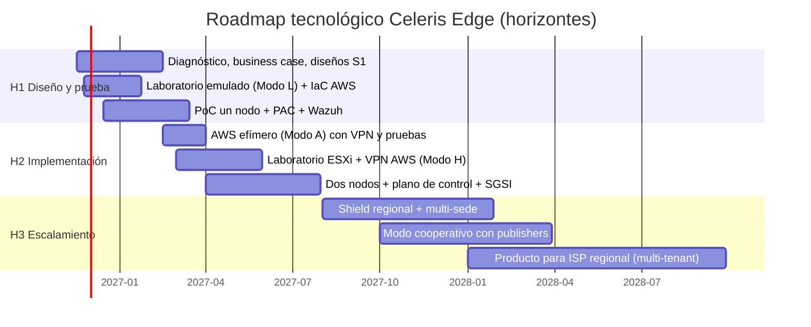

> Las fechas son una propuesta. Se ajustan al calendario académico real del equipo.

### B1.8 Matriz de riesgos estratégicos (CE0115)

Escala 1–5. Puntaje = P × I. Rojo ≥ 15, ámbar 8–14, verde ≤ 7.

| ID | Riesgo | P | I | Puntaje | Respuesta | Disparador |
| --- | --- | ---: | ---: | ---: | --- | --- |
| RE-01 | El proyecto depende de dos personas (bus factor 2) | 4 | 5 | **20** | Mitigar: documentación como código, runbooks, transferencia a la DTI, código abierto | Un integrante no disponible 2 semanas |
| RE-02 | Rechazo de usuarios por privacidad de la CA | 3 | 5 | **15** | Mitigar: alcance solo equipos institucionales, portal de transparencia previo al uso, CA limitada | Quejas formales |
| RE-03 | Aumento de ECH/QUIC reduce el contenido cacheable | 4 | 3 | 12 | Aceptar y mitigar: proxy explícito, modo cooperativo, medir BHR mensual | BHR < 15 % tres meses |
| RE-04 | Compromiso de la llave de la CA | 2 | 5 | 10 | Mitigar: raíz offline, intermedias por nodo de vida corta, Name Constraints | Alerta de integridad |
| RE-05 | La DTI no aprueba el despliegue | 3 | 4 | 12 | Mitigar: piloto en un solo laboratorio con métricas; demostración previa en Modo L/A | Respuesta negativa |
| RE-06 | Cambio de licenciamiento del hipervisor | 3 | 3 | 9 | Transferir/evitar: diseño agnóstico, Proxmox como equivalente | Aviso de Broadcom |
| RE-07 | Costos AWS fuera de presupuesto | 2 | 3 | 6 | Mitigar: AWS Budgets con alarma, laboratorio efímero (`tofu destroy`) | Gasto > 80 % del mes |
| RE-08 | Apps con *certificate pinning* fallan | 4 | 2 | 8 | Evitar: `never_intercept` por defecto, lista de compatibilidad | Ticket de soporte |
| RE-09 | No hay servidor físico disponible | 3 | 4 | 12 | Mitigar: Modo L (containerlab) y Modo A (AWS efímero) cubren las pruebas de S2 | Sin respuesta de la DTI |
| RE-10 | Laboratorio AWS volátil o con servicios bloqueados (p. ej. VPN) | 3 | 3 | 9 | Mitigar: todo por IaC + imagen; alternativa de VPN strongSwan↔strongSwan; Modo L como respaldo | Sesión expirada o API denegada |
| RE-11 | Compromiso del portal público | 2 | 4 | 8 | Mitigar: sitio estático, WAF, sin salida a Internet, monitoreo en Wazuh (D-15, D-16) | Alerta del WAF o de integridad |

### B1.9 Rúbrica E1 → evidencia para "Excelente"

| Criterio | Qué presentar para "Excelente" |
| --- | --- |
| Análisis del contexto | Cadena de valor con dependencia de red, stakeholders con estrategia, PESTEL con normas citadas |
| Brechas estratégicas | Brechas COBIT con nivel actual medido por entrevista y evidencia (no estimado) |
| Alineamiento | Matriz OE → capacidad → componente → KPI y vista ArchiMate |
| Sustentación | Cada uno explica cualquier fila de la matriz y su fuente |

## B2. Entregable 2 — Business Case del Proyecto (CE0113)

### B2.1 Justificación (2.1)

**Objetivos SMART:**

| ID | Objetivo | Indicador | Meta | Plazo |
| --- | --- | --- | --- | --- |
| OB-1 | Reducir el tráfico repetido de laboratorios | Byte hit ratio | ≥ 25 % [S-04] | 3 meses tras el despliegue |
| OB-2 | Acortar la actualización de un laboratorio | Tiempo de **descarga** para 40 PCs (la instalación se mide aparte) | −70 % frente al AS-IS | 1 ciclo de actualización |
| OB-3 | Detectar incidentes de red | MTTD | < 15 min en escenarios de prueba | Fin de S2 |
| OB-4 | Cumplir transparencia | Equipos con aviso entregado antes de instalar la CA | 100 % | Antes del piloto |

### B2.2 Análisis de alternativas (2.2)

Criterios y pesos (validar los pesos con la DTI; se puede usar AHP para derivarlos):

| Criterio | Peso |
| --- | ---: |
| Seguridad y privacidad | 25 % |
| TCO a 3 años | 20 % |
| Eficacia con tráfico HTTPS | 20 % |
| Escalabilidad y agnosticismo | 15 % |
| Soporte y mantenibilidad | 10 % |
| Valor académico e innovación | 10 % |

Puntaje 1–5 (evaluación del equipo, a contrastar con la DTI):

| Alternativa | Seg. | TCO | HTTPS | Escal. | Soporte | Innov. | **Total** |
| --- | ---: | ---: | ---: | ---: | ---: | ---: | ---: |
| A0 Ampliar ancho de banda | 3 | 2 | 1 | 4 | 5 | 1 | 2,55 |
| A1 Squid + SSL-Bump | 3 | 4 | 4 | 3 | 4 | 2 | 3,40 |
| A2 LanCache | 4 | 5 | 1 | 3 | 3 | 2 | 3,15 |
| A3 Appliance comercial tipo reflector | 1 | 2 | 2 | 3 | 2 | 2 | 1,90 |
| **A4 Celeris Edge** | 5 | 4 | 4 | 5 | 2 | 5 | **4,30** |

Lectura honesta: A1 (Squid) es la segunda opción y el **plan de respaldo**. Si RE-01 se materializa, la DTI puede migrar a Squid conservando el diseño de red, la PKI y el SIEM, porque son independientes del motor de caché. A4 pierde en soporte, y por eso RE-01 es el riesgo más alto.

### B2.3 Beneficios (2.3)

| Tipo | Beneficio | Cómo se mide | Valor ilustrativo/año |
| --- | --- | --- | --- |
| Cuantificable | Mbps diferidos: no ampliar 100 Mbps | BHR en hora punta × enlace | 100 × US$ 8 × 12 = **US$ 9 600** [S-03] |
| Cuantificable | Horas técnicas ahorradas en actualizaciones | Tiempo AS-IS − TO-BE | 400 × 2 × 0,25 h × US$ 5 = **US$ 1 000** [S-06, S-07] |
| Cualitativo | Visibilidad de seguridad (SIEM + IDS) | MTTD | — |
| Cualitativo | Capacidad institucional y producto propio | Registro de software, publicaciones | — |
| Cualitativo | Experiencia en clases | Encuesta a docentes | — |

Indicadores de valor: GB evitados por mes, costo por GB servido, BHR, MTTD, satisfacción, **tasa de adopción del proxy** (bytes LAB→EDGE ÷ bytes LAB totales hacia Internet). Sin este último, el BHR no se puede traducir a ahorro.

### B2.4 Costos (2.4)

**Inversión inicial (I₀) ilustrativa:** servidor US$ 4 500 [S-08] + **switch núcleo L2 gestionable con 10 GbE** US$ 600 (el ruteo lo hace FW01, ver D1.8) + UPS online 1,5 kVA US$ 700 + cableado y varios US$ 200 = **US$ 6 000**. Si la DTI aporta un servidor existente, I₀ baja y se registra el costo de oportunidad. Los switches de acceso son existentes [S-14] y no se cuentan.

**Costos operativos anuales:**

| Concepto | Cálculo | US$/año |
| --- | --- | ---: |
| AWS 24×7 (VPN, shield t3.medium, réplica t3.small, NAT t3.micro, IPv4, EBS, S3) | ≈ US$ 183/mes [S-12] | 2 196 |
| Energía | 480 W × 8 760 h × US$ 0,15 [S-09] | 631 |
| Mantenimiento | 10 % del hardware | 580 |
| **Total OPEX** | | **3 407** |

En modo laboratorio (EC2 encendidas 50 h/semana) AWS baja a ≈ US$ 125/mes, y en **modo efímero** (Parte F, solo durante sesiones de prueba) a pocos dólares por mes. Precios de referencia: VPN ≈ US$ 0,05/h por conexión; se confirman en la AWS Pricing Calculator antes de entregar.

### B2.5 Evaluación económica (ilustrativa, 3 años, COK 12 % [S-10])

| Indicador | Valor |
| --- | --- |
| Flujo neto anual | 10 600 − 3 407 = **US$ 7 193** |
| VAN (12 %) | **≈ US$ 11 277** |
| TIR | **≈ 106 %** |
| Payback | **≈ 10 meses** |
| B/C | **≈ 1,80** |
| Punto de equilibrio | VAN = 0 si se difieren **≈ 51 Mbps** (la mitad del supuesto) |

> Recalcular estos valores con `analytics/business_case.py` antes de entregar: cambiaron por el ajuste del NAT (t3.nano → t3.micro, D2.5).

**Análisis de sensibilidad (diferenciador):** en lugar de un solo escenario, se corre una simulación Monte Carlo (10 000 iteraciones en Python) variando BHR (10–40 %), costo por Mbps (US$ 4–12), **adopción del proxy (60–100 %)** y costos AWS (±30 %). Se reporta la probabilidad de VAN > 0 y un gráfico tornado de las variables que más pesan. El script vive en `analytics/business_case.py` y usa los mismos supuestos del registro.

### B2.6 Riesgos iniciales (2.5)

Se reutilizan RE-01 a RE-11 con su impacto económico: por ejemplo, RE-03 reduce el beneficio en proporción a la caída del BHR, y su efecto se ve en el tornado.

### B2.7 Rúbrica E2 → evidencia para "Excelente"

| Criterio | Qué presentar |
| --- | --- |
| Alternativas | Matriz ponderada con pesos validados y la lectura de la alternativa de respaldo |
| Evaluación económica | VAN, TIR, payback, B/C, punto de equilibrio y Monte Carlo |
| Riesgos | Riesgos con efecto cuantificado en el flujo |
| Sustentación | Explicar por qué A4 gana pese a perder en soporte |

## B3. Entregable 3 — Plan de Gestión del Proyecto (CE0121–CE0125)

Enfoque **híbrido**: predictivo para entregables académicos con fecha fija (EDT, cronograma, línea base de costos) y ágil para la construcción del software (backlog y sprints).

### B3.1 Acta de constitución (CE0121)

| Campo | Contenido |
| --- | --- |
| Proyecto | Celeris Edge — caché segura y agnóstica para redes institucionales |
| Sponsor | Dirección de la EP Ingeniería de Sistemas (propuesto). Usuario patrocinador: DTI del campus |
| Director del proyecto | Henyelrey Lucio Garcia Chura (propuesto) |
| Líder técnico | Nick Saim Mayta Jara (propuesto) |
| Objetivos | OB-1 a OB-4 |
| Alcance preliminar | Diseño S1 de las tres líneas, PoC de un nodo, laboratorio emulado y efímero, laboratorio híbrido en S2 |
| Fuera de alcance | BYOD, producción en toda la red del campus, contrato con ISP |
| Restricciones | Dos personas, presupuesto académico, ESXi gratuito (8 vCPU por VM, sin vCenter, API solo lectura), cuenta AWS de laboratorio volátil [S-13] |
| Supuestos | Registro A6 |
| Criterios de éxito | Nota ≥ "Logrado" en todos los entregables y KPI de OB-1 a OB-4 medidos |
| Hitos | H1 entregables S1, H2 laboratorio operativo, H3 sustentación |

### B3.2 RACI (propuesta para discutir en equipo)

R = responsable, A = aprueba, C = consultado, I = informado. **Toda pieza la revisa el otro integrante** antes de entregarse, porque la sustentación es individual.

| Paquete | Nick | Henyelrey | DTI | Docente |
| --- | :-: | :-: | :-: | :-: |
| GTI E1–E4 | C | **R/A** | C | I |
| Software E1 (SRS, C4, UML) | **R/A** | C | C | I |
| Infra E1 Red | C | **R/A** | C | I |
| Infra E2 Centro de datos | **R/A** | C | C | I |
| PoC Celeris | **R/A** | C | I | I |
| Laboratorio demostrable (Modo L/A) | **R/A** | C | I | I |
| SIEM y detección | C | **R** | C | I |
| Consolidado y sustentación | R | R/A | I | C |

### B3.3 EDT / WBS (CE0123)

```mermaid
flowchart TB
  P[0 Celeris Edge EPE]
  P --> G[1 Gestión del proyecto]
  P --> T[2 Gestión de TI]
  P --> S[3 Ingeniería de software]
  P --> I[4 Infraestructura]
  P --> C[5 Prueba de concepto]
  P --> X[6 Cierre y sustentación]
  G --> G1[1.1 Acta] & G2[1.2 Plan] & G3[1.3 Seguimiento semanal] & G4[1.4 Lecciones aprendidas]
  T --> T1[2.1 Diagnóstico] & T2[2.2 Business case] & T3[2.3 Plan de gestión] & T4[2.4 Procesos AS-IS/TO-BE]
  S --> S1[3.1 SRS] & S2[3.2 Prototipo validado] & S3[3.3 C4 + ADR] & S4[3.4 UML] & S5[3.5 Trazabilidad]
  I --> I1[4.1 Diseño de red] & I2[4.2 Diseño de centro de datos] & I3[4.3 Consolidado S1] & I4[4.4 Inventario único de red]
  C --> C1[5.1 Nodo con PQ y CA por nodo] & C2[5.2 PAC con failover] & C3[5.3 OpenTofu VPC + VPN] & C4[5.4 Laboratorio Modo L] & C5[5.5 Imagen OCI + cloud-init]
  X --> X1[6.1 Ensayos] & X2[6.2 Demo grabada] & X3[6.3 Expediente PDF]
```

**Diccionario de la EDT** (una fila por paquete): ID, descripción, criterio de aceptación, responsable, esfuerzo estimado, dependencias. Ejemplo:

| ID | Paquete | Criterio de aceptación | Resp. | Esfuerzo |
| --- | --- | --- | --- | ---: |
| 4.1 | Diseño de red | Las **15 secciones** de la plantilla oficial, matriz de componentes al 100 %, matriz de pruebas coherente con la VPN | Henyelrey | 40 h |
| 4.4 | Inventario único de red | `infra/inventory.yaml` genera las matrices de componentes y flujos; un chequeo verifica que cada flujo apunta a un componente | Nick | 6 h |
| 5.4 | Laboratorio Modo L | La topología levanta con un comando y pasa T06–T14 | Nick | 16 h |
| 3.1 | SRS | RF con criterios Gherkin, RNF por característica ISO 25010, trazabilidad generada | Nick | 30 h |

### B3.4 Cronograma (CE0123)

Semanas relativas (S01 = inicio). Se exporta a Gantt con dependencias y ruta crítica.

| Semana | Hito / actividad principal | Dependencia |
| --- | --- | --- |
| S01–S02 | Acta, levantamiento con DTI, registro de supuestos | — |
| S03–S04 | Diagnóstico (E1), SRS v0.5 | Levantamiento |
| S05 | Business case (E2) | E1 |
| S05–S06 | Diseño de red (Infra E1) + inventario único | Levantamiento |
| S06–S07 | Diseño de centro de datos (Infra E2), C4 + ADR | Diseño de red |
| S07 | Plan de gestión (E3) | E2 |
| S08 | AS-IS/TO-BE (E4), prototipo y validación con 5 usuarios | E1 |
| S09 | UML detallado, trazabilidad, consolidado S1 | Todo lo anterior |
| S10 | Ensayo de sustentación con demo Modo L, correcciones | Consolidado |

**Ruta crítica:** levantamiento → diseño de red → diseño de centro de datos → consolidado.

### B3.5 Costos y línea base (CE0122, CE0124)

| Rubro | Base | Monto (US$) |
| --- | --- | ---: |
| Horas del equipo (costo de oportunidad) | 2 × 12 h/sem × 10 sem × US$ 5 | 1 200 |
| Hardware (si se compra) | B2.4 | 6 000 |
| AWS durante el proyecto | Modo efímero + 1 mes en modo laboratorio | ≈ 150 |
| Herramientas | Todas con licencia libre o educativa | 0 |
| Reserva de contingencia | 10 % | 735 |
| **Línea base** | | **8 085** |
| Reserva de gestión | 5 % (fuera de la línea base) | 404 |

**Control:** EVM semanal con CPI y SPI. Umbral de alerta: CPI o SPI < 0,9.

### B3.6 Gestión de riesgos del proyecto (CE0125)

Además de los estratégicos (B1.8), riesgos de ejecución:

| ID | Riesgo | P | I | Respuesta | Dueño |
| --- | --- | ---: | ---: | --- | --- |
| RP-01 | Retraso en el levantamiento con la DTI | 3 | 4 | Usar supuestos marcados y validar después | Henyelrey |
| RP-02 | Sobrecarga académica en semanas de exámenes | 4 | 3 | Planificar holgura de 1 semana | Ambos |
| RP-03 | Diagramas inconsistentes entre entregables | 3 | 4 | Una sola fuente: `infra/inventory.yaml` | Nick |
| RP-04 | Secretos filtrados al repositorio (incluidas credenciales temporales de AWS) | 2 | 5 | gitleaks en pre-commit y en CI; credenciales solo en variables de entorno | Nick |
| RP-05 | Fallo de la demo el día de la sustentación | 2 | 4 | Modo L sin dependencia de red + video grabado del Modo A | Ambos |
| RP-06 | Recursos AWS olvidados encendidos | 3 | 2 | `tofu destroy` en el runbook, etiqueta `Ttl`, alarma de Budgets | Nick |

### B3.7 Gestión ágil

- **Marco:** Scrumban con sprints de 1 semana; la revisión de cada sprint es la reunión con el docente.
- **Backlog:** épicas = paquetes de la EDT; historias con ID de requisito (REQ-F-nn).
- **Definición de terminado:** revisado por el otro integrante, exportado a PDF, sin secretos (gitleaks), enlazado en la matriz de trazabilidad.
- **Métricas:** burn-up por entregable, *lead time* de historias.

### B3.8 Rúbrica E3 → evidencia para "Excelente"

| Criterio | Evidencia |
| --- | --- |
| Acta | Objetivos SMART, stakeholders, criterios de éxito |
| Alcance | EDT con diccionario y control de cambios (issues con etiqueta `cambio-alcance`) |
| Cronograma | Gantt con dependencias, hitos y ruta crítica |
| Costos | Línea base, reservas, EVM |
| Riesgos | Matriz con dueño, disparador y seguimiento |
| Ágil | Backlog priorizado, sprints, DoD, métricas |

## B4. Entregable 4 — Modelado de Procesos AS-IS / TO-BE (CE0131–CE0135)

### B4.1 Procesos elegidos (CE0131)

| ID | Proceso | Por qué | Dueño |
| --- | --- | --- | --- |
| P1 | Distribución de actualizaciones y software a laboratorios | Mayor consumo de ancho de banda repetido | DTI Soporte |
| P2 | Detección y respuesta a incidentes de seguridad de red | Brecha D3; hoy es reactivo | DTI Infraestructura |
| P3 (opcional) | Gestión de cambios de configuración de red y proxy | Riesgo de errores manuales | DTI Infraestructura |

### B4.2 P1 — AS-IS (CE0132)

**Narrativa:** el técnico inicia las actualizaciones lab por lab. Cada PC descarga lo mismo desde Internet, compitiendo con las clases. Si el laboratorio se ocupa, se interrumpe y se retoma otro día.

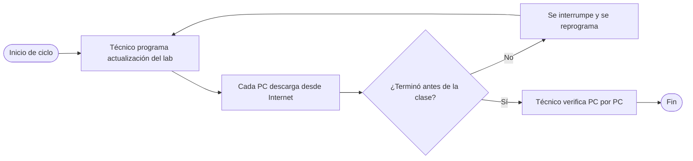

**Indicadores actuales** (medir ≥ 30 observaciones o tomar de registros): tiempo por laboratorio **separado en descarga e instalación**, GB descargados por ciclo, % de PCs al día, interrupciones por ciclo.

**Cálculo ilustrativo (solo descarga):** 40 PCs × 3 GB con 150 Mbps disponibles → 120 GB por el enlace → **≈ 1,8 h** por laboratorio.

### B4.3 P1 — TO-BE (CE0133, CE0134)

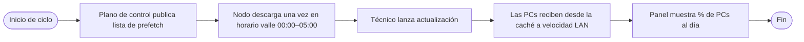

**Automatizaciones:** prefetch nocturno, coalescencia, tablero de avance, alerta si un laboratorio queda por debajo del 95 %.

**Cálculo ilustrativo (solo descarga):** 3 GB por el enlace + 117 GB por LAN de 1 Gbps → **≈ 18 min**. El tiempo de instalación en cada PC no cambia con la caché y se reporta aparte; si no se separa, la mejora total se sobreestima.

### B4.4 P2 — AS-IS y TO-BE

| Etapa | AS-IS | TO-BE |
| --- | --- | --- |
| Detección | Queja de un usuario o revisión manual | Regla Wazuh sobre eventos de Suricata, WAF, Celeris u honeypot |
| Registro | Correo o mensaje informal | Ticket automático en GLPI con severidad |
| Análisis | Logs dispersos por equipo | Línea de tiempo correlacionada en Wazuh |
| Contención | Manual, sin guía | Playbook: bloquear IP en OPNsense, aislar VLAN |
| Cierre | Sin registro de lecciones | Post-mortem con plantilla e indicador |

Indicadores: MTTD, MTTR, % incidentes con post-mortem, falsos positivos por semana.

### B4.5 Análisis comparativo (CE0135)

| Indicador | AS-IS | TO-BE | Mejora | Cómo se verifica |
| --- | --- | --- | --- | --- |
| Tiempo de descarga por laboratorio (P1) | ≈ 1,8 h | ≈ 18 min | **−83 %** | Cronometraje + registros de Celeris |
| Tiempo total con instalación (P1) | A medir | A medir | A medir | Cronometraje por fase |
| Tráfico WAN por ciclo (P1) | 120 GB | 3 GB | **−97,5 %** | Contadores del firewall |
| Costo por ciclo (P1) | Horas técnicas × tarifa | Idem | Ver B2.3 | Hoja de cálculo |
| MTTD (P2) | Días (estimado) | < 15 min | — | Simulaciones de ataque (`simular-ataques.ps1`, Modo L) |
| Calidad (P1) | % PCs al día | ≥ 95 % | — | Panel |

**Diferenciador — AS-IS medido, no supuesto:** con los registros JSONL de Celeris y los tickets se aplica minería de procesos (PM4Py) para obtener el flujo real, los tiempos de ciclo y los cuellos de botella. El TO-BE se simula en Bizagi con las distribuciones obtenidas.

### B4.6 Rúbrica E4 → evidencia para "Excelente"

| Criterio | Evidencia |
| --- | --- |
| AS-IS | BPMN detallado + indicadores medidos + ineficiencias señaladas en el diagrama |
| TO-BE | Rediseño con automatizaciones concretas y simulación |
| Comparativo | Tabla tiempo, costo y calidad con método de verificación |
| Sustentación | Explicar el cálculo y la fuente de cada número |

## B5. Software recomendado para Gestión de TI

| Necesidad | Recomendado | Alternativas | Por qué | Cuándo cambiar |
| --- | --- | --- | --- | --- |
| Redacción de entregables (DOCX + PDF) | **Quarto** (Markdown → DOCX y PDF) | Word, Google Docs | Una sola fuente versionada en Git genera los dos formatos que piden las rúbricas; diferencias revisables línea a línea | Si el docente exige comentarios dentro de Word, exportar y comentar ahí |
| Arquitectura empresarial y alineamiento | **Archi** (ArchiMate 3.2) | Sparx EA, draw.io | Libre, estándar abierto, la capa de motivación modela objetivo → requisito → componente | Si la organización ya usa Sparx EA |
| Diagramas generales | **draw.io** (diagrams.net) | Visio, Lucidchart | Es el formato que piden las rúbricas, libre, archivo XML versionable | — |
| Modelado BPMN con simulación | **Bizagi Modeler** | Camunda Modeler, Signavio | Simulación de escenarios gratis, útil para cuantificar el TO-BE; exporta BPMN 2.0 | **Camunda Modeler** si el TO-BE se va a ejecutar en un motor de procesos |
| Minería de procesos | **PM4Py** | Celonis (académico), Disco | Libre, Python, lee los JSONL directamente | Celonis si la universidad tiene licencia académica |
| Backlog y sprints | **GitHub Projects** | Jira, Taiga | Issues, commits e IDs de requisito en el mismo lugar que el código | Jira si el equipo crece y necesita flujos complejos |
| Gantt, línea base y EVM | **ProjectLibre** | MS Project, OpenProject | Libre, maneja línea base y valor ganado, que GitHub Projects no tiene | **OpenProject** si se necesita colaboración web |
| Business case y sensibilidad | **LibreOffice Calc / Excel + Python** | Solo hoja de cálculo | La hoja para el formato XLSX; Python para Monte Carlo reproducible | — |
| Mesa de ayuda (TO-BE de P2) | **GLPI** | Zammad, osTicket | Libre, ITSM con inventario y tickets; se integra con Wazuh por API | La herramienta que ya use la DTI |

## B6. Escalamiento futuro de la gestión

| Etapa | Gobierno | Proyecto | Procesos | Servicio |
| --- | --- | --- | --- | --- |
| Campus (H2) | COBIT nivel 2–3 en objetivos elegidos | Un proyecto | P1, P2 | Servicio interno |
| Multi-sede (H3) | Comité de TI con indicadores comunes | Programa con un proyecto por sede | P3 + gestión de capacidad | Catálogo de servicio con SLA |
| ISP regional (H3+) | Gobierno de producto | Portafolio | Facturación por GB ahorrado | Servicio comercial, contrato y soporte |

---

# Parte C — CE02 Ingeniería de Software

**Entregable S1:** E1 Requerimientos y Diseño del Sistema (CE0211 SRS, CE0212 prototipo, CE0213 arquitectura, CE0214 diseño detallado).

## C0. Arquitectura del proceso de ingeniería

Todo artefacto tiene un ID y vive como texto en el repositorio. La trazabilidad se **genera**, no se llena a mano.

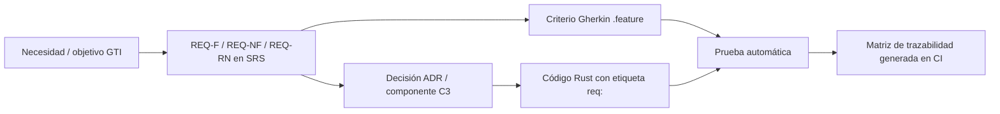

## C1. Especificación de requisitos (CE0211)

Estructura según **ISO/IEC/IEEE 29148**: propósito, alcance, definiciones (glosario A1), descripción general, requisitos específicos, verificación.

### C1.1 Actores

| Actor | Tipo | Objetivo |
| --- | --- | --- |
| Usuario de laboratorio | Humano | Navegar rápido y saber qué se descifra |
| Operador de red (DTI) | Humano | Configurar dominios, nodos y ver el ahorro |
| Analista de seguridad | Humano | Ver detecciones y responder |
| Auditor / docente | Humano | Verificar cumplimiento y privacidad |
| Publisher aliado | Sistema externo | Publicar contenido cacheable sin MITM |
| Origen | Sistema externo | Servir contenido |
| SIEM (Wazuh) | Sistema externo | Recibir eventos OCSF |
| Proveedor de identidad (OIDC) | Sistema externo | Autenticar operadores |

### C1.2 Requisitos funcionales

Prioridad MoSCoW. **Ver.**: R1 = prueba de concepto S1, R2 = implementación S2, R3 = escalamiento.

| ID | Requisito | Prioridad | Ver. | Estado en el repo |
| --- | --- | :-: | :-: | --- |
| REQ-F-01 | Atender como proxy explícito HTTP y HTTPS (`CONNECT`) en un puerto configurable | M | R1 | Hecho |
| REQ-F-02 | Descifrar TLS solo si el dominio está en la lista permitida, no está en la denegada y el SNI coincide con el `CONNECT` | M | R1 | Hecho |
| REQ-F-03 | Cachear respuestas compartibles según RFC 9111 | M | R1 | Hecho |
| REQ-F-04 | Revalidar copias vencidas con `If-None-Match` / `If-Modified-Since` | M | R1 | Hecho |
| REQ-F-05 | Coalescer peticiones concurrentes al mismo objeto ausente | M | R1 | Hecho |
| REQ-F-06 | Guardar objetos por SHA-256 y verificar el hash antes de servir | M | R1 | Hecho |
| REQ-F-07 | Normalizar claves con reglas declarativas (Store-ID, parámetros de rastreo) | M | R1 | Hecho |
| REQ-F-08 | Servir peticiones `Range` (206) desde un objeto completo en caché | S | R2 | Pendiente |
| REQ-F-09 | Respetar un límite de disco expulsando lo menos usado | M | R1 | Hecho |
| REQ-F-10 | Aceptar solo clientes de redes permitidas y limitar peticiones por IP | M | R1 | Hecho |
| REQ-F-11 | Bloquear destinos internos (SSRF) y puertos de túnel no permitidos | M | R1 | Hecho |
| REQ-F-12 | Publicar una página de transparencia generada desde la configuración real | M | R1 | Hecho (servida por el proxy; el portal independiente es D-15) |
| REQ-F-13 | Exponer métricas Prometheus y trazas OTLP | M | R2 | Parcial (sin OTLP) |
| REQ-F-14 | Emitir eventos de seguridad en OCSF hacia el SIEM | S | R2 | Parcial (JSONL propio) |
| REQ-F-15 | Generar detecciones de actividad inusual por IP | S | R1 | Hecho |
| REQ-F-16 | Enrolar nodos en el plano de control con mTLS | M | R2 | Pendiente |
| REQ-F-17 | Distribuir configuración versionada y firmada, con despliegue gradual y reversión | M | R2 | Pendiente |
| REQ-F-18 | Emitir y rotar una CA intermedia por nodo, limitada por Name Constraints | M | R2 | Parcial (CA única limitada) |
| REQ-F-19 | Purgar contenido por URL, prefijo o etiqueta en toda la flota | S | R2 | Pendiente |
| REQ-F-20 | Simular una política: "¿este URL se descifraría y cachearía?" sin aplicarla | S | R2 | Pendiente |
| REQ-F-21 | Repartir objetos entre nodos por hash consistente y consultar a un shield | C | R3 | Pendiente |
| REQ-F-22 | Ejecutar prefetch en una ventana horaria a partir de una lista firmada | S | R3 | Pendiente |
| REQ-F-23 | Validar manifiestos firmados de publishers (RFC 9421) y digests (RFC 9530) | C | R3 | Pendiente |
| REQ-F-24 | Registrar en auditoría todo cambio de configuración (quién, qué, cuándo) | M | R2 | Pendiente |
| REQ-F-25 | Exportar reportes de ahorro (GB evitados, BHR, costo por GB) | M | R2 | Parcial (panel) |
| REQ-F-26 | Generar el archivo PAC con varios nodos y `DIRECT` de respaldo | M | R1 | **Pendiente: único Must de R1 sin implementar** |
| REQ-F-27 | Alertar cuando se pide una honey-URL | C | R2 | Pendiente |
| REQ-F-28 | Eliminar de forma explícita las cabeceras que identifican al cliente (`X-Forwarded-For`, `Via`, `Forwarded`) antes de enviar una petición al origen o al shield | M | R2 | Pendiente (hoy no se agregan, pero no se eliminan si llegan) |
| REQ-F-29 | Enviar los MISS a un proxy padre (shield) configurable, con mTLS | S | R2 | Pendiente |
| REQ-F-30 | Exportar el aviso de transparencia como sitio estático firmado para el portal | S | R2 | Pendiente |

### C1.3 Requisitos no funcionales (ISO/IEC 25010:2023)

| ID | Característica | Requisito medible | Cómo se verifica |
| --- | --- | --- | --- |
| REQ-NF-01 | Eficiencia de desempeño | Latencia añadida p95 ≤ 5 ms en HIT desde memoria y ≤ 20 ms desde disco, en LAN | k6 / oha en laboratorio |
| REQ-NF-02 | Capacidad | ≥ 5 000 conexiones concurrentes por nodo de 4 vCPU y 8 GB (meta a confirmar con prueba) | Prueba de carga |
| REQ-NF-03 | Fiabilidad | Disponibilidad para el usuario ≥ 99,5 % mensual gracias al `DIRECT` del PAC y al DNS secundario | Sintético cada minuto desde PROBE01 (VLAN LAB) |
| REQ-NF-04 | Fiabilidad | Tras un corte de energía, ningún objeto corrupto se sirve | Prueba de corte (kill -9) + verificación de hash |
| REQ-NF-05 | Seguridad | La llave de una CA nunca sale de su nodo; la raíz vive offline | Revisión de diseño + auditoría de archivos |
| REQ-NF-06 | Seguridad | TLS ≥ 1.2 hacia clientes y orígenes; X25519MLKEM768 preferido cuando ambos lo soporten | Escaneo con testssl.sh |
| REQ-NF-07 | Seguridad / privacidad | No se guardan cookies, credenciales, cuerpos de peticiones ni parámetros de URL | Prueba automática sobre los registros |
| REQ-NF-08 | Safety | Ante error al evaluar la política, el nodo no intercepta (passthrough) | Prueba de inyección de fallos |
| REQ-NF-09 | Mantenibilidad | Cobertura ≥ 70 % en `policy`, `cache` y `tls`; `clippy` sin advertencias | CI |
| REQ-NF-10 | Flexibilidad | Compila para Linux x86_64 y aarch64 y para Windows x86_64; imagen OCI multi-arquitectura | CI con matriz de *targets* |
| REQ-NF-11 | Compatibilidad | HTTP/1.1 y HTTP/2 con clientes; cabecera `Cache-Status` (RFC 9211); eventos OCSF 1.x | Pruebas de conformidad |
| REQ-NF-12 | Capacidad de interacción | Panel con SUS ≥ 75 en la validación con usuarios | Cuestionario SUS |
| REQ-NF-13 | Observabilidad | Cada decisión (HIT, MISS, bypass, rechazo) produce una métrica | Revisión de métricas |
| REQ-NF-14 | Seguridad | El puerto de administración y métricas solo acepta TLS (o mTLS); el token nunca viaja en claro | Captura de tráfico (T27) |
| REQ-NF-15 | Seguridad / portabilidad | Imagen OCI sin privilegios (usuario no root), firmada y con SBOM | `cosign verify`, escaneo de la imagen en CI |

### C1.4 Reglas de negocio

| ID | Regla |
| --- | --- |
| REQ-RN-01 | Nunca se guarda una respuesta con `Set-Cookie`, `Cache-Control: private` o `no-store` |
| REQ-RN-02 | Nunca se sirve desde caché una petición con `Authorization` o `Cookie` |
| REQ-RN-03 | Los dominios de `never_intercept` ganan siempre sobre `intercept_domains` |
| REQ-RN-04 | Un dominio nuevo en `intercept_domains` exige una CA que lo cubra; si no, el nodo no arranca |
| REQ-RN-05 | El aviso debe estar disponible y entregado **antes** de instalar la CA y de configurar el proxy en un equipo |
| REQ-RN-06 | Los registros con IP real solo se activan con aviso actualizado y retención definida |
| REQ-RN-07 | Un cambio de configuración necesita aprobación de un segundo operador (cuatro ojos) |
| REQ-RN-08 | Un bundle de configuración sin firma válida se rechaza |

### C1.5 Restricciones

| ID | Restricción | Origen |
| --- | --- | --- |
| RS-01 | Rust estable; plano de datos sobre Hudsucker + rustls + Hyper + Tokio | Decisión del equipo (D-01, D-02) |
| RS-02 | ESXi gratuito: máximo 8 vCPU por VM, sin vCenter, API solo lectura | Licencia |
| RS-03 | Ningún secreto en el repositorio | Reglas de las rúbricas |
| RS-04 | Equipo de dos personas | Proyecto |
| RS-05 | Ley 29733 y su reglamento | Normativa |
| RS-06 | Cuenta AWS de laboratorio con sesiones limitadas, regiones restringidas y credenciales temporales [S-13] | Entorno académico |

### C1.6 Casos de uso e historias

| ID | Caso de uso | Actor | Requisitos |
| --- | --- | --- | --- |
| CU-01 | Navegar a través del proxy | Usuario | F-01, F-02, F-03 |
| CU-02 | Verificar qué se descifra y la huella de la CA (antes de usar el proxy) | Usuario / auditor | F-12, F-30, RN-05 |
| CU-03 | Agregar un dominio a la lista de intercepción | Operador | F-17, F-18, F-20, F-24, RN-04, RN-07 |
| CU-04 | Registrar un nodo nuevo | Operador | F-16, F-18 |
| CU-05 | Purgar un contenido | Operador | F-19 |
| CU-06 | Ver el ahorro del mes | Operador / DTI | F-25 |
| CU-07 | Investigar una detección | Analista | F-14, F-15 |
| CU-08 | Programar prefetch nocturno | Operador | F-22 |
| CU-09 | Alta de un publisher aliado | Operador | F-23 |
| CU-10 | Revertir una configuración | Operador | F-17 |

**Criterios de aceptación ejecutables (ejemplo):**

```gherkin
# tests/features/intercepcion.feature    @REQ-F-02 @REQ-RN-03
Característica: Intercepción selectiva

  Escenario: Un dominio denegado nunca se descifra
    Dado que "banco.example" está en never_intercept
    Y que "example" está en intercept_domains
    Cuando un cliente abre CONNECT banco.example:443
    Entonces el nodo abre un túnel sin descifrar
    Y el certificado que recibe el cliente es el del origen

  Escenario: SNI distinto del CONNECT
    Dado que "cdn.example" está en intercept_domains
    Cuando un cliente abre CONNECT cdn.example:443 con SNI "otro.example"
    Entonces el nodo no descifra
    Y se registra una detección "host_mismatch"

# tests/features/privacidad.feature    @REQ-F-28
  Escenario: La IP del cliente no sale del campus
    Dado un cliente que envía "X-Forwarded-For: 10.20.32.50"
    Cuando el nodo reenvía la petición al origen
    Entonces la petición saliente no contiene X-Forwarded-For, Via ni Forwarded
```

Se ejecutan con `cucumber` (crate de Rust) en el CI. Así el criterio de aceptación es también la prueba.

## C2. Prototipo navegable (CE0212)

### C2.1 Pantallas

| # | Pantalla | Usuario | Requisitos |
| --- | --- | --- | --- |
| P-01 | Inicio de sesión (OIDC o token) | Operador | F-13 |
| P-02 | Resumen: GB evitados, BHR, costo evitado, adopción del proxy, alertas | Operador / DTI | F-25 |
| P-03 | Registro en vivo con filtros | Operador | F-13 |
| P-04 | Políticas: dominios, simulador "¿qué pasaría si?" | Operador | F-17, F-20 |
| P-05 | Flota: nodos, versión de config, salud | Operador | F-16 |
| P-06 | Detecciones y alertas | Analista | F-15 |
| P-07 | Certificados: CA por nodo, vencimiento, huella | Operador / auditor | F-18 |
| P-08 | Cambios pendientes de aprobación (cuatro ojos) | Operador | RN-07 |
| P-09 | Portal público: aviso para el usuario | Usuario | F-12, F-30 |
| P-10 | Portal público: onboarding, QR, descarga de la CA, verificación de huella | Usuario | F-12, RN-05 |

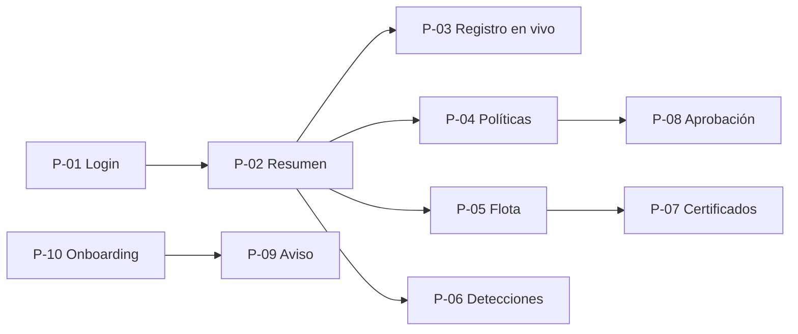

### C2.2 Validación con stakeholders

- **Participantes:** 2 técnicos de la DTI, 1 docente de infraestructura, 2 estudiantes (5 personas detectan la mayoría de problemas de usabilidad).
- **Tareas:** agregar un dominio y simular, encontrar el ahorro del mes, verificar la huella de la CA desde el portal, aprobar un cambio.
- **Medición:** tasa de éxito por tarea, tiempo por tarea, SUS. Meta: SUS ≥ 75 (REQ-NF-12).
- **Evidencia:** acta de validación firmada, hallazgos priorizados y cambios aplicados al prototipo (versión antes/después).

## C3. Diseño arquitectónico (CE0213)

### C3.1 C1 — Contexto

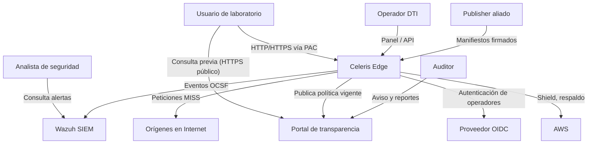

### C3.2 C2 — Contenedores (también vista de despliegue)

| Contenedor | Tecnología | Responsabilidad | Despliegue |
| --- | --- | --- | --- |
| `celeris-node` | Rust (Hudsucker, rustls, Hyper, Tokio, moka/foyer) | Proxy, caché, TLS, detecciones | VM EDGE01/EDGE02 (VLAN 60) |
| `celeris-shield` | Mismo binario en modo shield (proxy inverso sin MITM) | Caché regional de MISS | EC2 en subred privada AWS |
| `celeris-control` | Rust (axum) | API de flota, config, PKI, purgas, reportes, generación del portal | VM CTRL01 (VLAN 20) |
| Base de datos | PostgreSQL 18 | Inventario, políticas, auditoría, KPI diarios | VM DB01; réplica en AWS |
| Panel web | SPA estática servida por `celeris-control` | Interfaz de operación | CTRL01 |
| Portal de transparencia | Sitio estático firmado detrás de WAF | Aviso, huella de la CA, onboarding | WAF01 + WEB01 (VLAN 40) |
| PKI de infraestructura | step-ca | Certificados mTLS de nodos y servicios internos | CTRL01 |
| Observabilidad | OTel Collector, Prometheus, Grafana | Métricas y trazas | VM OBS01 |
| SIEM | Wazuh manager, indexer, dashboard | Correlación y alertas | VM SIEM01 (VLAN 50) |
| Servicios de red | Unbound (DNS), servidor PAC, chrony (NTP/NTS) | Resolución, PAC, hora | VM SVC01 (+ DNS secundario en FW01) |

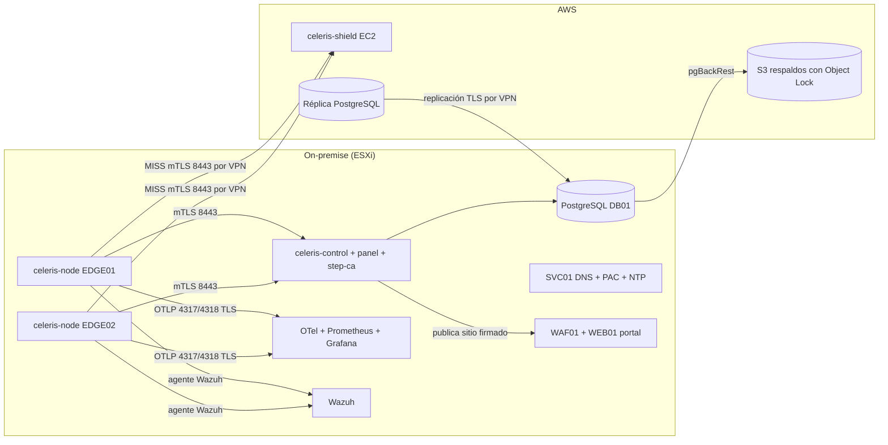

### C3.3 C3 — Componentes de `celeris-node`

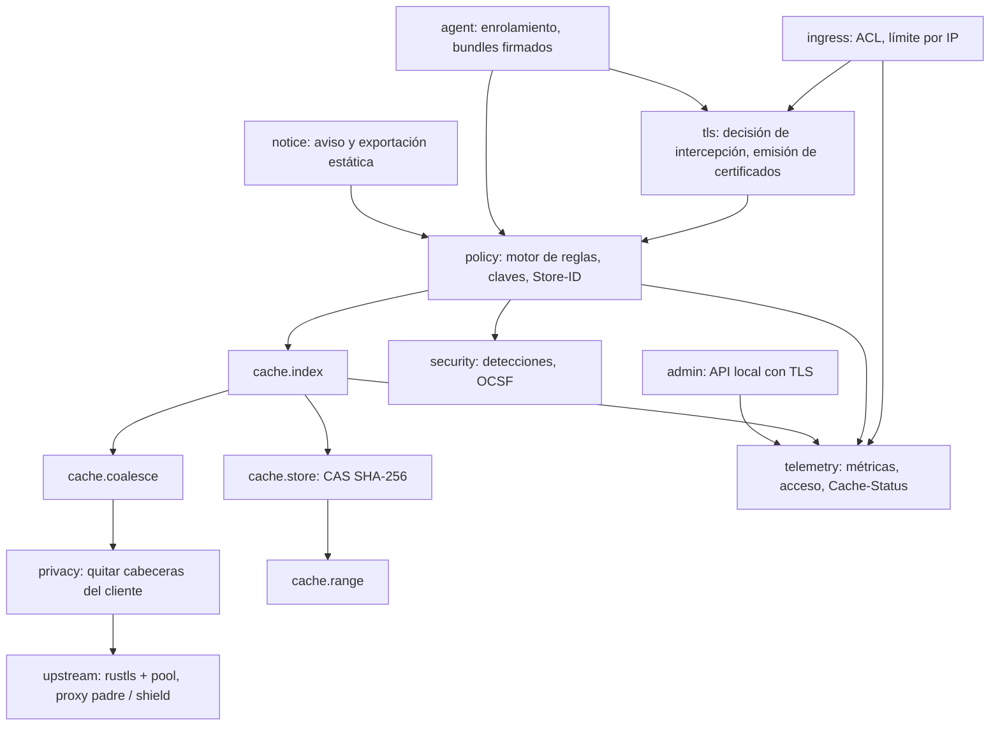

**Plan de refactorización del código actual** (de un crate a un *workspace*):

| Crate destino | Archivos actuales que absorbe | Puerto que expone |
| --- | --- | --- |
| `celeris-core` | `policy.rs`, `config.rs` (tipos) | `PolicyEngine`, `KeyNormalizer` |
| `celeris-store` | `store.rs`, `coalesce.rs`, `memory.rs` | `ObjectStore`, `Index` |
| `celeris-tls` | `ca.rs`, `secure.rs`, `upstream.rs` | `CertificateAuthority`, `UpstreamConnector` |
| `celeris-security` | `detect.rs`, `security.rs`, `access.rs`, `clients.rs` | `SecuritySink` (OCSF) |
| `celeris-telemetry` | `stats.rs`, `access_log.rs`, `monitor.rs`, `live.rs` | `MetricsSink`, `AccessLogSink` |
| `celeris-node` (binario) | `main.rs`, `handler.rs`, `admin.rs`, `notice.rs`, `panel/` | — |
| `celeris-control` (binario) | nuevo | API REST (OpenAPI 3.1) |
| `celeris-proto` | nuevo | Esquemas compartidos de bundles y mensajes |

### C3.4 Registro de decisiones (ADR, formato MADR)

| ADR | Decisión | Alternativas consideradas | Consecuencia principal |
| --- | --- | --- | --- |
| D-01 | Rust + Tokio para plano de datos y control | Go, C (Squid), Java | Seguridad de memoria y rendimiento; curva de aprendizaje alta |
| D-02 | Hudsucker para el proxy de reenvío con MITM | Pingora, Squid, mitmproxy | Hudsucker resuelve CONNECT + MITM en Rust. Pingora es un framework de proxy inverso con caché que Cloudflare ya usa para su propio caché; se reserva para el shield (D-13) |
| D-03 | Almacenamiento direccionado por contenido | Clave por URL (Squid, Varnish) | Deduplicación automática e integridad verificable |
| D-04 | CA intermedia por nodo con Name Constraints, raíz offline | Una CA única | Un nodo comprometido no compromete la flota; rotación por nodo |
| D-05 | Proxy explícito con PAC por URL fija (GPO); transparente como opción | Solo transparente; autodescubrimiento WPAD | Con ECH el proxy transparente ve menos; la URL fija evita el secuestro de WPAD; el PAC da failover a `DIRECT` |
| D-06 | Bloquear UDP/443 en los laboratorios + política de endpoint que desactiva QUIC | Permitir QUIC | El tráfico vuelve a TCP y pasa por la caché sin esperar el reintento del navegador |
| D-07 | Cedar como motor de políticas (R2) | Rego/OPA, TOML con lógica propia | Lenguaje formalmente verificado, implementado en Rust, en CNCF Sandbox desde octubre de 2025 |
| D-08 | OCSF para eventos de seguridad | Formato propio, ECS | Neutral: Wazuh, Security Lake o Elastic lo consumen sin reescribir el nodo |
| D-09 | OpenTofu + Ansible para IaC | Terraform, scripts | Licencia abierta; el mismo módulo sirve para AWS y Proxmox |
| D-10 | X25519MLKEM768 preferido con aws-lc-rs | Solo X25519 | Protección ante "guardar ahora, descifrar después" con costo bajo |
| D-11 | Bundles de configuración firmados con ed25519 | Configuración local | Un nodo solo aplica lo que firmó el plano de control |
| D-12 | PostgreSQL para el plano de control | SQLite, MySQL | Replicación nativa a AWS para continuidad |
| D-13 | Shield en modo proxy inverso (evaluar Pingora en R3) | Mismo motor de reenvío | El shield no necesita MITM; Pingora aporta caché y balanceo probados a escala |
| D-14 | Foyer como índice híbrido memoria + disco (R2) | moka (actual) | Extiende el conjunto en caché más allá de la RAM; se adopta tras medir |
| D-15 | Portal de transparencia estático en DMZ-SVC, detrás de WAF y con certificado público (ACME) | Aviso servido solo por el proxy; S3 + CloudFront + AWS WAF | El usuario lee el aviso **antes** de enrutar su tráfico por el proxy; superficie mínima (sin base de datos ni login); no depende de la CA Celeris, que el usuario aún no instaló |
| D-16 | Separar la DMZ de servicios (VLAN 40) de la de señuelos (VLAN 41) | Una DMZ única | Un honeypot está hecho para ser comprometido: no debe compartir segmento con un servicio real |
| D-17 | Todo tráfico entre zonas pasa por FW01, incluida la caché LAB→EDGE | Interfaz de servicio del nodo dentro de las VLAN de laboratorio (HIT conmutados sin firewall) | Prioriza control y registro de cada flujo. Riesgo: FW01 limita el rendimiento de los HIT. Se mide con iperf3 en S2 y se revisa la decisión con datos |
| D-18 | Laboratorio efímero: misma imagen OCI e IaC en local (Modo L), AWS (Modo A) y campus (Modo H) | AMI configurada a mano; despliegue manual por consola | Reproducible en una cuenta de laboratorio volátil; costo por hora de uso; evidencia regenerable |

Cada ADR completo incluye: contexto, factores, opciones con pros y contras, decisión, consecuencias y fecha de revisión.

## C4. Diseño detallado (CE0214)

### C4.1 Modelo de dominio

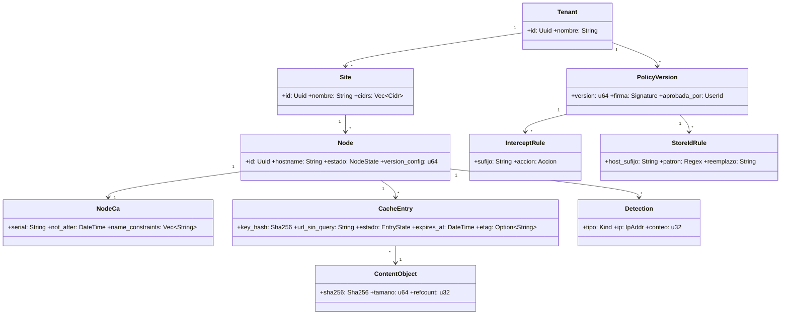

### C4.2 Secuencia — MISS con coalescencia y HIT posterior

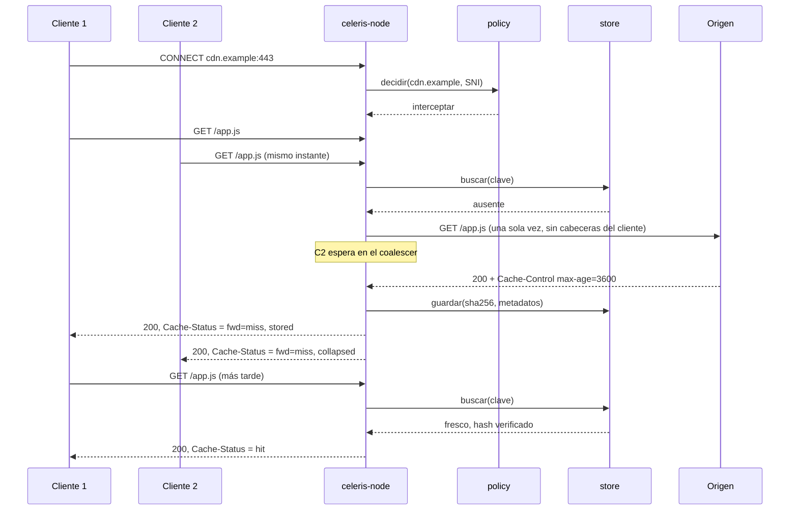

La cabecera real sigue la sintaxis de RFC 9211, por ejemplo `Cache-Status: celeris; fwd=miss; stored`.

### C4.3 Secuencia — despliegue de una política con aprobación

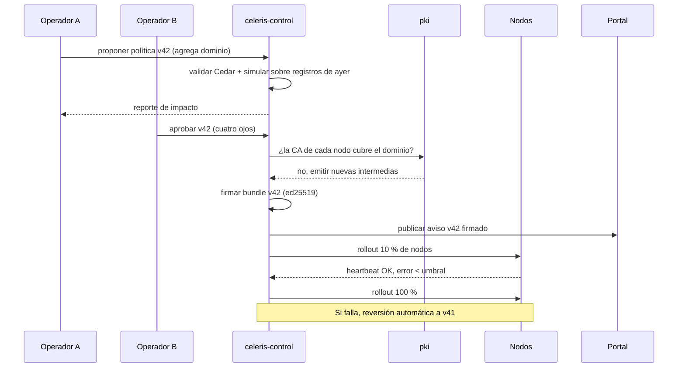

### C4.4 Estados de una entrada de caché

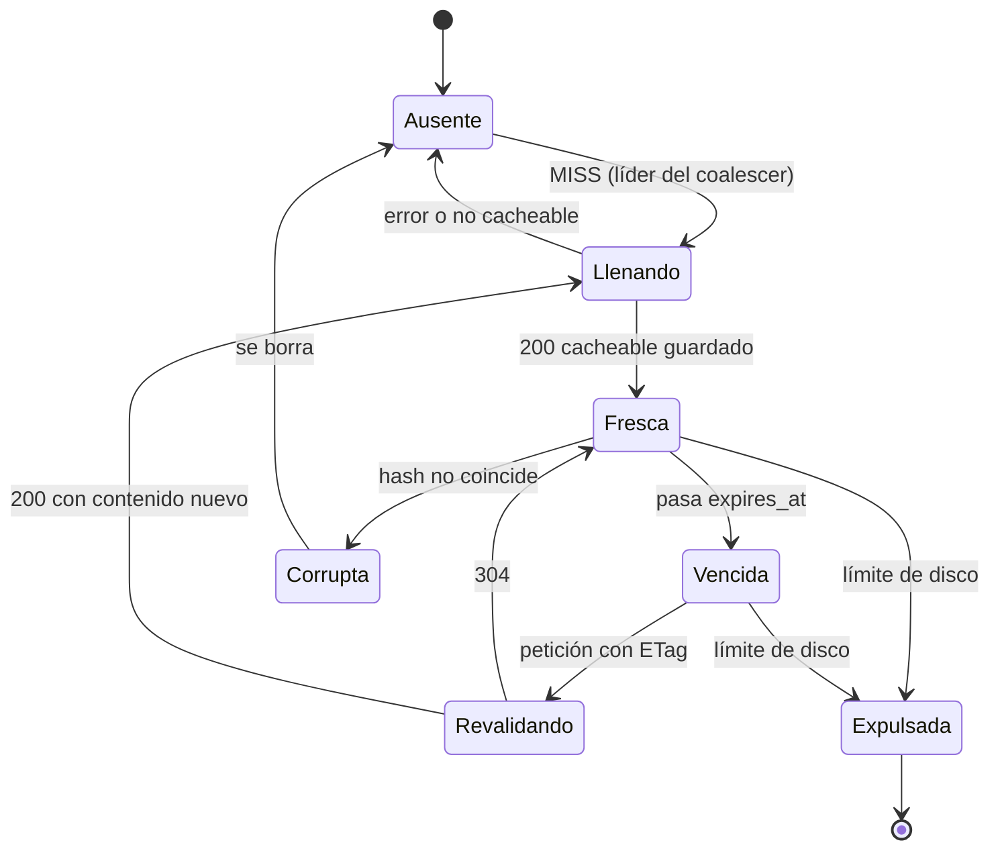

### C4.5 Estados de un nodo

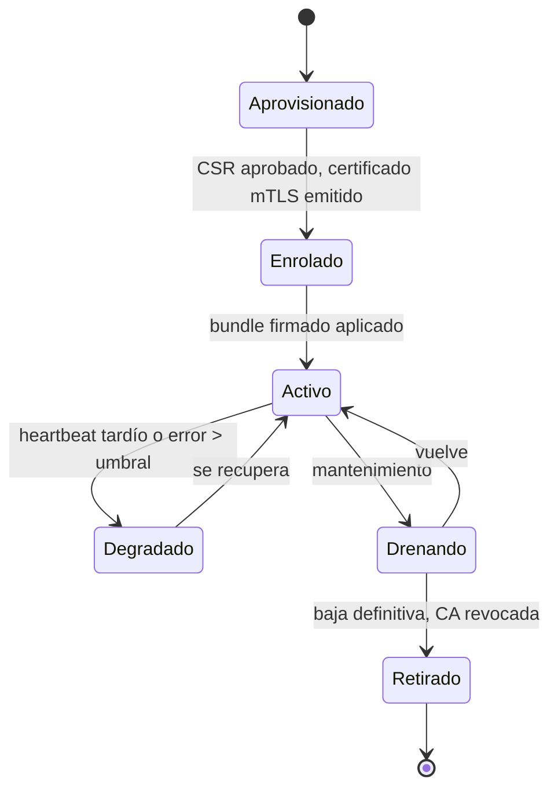

### C4.6 Modelo de datos preliminar del plano de control

Base para CE022 en S2.

| Tabla | Columnas principales | Nota |
| --- | --- | --- |
| `tenant` | id, nombre | Multi-organización (R3) |
| `site` | id, tenant_id, nombre, cidrs | |
| `node` | id, site_id, hostname, estado, version_config, last_seen | |
| `policy_version` | version, tenant_id, contenido_cedar, firma, propuesta_por, aprobada_por, creada_en | Inmutable |
| `node_ca` | serial, node_id, not_after, name_constraints, revocada_en | |
| `purge_job` | id, selector, estado, creado_por | |
| `audit_log` | id, actor, accion, objeto, antes, despues, ts | Solo inserción |
| `kpi_daily` | fecha, node_id, bytes_cache, bytes_origen, hits, misses, bypass | Alimenta reportes GTI |

### C4.7 API del plano de control (borrador)

| Método | Ruta | Uso |
| --- | --- | --- |
| POST | `/v1/nodes/enroll` | CSR del nodo → certificado mTLS |
| GET | `/v1/nodes/{id}/bundle?since=v` | El nodo descarga el bundle firmado |
| POST | `/v1/policies` | Proponer versión |
| POST | `/v1/policies/{v}/simulate` | Impacto sobre registros |
| POST | `/v1/policies/{v}/approve` | Segunda firma |
| POST | `/v1/purges` | Purgar |
| GET | `/v1/reports/savings?from=&to=` | Reporte de ahorro |
| POST | `/v1/portal/publish` | Generar y firmar el sitio del portal |

## C5. Matriz de trazabilidad

Se genera en CI a partir de etiquetas en Markdown (`REQ-F-02`), en Gherkin (`@REQ-F-02`) y en Rust (`// req: REQ-F-02`).

| Requisito | Objetivo (GTI) | Componente (C3) | ADR | Prueba | Pantalla |
| --- | --- | --- | --- | --- | --- |
| REQ-F-02 | OB-4 | tls | D-04, D-05 | `intercepcion.feature` | P-04, P-09 |
| REQ-F-05 | OB-1 | cache.coalesce | D-03 | e2e "20 peticiones, 1 descarga" | — |
| REQ-F-17 | OB-3 | agent, config | D-11 | `rollout.feature` | P-04, P-08 |
| REQ-F-25 | OB-1 | telemetry, reports | D-12 | `reportes.feature` | P-02 |
| REQ-F-28 | OB-4 | privacy | D-15 | `privacidad.feature`, T26 | — |
| REQ-NF-08 | OB-4 | policy | D-07 | inyección de fallos | — |
| REQ-NF-14 | OB-3 | admin | — | T27 | — |

## C6. Software recomendado para Ingeniería de Software

| Necesidad | Recomendado | Alternativas | Por qué | Cuándo cambiar |
| --- | --- | --- | --- | --- |
| Prototipo navegable | **Penpot** | Figma | Libre, autoalojable, diseño sobre SVG/CSS; no ata el proyecto a un proveedor | **Figma** (plan educativo) si se necesita más velocidad en prototipado interactivo |
| Arquitectura C4 | **Structurizr DSL** | C4-PlantUML, draw.io | Un modelo único genera C1, C2 y C3 coherentes entre sí | draw.io si el docente pide editar el diagrama a mano |
| UML detallado | **PlantUML** | Mermaid, StarUML | Cubre clases, secuencia y estados; texto versionable | Mermaid para diagramas dentro del Markdown (como en este documento) |
| ADR | **MADR** en `docs/adr/` | Log4brains | Plantilla simple en Markdown | Log4brains si se quiere un sitio navegable de ADR |
| Trazabilidad | **OpenFastTrace** | Doorstop, script propio | Rastrea etiquetas en Markdown y código y reporta huecos | Script propio si OFT complica el CI |
| Criterios ejecutables | **cucumber** (crate Rust) | Pruebas de integración simples | El Gherkin del SRS se ejecuta tal cual | — |
| Documentación | **MkDocs Material** (igual que la guía planb) + Quarto para DOCX/PDF | Docusaurus | Mismo stack que la guía del curso; búsqueda y Mermaid incluidos | — |
| Calidad del código | `clippy`, `cargo-deny`, `cargo-audit`, `cargo-llvm-cov` | SonarQube | Nativos de Rust, corren en CI sin servidor | **SonarQube** en S2 (CE024) si se pide tablero de calidad |
| Imagen y cadena de suministro | **Docker Buildx + cosign + Syft** | Podman, Kaniko | Imagen multi-arquitectura, firma y SBOM desde el mismo CI | Podman si el host no admite Docker |
| CI/CD | **GitHub Actions** | GitLab CI, Woodpecker | El repositorio ya está en GitHub | Woodpecker si se autoaloja todo |
| Secretos | **SOPS + age**, gitleaks | git-crypt | Cifra solo los valores, revisable en diff | OpenBao si hay muchos secretos dinámicos |

## C7. Escalamiento futuro del software

| Etapa | Plano de datos | Plano de control | Extensibilidad |
| --- | --- | --- | --- |
| R1 | Un nodo, config TOML, PAC generado | — | Reglas declarativas |
| R2 | Varios nodos, CA por nodo, OCSF, OTLP, Range, proxy padre, cabeceras de privacidad | API + PostgreSQL + aprobación + portal | Motor Cedar |
| R3 | Peering, shield, prefetch, FastCDC, modo cooperativo | Multi-tenant, réplica en AWS | Plugins Wasm (wasmtime) para Store-ID sin recompilar |
| R3+ | HTTP/3 hacia orígenes, compresión con diccionarios (RFC 9842) | Marketplace de políticas por sector | SDK para publishers |

---

# Parte D — CE03 Infraestructura Tecnológica

**Entregables S1:** E1 Análisis y Diseño de Red (CE0311) y E2 Análisis y Diseño de Centro de Datos Híbrido (CE0331). Ambos son **diseño, sin implementación**; la implementación y las pruebas van en S2 (CE0312, CE0313, CE0332, CE0333). La Parte F explica cómo se demuestra lo diseñado.

**Regla de coherencia:** las redes, IP y nombres de equipos de esta parte son la única fuente. El informe de red, el de centro de datos, la configuración de Celeris y el laboratorio (Parte F) los copian de aquí, y en el repositorio se generan desde `infra/inventory.yaml`.

**Regla de evidencia de la rúbrica oficial:** "no se evalúa como implementado/diseñado aquello que solo se describe de forma genérica". Por eso cada control de esta parte tiene IP, puerto, regla o prueba asociada.

## D0. Arquitectura de referencia

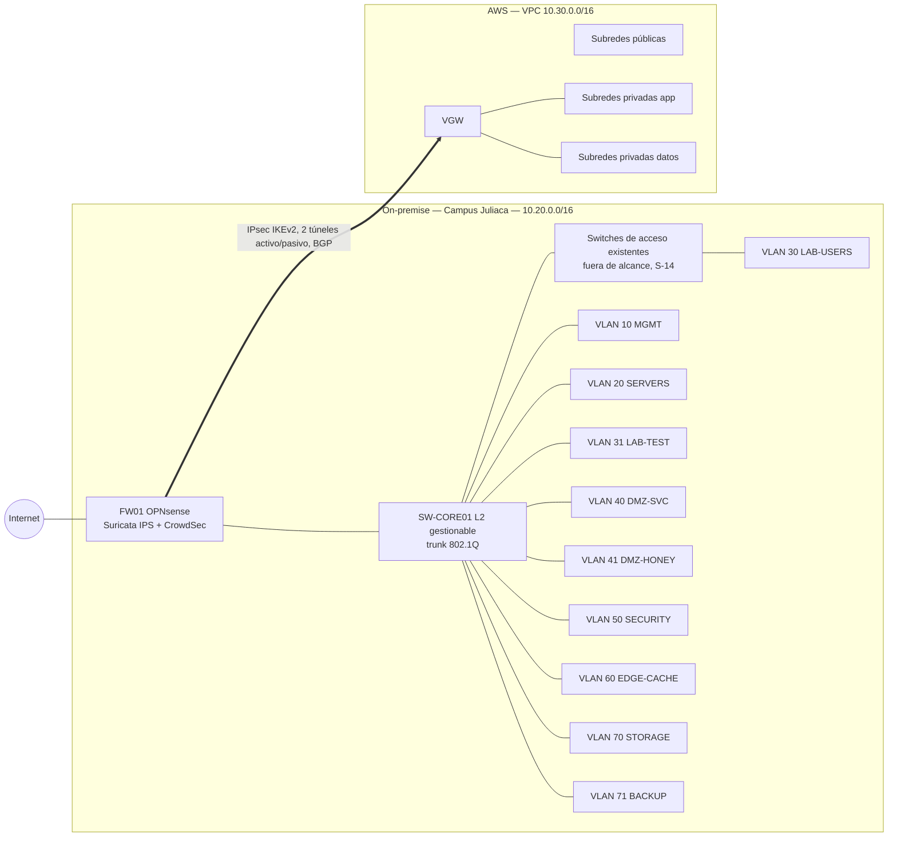

## D1. Entregable 1 — Análisis y Diseño de Red (CE0311)

**Estructura.** La plantilla oficial (`fuentes/CE03/S1_E1_Analisis_y_Diseno_de_Red.docx`) tiene **15 secciones**. D1.1 a D1.15 siguen ese orden uno a uno. D1.16 es la matriz de pruebas (producto obligatorio) y D1.17 el mapa rúbrica → evidencia.

**Productos obligatorios:** informe DOCX + PDF; diagramas draw.io + PDF/PNG (topología general, lógica, seguridad por zonas, VPN híbrida); matriz de componentes (100 % de lo dibujado); matriz de pruebas de conectividad planeadas.

### D1.1 Resumen ejecutivo del diseño de red (sección 1)

- **Proyecto / organización:** Celeris Edge en la red de laboratorios del Campus Juliaca [S-01].
- **Problema de conectividad y seguridad:** enlace limitado saturado por descargas repetidas; red plana sin segmentación entre laboratorios, servidores y gestión; sin detección de intrusiones; sin forma de que el usuario verifique qué tráfico se inspecciona.
- **Topología propuesta:** red on-premise segmentada en 10 VLAN detrás de un firewall OPNsense con ruteo entre zonas (*router-on-a-stick*), unida por VPN IPsec a una VPC en AWS.
- **VPN:** site-to-site IKEv2 con AES-256-GCM, dos túneles en activo/pasivo y BGP.
- **Zonas:** MGMT, SERVERS, LAB-USERS, LAB-TEST, DMZ-SVC (portal de transparencia protegido con WAF), DMZ-HONEY (señuelos), SECURITY, EDGE-CACHE, STORAGE, BACKUP.
- **Riesgos preliminares:** firewall virtual como punto único de falla, rendimiento de la caché a través del firewall, abuso del proxy, evasión del proxy (QUIC, DoH, IPv6), exposición del portal y del honeypot.
- **Siguientes pasos (S2):** implementar, ejecutar la matriz de pruebas T01–T28 y monitorear (CE0312–CE0313). Antes, se demuestra el diseño en el laboratorio emulado (Parte F).

### D1.2 Organización y necesidades de red (sección 2)

| Necesidad | Valor | Fuente |
| --- | --- | --- |
| Usuarios / equipos en alcance | 400 PCs de laboratorio | [S-01] |
| Sedes | 1 (Juliaca); crecimiento a Lima y Tarapoto | Plan de escalamiento |
| Enlace a Internet | 300 Mbps simétricos, 1 IP pública fija | [S-02], [S-15] |
| Servicios que dependen de la red | Navegación de clases, actualizaciones, plataforma virtual, caché, SIEM, portal de transparencia | Levantamiento |
| Uso de cloud | Shield de caché, réplica del plano de control, respaldos | Diseño |
| Entorno local | ESXi en el rack del laboratorio; capa de acceso existente [S-14] | Levantamiento |
| Disponibilidad esperada | Navegación ≥ 99,5 % (con `DIRECT` y DNS secundario) | REQ-NF-03 |
| Crecimiento | Hasta 1 000 equipos en laboratorio y 2 sedes más | Plan de escalamiento |

### D1.3 Servicios y procesos críticos dependientes de la red (sección 3)

| Proceso | Servicio TI | Criticidad |
| --- | --- | --- |
| Clases en laboratorio | Navegación vía Celeris + DNS + PAC | Alta |
| Actualización de laboratorios (P1) | Celeris + prefetch | Alta |
| Monitoreo de seguridad (P2) | Wazuh + Suricata + WAF | Alta |
| Consentimiento informado | Portal de transparencia | Alta (requisito legal previo al uso) |
| Administración de la plataforma | Plano de control + jump host | Media |
| Respaldo | NAS + S3 | Media |

### D1.4 Partes interesadas relevantes (sección 4)

| Parte interesada | Tipo de la plantilla | Interés en la red |
| --- | --- | --- |
| Estudiantes y docentes | Clientes / usuarios | Velocidad, disponibilidad, privacidad |
| Técnicos de la DTI | Empleados / administradores | Segmentación, operación, visibilidad |
| Dirección del campus | Dirección | Costo, riesgo, imagen |
| ISP local | Proveedor / ISP | Enlace, IP fija, contrato |
| AWS | Proveedor cloud | Extremo VPN, servicios de la VPC |
| Oficial de datos personales; Autoridad Nacional de Protección de Datos Personales | Organismo regulador | Ley 29733: aviso, minimización, flujo transfronterizo |

### D1.5 Alcance del diseño de red (sección 5)

- **Declaración:** el diseño comprende la conectividad, el direccionamiento, la segmentación, la seguridad perimetral, la detección y la protección en tránsito de la red on-premise del laboratorio Celeris y su integración por VPN con la VPC en AWS.
- **Límites físicos:** rack del laboratorio, servidor ESXi, switch núcleo, NAS, UPS y el enlace hacia la capa de acceso.
- **Límites tecnológicos:** OPNsense, VLAN, VPN, Suricata, WAF, honeypots, VPC, subredes, tablas de rutas, Security Groups, NACL.
- **Límites organizacionales:** la DTI administra todos los segmentos y la capa de acceso; el equipo del proyecto opera el laboratorio durante el piloto.
- **Exclusiones justificadas:**
  - BYOD: no se puede garantizar consentimiento ni instalación controlada de la CA.
  - Red administrativa del campus y Wi-Fi de estudiantes: fuera del piloto.
  - **Capa de acceso (switches de los laboratorios):** existente; se documenta AS-IS (modelo, puertos, PoE, uplinks) y se exige soporte 802.1Q y los controles de capa 2 de D1.9, pero su rediseño queda fuera de alcance [S-14].

### D1.6 Objetivos medibles del diseño (sección 6)

| Objetivo | Indicador | Meta | Responsable |
| --- | --- | --- | --- |
| Segmentar por zonas | Servidores críticos en VLAN dedicadas | 100 % | Diseño de red |
| Aislar la gestión | Interfaces de gestión alcanzables solo desde JMP01 (VLAN 10) | 100 % | Seguridad |
| Rutas alternas | Rutas de salida para un usuario | ≥ 3 (EDGE01, EDGE02, DIRECT) | Diseño de red |
| Resolución sin punto único | Servidores DNS por cliente | 2 (SVC01 + FW01) | Diseño de red |
| Enlace híbrido redundante | Túneles VPN configurados / convergencia medida | 2 túneles; ≤ 60 s | Infraestructura |
| Política por defecto | Tráfico entre zonas con regla explícita y registro | 100 %, *deny-all* en el resto | Seguridad |
| Protección en tránsito | Flujos con protección criptográfica o riesgo aceptado documentado | 100 % de los flujos de D1.11 | Seguridad |
| Servicio expuesto endurecido | Calificación TLS del portal; puertos abiertos desde Internet | ≥ A; solo 80/443 (+ señuelos en ventana autorizada) | Seguridad |
| Detección | Escenarios de ataque planificados detectados en S2 | ≥ 90 % | Seguridad |
| Adopción del proxy | Bytes HTTP(S) de LAB que pasan por la caché | Se mide en el piloto; meta ≥ 90 % en modo gestionado | Diseño de red |

### D1.7 Topología general de infraestructura de red (sección 7)

**Para el informe:** diagrama 5.1 en draw.io con usuarios (laboratorios), Internet, FW01, on-premise (ESXi y sus zonas), DMZ-SVC, DMZ-HONEY, LAN, gestión, AWS y la VPN. Debe mostrar el ID de cada componente de D1.12. Base: diagrama D0.

### D1.8 Topología lógica de red (sección 8)

#### Plan de direccionamiento

Supernet de la sede: **10.20.0.0/16** (RFC 1918). Sedes futuras: 10.21.0.0/16 (Lima), 10.22.0.0/16 (Tarapoto); todo el campus se resume como **10.20.0.0/14**. AWS: **10.30.0.0/16**. No hay solapamiento. Convención: el número de VLAN coincide con el tercer octeto.

| VLAN | Nombre | Red / CIDR | Gateway | Hosts útiles | Propósito |
| ---: | --- | --- | --- | ---: | --- |
| 10 | MGMT | 10.20.10.0/24 | 10.20.10.1 | 254 | Gestión de ESXi, switch, IPMI, UPS, JMP01; puerto *break-glass* |
| 20 | SERVERS | 10.20.20.0/24 | 10.20.20.1 | 254 | Plano de control, base de datos, observabilidad, DNS/PAC/NTP |
| 30 | LAB-USERS | 10.20.32.0/22 | 10.20.32.1 | 1 022 | PCs de laboratorio. Reserva contigua 10.20.36.0/22 para crecer a /21 |
| 31 | LAB-TEST | 10.20.31.0/24 | 10.20.31.1 | 254 | Equipos de prueba y ataque controlado (KALI01). Separado de LAB para que las pruebas **crucen** el firewall |
| 40 | DMZ-SVC | 10.20.40.0/24 | 10.20.40.1 | 254 | Servicios publicados: WAF01 y WEB01 (portal de transparencia) |
| 41 | DMZ-HONEY | 10.20.41.0/24 | 10.20.41.1 | 254 | Señuelos expuestos (HNY01) |
| 50 | SECURITY | 10.20.50.0/24 | 10.20.50.1 | 254 | Wazuh, sensor Suricata |
| 60 | EDGE-CACHE | 10.20.60.0/24 | 10.20.60.1 | 254 | Nodos Celeris |
| 70 | STORAGE | 10.20.70.0/24 | sin gateway (no enrutada) | 254 | **Solo** NFS entre el vmkernel de ESXi y el NAS |
| 71 | BACKUP | 10.20.71.0/24 | 10.20.71.1 | 254 | Interfaz de respaldo del NAS, enrutada con lista de permitidos (restic por SFTP desde SERVERS) |
| 999 | BLACKHOLE | — | — | — | VLAN nativa sin uso en todos los trunks; puertos sin uso apagados en esta VLAN |

> Por qué VLAN 70 y 71 separadas: el NFS del hipervisor no necesita ruteo y queda aislado. Los respaldos de las VM sí necesitan llegar al NAS desde SERVERS; con una VLAN enrutada aparte, la regla 3-2-1 se puede ejecutar sin abrir la red de almacenamiento.

**Enlaces internos de la VPN:** túnel 1 169.254.10.0/30, túnel 2 169.254.11.0/30 (AWS asigna o se fijan en la configuración de la VPN; se registran en el inventario).

#### Ruteo

- FW01 enruta entre VLAN (*router-on-a-stick*): todo tráfico entre zonas pasa por una regla y queda registrado (D-17). SW-CORE01 trabaja en capa 2.
- Ruta por defecto hacia el ISP. 10.30.0.0/16 aprendida por BGP desde AWS.
- VLAN 70 no tiene interfaz en FW01.

#### Servicios de red base

| Servicio | Diseño | Por qué |
| --- | --- | --- |
| DHCP | Pools por VLAN en FW01 (Kea/dnsmasq de OPNsense) o el DHCP existente de la DTI [S-14]. Reservas para los equipos de laboratorio; esa lista alimenta `allowed_clients` del nodo | 400 PCs sin DHCP no es un diseño reproducible; las reservas convierten el alcance "solo equipos institucionales" en un control |
| DNS | Unbound en SVC01 (primario) con validación DNSSEC; **Unbound de FW01 como secundario**. Los clientes reciben ambos | Sin DNS, ni el proxy ni el `DIRECT` funcionan: un solo servidor sería un punto único de falla oculto |
| PAC | URL fija `http://pac.celeris.internal/wpad.dat` por GPO, sin autodescubrimiento. El nombre resuelve a SVC01 y EDGE01 (dos registros A). Servirlo por HTTPS se evalúa en S2 | Evita el secuestro de WPAD y el PAC sobrevive a la caída de SVC01 |
| NTP | chrony en SVC01; hacia arriba con **NTS**; los clientes por NTP 123 | Los certificados y la correlación del SIEM dependen de la hora |
| IPv6 | **Deshabilitado en LAB** con RA guard y DHCPv6 guard en el switch; declarado como decisión | Un cliente con IPv6 se saltaría el proxy IPv4; además, el VGW de AWS no transporta IPv6 |
| DNS cifrado | TCP/UDP 853 (DoT) bloqueado desde LAB; DoH a resolvedores públicos conocidos bloqueado por política del navegador (GPO) | Que el cliente no salte el DNS institucional ni el PAC |

#### Matriz de comunicación entre zonas

Política por defecto: **denegar y registrar**. ✔ = permitido solo en los puertos de la matriz de flujos (D1.11, F-nn); ✖ = denegado. El tráfico de retorno de una conexión permitida lo deja pasar el firewall con estado y no se lista.

| Origen ↓ / Destino → | MGMT | SERVERS | LAB | LAB-TEST | DMZ-SVC | DMZ-HONEY | SECURITY | EDGE | STORAGE | BACKUP | AWS | Internet |
| --- | :-: | :-: | :-: | :-: | :-: | :-: | :-: | :-: | :-: | :-: | :-: | :-: |
| **MGMT** (solo JMP01) | — | ✔ F20 | ✔ F20 | ✔ F20 | ✔ F20 | ✔ F20 | ✔ F20 | ✔ F20 | ✖ | ✔ F20 | ✖ (SSM por Internet) | ✔ 443 actualizaciones |
| **SERVERS** | ✖ | — | ✖ | ✖ | ✖ | ✖ | ✔ F13 | ✔ F12 | ✖ | ✔ F17 | ✔ F12 | ✔ F18, F25 |
| **LAB** | ✖ | ✔ F2, F3 | — | ✖ | ✔ F5 | ✖ | ✔ F13 (solo HNY02) | ✔ F1 | ✖ | ✖ | ✖ | ✔ F6 piloto; ✖ F7 |
| **LAB-TEST** | ✖ | ✔ F2, F3 | ✖ | — | ✔ F5 | ✖ | ✖ | ✔ F1 | ✖ | ✖ | ✖ | ✔ F6 |
| **DMZ-SVC** | ✖ | ✖ | ✖ | ✖ | — | ✖ | ✔ F13 | ✖ | ✖ | ✖ | ✖ | ✔ F23 (solo ACME) |
| **DMZ-HONEY** | ✖ | ✖ | ✖ | ✖ | ✖ | — | ✔ F13 | ✖ | ✖ | ✖ | ✖ | ✖ |
| **SECURITY** | ✖ | ✔ F2 (NTP/DNS) | ✖ | ✖ | ✖ | ✖ | — | ✖ | ✖ | ✖ | ✖ | ✔ F26 |
| **EDGE** | ✖ | ✔ F10, F11, F2 | ✖ | ✖ | ✖ | ✖ | ✔ F13 | ✔ peering | ✖ | ✖ | ✔ F9 | ✔ F8 |
| **STORAGE** | ✖ | ✖ | ✖ | ✖ | ✖ | ✖ | ✖ | ✖ | — | ✖ | ✖ | ✖ |
| **BACKUP** | ✖ | ✖ | ✖ | ✖ | ✖ | ✖ | ✔ F13 | ✖ | ✖ | — | ✖ | ✔ F18 (solo S3) |
| **AWS** | ✖ | ✔ F16 | ✖ | ✖ | ✖ | ✖ | ✔ F13 | ✖ | ✖ | ✖ | — | — |
| **Internet** | ✖ | ✖ | ✖ | ✖ | ✔ F21 | ✔ F24 (ventana autorizada) | ✖ | ✖ | ✖ | ✖ | — | — |

> Notas para la sustentación:
> 1. **LAB-TEST** tiene reglas de prueba adicionales **deshabilitadas por defecto**, que se activan solo en ventanas autorizadas y quedan registradas.
> 2. **Tráfico que el firewall no ve:** el tráfico dentro de una misma VLAN (PC a PC en LAB, WAF01 a WEB01 en DMZ-SVC) se conmuta en capa 2. Lo compensan el firewall de host (nftables) en cada servidor, el canary HNY02 dentro de LAB y los controles de capa 2 (D1.9).
> 3. **Modo piloto vs. gestionado:** en el piloto, LAB → Internet directo (F6) queda permitido como *fail-open*. Esa excepción tiene dueño (DTI), plazo (fin del piloto) y registro en la matriz de riesgos. En el modo gestionado se bloquea y todo pasa por el proxy. El bloqueo de F7 aplica en ambos modos.

### D1.9 Diseño de seguridad perimetral y zonas (sección 9)

#### Defensa en profundidad

| Capa | Control en este diseño | Dónde se detalla |
| --- | --- | --- |
| Perímetro | FW01 *deny-all*, Suricata IPS inline en WAN y DMZ, CrowdSec, filtrado de salida | D1.13 |
| Zona | 10 VLAN, matriz zona × zona, DMZ dividida (D-16), STORAGE sin ruteo | D1.8 |
| Capa 2 | DHCP snooping, DAI, IP source guard, RA guard, port-security, BPDU/root guard, storm control, pruning de VLAN en trunks, nativa 999 | Esta sección |
| Host | nftables por servidor, endurecimiento CIS, sin `ip_forward` en equipos con varias interfaces (NAS01, IDS01) | D2 |
| Aplicación | WAF con OWASP CRS delante del portal; nodo Celeris con ACL, SSRF y puertos limitados; CA con Name Constraints | Esta sección, Parte C |
| Datos en tránsito | Una protección por flujo (columna "Protección" de D1.11) | D1.11 |
| Detección | Suricata, honeypots, canary, detecciones Celeris, honey-URLs, WAF → Wazuh | D1.14 |
| Respuesta | Playbooks: bloquear IP en OPNsense, aislar VLAN, revocar CA de un nodo | B4.4 |
| Recuperación | Puerto *break-glass*, configuraciones en Git, respaldos 3-2-1-1-0 | D2.9 |

#### Zonas y su nivel de confianza

| Zona | Confianza | Qué contiene | Regla de diseño |
| --- | --- | --- | --- |
| MGMT | Máxima | Interfaces de gestión | Solo JMP01 inicia conexiones; MFA en JMP01 y en la GUI de OPNsense |
| SERVERS | Alta | Control, DB, observabilidad, DNS/PAC | No inicia hacia usuarios |
| SECURITY | Alta | SIEM, IDS | Recibe de todos, no inicia hacia ninguno salvo NTP/DNS y feeds |
| EDGE | Media | Nodos de caché | Solo recibe 3128 desde LAB; sale a Internet y al shield |
| LAB / LAB-TEST | Baja | Usuarios y pruebas | Solo servicios listados |
| DMZ-SVC | Baja, expuesta | Portal | No inicia hacia ninguna zona interna |
| DMZ-HONEY | Nula | Señuelos | Solo envía al SIEM; nada más |
| STORAGE | Aislada | NFS | Sin ruteo |
| BACKUP | Alta, aislada | Respaldo | Solo recibe de SERVERS; sale solo a S3 |

#### DMZ-SVC: el servicio expuesto protegido

El portal de transparencia es el único servicio que el proyecto necesita publicar, y resuelve el orden del consentimiento: el usuario lee el aviso y verifica la huella de la CA **antes** de que su tráfico pase por el proxy (D-15, REQ-RN-05). Hoy el aviso solo se sirve a través del proxy (`http://celeris.aviso`), es decir, después.

| Capa | Control | Justificación |
| --- | --- | --- |
| Perímetro | DNAT solo 443 → WAF01; 80 solo redirige a HTTPS y atiende el reto ACME. Suricata IPS inline en la interfaz DMZ. CrowdSec (plugin de OPNsense) bloquea IP con mala reputación | Superficie mínima |
| WAF | WAF01: Caddy o Nginx con Coraza/ModSecurity y OWASP CRS; límite de peticiones por IP. Alternativa todo en uno: BunkerWeb | Bloquea ataques web conocidos antes de llegar al sitio |
| TLS | Certificado **público** por ACME (Let's Encrypt), no de la CA Celeris. TLS 1.3 con 1.2 de respaldo, HSTS, OCSP stapling | El usuario todavía no instaló la CA Celeris: el portal tiene que ser confiable sin ella |
| Contenido | WEB01 sirve un sitio estático generado desde la configuración real y firmado (REQ-F-30). Sin base de datos, sin login, contenedor sin root con sistema de archivos de solo lectura | Lo que no existe no se puede explotar |
| Cabeceras | `Content-Security-Policy: default-src 'self'`, `frame-ancestors 'none'`, `X-Content-Type-Options: nosniff`, `Referrer-Policy: no-referrer` | Defensa en el navegador |
| Salida | WEB01 sin salida a ninguna zona ni a Internet, salvo el agente Wazuh. WAF01 solo sale a los endpoints ACME. El despliegue del sitio lo hace JMP01 por SSH | Un portal comprometido no sirve de trampolín |
| Monitoreo | Logs del WAF y del sitio a Wazuh; integridad de archivos (syscheck) en WEB01 | Un cambio no autorizado del sitio genera alerta |

**Alternativa evaluada:** publicar el portal en S3 + CloudFront + AWS WAF. Ventaja: no expone la IP del campus. Desventaja: costo, dependencia de AWS y la rúbrica evalúa una DMZ diseñada. Se deja como opción de H3.

#### DMZ-HONEY

HNY01 (OpenCanary + Cowrie) en su propia VLAN. Solo envía eventos al SIEM; no alcanza ninguna zona ni sale a Internet. La publicación de sus puertos señuelo (F24) requiere **autorización escrita de la DTI** y una ventana definida, porque atrae tráfico hostil hacia la IP del campus y consume el enlace que el proyecto quiere ahorrar. Alternativa para telemetría continua: un honeypot persistente en una subred aislada de AWS sin ruta hacia on-premise (H2).

#### Puerto *break-glass*

Un puerto de acceso del SW-CORE01 en VLAN 10, rotulado y desactivado administrativamente (se activa desde la consola del switch). Si FW01 cae no hay ruteo entre VLAN: con una laptop en ese puerto (10.20.10.250) se llega a la web de ESXi, a IPMI y a la consola DCUI para recuperar FW01 desde su XML en Git (RTO 1 h, D2.9).

#### Modelo de amenazas (STRIDE por zona)

| # | Zona / activo | STRIDE | Amenaza | Control | ISO/IEC 27002:2022 | Prueba |
| ---: | --- | :-: | --- | --- | --- | --- |
| 1 | LAB → proxy | S | Equipo no institucional usa el proxy | Reservas DHCP + `allowed_clients` + port-security (802.1X en H2) | 8.20, 8.22 | T13 |
| 2 | LAB | S | Secuestro de WPAD | URL fija del PAC por GPO | 8.20 | T22 |
| 3 | LAB | T | DHCP o RA falso | DHCP snooping, RA guard | 8.20 | T23 |
| 4 | Proxy | E | Usar el proxy para alcanzar redes internas (SSRF) | `allowed_internal_networks`, puertos limitados | 8.22 | T13, T14 |
| 5 | Portal | T | Desfiguración o inyección | WAF + sitio estático firmado + FS solo lectura | 8.23, 8.26 | T17, T18 |
| 6 | Portal | D | Saturación de peticiones | Límite por IP en WAF, CrowdSec | 8.20 | T15 |
| 7 | Túnel AWS | I | Datos personales hacia la nube | Quitar cabeceras del cliente (REQ-F-28) + IPsec | 5.14, 8.24 | T26 |
| 8 | Métricas | I | Token de administración en claro | TLS en 9128 (REQ-NF-14) | 8.24 | T27 |
| 9 | Syslog | I/T | Logs del firewall leídos o alterados en tránsito | Syslog sobre TLS 6514 | 8.15, 8.24 | T28 |
| 10 | DMZ-HONEY | E | Honeypot comprometido como trampolín | VLAN propia, sin salida | 8.22 | T20 |
| 11 | MGMT | E | Acceso administrativo desde LAB | MGMT solo desde JMP01 + MFA | 8.2, 8.22 | T06 |
| 12 | FW01 | D | Caída del firewall virtual | Break-glass, XML en Git, CARP en H3 | 8.14 | T25 |
| 13 | Cualquiera | R | Acciones sin rastro | Registro en todas las denegaciones, auditoría de cambios, NTP/NTS | 8.15, 8.17 | Revisión de logs |

#### Controles de capa 2 (requisito para la capa de acceso existente)

DHCP snooping y DAI en VLAN 30/31; IP source guard; RA guard y DHCPv6 guard; port-security con máximo de MAC por puerto; BPDU guard en puertos de acceso y root guard en uplinks; storm control; trunks con lista explícita de VLAN permitidas; VLAN nativa 999; puertos sin uso en 999 y apagados. Si un switch de acceso no soporta estos controles, se registra como brecha [S-14].

### D1.10 Diseño de conectividad VPN híbrida (sección 10)

| Parámetro | Extremo on-premise | Extremo AWS |
| --- | --- | --- |
| Dispositivo | FW01 OPNsense (IPsec *route-based* con interfaces VTI, strongSwan) | Virtual Private Gateway (VGW) adjunto a la VPC |
| IP pública | 203.0.113.10 (documentación, RFC 5737) [S-15] | 2 IP asignadas por AWS, una por túnel |
| Redes anunciadas | 10.20.0.0/16 (luego 10.20.0.0/14) | 10.30.0.0/16 |
| Tipo de túnel | IPsec site-to-site, IKEv2, **2 túneles en activo/pasivo** | Idem. El VGW usa un solo túnel a la vez y no reparte tráfico (sin ECMP) |
| Ruteo | BGP, ASN privado 65020; túnel 2 con *AS-path prepending* para que sea el de respaldo | BGP, ASN 64512 (por defecto) |
| Direcciones internas | 169.254.10.0/30 (túnel 1), 169.254.11.0/30 (túnel 2) | Idem |
| Temporizadores BGP | keepalive 10 s, hold 30 s (el valor por defecto de AWS) | Idem |
| Fase 1 | AES-256-GCM-16, PRF SHA2-384, DH grupo 20 (ECP-384), vida 28 800 s | Idem |
| Fase 2 | AES-256-GCM-16, PFS grupo 20, vida 3 600 s | Idem |
| Detección de pares muertos | DPD 10 s, acción *restart* | Idem |
| MTU / MSS | MTU 1400 en las VTI; *MSS clamping* a 1360 | — |
| Capacidad | Hasta ≈ 1,25 Gbps por túnel | Idem |
| IPv6 | No se transporta (el VGW no lo soporta) | — |
| Secretos | Llave precompartida generada por AWS, guardada cifrada con SOPS; **nunca** en el informe | — |

**Justificación.** IKEv2 y GCM son el conjunto moderno que AWS soporta. BGP permite que, al agregar una sede, AWS aprenda la nueva red sin cambios manuales. Dos túneles cubren el mantenimiento de un extremo de AWS. El túnel *route-based* es el que funciona bien con BGP. El MTU y el MSS evitan la fragmentación, que es la falla más común de una VPN real.

**Convergencia:** la meta es ≤ 60 s **medidos** (T05). El hold de BGP de 30 s es solo una de las componentes; el valor real se reporta tal como se mida.

**Más de una VPC o más ancho de banda:** se migra de VGW a Transit Gateway, que sí admite ECMP entre túneles (D1.15).

### D1.11 Diagrama de flujo de información planeado (sección 11)

**Para el informe:** el diagrama draw.io de flujos usa estos IDs en cada flecha. La columna "Protección" es la matriz de protección en tránsito.

| # | Origen | Destino | Protocolo · puerto | Propósito | Protección en tránsito |
| ---: | --- | --- | --- | --- | --- |
| F1 | LAB 10.20.32.0/22, LAB-TEST | EDGE01/02 10.20.60.10–11 | TCP 3128 | Proxy explícito | Contenido: TLS de extremo a extremo (passthrough) o TLS con certificado de la CA limitada (dominios listados). El `CONNECT` revela el nombre en la LAN (aceptado; proxy HTTPS en evaluación para S2) |
| F2 | LAB, SECURITY, EDGE | SVC01 10.20.20.30; FW01 (.1 de cada VLAN) | UDP/TCP 53, UDP 123 | DNS primario y secundario, NTP | DNS interno sin cifrar con validación DNSSEC en el resolvedor; NTP interno sin autenticar (riesgo bajo, dentro de la LAN) |
| F3 | LAB, LAB-TEST | `pac.celeris.internal` (SVC01, EDGE01) | TCP 80 | PAC (`wpad.dat`) | URL fija por GPO (sin autodescubrimiento). HTTPS en evaluación para S2 |
| F4 | — | — | — | (reservado) | — |
| F5 | LAB, LAB-TEST | WAF01 10.20.40.10 | TCP 443 | Portal de transparencia | TLS 1.3 con certificado público |
| F6 | LAB, LAB-TEST | Internet | TCP 80/443 | Respaldo `DIRECT` (fail-open, solo piloto) | TLS del propio sitio |
| F7 | LAB | Internet | UDP 443, TCP/UDP 853, IPv6 | **Bloqueado** (QUIC, DoT, fuga IPv6) | — |
| F8 | EDGE | Internet | TCP 80/443 | Descargas MISS | TLS verificado contra raíces públicas (webpki-roots) |
| F9 | EDGE | EC2-SHIELD 10.30.10.10 | TCP 8443 | Caché de segundo nivel (H3) | mTLS dentro de IPsec; sin cabeceras del cliente (REQ-F-28) |
| F10 | EDGE | CTRL01 10.20.20.10 | TCP 8443 | Enrolamiento, bundles, heartbeat | mTLS + bundles firmados ed25519 |
| F11 | EDGE, CTRL01 | OBS01 10.20.20.20 | TCP 4317/4318 | Trazas y métricas OTLP | TLS (certificados de step-ca) |
| F12 | OBS01 | EDGE, CTRL01, EC2-SHIELD | TCP 9128, 9100 | Scraping Prometheus, node_exporter | **TLS obligatorio** (REQ-NF-14). Hoy el puerto 9128 es HTTP con token: hallazgo a corregir |
| F13 | Todos los agentes | SIEM01 10.20.50.10 | TCP 1514, 1515 | Agentes Wazuh | Cifrado AES del protocolo Wazuh; enrolamiento con verificación del manager |
| F14 | FW01 | SIEM01 | **TCP 6514** | Logs del firewall y EVE de Suricata | Syslog sobre TLS (sustituye a UDP 514 en claro) |
| F15 | CTRL01 | DB01 10.20.20.11 | TCP 5432 | Base del plano de control | TLS + scram-sha-256 |
| F16 | EC2-CTRLR 10.30.11.10 | DB01 10.20.20.11 | TCP 5432 | Réplica en espera (el standby se conecta al primario) | TLS `verify-full` dentro de IPsec |
| F17 | DB01, CTRL01, SVC01, OBS01 | NAS01 10.20.71.20 | TCP 22 | Respaldos restic por SFTP | SSH + cifrado de restic en origen |
| F18 | DB01, NAS01 (VLAN 71) | S3 (Internet) | TCP 443 | Copia fuera del sitio; bucket limitado a la IP pública del campus | HTTPS; los datos ya van cifrados por restic / pgBackRest |
| F19 | ESX01 vmk1 10.20.70.10 | NAS01 10.20.70.20 | TCP 2049 | NFS 4.1 (un solo puerto) | Sin cifrado, en VLAN no enrutada: riesgo aceptado y documentado |
| F20 | JMP01 10.20.10.20 | Hosts listados de cada zona | TCP 22, 443, 3000, 5601, 9128 | Administración | SSH con llave + MFA; interfaces web por HTTPS |
| F21 | Internet | WAF01 (DNAT desde 203.0.113.10) | TCP 443; TCP 80 → redirección y ACME | Portal público | TLS 1.3, HSTS |
| F22 | WAF01 | WEB01 10.20.40.20 | TCP 8080 | Origen del portal (intra-VLAN) | Sin cifrar dentro de DMZ-SVC; nftables en WEB01 solo acepta desde WAF01 |
| F23 | WAF01 | Internet (endpoints ACME) | TCP 443 | Renovación del certificado | TLS |
| F24 | Internet | HNY01 10.20.41.20 | TCP 22→2222, 23 (DNAT) | Señuelo (solo con aprobación de la DTI) | En claro a propósito (es un señuelo) |
| F25 | SVC01 | Internet | TCP 4460 + UDP 123; TCP 853 | NTS hacia servidores públicos; DNS hacia arriba por DoT (opcional) | NTS / TLS |
| F26 | SIEM01, IDS01, FW01 | Internet | TCP 443 | Reglas y feeds (ET Open, CrowdSec, Wazuh) | TLS |

**Hallazgos que esta tabla corrige respecto de la v0.1:** métricas 9128 por HTTP con token (F12), syslog UDP 514 en claro (F14), PAC por autodescubrimiento (F3), flujos OTLP 4317/4318 y 9100 que no estaban en la matriz (F11, F12), y NFS v3 que requería puertos que la matriz no listaba (F19, ahora NFS 4.1).

### D1.12 Matriz de componentes de red (sección 12)

Cubre el 100 % de lo dibujado. En el repositorio se genera desde `infra/inventory.yaml`.

| Componente | IP planeada | Zona | Función | Criticidad |
| --- | --- | --- | --- | --- |
| FW01 | WAN 203.0.113.10; .1 en cada VLAN salvo 70 | Perímetro | Firewall, ruteo, VPN, IPS, DNS secundario, DHCP | Alta |
| SW-CORE01 | 10.20.10.2 | MGMT | Switch L2 gestionable, trunk, SPAN | Alta |
| SW-ACC (existentes) | Según levantamiento [S-14] | MGMT / LAB | Capa de acceso de los laboratorios | Alta (fuera de alcance) |
| BRK01 (puerto break-glass) | Laptop 10.20.10.250 | MGMT | Acceso de emergencia | Media |
| ESX01 (vmk0) | 10.20.10.10 | MGMT | Gestión del hipervisor | Alta |
| ESX01 (vmk1) | 10.20.70.10 | STORAGE | Tráfico NFS | Media |
| IPMI01 (iDRAC/iLO) | 10.20.10.11 | MGMT | Gestión fuera de banda | Media |
| UPS01 | 10.20.10.40 | MGMT | Tarjeta de red de la UPS (NUT) | Media |
| JMP01 | 10.20.10.20 | MGMT | Jump host de administración | Media |
| CTRL01 | 10.20.20.10 | SERVERS | Plano de control, panel, step-ca | Alta |
| DB01 | 10.20.20.11 | SERVERS | PostgreSQL | Alta |
| OBS01 | 10.20.20.20 | SERVERS | OTel, Prometheus, Grafana | Media |
| SVC01 | 10.20.20.30 | SERVERS | DNS (Unbound), PAC, NTP | Alta |
| EDGE01 | 10.20.60.10 | EDGE | Nodo Celeris (+ copia del PAC) | Alta |
| EDGE02 | 10.20.60.11 | EDGE | Nodo Celeris (redundancia) | Alta |
| WAF01 | 10.20.40.10 | DMZ-SVC | WAF / proxy inverso del portal | Alta |
| WEB01 | 10.20.40.20 | DMZ-SVC | Sitio estático del portal | Alta |
| HNY01 | 10.20.41.20 | DMZ-HONEY | Honeypot OpenCanary + Cowrie | Media |
| SIEM01 | 10.20.50.10 | SECURITY | Wazuh | Alta |
| IDS01 | 10.20.50.20 (+ interfaces de captura sin IP) | SECURITY | Suricata pasivo | Media |
| HNY02 | 10.20.35.250 | LAB | Canary interno (movimiento lateral) | Media |
| PROBE01 | 10.20.32.251 | LAB | Sondeo sintético (blackbox_exporter) desde el segmento del usuario | Baja |
| LABCLI01 | 10.20.32.50 | LAB | Cliente de prueba Windows 11 | Baja |
| KALI01 | 10.20.31.60 | LAB-TEST | Equipo de pruebas de ataque (apagado fuera de ventanas) | Baja |
| NAS01 | 10.20.70.20 / respaldo 10.20.71.20 / gestión 10.20.10.30 | STORAGE / BACKUP / MGMT | Respaldos (TrueNAS); sin reenvío entre interfaces | Media |
| VTI1 / VTI2 | 169.254.10.0/30, 169.254.11.0/30 | Perímetro | Interfaces de los túneles | Alta |
| VGW | — | AWS | Extremo VPN | Alta |
| EC2-SHIELD | 10.30.10.10 | AWS app-a | Shield de caché | Media |
| EC2-CTRLR | 10.30.11.10 | AWS app-c | Réplica / DR del plano de control | Media |
| NAT01 | 10.30.0.10 | AWS pub-a | Instancia NAT | Media |

### D1.13 Diseño de seguridad perimetral: producto, interfaces y política (sección 13)

**Producto:** OPNsense en VM (FW01), con Suricata (IPS inline en WAN y DMZ), CrowdSec y Unbound integrados.

**Interfaces:**

| Interfaz | Conexión | VLAN | Nota |
| --- | --- | --- | --- |
| WAN | vSwitch1 → vmnic2 (NIC física dedicada) | — | Anti-spoofing: bloqueo de redes privadas y *bogons* entrantes |
| LAN trunk | PG-FW-TRUNK (4095) en vSwitch0 | 10, 20, 30, 31, 40, 41, 50, 60, 71 | Una subinterfaz VLAN por zona; la 70 no existe en FW01 |
| VTI1 / VTI2 | IPsec | — | Ruteo dinámico BGP |

**Política por defecto:** *deny all* entrante, saliente y entre zonas, con registro en todas las denegaciones.

**Criterio general de reglas:**

1. Una regla = un flujo F-nn. La descripción de la regla lleva el ID del flujo, de modo que el informe, el diagrama y el firewall coinciden.
2. Mínimo privilegio por zona, por host (alias) y por puerto. Ninguna regla con origen o destino "any" entre zonas internas.
3. Filtrado de salida: cada zona sale a Internet solo por los puertos y destinos de la matriz.
4. GUI de OPNsense solo desde JMP01, con MFA (TOTP).
5. Cambios de reglas exportados como XML a Git y revisados por el otro integrante (cuatro ojos).
6. Reglas de prueba de LAB-TEST deshabilitadas por defecto.
7. Revisión mensual de reglas sin uso (contadores en cero).

### D1.14 Diseño de detección: IDS/IPS y honeypot (sección 14)

| Tecnología | Ubicación | Qué detecta | ATT&CK | Validación en S2 |
| --- | --- | --- | --- | --- |
| Suricata IPS (FW01) | Inline en WAN y DMZ-SVC | Escaneos, explotación conocida (ET Open), protocolos anómalos | T1595, T1190 | `nmap -sS` y `nikto` contra 203.0.113.10 desde fuera |
| Suricata IDS (IDS01) | Interfaces de captura en las VLAN 10, 20, 31 y 50 (no en 30/60, ver nota) | Movimiento lateral, C2, DNS sospechoso, acceso a gestión | T1046, T1021, T1071 | Escaneo desde KALI01 hacia SERVERS |
| WAF (WAF01) | Delante del portal | Inyección SQL, XSS, recorrido de rutas, escáneres web | T1190 | Payloads de prueba → 403 + alerta (T18) |
| OpenCanary + Cowrie (HNY01) | DMZ-HONEY | Fuerza bruta SSH/Telnet, comandos del atacante | T1110, T1059 | `hydra` contra el puerto 22 publicado |
| Canary interno (HNY02) | LAB | Cualquier escaneo dentro de LAB (tráfico que el firewall no ve) | T1046 | Barrido de puertos desde un equipo de LAB |
| Detecciones Celeris | EDGE | Abuso del proxy, puertos raros, nombre que no coincide, volumen | T1090 | `siem/simular-ataques.ps1` (ya existe) |
| Honey-URLs | EDGE | Herramientas que recorren rutas que ningún usuario visita | T1595.003 | Pedir la URL señuelo |
| CrowdSec (FW01) | WAN | IP con comportamiento abusivo conocido | T1110, T1595 | Simulación con su escenario de prueba |
| Wazuh | SECURITY | Correlación de todo lo anterior; integridad de archivos del portal | — | Cada escenario produce una alerta con nivel ≥ 10 |

> **Nota sobre la captura.** En un solo host ESXi, el tráfico entre VM de distinta VLAN nunca sale al switch físico: pasa del vSwitch a FW01 y vuelve. Un SPAN en el switch físico no lo vería. Por eso IDS01 recibe copias desde **port groups de captura por VLAN** (promiscuos solo en esos port groups, como excepción documentada). Se excluyen las VLAN 30 y 60 porque cargan el tráfico masivo de la caché: ahí ya informan los registros de acceso de Celeris y los del firewall, y duplicar esa telemetría saturaría a un Suricata de 4 vCPU.

### D1.15 Escalabilidad, conclusiones, hoja de ruta y referencias (sección 15)

**Escalabilidad:**

- **Direcciones:** cada zona usa una /24 de las 256 disponibles en la /16; LAB crece a /21 sin renumerar. Opción de H2: una /24 por laboratorio (VLAN 32–35) para aplicar política y medición por laboratorio.
- **Sedes:** cada sede recibe su /16 dentro de 10.20.0.0/14; BGP anuncia la nueva red sin tocar AWS.
- **Más VPC o más ancho de banda:** VGW → Transit Gateway con ECMP.
- **Enlace redundante:** segundo ISP en OPNsense con *gateway group* y segunda VPN.
- **Firewall:** el punto único de falla (FW01 virtual) se cubre en H3 con un segundo nodo OPNsense en CARP sobre otro host físico. CARP exige aceptar modo promiscuo y cambios de MAC en un port group dedicado, que se documenta como excepción.
- **Nodos de caché:** se agregan como EDGE03…n; el PAC y, en H3, el hash consistente los integran.
- **Control de acceso a la red:** 802.1X con FreeRADIUS (H2) para que el límite BYOD sea técnico y no solo declarativo.
- **Calidad de servicio:** fq_codel en la WAN y una clase de baja prioridad (DSCP CS1) para el prefetch (H2); evidencia: p95 de latencia bajo carga antes/después.

**Conclusiones (borrador para el informe):** el diseño segmenta el 100 % de los servicios en zonas con política por defecto de denegación, publica un único servicio endurecido, protege cada flujo en tránsito o documenta por qué no, y planifica la detección con validación concreta para S2.

**Hoja de ruta hacia la implementación:** (1) demostración en laboratorio emulado (Parte F, Modo L); (2) VPN y VPC reales en AWS efímero (Modo A); (3) implementación en el campus con la DTI (Modo H), ejecución de T01–T28 y monitoreo (CE0312–CE0313).

**Referencias (IEEE):** ISO/IEC 27001:2022; ISO/IEC 27002:2022 (5.14, 8.15, 8.20, 8.21, 8.22, 8.23, 8.24); RFC 1918; RFC 5737; RFC 4271 (BGP); RFC 7296 (IKEv2); RFC 8915 (NTS); RFC 9849 (ECH); documentación de AWS Site-to-Site VPN; documentación de OPNsense, Suricata, OWASP CRS y MITRE ATT&CK.

### D1.16 Matriz de pruebas de conectividad planeadas (producto obligatorio)

| # | Prueba planeada (S2) | Comando sugerido | Resultado esperado |
| ---: | --- | --- | --- |
| T01 | ON-PREM → AWS | `ping 10.30.10.10` desde CTRL01 | Permitido (VPN) |
| T02 | AWS → ON-PREM | `nc -zv 10.20.20.11 5432` desde EC2-CTRLR | Permitido solo 5432 |
| T03 | DMZ → AWS | `ping 10.30.10.10` desde HNY01 y WEB01 | Denegado |
| T04 | Internet → subred privada AWS | Escaneo a la IP privada desde fuera | Denegado (sin ruta) |
| T05 | Falla de un túnel | Bajar el túnel activo | El tráfico continúa por el otro túnel; convergencia **≤ 60 s medida** |
| T06 | LAB → MGMT | `nmap -p22,443 10.20.10.0/24` desde LABCLI01 | Denegado |
| T07 | LAB → EDGE 3128 | `curl -x 10.20.60.10:3128 https://dominio-listado` | Permitido, `Cache-Status` presente |
| T08 | LAB → UDP 443 | Navegador con QUIC activado | Bloqueado; el navegador usa TCP |
| T09 | Caída de EDGE01 | Apagar EDGE01, navegar con navegador real | El PAC usa EDGE02; con ambos caídos, `DIRECT`; tiempo de cambio medido |
| T10 | DMZ → LAN | `nc -zv 10.20.32.50 445` desde WEB01 y HNY01 | Denegado |
| T11 | Internet → DMZ-HONEY | Conexión a 203.0.113.10:22 en ventana autorizada | Llega al honeypot y genera alerta |
| T12 | STORAGE no enrutada | `ping 10.20.70.20` desde LAB y desde SERVERS | Sin respuesta (sin gateway) |
| T13 | Abuso del proxy | `CONNECT 10.20.10.10:443` vía EDGE | 403 + detección `destination_blocked` |
| T14 | Puerto no permitido | `CONNECT example.com:25` vía EDGE | 403 + evento `port_blocked` |
| T15 | Exposición del portal | `nmap` externo a 203.0.113.10 | Solo 80 y 443 (y señuelos en ventana autorizada) |
| T16 | TLS del portal | `testssl.sh https://portal` | Sin TLS < 1.2 ni cifrados débiles; HSTS presente; calificación ≥ A |
| T17 | Escaneo web | OWASP ZAP *baseline* contra el portal | Sin alertas de severidad alta |
| T18 | WAF | `curl "https://portal/?q=' OR 1=1--"` | 403 + alerta en Wazuh nivel ≥ 10 |
| T19 | Salida del portal | `curl https://example.com` desde WEB01 | Denegado |
| T20 | Aislamiento del señuelo | `nc -zv 10.20.40.20 8080` desde HNY01 | Denegado |
| T21 | MTU del túnel | `ping -M do -s 1372 10.30.10.10` y `-s 1400` | El primero pasa; el segundo falla por tamaño, sin cortes de TCP |
| T22 | Caída de SVC01 | Apagar SVC01 y navegar | DNS por FW01, PAC por EDGE01; la navegación continúa |
| T23 | Fuga IPv6 | Anunciar un RA falso desde un equipo de LAB | RA guard lo bloquea; el cliente no obtiene ruta IPv6 |
| T24 | DNS cifrado | `kdig +tls @1.1.1.1 example.com` desde LAB | Bloqueado (853) |
| T25 | Break-glass | Con FW01 apagado, laptop en el puerto de emergencia | Alcanza ESXi e IPMI; FW01 se restaura desde Git |
| T26 | Privacidad del túnel | `tcpdump` en la VTI durante un MISS | Sin `X-Forwarded-For`, `Via` ni IP de clientes |
| T27 | Métricas cifradas | Captura del scraping 10.20.20.20 → 10.20.60.10:9128 | Solo TLS; el token no aparece en claro |
| T28 | Syslog cifrado | Captura de FW01 → SIEM01 | Solo TLS en 6514; nada en UDP 514 |

### D1.17 Rúbrica E1 de red → evidencia para "Excelente"

| # | Criterio (peso) | Evidencia |
| ---: | --- | --- |
| 1 | Contexto y alcance (10 %) | D1.2–D1.5, con exclusiones justificadas (incluida la capa de acceso) |
| 2 | Arquitectura lógica (20 %) | D1.8: direccionamiento, gateways, ruteo, servicios base y matriz zona × zona con IDs de flujo |
| 3 | VPN híbrida (15 %) | D1.10 completa (activo/pasivo, MTU/MSS, BGP) + T01–T05, T21, T26 |
| 4 | Seguridad perimetral (20 %) | D1.9 + D1.13: defensa en profundidad, DMZ dividida, portal endurecido, STRIDE, política por defecto y criterio de reglas |
| 5 | Detección (10 %) | D1.14 con ATT&CK, ubicación justificada por la topología y validación T11, T15–T18 |
| 6 | Flujos y componentes (10 %) | D1.11 con protección por flujo y D1.12 al 100 %, generadas del inventario |
| 7 | Calidad documental (8 %) | 15 secciones oficiales, versionado en Git, trazabilidad objetivo → decisión (ADR) → flujo → prueba |
| 8 | Sustentación (7 %) | Cada integrante explica cualquier regla o subred; demo en Modo L (Parte F) |

## D2. Entregable 2 — Análisis y Diseño de Centro de Datos Híbrido (CE0331)

### D2.1 Resumen y necesidades (secciones 1–2)

- **Problema:** se necesita alojar caché, plano de control, observabilidad, seguridad y el portal con poco presupuesto, y mantener continuidad si falla el sitio local.
- **On-premise:** VMware ESXi 8.0U3e gratuito, porque Broadcom volvió a publicarlo gratis en abril de 2025 y es el hipervisor de referencia de la línea.
- **Cloud:** AWS, por la VPN gestionada (VGW), las regiones cercanas y los créditos del plan gratuito o de AWS Academy [S-13].
- **Criterio de reparto:** en el sitio queda lo que debe estar cerca de los usuarios o manejar datos sensibles (caché, SIEM, plano de control primario, portal). En AWS queda lo que sirve para continuidad o para varias sedes (réplica, respaldos, shield).

### D2.2 Alcance (sección 3)

- **Incluye:** host ESXi y sus VM, almacenamiento local y NAS, VPC, subredes, EC2, Security Groups, NACL, S3.
- **Límites:** físicos (rack, servidor, NAS, UPS), tecnológicos (ESXi, vSwitches, VM, VPC, EC2, SG, NACL), organizacionales (DTI administra el host; el equipo del proyecto administra las VM durante el piloto).
- **Exclusiones:** equipos de usuario final; alta disponibilidad entre hosts (requiere licencia o segundo host, va en H3).

### D2.3 Objetivos medibles (sección 4)

| Objetivo | Indicador | Meta | Responsable |
| --- | --- | --- | --- |
| Dimensionar el host | Recursos asignados vs. requeridos + crecimiento | 100 % cubierto con ≥ 15 % de holgura | Infraestructura |
| AWS costo-eficiente | Servicios justificados y costo mensual | 100 % documentado; ≤ US$ 185/mes 24×7; laboratorio efímero < US$ 1 por sesión | Cloud |
| Disponibilidad mínima | RTO/RPO por servicio definidos | RTO ≤ 2 h en servicios de alta criticidad | Infraestructura |
| Respaldo inmutable | Copias con bloqueo de borrado | 100 % de bases y configuraciones | Seguridad |
| Reproducibilidad | Tiempo para recrear el entorno AWS desde código | ≤ 15 min | Cloud |

### D2.4 Arquitectura on-premise (sección 5)

#### Topología física (5.1) — rack de 12U

| U | Equipo | Nota |
| --- | --- | --- |
| 12 | Patch panel 24 puertos | |
| 11 | SW-CORE01 (24× 1 GbE + 2–4× SFP+ 10 GbE, 802.1Q) | Incluye el puerto *break-glass* rotulado |
| 10 | Organizador de cables | |
| 6–9 | ESX01 servidor 2U | |
| 4–5 | NAS01 (2 bahías o más) | |
| 1–3 | UPS online 1,5 kVA + PDU | |

**Servidor ESX01 (mínimo):** 1 CPU de 16 núcleos, 128 GB RAM, controladora RAID por hardware, 2× SSD 1,92 TB en RAID 1 (datastore de VM), 2× NVMe 1 TB sin RAID (un datastore de caché por nodo edge), 4 NIC (2× 10 GbE trunk, 1× 1 GbE WAN, 1× 10 GbE almacenamiento), iDRAC/iLO.

> ESXi no hace RAID por software en discos locales; por eso la controladora RAID. La caché no lleva RAID a propósito: su contenido se reconstruye solo desde los orígenes, así que la redundancia ahí sería un gasto sin beneficio.

**Energía:** consumo estimado ≈ 480 W (servidor ≈ 350 W, switch, NAS, firewall). Una UPS online de 1,5 kVA da una autonomía del orden de 15–20 minutos a esa carga, que debe confirmarse con la tabla del fabricante. Alcanza para un apagado ordenado, no para operar en un corte largo. **El apagado se automatiza con NUT** (UPS → NAS01 como servidor NUT → ESXi y VM), con orden de arranque FW01 → SVC01 → DB01 → CTRL01 → EDGE01/02 → resto.

#### Diseño del hipervisor (5.2)

| vSwitch | NIC físicas | Port groups (VLAN) | Política |
| --- | --- | --- | --- |
| vSwitch0 | vmnic0 + vmnic1 (activo/activo, *route based on originating virtual port*) | PG-MGMT (10), PG-SERVERS (20), PG-LAB (30), PG-LABTEST (31), PG-DMZ-SVC (40), PG-DMZ-HONEY (41), PG-SEC (50), PG-EDGE (60), PG-BACKUP (71), PG-FW-TRUNK (4095) | Promiscuo, cambios de MAC y transmisiones falsificadas: **rechazar** |
| vSwitch0 | — | PG-CAP-10, PG-CAP-20, PG-CAP-31, PG-CAP-50 (una VLAN cada uno) | Promiscuo: **aceptar** solo aquí; cada uno conectado únicamente a una NIC de captura de IDS01 (excepción documentada) |
| vSwitch1 | vmnic2 | PG-WAN (sin VLAN) | Solo FW01 |
| vSwitch2 | vmnic3 | PG-STORAGE (70) + vmk1 (MTU 9000) | Sin gateway |

> El vSwitch estándar no soporta LACP (requiere vDS y vCenter, que la licencia gratuita no permite). Por eso el teaming usa el puerto virtual de origen y los puertos del switch físico van como trunk normal, sin port-channel. Los port groups de captura reemplazan al espejo 4095 de la v0.1: con 4095 IDS01 recibía todas las VLAN, incluido el tráfico masivo de la caché (ver nota en D1.14).

**Máquinas virtuales planeadas** (ninguna VM supera 8 vCPU, límite de la licencia gratuita):

| VM | Fase | vCPU | RAM (GB) | Disco (GB) | SO | Función | Port group |
| --- | :-: | ---: | ---: | ---: | --- | --- | --- |
| FW01 | F1 | 4 | 8 | 40 | OPNsense | Firewall, VPN, IPS, DNS secundario | WAN + FW-TRUNK |
| EDGE01 | F1 | 4 | 8 | 40 + 500 caché | Debian 13 | Nodo Celeris | EDGE |
| EDGE02 | F2 | 4 | 8 | 40 + 500 caché | Debian 13 | Nodo Celeris | EDGE |
| CTRL01 | F1 | 2 | 4 | 40 | Debian 13 | Plano de control, step-ca | SERVERS |
| DB01 | F1 | 2 | 8 | 100 | Debian 13 | PostgreSQL | SERVERS |
| OBS01 | F1 | 2 | 8 | 200 | Debian 13 | OTel, Prometheus, Grafana | SERVERS |
| SVC01 | F1 | 1 | 2 | 20 | Debian 13 | Unbound, PAC, chrony | SERVERS |
| SIEM01 | F1 | 4 | 16 | 300 | Ubuntu 24.04 | Wazuh todo en uno | SEC |
| IDS01 | F1 | 4 | 8 | 80 | Debian 13 | Suricata pasivo | SEC + CAP-10/20/31/50 |
| WAF01 | F1 | 1 | 1 | 20 | Debian 13 | WAF (Coraza/ModSecurity + CRS) | DMZ-SVC |
| WEB01 | F1 | 1 | 1 | 20 | Debian 13 | Sitio estático del portal | DMZ-SVC |
| HNY01 | F1 | 1 | 2 | 20 | Debian 13 | OpenCanary + Cowrie | DMZ-HONEY |
| HNY02 | F1 | 1 | 2 | 20 | Debian 13 | Canary interno | LAB |
| PROBE01 | F1 | 1 | 1 | 10 | Debian 13 | Sondeo sintético | LAB |
| JMP01 | F1 | 2 | 4 | 60 | Debian 13 | Jump host | MGMT |
| LABCLI01 | F1 | 2 | 4 | 64 | Windows 11 | Cliente de prueba | LAB |
| KALI01 | F1 | 2 | 4 | 80 | Kali Linux | Pruebas de ataque | LABTEST |
| **Total F1** | | **34** | **81** | **1 614** | | | |
| **Total F2** | | **38** | **89** | **2 154** | | | |

> Además de las VM, la validación del cliente se hace en **2–3 PC reales del laboratorio** con consentimiento: Name Constraints, *pinning*, GPO y almacén de certificados se comportan distinto en hardware real que en una VM.

### D2.5 Arquitectura AWS (sección 6)

#### Región (6.1)

| Opción | A favor | En contra | Decisión |
| --- | --- | --- | --- |
| sa-east-1 São Paulo | Región completa con VGW y 3 AZ; datos en Sudamérica | Precios mayores; la latencia desde Perú no siempre es menor que a Virginia | Candidata de producción, **a confirmar con medición** [S-11] |
| us-east-1 N. Virginia | Precios menores; región padre de la Local Zone de Lima; región disponible en AWS Academy | Datos fuera de Sudamérica | **Región del laboratorio (Modo A)**; candidata de producción |
| us-east-1 + Local Zone Lima | La Local Zone de Lima está cerca de los usuarios | El VGW termina en Virginia y en la Local Zone hay que montar la VPN con un equipo virtual propio; menos servicios | Escalamiento H3 para el shield |
| Región Chile | AWS anunció su lanzamiento para fines de 2026 | Disponibilidad a confirmar | Reevaluar cuando esté disponible |

La región es una **variable** del código OpenTofu (`var.region`): cambiarla no cambia el diseño. Para la Ley 29733, cualquier opción implica un flujo transfronterizo: los datos que se envían no contienen datos personales (sin IP real ni navegación, REQ-F-28), lo que reduce ese riesgo.

#### VPC y subredes (6.2)

VPC **10.30.0.0/16**, dos zonas de disponibilidad (a y b o c, según la región) para poder crecer a alta disponibilidad.

| Subred | CIDR | AZ | Tipo | Propósito |
| --- | --- | --- | --- | --- |
| pub-a | 10.30.0.0/24 | a | Pública | NAT01 |
| pub-b | 10.30.1.0/24 | b | Pública | Reserva para NAT redundante |
| app-a | 10.30.10.0/24 | a | Privada | EC2-SHIELD |
| app-b | 10.30.11.0/24 | b | Privada | EC2-CTRLR |
| data-a | 10.30.20.0/24 | a | Privada | Reserva para base de datos gestionada |
| data-b | 10.30.21.0/24 | b | Privada | Reserva |
| reservado | 10.30.128.0/17 | — | — | Kubernetes / crecimiento |

**Tablas de rutas:**

| Tabla | Destino | Destino de salto |
| --- | --- | --- |
| rt-public | 0.0.0.0/0 | Internet Gateway |
| rt-public | 10.20.0.0/14 | VGW (propagada por BGP) |
| rt-private | 0.0.0.0/0 | NAT01 (ENI) |
| rt-private | 10.20.0.0/14 | VGW (propagada) |
| rt-private | Prefijo S3 | VPC Gateway Endpoint de S3 (sin costo por hora) |

**NAT:** instancia NAT **t3.micro** en lugar de NAT Gateway. El NAT Gateway cobra por hora y por GB procesado; para un laboratorio la instancia es más barata. La v0.1 usaba t3.nano, pero su ancho de banda **base** es de solo ≈ 32 Mbps (con ráfagas de hasta 5 Gbps por créditos). t3.micro duplica la base (≈ 64 Mbps) y es apta para la capa gratuita. Con un prefetch nocturno estimado ≤ 50 GB, la base alcanza (≈ 1,7 h dentro de la ventana 00:00–05:00); si el volumen medido es mayor, se sube a t3.medium (≈ 256 Mbps base) o a NAT Gateway. La instancia NAT es un punto único de falla aceptado en esta fase, con runbook de reemplazo (se recrea con `tofu apply`).

#### EC2 planeadas (6.3)

| Instancia | Tipo (producción) | Tipo (laboratorio) | Función | Subred | Justificación |
| --- | --- | --- | --- | --- | --- |
| EC2-SHIELD | t3.medium (2 vCPU, 4 GiB) + 200 GB gp3 | t3.small | Caché de segundo nivel | app-a | Solo atiende los MISS de los nodos, en ráfagas (instancia con créditos). Se vigilan `CPUCreditBalance` y los créditos de red |
| EC2-CTRLR | t3.small (2 vCPU, 2 GiB) + 60 GB gp3 | t3.micro | Réplica de PostgreSQL y API en espera | app-b | Uso bajo, solo continuidad |
| NAT01 | t3.micro | t3.micro | Salida a Internet de subredes privadas | pub-a | Costo; ancho de banda base suficiente para el volumen estimado |

El binario de Celeris se compila para x86_64 y aarch64, así que las instancias Graviton (t4g) son una alternativa más barata.

**Sin bastion público:** la administración se hace con AWS Systems Manager Session Manager, que no necesita abrir el puerto 22 a Internet. Requiere salida por NAT01 o *interface endpoints* (`ssm`, `ssmmessages`, `ec2messages`); en el diseño se usa la salida por NAT01 por costo.

#### Security Groups y NACL (6.4)

| Nombre | Alcance | Regla principal |
| --- | --- | --- |
| sg-shield | Instancia | Entrada TCP 8443 solo desde 10.20.60.0/24; TCP 9128 solo desde 10.20.20.20 |
| sg-ctrlr | Instancia | Entrada TCP 8443 desde 10.20.20.0/24; salida TCP 5432 solo hacia 10.20.20.11 (la réplica se conecta al primario) |
| sg-nat | Instancia | Entrada todo desde 10.30.10.0/23; salida a Internet |
| nacl-private | Subredes app y data | Entrada: permitir 10.20.0.0/14 y 10.30.0.0/16 en los puertos de servicio, permitir efímeros 1024–65535 de retorno; denegar el resto |
| nacl-public | Subredes públicas | Denegar entrada TCP 22 y 3389 desde Internet; permitir retorno efímero |

**IAM y control de costos:** roles por instancia (sin llaves de acceso en servidores; en AWS Academy se usa el perfil de instancia que provee el laboratorio), MFA en la cuenta, CloudTrail activado, **AWS Budgets** con alarma al 80 % del presupuesto mensual (RE-07) y etiqueta `Ttl` en los recursos efímeros.

### D2.6 Integración híbrida (sección 7)

Es la misma VPN del entregable de red (D1.10): FW01 ↔ VGW, 10.20.0.0/16 ↔ 10.30.0.0/16, activo/pasivo con BGP. Ambos informes usan esa tabla tal cual, sin redibujarla.

### D2.7 Matriz de componentes del centro de datos (sección 8)

| Componente | Entorno | Tipo | Función | Criticidad | Recursos |
| --- | --- | --- | --- | --- | --- |
| ESX01 | On-premise | Hipervisor | Virtualización | Alta | 16 núcleos, 128 GB |
| Datastore VM (RAID 1) | On-premise | Almacenamiento | Discos de VM | Alta | 1,92 TB útiles |
| Datastore caché 1 y 2 | On-premise | Almacenamiento | Caché de EDGE01 y EDGE02 | Media | 1 TB NVMe c/u |
| NAS01 | On-premise | Almacenamiento | Respaldos; servidor NUT | Media | 2× 4 TB RAID 1; interfaces en VLAN 70, 71 y 10 sin reenvío |
| SW-CORE01 | On-premise | Red | Switch | Alta | 10 GbE |
| UPS01 | On-premise | Energía | Respaldo eléctrico | Alta | 1,5 kVA |
| VM de la tabla D2.4 | On-premise | Cómputo | Ver tabla | Ver tabla | Ver tabla |
| VPC principal | AWS | Red virtual | Aislamiento | Alta | 10.30.0.0/16 |
| VGW | AWS | Red | Extremo VPN | Alta | 2 túneles |
| EC2-SHIELD | AWS | Cómputo | Shield | Media | t3.medium |
| EC2-CTRLR | AWS | Cómputo | Réplica / DR | Media | t3.small |
| NAT01 | AWS | Red | Salida | Media | t3.micro |
| S3 `celeris-backups` | AWS | Almacenamiento | Respaldos con versionado y Object Lock | Alta | ≈ 300 GB |

### D2.8 Dimensionamiento y capacidad (sección 9)

**CPU.** 38 vCPU en F2. Para VM sensibles a CPU (FW01, EDGE01/02, IDS01 = 16 vCPU) se usa una relación 2:1 → 8 núcleos; para el resto (22 vCPU) 4:1 → 5,5 núcleos. Total ≈ **13,5 núcleos** → host de **16 núcleos** (≈ 18 % de margen).

**RAM.** 89 GB en F2, sin sobreasignación. +10 % por sobrecarga de ESXi y de cada VM y +20 % de crecimiento → **≈ 117,5 GB** → **128 GB**.

**Almacenamiento.** VM sin caché: 1 154 GB × 1,3 (snapshots y crecimiento) ≈ **1 500 GB** → 2× 1,92 TB en RAID 1 (≈ 78 % de uso). Caché: 500 GB por nodo, en NVMe separado.

**Tamaño de la caché.** 500 GB por nodo es un punto de partida [S-04]. En S2 se calcula la curva MRC con SHARDS sobre los registros reales y se elige el tamaño donde la curva se aplana. Ese cálculo reemplaza al supuesto.

**Red.** Con 1 GbE la caché quedaría limitada a ≈ 940 Mbps hacia los laboratorios; con 400 PCs pidiendo a la vez, ese sería el cuello de botella. De ahí los uplinks de 10 GbE. Como los HIT atraviesan FW01 (D-17), en S2 se mide con iperf3 el rendimiento LAB → EDGE con y sin IPS activo; si FW01 limita, se revisa D-17.

**SIEM.** Wazuh recomienda 4 vCPU, 8 GB y 50 GB para 1–25 agentes con 90 días de alertas. Aquí hay ≈ 15 agentes, pero también entran los eventos de Suricata, del WAF y del firewall, que son voluminosos: se asignan 16 GB y 300 GB para ≈ 90 días con holgura. Se ajusta con el volumen diario medido.

**AWS.** t3.medium para el shield frente a la carga esperada: los nodos solo le envían MISS (≈ 70 % del tráfico cacheable si el BHR local es 30 %), en ráfagas. Techo de la VPN: ≈ 1,25 Gbps por túnel. La prueba de carga de S2 confirma o corrige el tipo.

### D2.9 Disponibilidad y continuidad (sección 10)

| Servicio | Criticidad | Redundancia | Respaldo | RTO | RPO |
| --- | --- | --- | --- | --- | --- |
| Navegación de usuarios | Alta | EDGE01 + EDGE02 + `DIRECT` en el PAC; DNS en SVC01 + FW01 | No aplica | **≈ 0** (el cliente cambia solo; tiempo medido en T09/T22) | No aplica |
| Caché (contenido) | Media | Un datastore por nodo | No se respalda: se reconstruye | 15 min (nodo nuevo desde la imagen) | No aplica |
| Plano de control | Alta | Réplica en EC2-CTRLR | pgBackRest con WAL a S3 | 2 h | 15 min |
| SIEM | Alta | — | Snapshots del indexer al NAS diarios | 4 h | 24 h |
| Portal | Alta | — | Se regenera desde la política vigente | 30 min | Última política |
| Firewall | Alta | — (CARP en H3); puerto *break-glass* | Configuración XML en Git | 1 h | Último cambio confirmado |
| CA raíz | Crítica | Offline, dividida con Shamir 2 de 3 (los dos integrantes + custodia de la EP) | Copias cifradas en dos lugares | 1 h | 0 |
| Entorno AWS | Media | Recreable desde código | OpenTofu + imagen OCI | 15 min | Último commit |
| Configuración de todo | Alta | Git | Git remoto | 30 min | Último commit |

**Regla 3-2-1-1-0:** 3 copias, 2 medios (NAS y S3), 1 fuera del sitio (S3), 1 inmutable (S3 Object Lock por 30 días), 0 errores en la prueba de restauración mensual con RTO cronometrado.

> La licencia gratuita de ESXi no permite respaldos por la API de vSphere (VADP). Por eso el respaldo se hace **dentro** de cada VM con restic hacia NAS01 por la VLAN 71 (F17) y hacia S3 (F18), y las VM se pueden reconstruir desde plantillas e IaC.

### D2.10 Hoja de ruta (sección 11)

Pendiente para S2 (CE0332, CE0333): instalar ESXi y las VM de F1, crear la VPC y la VPN con OpenTofu (ya probado en Modo A), desplegar EDGE02 (F2), probar la restauración y medir el RTO real.

### D2.11 Rúbrica E2 → evidencia para "Excelente"

| # | Criterio (peso) | Evidencia |
| ---: | --- | --- |
| 1 | Contexto y alcance (8 %) | Criterio de reparto on-prem/cloud justificado |
| 2 | On-premise ESXi (22 %) | Rack, vSwitches, port groups (incluidos los de captura), teaming explicado, VM con recursos |
| 3 | AWS (22 %) | Región comparada y parametrizada, VPC, subredes, rutas, NAT justificado con su ancho de banda, EC2, SG, NACL |
| 4 | Integración (10 %) | Misma tabla VPN que el informe de red |
| 5 | Dimensionamiento (12 %) | Cálculo de núcleos, RAM, disco y plan MRC |
| 6 | Matriz de componentes (10 %) | Tabla D2.7 al 100 % |
| 7 | Continuidad (8 %) | RTO/RPO por servicio, regla 3-2-1-1-0, NUT y orden de arranque |
| 8 | Calidad y sustentación (8 %) | Documento versionado; cada integrante defiende cualquier cifra |

## D3. Software recomendado para Infraestructura

| Necesidad | Recomendado | Alternativas | Por qué | Cuándo cambiar |
| --- | --- | --- | --- | --- |
| Hipervisor | **VMware ESXi 8.0U3e gratuito** | Proxmox VE, Hyper-V | Es la referencia de la línea y vuelve a ser gratuito; conocido en la industria | **Proxmox VE** si se necesita API para IaC, clúster o respaldos integrados: la licencia gratuita de ESXi solo da API de lectura, sin vCenter y con 8 vCPU por VM |
| Firewall / VPN | **OPNsense** | pfSense CE, VyOS | Código abierto, actualizaciones frecuentes, Suricata y CrowdSec integrados, API para automatizar | pfSense si la DTI ya lo usa |
| IDS/IPS | **Suricata** | Snort 3, Zeek | Multihilo, salida EVE JSON que Wazuh lee directamente | **Zeek** como complemento si se quiere metadatos de red ricos para análisis |
| WAF | **Coraza o ModSecurity + OWASP CRS** (detrás de Caddy o Nginx) | BunkerWeb, HAProxy + Coraza SPOA | Reglas estándar y libres; Coraza es moderno y mantenido | **BunkerWeb** si se prefiere una solución todo en uno con panel |
| Reputación de IP | **CrowdSec** (plugin de OPNsense) | Fail2ban | Listas compartidas por la comunidad; bloqueo en el perímetro | — |
| Honeypot | **OpenCanary + Cowrie** | T-Pot | Livianos (1 vCPU, 2 GB) | T-Pot cuando haya un host dedicado: es mucho más pesado |
| SIEM | **Wazuh 4.14** | Security Onion, Elastic | Ya integrado en el repo con reglas y simulaciones; libre; puede convertir eventos a OCSF | **Wazuh 5.x** cuando salga de *release candidate* (sus agentes usan otro puerto, 1517) |
| Métricas y paneles | **Prometheus + Grafana** | VictoriaMetrics, Zabbix | Celeris ya expone `/metrics` | VictoriaMetrics si la retención crece mucho |
| Trazas | **OpenTelemetry Collector** | Jaeger directo | Neutral: exporta a cualquier backend | — |
| IaC nube y VM | **OpenTofu** | Terraform | Licencia abierta, mismos proveedores (AWS, Proxmox) | — |
| Configuración de servidores | **Ansible** | Salt, Puppet | Sin agente, funciona por SSH contra ESXi gratuito y Linux | — |
| Imágenes base | **Packer** + **cloud-init** | Plantillas manuales | Una plantilla genera OVA y AMI; cloud-init configura en el primer arranque | — |
| Laboratorio de red emulado | **containerlab** | Docker Compose, GNS3, EVE-NG | Topologías de red declarativas con contenedores; liviano y versionable | **GNS3 / EVE-NG** si se necesita emular appliances que no corren en contenedor (p. ej. OPNsense real) |
| Emulación de APIs de AWS | **AWS Emulator** (oficial, gratuito, nov. 2026) | Floci, MiniStack | Validar el código OpenTofu sin cuenta ni costo | Solo valida APIs: no crea túneles reales ni prueba IAM o seguridad; para eso, Modo A |
| Respaldo | **restic** + **pgBackRest** | Veeam CE, Borg | Funciona dentro de la VM (no depende de VADP), cifra en origen y escribe a S3 | **Veeam** si se licencia vSphere |
| NAS | **TrueNAS CE** | OpenMediaVault | ZFS con verificación de integridad; servidor NUT | — |
| PKI de infraestructura | **step-ca** | OpenBao PKI, AWS Private CA | Libre, ACME y mTLS para nodos y servicios internos | AWS Private CA si todo pasa a la nube |
| Diagramas | **draw.io** | Visio, D2, nwdiag | Formato pedido por la rúbrica | D2 / nwdiag como fuente en texto en H2, exportando a draw.io |
| Pruebas de red y seguridad | **nmap, iperf3, mtr, testssl.sh, OWASP ZAP, k6, tcpdump** | — | Libres y reproducibles en scripts | — |

## D4. Escalamiento futuro de la infraestructura

| Etapa | On-premise | AWS | Red |
| --- | --- | --- | --- |
| F1 (S2) | 1 host ESXi, 1 nodo edge, portal en DMZ | VPC + VPN + réplica | 10 VLAN, 1 ISP |
| F2 | 2 nodos edge, failover por PAC | Shield | Segundo túnel en uso, 802.1X, QoS |
| F3 | 2 hosts (Proxmox HA o vSphere licenciado), OPNsense en CARP | Shield en Local Zone Lima (VPN propia) | Segunda sede por BGP, 10.20.0.0/14 |
| F4 | Nodos edge en K3s por sede | Transit Gateway, varias VPC | ISP regional: un tenant por cliente |
| F5 | Nodos aarch64 de bajo consumo en sedes pequeñas | Región Chile cuando esté disponible | Modo cooperativo con publishers nacionales |

---

# Parte E — Transversal

## E1. Repositorio

### E1.1 Estructura (monorepo)

```text
celeris/
├── crates/
│   ├── celeris-core/        # políticas, claves, tipos de configuración
│   ├── celeris-store/       # CAS, índice, coalescencia, rangos
│   ├── celeris-tls/         # CA por nodo, intercepción, conector upstream
│   ├── celeris-security/    # detecciones, eventos OCSF
│   ├── celeris-telemetry/   # métricas, registro de acceso, alertas
│   ├── celeris-proto/       # esquemas de bundles y mensajes
│   ├── celeris-node/        # binario del plano de datos (hoy: celeris-cache)
│   └── celeris-control/     # binario del plano de control
├── infra/
│   ├── inventory.yaml       # FUENTE ÚNICA: VLAN, IP, componentes, flujos
│   └── gen/                 # scripts que generan matrices, reglas nftables del lab y el PAC
├── deploy/
│   ├── image/               # Dockerfile multi-etapa de celeris-node
│   ├── cloud-init/          # user-data por rol: shield, cgw-sim, nat
│   ├── opentofu/
│   │   ├── modules/         # aws-vpc, aws-vpn, aws-shield, onprem-sim, vsphere-vm, proxmox-vm
│   │   └── envs/            # demo (efímero) y prod
│   ├── ansible/             # roles por servicio
│   ├── packer/              # imagen base OVA + AMI
│   └── pac/                 # plantilla de wpad.dat
├── lab/
│   ├── celeris.clab.yml     # topología containerlab del Modo L
│   └── images/              # fw-sim, vgw-sim, portal, honeypots
├── siem/                    # reglas Wazuh y Suricata (ya existe)
├── analytics/               # business_case.py, mrc_shards.py, prefetch
├── tests/
│   ├── e2e/                 # ya existe
│   ├── features/            # Gherkin con @REQ-*
│   ├── network/             # T01–T28 como YAML: comando + resultado esperado
│   └── load/                # k6
├── evidencias/              # salidas de cada sesión de laboratorio (sin secretos)
├── docs/
│   ├── gti/  software/  infra/   # entregables en Markdown (Quarto → DOCX/PDF)
│   ├── adr/                 # MADR
│   ├── diagrams/            # .drawio, .dsl (Structurizr), .puml
│   └── AVISO.md             # ya existe
└── .github/workflows/       # CI: build multi-target, imagen OCI, tests, trazabilidad, gitleaks, docs
```

### E1.2 Topics según el estándar de la escuela

```text
campus-juliaca
semestre-2026-2
tipo-epe
linea-infraestructura
linea-software
linea-gestion
seccion-<gu|g1|g2|g3|g4>
grupo-<numero>-celeris-edge
```

> El estándar muestra una sola línea por repositorio. Como el proyecto cubre tres, hay que **confirmar con el docente** si se aceptan tres topics `linea-*` o si se prefiere un repositorio por línea que referencie este monorepo.

### E1.3 Reglas del repositorio

- Ramas: `main` protegida; cambios por pull request con revisión del otro integrante.
- `gitleaks` en pre-commit y en CI: ningún secreto, llave ni token (regla común de las rúbricas). Las credenciales temporales de AWS solo viven en variables de entorno de la sesión.
- Secretos necesarios para la demo: cifrados con SOPS + age; cada integrante tiene su llave.
- El estado de OpenTofu (`*.tfstate`) nunca se sube: contiene datos sensibles. En el laboratorio efímero vive en la máquina de quien despliega.
- Cada release etiqueta el código **y** los documentos con la misma versión, para que el informe entregado corresponda a un commit exacto.

## E2. Cronograma integrado S1

| Semana | GTI (Henyelrey) | Software (Nick) | Infra red (Henyelrey) | Infra DC (Nick) | Ambos |
| --- | --- | --- | --- | --- | --- |
| S01 | Acta, stakeholders | Estructura del SRS | Levantamiento | Inventario de hardware | Registro de supuestos |
| S02 | Contexto, cadena de valor | Actores y RF | Requisitos de red | — | Reunión con DTI |
| S03 | FODA, PESTEL, COBIT | RNF y reglas | Plan de direccionamiento | — | Revisión cruzada |
| S04 | Problema y alineamiento | Casos de uso, Gherkin | Matriz de flujos + inventario | Diseño del hipervisor | — |
| S05 | Business case | Prototipo v1 | VPN y seguridad perimetral | Diseño AWS + módulo OpenTofu | Revisión cruzada |
| S06 | Roadmap, riesgos | C4 + ADR | Detección | Dimensionamiento + imagen OCI | — |
| S07 | Plan de gestión | UML | Pruebas planeadas | Continuidad + Modo L | Revisión cruzada |
| S08 | AS-IS / TO-BE | Validación con 5 usuarios | Diagramas finales | Matriz de componentes | — |
| S09 | — | Trazabilidad | — | — | **Consolidado S1** |
| S10 | — | — | — | — | Ensayo de sustentación con demo |

## E3. Ética profesional (ACM) y privacidad

El producto descifra tráfico. Por eso la ética es parte del diseño, no un anexo.

| Principio del Código ACM | Cómo lo cumple el diseño |
| --- | --- |
| 1.2 Evitar daño | Fail-closed en el descifrado; `never_intercept` para bancos y logins |
| 1.3 Ser honesto y confiable | Portal de transparencia generado de la configuración real, consultable antes del uso; huella verificable |
| 1.6 Respetar la privacidad | Minimización: sin cookies, cuerpos ni parámetros; seudónimos que rotan a diario; sin datos del cliente hacia la nube (REQ-F-28); BYOD excluido |
| 2.8 Acceder solo cuando esté autorizado | Solo equipos institucionales, con aviso previo y aceptación registrada; pruebas de ataque solo en LAB-TEST y en ventanas autorizadas |
| 2.5 Evaluar riesgos de forma completa | Matrices de riesgo estratégico y de proyecto; STRIDE; evaluación de impacto en datos personales |
| 3.1 Asegurar el bien público | Código abierto; el diseño se puede auditar |

**Evaluación de impacto en protección de datos:** el nuevo reglamento de la Ley 29733 promueve la evaluación de impacto como medida preventiva. Se completa antes del piloto con: datos tratados, finalidad, base de legitimación (consentimiento informado), retención por tipo de registro (tabla de `docs/AVISO.md`), medidas técnicas (incluida la captura T26 como evidencia) y riesgos residuales.

## E4. Extensión opcional a CE04 (Ciencia de Datos e IA)

El material incluye la evaluación de la línea CE04. Celeris produce los datos para una solución de esa línea sin trabajo adicional de recolección. Si en el futuro se quiere cubrirla:

| Bloque CE04 | Aporte natural de Celeris |
| --- | --- |
| CE041 Requerimientos analíticos | "¿Qué contenido conviene precargar y cuánto disco hace falta?" |
| CE042 Infraestructura de datos | Registros JSONL de acceso y KPI diarios → pipeline versionado (Parquet) |
| CE043 Modelado | MRC con SHARDS (descriptivo), predicción de popularidad por hora (predictivo), lista de prefetch con presupuesto de ancho de banda (prescriptivo); detección de anomalías sobre eventos OCSF |
| CE044 Inteligencia para decisiones | Tablero de ahorro, recomendación de tamaño de caché y de ventana de prefetch |

Esto encaja con el trabajo de NIDS del equipo: los eventos OCSF y los registros de red son un dataset propio de campus.

## E5. Riesgos técnicos y respuestas de diseño

| Riesgo técnico | Respuesta |
| --- | --- |
| ECH cifra el SNI | El proxy explícito sigue viendo el host en `CONNECT`; el transparente queda como opción secundaria. Matriz de pruebas ECH por navegador en S2 |
| QUIC evita el proxy | Bloqueo de UDP/443 + política de endpoint que desactiva QUIC (D-06) |
| IPv6, DoH o DoT evitan el proxy o el DNS | IPv6 deshabilitado con RA guard; 853 bloqueado; DoH limitado por política del navegador (D1.8) |
| Secuestro de WPAD | URL fija del PAC por GPO (D-05) |
| Apps con *certificate pinning* | `never_intercept` y lista de compatibilidad publicada |
| Navegadores que no respetan Name Constraints en la raíz | CA intermedia por nodo con Name Constraints además de la raíz; probar cada navegador en PC reales del laboratorio antes de repartir la CA |
| Envenenamiento de caché | No se cachea con `Cookie`/`Authorization`; clave desde la URI, no desde `Host`; `Vary` restringido |
| Llave de CA robada | Intermedias de vida corta por nodo, revocación desde el plano de control, raíz offline |
| Disco lleno | Límite y expulsión (ya implementado), alerta `disk_space` |
| FW01 limita el rendimiento de los HIT | Medición iperf3 en S2; revisión de D-17 con datos |
| Fragmentación en la VPN | MTU 1400 + MSS 1360; prueba T21 |

## E6. Mapa rúbrica → sección

| Entregable | Sección de este documento |
| --- | --- |
| CE01 E1 Diagnóstico y alineamiento (CE0111–CE0115) | B1 |
| CE01 E2 Business case (CE0113) | B2 |
| CE01 E3 Plan de gestión (CE0121–CE0125) | B3 |
| CE01 E4 AS-IS / TO-BE (CE0131–CE0135) | B4 |
| CE02 E1 Requerimientos y diseño (CE0211–CE0214) | C1–C5 |
| CE03 E1 Diseño de red (CE0311) | D1 (15 secciones + D1.16 pruebas) |
| CE03 E2 Diseño de centro de datos híbrido (CE0331) | D2 |
| Demostración y laboratorio (sustentación S1; CE0312–13, CE0332–33) | F |
| Software recomendado por área | B5, C6, D3 |
| Escalamiento por área | B6, C7, D4 |

## E7. Próximos pasos inmediatos

1. Reestructurar el informe de red en las 15 secciones oficiales a partir de D1.
2. Reunión con la DTI para reemplazar los supuestos S-01 a S-10 y S-14, S-15 por datos.
3. Confirmar con el docente qué cuenta AWS se usará (S-13) y si habilita Site-to-Site VPN.
4. Medir latencia desde Juliaca a sa-east-1 y us-east-1 (S-11).
5. Cotizar el costo por Mbps (S-03): es la variable que más pesa en el business case.
6. Crear `infra/inventory.yaml` y el generador de matrices; implementar REQ-F-26 (PAC).
7. Confirmar con el docente los topics del repositorio y si el ESXi puede reemplazarse por Proxmox como equivalente técnico.

## E8. Estado actual del código y brecha

**Situación (repositorio Project-Celeris, noviembre de 2026):** un crate de Rust (`celeris-cache`) con unas 6 000 líneas en 20 módulos y un solo commit. Incluye además `siem/` (Wazuh, simulaciones de ataque, conversión de logs del firewall) y `e2e/`.

| Área | Estado | Brecha frente a este documento |
| --- | --- | --- |
| Plano de datos R1 | Prácticamente completo (REQ-F-01 a 07, 09 a 12, 15) | Falta **REQ-F-26 (PAC)**, el único Must de R1 sin implementar |
| Seguridad del nodo | ACL, SSRF, puertos, Name Constraints, verificación de hash, token de administración | El puerto de administración y métricas es HTTP (REQ-NF-14); eliminación explícita de cabeceras del cliente (REQ-F-28) |
| Observabilidad | `/metrics` y panel | OTLP, OCSF |
| Despliegue | Binario y `config.toml` | No hay `Dockerfile`, IaC ni topología de laboratorio |
| Pruebas | e2e + simulaciones del SIEM | No hay pruebas de red ni Gherkin |

**Lectura para la sustentación:** CE0311 y CE0331 evalúan **diseño**, no código. El código es la prueba de concepto del plano de datos (H1) y la brecha es el roadmap H2. Lo que más valor aporta al diseño de red no son funciones nuevas del proxy sino artefactos de "diseño como código": inventario único, generador del PAC, imagen OCI, IaC y pruebas de red.

**Prioridades de código, en orden:** (1) `infra/inventory.yaml` + generador de matrices; (2) generador del PAC (REQ-F-26); (3) `Dockerfile` + imagen en CI; (4) `tests/network/` con T01–T28; (5) TLS en administración (REQ-NF-14) y cabeceras de privacidad (REQ-F-28); (6) proxy padre (REQ-F-29), necesario para que el shield funcione en Modo A; (7) OCSF y OTLP.

## E9. Fuentes

Normas y documentos del curso:

- Guía del proyecto EPE 2026, plantilla `S1_E1_Analisis_y_Diseno_de_Red.docx` y rúbrica `Rubrica_S1_E1_Diseno_de_Red.xlsx` (repositorio planb, carpeta `fuentes/CE03`).
- ISO/IEC 27001:2022, ISO/IEC 27002:2022, ISO/IEC/IEEE 29148:2018, ISO/IEC 25010:2023, COBIT 2019, Código de Ética de la ACM.

Fuentes consultadas para este documento:

- [RFC 9842: Compression Dictionary Transport](https://www.rfc-editor.org/rfc/rfc9842)
- [RFC 9849: TLS Encrypted Client Hello](https://www.rfc-editor.org/rfc/rfc9849)
- [AWS — Local Zones disponibles (Lima: us-east-1-lim-1a)](https://docs.aws.amazon.com/local-zones/latest/ug/available-local-zones.html)
- [AWS — Blog: VPN site-to-site hacia Local Zones con equipos virtuales](https://aws.amazon.com/es/blogs/aws-spanish/experimente-sus-primeras-cargas-de-trabajo-en-aws-local-zones)
- [AWS — Región Chile anunciada para fines de 2026](https://aws.amazon.com/blogs/aws/coming-soon-aws-south-america-chile-region)
- [AWS — Precios de Site-to-Site VPN](https://www.aws.amazon.com/vpn/pricing/)
- [AWS — Prioridad de rutas de Site-to-Site VPN (un solo túnel en VGW; ECMP solo con Transit Gateway; VGW sin IPv6)](https://docs.aws.amazon.com/vpn/latest/s2svpn/vpn-route-priority.html)
- [AWS — Preferencia de túnel: ECMP no soportado en VGW](https://aws.amazon.com/premiumsupport/knowledge-center/vpn-configure-tunnel-preference/)
- [AWS re:Post — Hold time de BGP por defecto de 30 s en VPN](https://www.repost.aws/knowledge-center/vpn-bgp-logs-troubleshoot-tunnel)
- [AWS — Cargo por IPv4 pública (US$ 0,005/h)](https://aws.amazon.com/blogs/aws/new-aws-public-ipv4-address-charge-public-ip-insights)
- [AWS — Preguntas frecuentes del plan gratuito y créditos](https://aws.amazon.com/free/faqs/)
- [Ancho de banda base de t3 (t3.nano 0,032 Gbps, t3.micro 0,064 Gbps)](https://go.runs-on.com/instances/ec2/t3)
- [AWS Academy Learner Lab — restricciones (regiones us-east-1 y us-west-2)](https://cyberlab.pacific.edu/courses/comp175/resources/aws-academy/AWS_Academy_Learner_Lab-Foundational_Services.pdf)
- [AWS Academy Learner Lab — sesiones de 4 horas](https://reverent-meitner-870e21.netlify.app/aws/access_learner_lab)
- [LocalStack — Fin de la edición Community (23 de marzo de 2026)](https://blog.localstack.cloud/2026-upcoming-pricing-changes/)
- [AWS Emulator — anuncio del 11 de noviembre de 2026](https://siliconangle.com/?p=853818)
- [Precios t3 en sa-east-1 (DoiT)](https://www.doit.com/compute/spot/sa-east-1/t3.xlarge)
- [Broadcom KB 399823 — ESXi 8.0U3e gratuito y sus limitaciones](https://knowledge.broadcom.com/external/article/399823/vmware-esxi-80-update-3e-now-has-a-Free-Hypervisor)
- [NAKIVO — Restricciones de ESXi gratuito (8 vCPU por VM)](https://www.nakivo.com/es/blog/free-vmware-esxi-restrictions-limitations/)
- [rustls — X25519MLKEM768](https://docs.rs/crate/rustls/0.23.43/source/src/manual/defaults.rs)
- [Cloudflare — Pingora ahora impulsa su caché](https://developers.cloudflare.com/changelog/post/2026-05-04-pingora-powers-cache/)
- [foyer — caché híbrida en Rust](https://foyer.rs/docs/overview)
- [CNCF — Cedar](https://www.cncf.io/projects/cedar/)
- [Wazuh — Integración con Amazon Security Lake (OCSF)](https://documentation.wazuh.com/4.14/integrations-guide/amazon-security-lake/index.html)
- [Wazuh — Requisitos de hardware (quickstart)](https://documentation.wazuh.com/5.0-rc/quickstart.html)
- [PMI — PMBOK Guide 8.ª edición](https://www.projectmanagement.com/articles/1134510/pmi-launches-the-pmbok--guide---eighth-edition)
- [ITIL (Version 5) — lanzamiento 2026](https://www.ilxgroup.com/uk/blog/introducing-itil-version-5-everything-you-need-to-know-about-the-new-certification-scheme)
- [D.S. 016-2024-JUS — Reglamento de la Ley 29733](https://www.congreso.gob.pe/Docs/DGP/DIDP/files/ds_016-2024-jus.pdf)
- [CMS — Vigencia del nuevo reglamento (marzo de 2025)](https://cms.law/en/per/publication/nuevo-reglamento-de-proteccion-de-datos-personales)

---

# Parte F — Laboratorio demostrable y despliegue efímero

**Pregunta que responde esta parte:** ¿cómo se muestra que el diseño de red funciona, si la cuenta de AWS es un laboratorio volátil, el servidor del campus puede no estar disponible y el día de la sustentación la red de la sala es desconocida?

**Idea central (D-18):** no se conserva un laboratorio, se **recrea**. La misma fuente (`infra/inventory.yaml`), la misma imagen OCI de `celeris-node` y el mismo código OpenTofu sirven para tres modos de demostración. Si un modo falla, el otro muestra lo mismo.

## F1. Qué tiene que demostrar el laboratorio

| Afirmación del diseño | Se demuestra con | Prueba |
| --- | --- | --- |
| La segmentación niega por defecto y permite solo lo listado | Firewall con reglas generadas del inventario | T06, T10, T12, T13, T19, T20 |
| La VPN cifra, enruta por BGP y converge si cae un túnel | Túneles IKEv2 reales | T01–T05, T21 |
| El portal está protegido | WAF + TLS + cabeceras | T15–T18 |
| Los datos personales no salen por el túnel | Captura en la interfaz del túnel | T26 |
| La detección funciona | Suricata, honeypot, WAF y Celeris enviando a Wazuh | T11, T18, escenarios de `simular-ataques.ps1` |
| El usuario sigue navegando si cae un nodo | PAC con dos nodos y `DIRECT` | T09, T22 |

## F2. Opciones evaluadas

| Opción | Qué es | A favor | En contra | Costo |
| --- | --- | --- | --- | --- |
| **Modo L — Emulación local** | containerlab en una laptop Linux: cada VLAN es un *bridge*, cada servidor un contenedor; FW01 y el VGW se emulan con Linux (nftables, strongSwan, FRR) | Funciona sin Internet ni cuenta; se levanta en minutos; reproduce segmentación, VPN IKEv2+BGP, WAF, IDS y honeypots | No es OPNsense ni el VGW real (equivalencia funcional, no de producto); no prueba Security Groups ni NACL | 0 |
| **Modo A — AWS efímero** | OpenTofu crea en AWS la VPC del diseño **y** una segunda VPC que simula el campus (10.20.0.0/16) con un EC2 strongSwan como *customer gateway*; entre ambas, una Site-to-Site VPN real con VGW | Prueba los servicios reales de AWS (VGW, BGP de AWS, SG, NACL, rutas); se destruye al terminar | Requiere Internet y una cuenta activa; la VPN tarda unos minutos en levantar; la VPN no es gratuita | ≈ US$ 0,10/h (ver F5) |
| **Modo A' — AWS sin VGW** | Igual que A, pero el extremo AWS es otro EC2 strongSwan (sin servicio VPN gestionado) | Sirve si la cuenta de laboratorio no habilita Site-to-Site VPN; más barato | No demuestra el VGW | ≈ US$ 0,05/h |
| **Modo H — Híbrido real** | FW01 del campus ↔ VGW real | Es el diseño final | Requiere servidor, IP pública fija [S-15] y aprobación de la DTI | Producción |
| Emulador de APIs (AWS Emulator, Floci, MiniStack) | Responde las llamadas de la API de AWS en local | Valida el código OpenTofu sin cuenta ni costo | No crea túneles ni tráfico real; AWS indica que no sirve para probar IAM ni seguridad | 0 |
| Solo capa gratuita | Usar únicamente servicios gratuitos | — | La Site-to-Site VPN no tiene capa gratuita: se paga por hora (con créditos, el costo efectivo puede ser cero) | — |

**Hechos que condicionan la elección:**

- **AWS Academy Learner Lab** (si es la cuenta del curso): limita el acceso a us-east-1 y us-west-2, las sesiones duran 4 horas y cada estudiante tiene un presupuesto de créditos. Las credenciales son temporales y cambian en cada sesión, y los roles IAM se reemplazan por el rol y perfil de instancia que provee el laboratorio. Hay que verificar si habilita Site-to-Site VPN; si no, se usa el Modo A'.
- **Cuenta nueva de AWS:** desde julio de 2025 tiene un plan gratuito de hasta 6 meses con créditos (hasta US$ 200). Las instancias t3.micro, t3.small, t4g.micro y t4g.small son elegibles. La VPN y las IPv4 públicas (US$ 0,005/h cada una) consumen créditos.
- **LocalStack Community** dejó de mantenerse el 23 de marzo de 2026 y su imagen ahora exige cuenta y token. Para emular APIs se usa el **AWS Emulator** oficial (gratuito, desde el 11 de noviembre de 2026) o alternativas libres como Floci o MiniStack.

## F3. Recomendación

| Momento | Qué se presenta | Por qué |
| --- | --- | --- |
| **Sustentación S1 (diseño)** | El diseño (Parte D) + esta Parte F como plan de demostración. Si da tiempo: la topología `lab/celeris.clab.yml` y el módulo OpenTofu validados con `tofu validate` y, opcionalmente, `tofu plan` contra el AWS Emulator | La rúbrica de S1 evalúa diseño; mostrar que el diseño ya es código reproducible suma en calidad documental y trazabilidad sin depender de la red de la sala |
| Antes de S2 | **Modo L operativo** con T06–T20 y T22–T28 automatizadas | Base de pruebas que no depende de nadie |
| S2 (CE0312–13, CE0332–33) | **Modo A** en vivo o grabado (T01–T05, T21, T26), con evidencias en `evidencias/` | Prueba los servicios reales de AWS |
| Piloto con la DTI | **Modo H** | El diseño en producción |

Pensamiento lateral: ningún modo es "el mejor". El Modo L no prueba los servicios propios de AWS. El Modo A depende de Internet y de una sesión activa. El Modo H es el real pero el más lento de conseguir. Por eso se combinan, y por eso los tres salen del mismo código.

## F4. Modo L — Emulación local con containerlab

### F4.1 Topología

Usa **las mismas IP del diseño** (D1.8), para que las pruebas y las capturas sean idénticas a las del informe. La WAN y las IP públicas se reemplazan por la red de documentación 198.51.100.0/24 (RFC 5737).

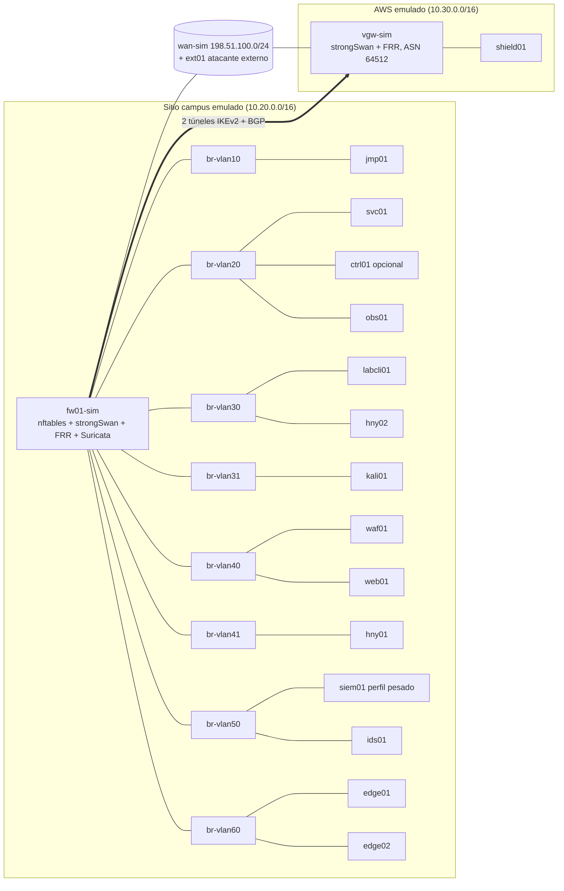

### F4.2 Equivalencias (qué se emula y qué no)

| En el diseño | En el Modo L | Equivalencia |
| --- | --- | --- |
| FW01 OPNsense | `fw01-sim`: Debian + nftables (reglas generadas del inventario) + strongSwan + FRR + Suricata | Funcional: mismas zonas, flujos, política por defecto, VPN y BGP. OPNsense no corre en contenedor (FreeBSD); si se quiere el producto real, se usa una VM en GNS3/EVE-NG |
| Port groups de ESXi | Bridges Linux por VLAN | Funcional |
| VGW de AWS | `vgw-sim`: strongSwan + FRR con los mismos parámetros de fase 1/2 y BGP | Funcional, sin el servicio gestionado |
| EC2-SHIELD | `shield01`: imagen `celeris-node` | Hasta que exista REQ-F-29, recibe solo tráfico de prueba directo |
| WAF01 / WEB01 | Contenedores Caddy + Coraza (CRS) / Nginx estático | Mismo producto |
| HNY01 / HNY02 | Contenedores Cowrie / OpenCanary | Mismo producto |
| SIEM01 | Wazuh single-node en contenedores | Mismo producto (perfil opcional por consumo de RAM) |
| Certificado público del portal | Certificado de una CA de laboratorio | El ACME real se prueba en Modo A o H |

### F4.3 Requisitos y operación

- **Host:** Linux con Docker y containerlab (WSL2 por validar). RAM: ≈ 6 GB sin Wazuh, ≈ 14 GB con Wazuh.
- **Levantar:** `sudo containerlab deploy -t lab/celeris.clab.yml`.
- **Probar:** `make test-lab` ejecuta `tests/network/*.yaml` y guarda resultados en `evidencias/<fecha>-L/`.
- **Demostrar en vivo (5 min):** T06 (LAB → MGMT denegado), T18 (SQLi → 403 + alerta en Wazuh), T05 (bajar un túnel y ver la convergencia BGP), T26 (captura del túnel sin datos del cliente).
- **Destruir:** `sudo containerlab destroy -t lab/celeris.clab.yml --cleanup`.

## F5. Modo A — AWS efímero

### F5.1 Arquitectura

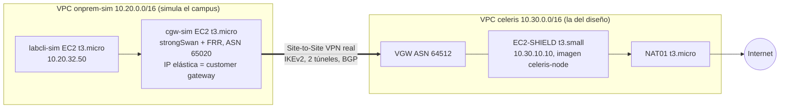

- La VPC `celeris` es **exactamente** la de D2.5 (subredes, rutas, SG, NACL). Lo único extra es `onprem-sim`.
- `cgw-sim` usa los mismos parámetros de D1.10. Tiene el *source/dest check* desactivado para enrutar hacia su VPC.
- Si la cuenta no habilita Site-to-Site VPN (Modo A'), el módulo `aws-vpn` se reemplaza por un segundo EC2 strongSwan en la VPC `celeris`; el resto no cambia.

### F5.2 Costo estimado por hora (us-east-1, referencial)

| Recurso | Cálculo | US$/h |
| --- | --- | ---: |
| Site-to-Site VPN | 1 conexión | 0,050 |
| EC2 cgw-sim, labcli-sim, NAT01 (t3.micro) + shield (t3.small) | 3 × ≈ 0,0104 + ≈ 0,0208 | ≈ 0,052 |
| IPv4 públicas (IP elástica del cgw-sim, NAT01, 2 IP de túnel) | 4 × 0,005 | 0,020 |
| EBS (4 × 8–20 GB gp3) | Prorrateado | ≈ 0,003 |
| **Total** | | **≈ 0,13 /h** |

Una sesión de 4 horas cuesta ≈ US$ 0,50, cubierto por los créditos del plan gratuito o de AWS Academy. El riesgo de costo no es la sesión, sino olvidar destruirla (RP-06).

### F5.3 Runbook de una sesión

1. Iniciar la sesión de la cuenta y exportar las credenciales temporales en el terminal (nunca en archivos del repositorio).
2. `tofu -chdir=deploy/opentofu/envs/demo init`
3. `tofu -chdir=deploy/opentofu/envs/demo apply -var region=us-east-1` (≈ 10 min; los túneles tardan unos minutos en quedar arriba).
4. `make test-aws` → ejecuta T01–T05, T21 y T26 contra las salidas de OpenTofu y guarda evidencias en `evidencias/<fecha>-A/`.
5. Demostración de failover: en `cgw-sim`, `swanctl --terminate --ike tunel1`; medir el tiempo hasta que el tráfico sigue por el túnel 2.
6. `tofu -chdir=deploy/opentofu/envs/demo destroy` y verificar con `aws ec2 describe-vpn-connections` que no queda nada.

## F6. Imagen de despliegue

| Artefacto | Qué es | Dónde se usa |
| --- | --- | --- |
| Imagen OCI `celeris-node` | `Dockerfile` multi-etapa: compila con Rust y entrega un binario estático en una imagen mínima, con usuario no root. Multi-arquitectura (amd64/arm64), firmada con cosign y con SBOM (REQ-NF-15). Publicada en GitHub Container Registry por el CI | Modo L, Modo A (vía cloud-init), VM del campus |
| `cloud-init` por rol | *user-data* que instala Docker, descarga la imagen fijada por *digest*, escribe la configuración y arranca el servicio | Modo A (shield, cgw-sim, NAT) y, en H2, VM de ESXi/Proxmox |
| Módulos OpenTofu | `aws-vpc`, `aws-vpn`, `aws-shield`, `onprem-sim`; entornos `demo` y `prod` | Modo A, producción |
| AMI / OVA con Packer (H2) | Imagen base endurecida con la imagen OCI ya descargada | Arranque más rápido; en AWS Academy las AMI propias se conservan entre sesiones |

**Por qué una imagen OCI y no una AMI primero:** la AMI es por región y por cuenta; si el laboratorio se reinicia o cambia la región, hay que volver a construirla. La imagen OCI es una sola y corre igual en la laptop, en EC2 y en el campus. La AMI queda como optimización.

## F7. Riesgos del laboratorio

| Riesgo | Respuesta |
| --- | --- |
| La sesión de AWS expira durante la demo | Modo L como demo principal; Modo A grabado como respaldo |
| La cuenta no permite crear la VPN | Modo A' (strongSwan ↔ strongSwan) |
| Recursos olvidados encendidos | `destroy` en el runbook, etiqueta `Ttl`, alarma de Budgets |
| Credenciales en el repositorio | gitleaks; credenciales solo en variables de entorno |
| El laboratorio emulado se presenta como si fuera el producto real | Tabla de equivalencias F4.2 en la presentación; se dice explícitamente qué se emula |
| Tráfico de ataque fuera del laboratorio | KALI01 y `ext01` solo existen dentro del laboratorio; nunca se apuntan a IP reales sin autorización escrita |
