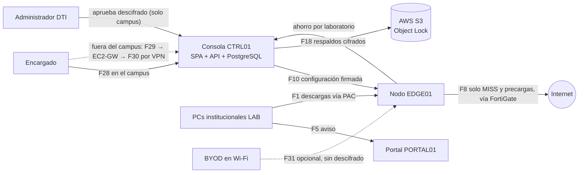

# Celeris Edge — 00 Marco común

**Caché de descargas para los laboratorios de cómputo del Campus Juliaca, administrada por el encargado del laboratorio.**

Este documento contiene **solo lo que comparten las tres áreas**: el problema, el alcance, los actores, la solución en una página, los supuestos, los identificadores y la matriz que une las áreas.

| Documento | Para qué |
| --- | --- |
| `Celeris-Que-es-el-proyecto.md` | Explicación general para cualquier lector |
| `Celeris-Arquitectura-v0.4.md` | Arquitectura definitiva: qué va en el campus y qué en la nube, y por qué |
| `Celeris-CE01-Gestion-TI.md` | CE01: diagnóstico, business case, plan de gestión, procesos |
| `Celeris-CE02-Ingenieria-Software.md` | CE02: requisitos y diseño del nodo y de la consola |
| `Celeris-CE03-Infraestructura.md` | CE03: diseño de red (CE0311) y de centro de datos híbrido (CE0331) |

**Regla de coherencia:** si un dato aparece en dos documentos, su fuente es la que indica la tabla M4.1. Los demás documentos lo citan por su ID. Para red, componentes, flujos y pruebas, la fuente final es `infra/*.yaml` del repositorio: **si un documento y el repositorio no coinciden, manda el repositorio** y se registra el cambio en `docs/infra/e1/CAMBIOS-INVENTARIO.md`.

## Registro de cambios

| Versión | Fecha | Cambio |
| --- | --- | --- |
| 0.1–0.2.1 | 17–18 nov 2026 | Documento maestro único |
| 0.3 | 22 nov 2026 | Alcance delimitado a laboratorios; encargado de laboratorio como actor central; división en 00 + CE01 + CE02 + CE03 |
| **0.4** | 22 nov 2026 | **Arquitectura definitiva.** Se incluyen BYOD y el Wi-Fi de estudiantes (sin descifrado); se incorpora el FortiGate existente; la consola completa queda en el campus y en AWS solo hay un gateway de acceso remoto (EC2-GW) y respaldos; simplificación de servicios; **los IDs se alinean con el repositorio** (F28–F32, T50–T60, S-26–S-30) |

---

## M1. Glosario común

| Término | Significado en este proyecto |
| --- | --- |
| **Caché** | Copia local de un archivo descargado. La primera PC que lo pide lo descarga de Internet; las siguientes lo reciben por la red interna. |
| **HIT / MISS** | El archivo se sirvió desde la caché / tuvo que descargarse de Internet. |
| **Byte hit ratio (BHR)** | Bytes servidos desde la caché ÷ bytes totales servidos. Es la medida directa del ahorro de Internet. |
| **Precarga** | Descargar con anticipación (de noche) lo que una clase va a necesitar. |
| **Coalescencia** | Si 40 PCs piden a la vez un archivo que no está en caché, solo una descarga va a Internet y las demás esperan esa copia. |
| **Nodo de caché (EDGE)** | Servidor del campus que guarda las copias y atiende a las PCs. |
| **Consola del encargado** | Aplicación web (pantallas + API + base de datos) donde el encargado configura contenido, laboratorios y precargas y ve el ahorro. Vive en el campus (CTRL01). |
| **Gateway de acceso remoto (EC2-GW)** | Proxy inverso en AWS que deja entrar al panel desde Internet sin publicar nada del campus. No guarda datos. |
| **Proxy explícito / PAC** | Las PCs piden sus descargas al nodo. El PAC (`wpad.dat`) les dice a qué nodo ir y que, si ninguno responde, vayan directo (`DIRECT`). |
| **Descifrado selectivo** | El nodo descifra HTTPS **solo** en dominios aprobados y **solo** en PCs institucionales con la CA del proyecto instalada con aviso previo. El Wi-Fi de estudiantes nunca se descifra. |
| **CA / Name Constraints** | Autoridad de certificación del proyecto, limitada técnicamente a los dominios aprobados. |
| **Configuración firmada** | La consola firma la configuración (ed25519); el nodo rechaza lo que no tiene firma válida. |
| **Portal de transparencia** | Página pública con el aviso y la huella de la CA, consultable **antes** de usar el proxy. |
| **BYOD** | Equipos personales de estudiantes en el Wi-Fi. |
| **FortiGate / FortiGuard** | Firewall perimetral existente de la universidad y su filtro web. |
| **Modo L / Modo A / Modo H** | Laboratorio emulado en una laptop / AWS efímero / campus real. |

## M2. El problema que se resuelve

### M2.1 Enunciado

> En los laboratorios de cómputo del Campus Juliaca, cada PC descarga por separado los mismos archivos grandes: actualizaciones del sistema operativo, instaladores del software de cada curso y paquetes. Cuando un laboratorio entero descarga a la vez, el enlace del campus se satura, las descargas tardan horas, las clases se retrasan y el resto del campus pierde ancho de banda. El FortiGate filtra qué sitios se pueden abrir, pero no evita que lo mismo se descargue 40 veces, y nadie en el laboratorio puede decidir qué conviene reutilizar ni medir cuánto se desperdicia.

### M2.2 Por qué ocurre (análisis completo en CE01 §B1.5)

| Causa raíz | Evidencia que se levanta |
| --- | --- |
| La misma descarga se repite en 40 PCs por laboratorio | Registro de descargas por laboratorio; contadores del FortiGate |
| Las descargas ocurren en horario de clase | Horario de laboratorios vs. picos del enlace |
| Casi todo viaja por HTTPS: la caché clásica no sirve | Muestra de tráfico por protocolo |
| No existe un rol ni una herramienta para decidir qué se reutiliza | Organigrama y entrevista a la DTI |

### M2.3 Qué se mejora y cómo se mide

| Dimensión | Indicador | Línea base | Meta | Detalle |
| --- | --- | --- | --- | --- |
| Ahorro de Internet | GB evitados por mes; BHR | A medir | BHR ≥ 25 % [S-04] | CE01 OB-1 |
| Ahorro de tiempo | Tiempo de **descarga** para dejar listo un laboratorio de 40 PCs | ≈ 1,8 h (ilustrativo) | −70 % | CE01 OB-2 |
| Autonomía del encargado | Tiempo para habilitar una fuente o un laboratorio | Días (solicitud a la DTI) | ≤ 5 min | CE01 OB-3 |
| Transparencia | PCs con aviso entregado antes de instalar la CA | 0 % | 100 % | CE01 OB-4 |
| Seguridad del servicio | Escenarios de abuso planificados detectados | — | ≥ 90 % en S2 | CE01 OB-5 |

### M2.4 Problema mayor (contexto, fuera del alcance de S1)

La universidad tiene además un riesgo académico: durante un examen, un estudiante puede usar IA o buscar respuestas, e intentar llegar a los sistemas de los docentes para robar exámenes o cambiar notas. FortiGuard bloquea categorías como redes sociales, pero no distingue un examen de una clase. El proyecto **no resuelve esto en S1**, pero la arquitectura deja la base para un futuro **modo examen** (Arquitectura v0.4 §15): control por laboratorio, configuración firmada y auditada, roles y filtrado por dominio sin descifrar.

## M3. Alcance

### M3.1 Incluye

- Los **laboratorios de cómputo** del Campus Juliaca y sus PCs institucionales [S-01, S-26].
- Los **dispositivos personales (BYOD) y el Wi-Fi de estudiantes**, con perfil sin descifrado y proxy opcional (CE03 D1.9).
- El servicio de caché: nodos, consola del encargado, portal de transparencia.
- La seguridad de **todo el trayecto de los datos**: firewall, segmentación, cifrado por tramo, firma de la configuración, detección y respaldo (Arquitectura v0.4 §8).
- AWS para lo que el campus no puede hacer solo: acceso remoto al panel sin publicar el campus y respaldos inmutables fuera del sitio.

### M3.2 Excluye (con justificación)

| Excluido | Por qué |
| --- | --- |
| Descifrar tráfico de BYOD | No se puede garantizar consentimiento ni instalación controlada de la CA en equipos ajenos |
| Rediseño del FortiGate, del Wi-Fi y de la capa de acceso | Son de la DTI. Se documentan AS-IS y se piden cambios mínimos [S-14, S-28, S-29] |
| Red administrativa y PCs de docentes | Fuera del piloto; LAB y Wi-Fi no alcanzan las zonas del proyecto |
| Modo examen | Plan futuro (M2.4) |
| Shield de caché en AWS (D-19) | Un MISS servido desde AWS igual cruza el enlace del campus |
| Varias sedes, modo ISP, publishers aliados, CE04 | Trabajo futuro |

### M3.3 Actores y roles

| Actor | Quién es | Qué puede hacer | Dónde se detalla |
| --- | --- | --- | --- |
| **Encargado de laboratorio** | Responsable del laboratorio | Definir qué contenido se cachea (`cachear`), habilitar sus laboratorios y horarios, programar precargas, ver el ahorro, publicar el aviso. Desde ENC01 o, fuera del campus, por EC2-GW | CE02 C1.1 |
| **Administrador DTI** | Técnico de infraestructura | Operar nodos, red y CA; **aprobar** fuentes que requieren descifrado (solo desde el campus); habilitar el perfil Wi-Fi | CE02 C1.1, CE03 |
| **Usuario de laboratorio** | Estudiante o docente en una PC institucional | Navegar y descargar; consultar el portal | CE02 C1.1 |
| **Usuario BYOD** | Estudiante con equipo propio en el Wi-Fi | Usar el proxy de forma opcional (sin descifrado); consultar el portal | CE02 C1.1 |
| **Auditor** | Docente evaluador, oficial de datos personales | Leer el aviso, los reportes y la auditoría | CE02 C1.1 |
| *Docente (futuro)* | Docente a cargo de un examen | Activar el modo examen en su laboratorio y horario (H2/H3) | Arquitectura v0.4 §15 |

## M4. La solución en una página

| Pieza | Dónde | Qué hace | Estado en el repositorio | Área |
| --- | --- | --- | --- | --- |
| Nodo de caché (`celeris-node`) | Campus | Cachea HTTP y HTTPS aprobado, coalesce, verifica integridad, sirve el PAC | **Existe** (`celeris-cache`); en ramas: PAC, eliminación de cabeceras, TLS en administración, `Cache-Status` | CE02, CE03 |
| Consola del encargado (`celeris-console`) | Campus (CTRL01) | Contenido, laboratorios, precargas, aprobaciones, ahorro, auditoría | No existe; prototipo de la v0.2 en la rama de CE02 | CE02 |
| Portal de transparencia | Campus (DMZ) | Aviso y huella de la CA antes del uso | Parcial (`notice.rs`) | CE02, CE03 |
| Gateway de acceso remoto (EC2-GW) | AWS | Entrada pública al panel, sin datos | Diseño | CE03 |
| Respaldos | AWS S3 | Copia cifrada e inmutable | Diseño | CE03 |
| Red y seguridad | Campus + AWS | Zonas, FW01, VPN, detección | Diseño + laboratorio emulado | CE03 |

### M4.1 Fuente de cada dato compartido

| Dato | Fuente única | Lo citan |
| --- | --- | --- |
| Problema, alcance, actores, supuestos, contrato de IDs | Este documento (00) | Todos |
| Por qué cada componente y dónde vive | `Celeris-Arquitectura-v0.4.md` | Todos |
| Objetivos (OB-x), costos, beneficios, riesgos (RE-x, RP-x), procesos (P1, P2) | CE01 | CE02, CE03 |
| Requisitos (REQ-x), casos de uso, pantallas, ADR de software | CE02 | CE01, CE03 |
| IP, VLAN, componentes, flujos (F-x), pruebas (T-x), amenazas (AM-x), detecciones (DET-x), VM, AWS | **Repositorio `infra/*.yaml`**; CE03 los documenta | CE01, CE02 |

## M5. Registro de supuestos

Los S-16 a S-19 y S-25 ya tienen uso en el repositorio (desfase de reloj, ruta honey-URL, restic de laboratorio, destinos de F27, laboratorio). Los nuevos empiezan en S-26.

| ID | Supuesto | Valor usado | Cómo validarlo | Resp. |
| --- | --- | --- | --- | --- |
| S-01 | PCs de laboratorio en alcance | 400 | Inventario de la DTI | Henyelrey |
| S-02 | Enlace a Internet del campus | 300 Mbps simétricos | Contrato / medición | Henyelrey |
| S-03 | Costo de 1 Mbps adicional | US$ 8 por Mbps-mes | Cotización del ISP | Henyelrey |
| S-04 | BHR alcanzable | 30 % | Registros del piloto | Nick |
| S-05 | Tráfico mensual de los laboratorios | ≈ 19,4 TB | Contadores del FortiGate | Henyelrey |
| S-06 | Ciclos de actualización masiva por año | 2 por PC | Calendario de la DTI | Henyelrey |
| S-07 | Horas técnicas ahorradas por PC y ciclo | 0,25 h a US$ 5/h | Entrevista a técnicos | Henyelrey |
| S-08 | Servidor físico (12 núcleos, 96 GB, 2 × 1,92 TB + 2 × 1 TB NVMe) | US$ 3 800 si se compra | Cotización | Nick |
| S-09 | Tarifa eléctrica | US$ 0,15 por kWh | Recibo del campus | Nick |
| S-10 | COK | 12 % anual | Área de finanzas | Henyelrey |
| S-11 | Región AWS | us-east-1 (variable `var.region`) | mtr desde Juliaca | Nick |
| S-12 | Precios AWS | Lista pública de noviembre de 2026 | AWS Pricing Calculator | Nick |
| S-13 | Cuenta AWS del laboratorio | AWS Academy Learner Lab o cuenta con créditos | Confirmar con el docente | Nick |
| S-14 | Capa de acceso y DHCP de laboratorios | Existentes, con 802.1Q | Levantamiento con la DTI | Henyelrey |
| S-15 | IP pública fija del campus | 203.0.113.10 (documentación), en el FortiGate | Contrato con el ISP | Henyelrey |
| S-16…S-19, S-25 | Supuestos del laboratorio y de F27 | Ver `CAMBIOS-INVENTARIO.md` del repositorio | — | Nick |
| S-26 | Laboratorios en alcance | 10 laboratorios × 40 PCs | Inventario de la DTI | Henyelrey |
| S-27 | Volumen de una actualización o instalación masiva | 3 GB por PC | Registro de un ciclo real | Henyelrey |
| S-28 | Wi-Fi de estudiantes | Red de la DTI; valor provisional 172.16.0.0/16; la DTI decide si publica el PAC por DHCP (opción 252) | Levantamiento con la DTI | Henyelrey |
| S-29 | FortiGate | Tiene la IP pública, hace NAT 1:1 a FW01 (UDP 500/4500, TCP 80/443) por la red de tránsito 10.20.0.0/29 y excluye EDGE01/02 de la inspección SSL; el pedido a la DTI incluye TCP 22 y 23 hacia HNY01 en la ventana del señuelo (F24): si lo niega, HNY01 solo ve tráfico interno | Reunión con la DTI | Henyelrey |
| S-30 | IAM para respaldos | La cuenta permite una credencial de solo escritura en el bucket | Confirmar con el docente | Nick |
| S-31 | Certificado del portal | El FortiGate permite a FW01 llegar a los endpoints ACME de la CA elegida (TCP 443 y 80); PORTAL01 no sale a la WAN | Reunión con la DTI y prueba de renovación en el Modo H (T49) | Henyelrey |
| S-32 | Nombre del portal | El FQDN público lo entrega la DTI; hasta entonces el diseño y las pruebas usan el nombre de trabajo `portal.celeris.internal` y el Modo H lo sustituye por el real | La DTI entrega el dominio y FW01 emite el certificado por ACME (T16, T49) | Henyelrey |
| S-33 | Carga esperada de EC2-GW | 10 sesiones simultáneas del panel (una por laboratorio, derivadas de S-26), 5 solicitudes por segundo, 0,10 vCPU de media y 512 MiB de RAM | Medición con el piloto en S2; si supera la línea base del t3.micro, pasar a t3.small | Nick |
| S-34 | Plazo de reposición del servidor físico | Sin plazo definido; el que acuerde la DTI (garantía, repuesto o servidor de contingencia) | Confirmar con la DTI antes de S2; es el plazo que antecede a la restauración de la consola y la caché tras la caída de ESX01 | Henyelrey |
| S-35 | Contingencia de los laboratorios si cae ESX01 | Cae FW01, así que `DIRECT` no basta: la DTI devuelve la puerta de enlace de la VLAN 30 al FortiGate (estado previo al proyecto) y los laboratorios navegan sin caché; RTO objetivo de 30 min. FW01 es hoy el DNS de los laboratorios: la DTI entrega también un resolvedor | Confirmar con la DTI antes de S2 y ensayarlo y cronometrarlo en S2 | Henyelrey |

> Un supuesto que no se valida se declara como limitación en el informe. Nunca se presenta como dato.

## M6. Contrato de identificadores

| Prefijo | Qué identifica | Definido en | Rango vigente |
| --- | --- | --- | --- |
| S-xx | Supuesto | 00 M5 | S-01…S-35 |
| OB-x | Objetivo del proyecto | CE01 B2.1 | OB-1…OB-5 |
| RE-xx / RP-xx | Riesgo estratégico / de proyecto | CE01 B1.8 / B3.6 | RE-01…RE-12 / RP-01…RP-07 |
| P1, P2 | Proceso | CE01 B4 | — |
| REQ-F / NF / RN | Requisito | CE02 C1 | F-01…F-37, NF-01…NF-16, RN-01…RN-11 |
| CU-xx / P-xx | Caso de uso / pantalla | CE02 | CU-01…CU-11 / P-01…P-10 |
| D-xx | Decisión de arquitectura | CE02 C3.4 y CE03 D3 (misma numeración) | D-01…D-29 |
| OD-xx, AM-xx, DET-xx | Objetivo de diseño, amenaza, detección | `infra/trazabilidad.yaml`; CE03 | Los del repositorio prevalecen |
| F-xx | Flujo de red | `infra/inventory.yaml`; CE03 D1.11 | F1…F32 (F4 reservado; F9, F11, F12, F15, F16, F17, F19, F22 retirados) |
| T-xx | Prueba planeada | `infra/pruebas.yaml`; CE03 D1.16 | T01…T60 (8 retiradas) |
| CI-xx | Entrada del registro de cambios del inventario | `docs/infra/e1/CAMBIOS-INVENTARIO.md` | CI-01…CI-63 |
| Componentes | `FW01`, `EDGE01`, `CTRL01`, `EC2-GW`, … | `infra/inventory.yaml`; CE03 D1.12 | — |

**Regla:** un ID retirado no se reutiliza. Un ID nuevo se pide en `CAMBIOS-INVENTARIO.md` antes de usarlo en un documento.

## M7. Matriz de correlación entre áreas

| Necesidad (00) | Objetivo (CE01) | Proceso | Requisitos (CE02) | Componentes y flujos (CE03) | Prueba |
| --- | --- | --- | --- | --- | --- |
| Descargar una vez y servir muchas | OB-1 | P1, P2 | REQ-F-03, F-05, F-06 | EDGE01/02; F1, F8 | T07, T55 |
| Contenido listo antes de la clase | OB-2 | P2 | REQ-F-22, F-34, RN-10 | EDGE01, CTRL01; F8, F10 | T50 |
| Que el encargado decida qué se cachea | OB-3 | P2 | REQ-F-31, RN-07 | CTRL01, ENC01; F28, F10 | CU-03, T51 |
| Que el encargado decida quién accede | OB-3 | P1, P2 | REQ-F-10, F-32 | EDGE01 (`allowed_clients`), rangos /26; F1 | T13, T52 |
| Administrar desde fuera del campus sin exponerlo | OB-3, OB-5 | — | REQ-F-33, F-37 | EC2-GW, VPN; F29, F30 | T53, T54, T58 |
| Que el usuario sepa qué se descifra | OB-4 | — | REQ-F-12, F-30, RN-05 | PORTAL01; F5, F21, F32 | T15–T18 |
| Que el BYOD nunca se descifre | OB-4 | — | REQ-F-36 | EDGE01; F31 | T56 |
| Que el Wi-Fi no alcance los servidores | OB-5 | — | — | FW01; WIFI-EST | T57 |
| Que nadie use el proxy para otra cosa | OB-5 | — | REQ-F-11, F-15 | EDGE01, FW01, SIEM01 | T13, T14 |
| Detectar ataques (DMZ, honeypot, intra-laboratorio) | OB-5 | — | REQ-F-14 | FW01 (Suricata), HNY01, HNY02, SIEM01; F13, F14, F24 | T11, T29, T30 |
| Que la configuración no se altere | OB-5 | — | REQ-F-17, RN-08 | CTRL01, EDGE01; F10 | T51 |
| Medir el ahorro por laboratorio | OB-1, OB-2 | P1, P2 | REQ-F-25 | CTRL01; F10 | P-02 |
| Que la navegación no dependa de un equipo | OB-2 | — | REQ-NF-03, F-26 | EDGE01 + EDGE02 + `DIRECT` | T09 |
| Que la configuración no se pierda | — | — | REQ-F-24 | CTRL01, S3; F18 | T40, T59 |

## M8. Estado actual del repositorio (revisado el 22 nov 2026)

| Rama | Autor | Contenido | Diseño que refleja |
| --- | --- | --- | --- |
| `main` | — | 2 commits: nodo de caché y entorno inicial | — |
| `e1/codigo-lab` | Nick | Fuente única `infra/*.yaml`, validador, generadores (nftables, VPN, PAC), imagen OCI, laboratorio containerlab | v0.2 |
| `e1/matriz-pruebas` | Nick | Lo anterior + IaC OpenTofu, PAC en el nodo, REQ-F-28, TLS en 9128, shield (REQ-F-29), `Cache-Status`, matriz de pruebas XLSX; **ensayo Modo L: 31 PASA, 0 FALLA, 1 PARCIAL, 17 NO_APLICA (49 pruebas)** | v0.2 |
| `e1/diagramas` | Henyelrey | Diagramas draw.io generados del inventario + V-50…V-56 | v0.2 |
| `e1/matriz-componentes` | Henyelrey | Matriz de componentes XLSX + V-60…V-66 | v0.2 |
| `ce02/e1-requerimientos-diseno` | Henyelrey | Prototipo navegable P-01…P-10, 13 diagramas PlantUML, SNI = CONNECT, CI de Rust | v0.2 |

**Lectura:**
- Hay mucho avance, pero **ninguna rama está fusionada** y todas reflejan la v0.2. La fusión de prueba da 6 conflictos.
- El nodo de caché está avanzado. Falta lo que lo convierte en una herramienta del encargado: la consola, la configuración firmada, la precarga y el filtro por red de origen.

**Siguiente paso:** fusionar en `main` y aplicar CI-30…CI-38 (CE03 D7; prompts en `Prompts-Infraestructura-v0.4.md`).

## M9. Cronograma integrado S1 (desde hoy)

| Semana | CE01 (Henyelrey) | CE02 (Nick) | CE03 red (Henyelrey) | CE03 DC y laboratorio (Nick) |
| --- | --- | --- | --- | --- |
| S1 | Recalcular business case v0.4 | Actualizar SRS (F-36, F-37) | Fusión de ramas + CI-30…37 en el inventario | Fusión de ramas + laboratorio v0.4 |
| S2 | Plan de gestión y riesgos | Prototipo de la consola v0.4 | Diagramas y matrices regenerados | Ensayo Modo L v0.4 + IaC EC2-GW |
| S3 | AS-IS / TO-BE | C4, ADR, UML | Informe CE0311 | Informe CE0331 |
| S4 | Consolidado S1, auditoría y ensayo de sustentación (ambos) | | | |

## M10. Mapa rúbrica → documento

| Entregable | Rúbrica oficial | Documento y sección |
| --- | --- | --- |
| CE01 E1 Diagnóstico y alineamiento | 4 criterios | CE01 B1 |
| CE01 E2 Business case | 4 criterios | CE01 B2 |
| CE01 E3 Plan de gestión | 7 criterios | CE01 B3 |
| CE01 E4 AS-IS / TO-BE | 4 criterios | CE01 B4 |
| CE02 E1 Requerimientos y diseño | 7 criterios | CE02 C1–C5 |
| CE03 E1 Diseño de red | 8 criterios (100 %) | CE03 D1 |
| CE03 E2 Centro de datos híbrido | 8 criterios (100 %) | CE03 D2 |

## M11. Ética y privacidad (común a las tres áreas)

| Principio (Código ACM) | Cómo lo cumple el proyecto |
| --- | --- |
| 1.2 Evitar daño | Si la política falla, el nodo no descifra; bancos, inicios de sesión y plataformas con sesión nunca se descifran |
| 1.3 Ser honesto | Portal de transparencia generado de la configuración real, consultable antes del uso |
| 1.6 Respetar la privacidad | Sin cookies, credenciales, cuerpos ni parámetros de URL; el ahorro se reporta por laboratorio, no por persona; los datos de uso no salen del campus; el BYOD nunca se descifra |
| 2.8 Acceder solo con autorización | Descifrado solo en PCs institucionales de laboratorios habilitados, con aviso previo; pruebas de ataque solo en ventanas autorizadas |

Marco legal: Ley 29733 y su reglamento (D.S. 016-2024-JUS, vigente desde marzo de 2025): aviso previo, minimización y evaluación de impacto antes del piloto.
