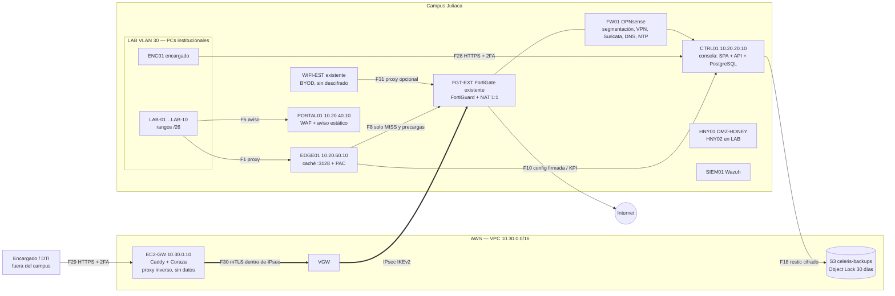

# Celeris Edge — Arquitectura definitiva v0.4

## 0. Glosario

| Término | Qué significa aquí |
| --- | --- |
| **Nodo de caché (EDGE)** | Servidor del campus que hace de proxy: descarga una vez de Internet y entrega la copia por la LAN a todas las PCs que la pidan. |
| **Consola** | Aplicación web del encargado: backend (API en Rust) + frontend (SPA, archivos estáticos) + base de datos PostgreSQL. Decide qué se cachea y qué laboratorio tiene acceso. |
| **Frontend / backend** | Frontend: lo que corre en el navegador (pantallas). Backend: la API que guarda los datos, aplica permisos y firma la configuración. |
| **Proxy inverso (gateway)** | Servidor que recibe conexiones de Internet y las reenvía a un servidor interno. No guarda datos ni lógica. Aquí: EC2-GW en AWS. |
| **Configuración firmada** | La consola firma la configuración con una llave ed25519. El nodo solo aplica lo que trae una firma válida, aunque alguien altere el archivo en el camino. |
| **mTLS** | TLS en el que cliente y servidor presentan certificado. Sirve para que la consola sepa que quien llama es el nodo o el gateway, y no otro equipo. |
| **Descifrado selectivo** | El nodo abre (descifra) el HTTPS solo de los dominios aprobados y solo en PCs institucionales que tienen instalada la CA del proyecto. Todo lo demás pasa cifrado. |
| **Passthrough** | El nodo reenvía la conexión HTTPS sin abrirla. No la puede cachear, pero sí sabe a qué dominio va. |
| **BYOD** | *Bring your own device*: laptops y celulares de los estudiantes, conectados al Wi-Fi. |
| **FortiGate / FortiGuard** | Firewall perimetral que ya tiene la universidad (FortiGate) y su servicio de filtrado web (FortiGuard), que hoy bloquea redes sociales y otras categorías. |
| **Trayecto de los datos** | El camino completo que recorre un dato: desde que nace (origen, encargado, nodo) hasta que se usa o se guarda (PC, consola, respaldo). |
| **Modo examen** | Función futura: durante un examen, el docente limita lo que un laboratorio puede abrir (solo material educativo, sin IA ni otros sitios). No se implementa en S1. |

---

## 1. Respuesta corta: ¿qué va en la nube?

**Ni el frontend ni el backend van en la nube.** La consola completa (SPA, API y base de datos) vive en el campus, en CTRL01.

En AWS van **dos cosas**, cada una porque resuelve algo que el campus no puede resolver solo:

| En AWS | Para qué | Por qué en la nube y no en el campus |
| --- | --- | --- |
| **EC2-GW** (proxy inverso, sin datos) | Entrada pública al panel para el encargado y la DTI cuando están fuera del campus | Si el panel se publicara en el campus, cualquier escaneo o ataque desde Internet consumiría el mismo enlace que el proyecto quiere liberar, y el servidor que firma la configuración quedaría expuesto. En AWS, el tráfico hostil se queda en AWS y al campus solo llega, por la VPN, lo que pasó el filtro. |
| **S3 `celeris-backups`** con Object Lock | Copia de la base de la consola y de la configuración, fuera del sitio e inmutable por 30 días | Un incendio, un robo del servidor o un atacante con acceso de administrador en el campus no puede borrar ni modificar esa copia. |

La **VPN IPsec** une las dos partes. No es un adorno para la rúbrica: transporta el tráfico del panel remoto (F30) y los eventos de EC2-GW hacia el SIEM (F13).

### 1.1 Por qué el backend no va en AWS

| Razón | Explicación |
| --- | --- |
| El nodo depende de la consola | El nodo consulta su configuración firmada cada 30 s. Si la consola estuviera en AWS, una caída del enlace o de la VPN dejaría al nodo sin poder recibir cambios justo cuando el enlace está mal, que es cuando más se necesita la caché. |
| La llave que firma vive donde está el control físico | La llave ed25519 decide qué aplica cada nodo. Fuera del campus habría una superficie de ataque más que proteger (cuenta AWS, IAM, instancia pública). |
| Datos personales | La base guarda uso por laboratorio y registros con IP de equipos del campus. En el campus no hay flujo transfronterizo (Ley 29733). |
| Costo y latencia | Base y API en AWS 24×7 cuestan más que una VM más en el host que ya existe. El encargado en el campus (ENC01) habla con CTRL01 sin salir a Internet. |

### 1.2 Por qué el frontend tampoco va en AWS (S3 + CloudFront)

La SPA son archivos estáticos sin secretos: protegerla no aporta seguridad, porque lo sensible es la API. Separarla en S3 obligaría a abrir CORS, a manejar dos dominios y a publicar la API de todos modos. Servida desde el mismo origen que la API (CTRL01, y a través de EC2-GW cuando se entra desde fuera), las cookies quedan en el mismo sitio y la política CSP puede ser `default-src 'self'`.

### 1.3 Alternativas evaluadas para el acceso remoto

| Opción | A favor | En contra | Decisión |
| --- | --- | --- | --- |
| **A. EC2-GW en AWS + VPN** (D-24) | El campus no publica nada para el panel; el ataque consume AWS, no el enlace; la VPN tiene un uso real | Depende de la VPN: si cae, el panel remoto no funciona (el local sí) | **Elegida** |
| B. DNAT del campus a CTRL01 (o vía WAF01 en la DMZ) | Más simple, sin AWS | Expone el servidor que firma y consume el enlace del campus | Descartada |
| C. VPN de acceso remoto (WireGuard en OPNsense) | Nada público | Hay que instalar un cliente en cada equipo del encargado; no deja una URL simple | Alternativa válida si la DTI no aprueba EC2-GW |
| D. Túnel de un tercero (Cloudflare Tunnel, Tailscale) | Muy rápido de montar | Dependencia de un proveedor externo; la rúbrica pide VPN propia | Descartada para el EPE |
| E. Sin acceso remoto (solo ENC01) | Lo más seguro | El encargado no puede actuar fuera del horario de campus | Es el modo degradado cuando la VPN cae |

---

## 2. Alcance

| Incluye | Detalle |
| --- | --- |
| Laboratorios de cómputo del Campus Juliaca | 10 laboratorios × 40 PCs institucionales [S-26], cada uno con su rango /26 |
| **Dispositivos personales (BYOD) y Wi-Fi de estudiantes** | Nuevo en v0.4. Se integran como una zona con **perfil sin descifrado** (sección 9) |
| Servidores del proyecto | Host ESXi con las VM de la sección 10 |
| AWS | VPC con EC2-GW, S3 de respaldos y la VPN |
| Seguridad del trayecto completo de los datos | Sección 8 |

| Excluye | Por qué |
| --- | --- |
| Rediseño del FortiGate y de la red Wi-Fi existente (APs, controlador, DHCP del Wi-Fi) | Son de la DTI. Se documentan AS-IS y se piden los cambios mínimos [S-28, S-29] |
| Red administrativa y PCs de docentes | Fuera del piloto. Se protegen indirectamente: LAB y Wi-Fi no pueden alcanzar las zonas del proyecto (sección 6) |
| Modo examen | Plan futuro (sección 15). La v0.4 deja preparados los ganchos, sin implementarlo |
| Descifrar tráfico de BYOD | No se puede garantizar consentimiento ni instalación controlada de la CA en equipos que la universidad no administra |

---

## 3. Vista general



**Cómo interactúan, en una frase cada uno:**

1. El encargado define fuentes, laboratorios y precargas en la consola (desde ENC01 o, fuera del campus, entrando por EC2-GW).
2. La consola compila esa configuración, la firma y la deja disponible para el nodo.
3. El nodo la descarga por mTLS (F10), verifica la firma y la aplica.
4. Las PCs de los laboratorios habilitados descargan a través del nodo; solo los MISS salen a Internet, pasando por el FortiGate, que sigue aplicando FortiGuard.
5. Nodo, firewall, portal, honeypots y EC2-GW envían eventos al SIEM.
6. La consola respalda su base cifrada en S3.

---

## 4. Componentes y por qué existe cada uno

### 4.1 Campus

| ID | Ubicación | Función | Por qué existe | Si falla |
| --- | --- | --- | --- | --- |
| **EDGE01** | VLAN 60, 10.20.60.10 | Nodo de caché (`celeris-node`), sirve también el PAC | Es la solución al problema: una descarga entra una vez por el enlace y se reparte por la LAN. Ya existe y funciona (prueba T07 PASA en el Modo L) | Las PCs pasan a `DIRECT` por el PAC: siguen navegando, sin ahorro |
| EDGE02 | VLAN 60, 10.20.60.11 | Segundo nodo (fase 2) | Quita el único punto de falla de la caché cuando el piloto crezca | — |
| **CTRL01** | VLAN 20, 10.20.20.10 | Consola: SPA + API (axum) + PostgreSQL local + CA interna (step-ca) | El encargado necesita un lugar para decidir qué se cachea y quién accede, y el nodo necesita una configuración firmada que no se pueda alterar | El nodo sigue con la última configuración válida; no se pueden hacer cambios |
| **FW01** | Entre el FortiGate y las zonas del proyecto | OPNsense: ruteo entre zonas con *deny-all*, VPN a AWS, Suricata IPS, DNS (Unbound con DNSSEC) y NTP | Es el control que separa laboratorios, servidores, DMZ y gestión. Sin él la red es plana y un estudiante puede llegar a la consola | Sin ruteo entre zonas; recuperación por *break-glass* y XML en Git (RTO 1 h) |
| **PORTAL01** | DMZ-SVC, 10.20.40.10 | Caddy + Coraza (OWASP CRS) sirviendo el aviso de transparencia como sitio estático firmado | El usuario debe poder leer qué se descifra y verificar la huella de la CA **antes** de usar el proxy. Es el servicio protegido que exige la DMZ de la rúbrica | Las PCs ya enroladas siguen funcionando; no se pueden enrolar nuevas |
| **HNY01** | DMZ-HONEY, 10.20.41.20 | Honeypot Cowrie (SSH/Telnet señuelo) | Lo exige la rúbrica (criterio 5 en S1, criterio 4 en S2). Cuesta 1 vCPU | Se pierde una fuente de detección |
| **HNY02** | LAB, 10.20.35.250 | Canary interno | El firewall no ve el tráfico entre PCs de la misma VLAN. Un estudiante que escanee el laboratorio (por ejemplo, buscando el equipo del docente) toca el canary | Se pierde visibilidad intra-VLAN |
| **SIEM01** | SECURITY, 10.20.50.10 | Wazuh: correlación y alertas | Sin un lugar donde se junten los eventos, las detecciones no tienen quien las vea. Las alertas incluyen IP del campus, por eso queda en el campus | Se pierden alertas; los equipos siguen funcionando |
| **JMP01** | MGMT, 10.20.10.20 | Jump host de la DTI con MFA | Única puerta de administración: nadie administra servidores desde LAB ni desde Wi-Fi | Administración por consola local del host |
| **ENC01** | LAB infra, 10.20.35.10 | PC del encargado de laboratorio | El encargado opera la consola sin recibir acceso a la red de gestión | Usa el acceso remoto por EC2-GW |
| LABCLI01 | LAB infra, 10.20.35.50 | Cliente Windows de prueba | Prueba lo que ve una PC real (GPO, CA, PAC) | — |
| KALI01 | LAB infra, 10.20.35.60 | Equipo de pruebas de ataque, apagado fuera de ventanas autorizadas | Las pruebas de S2 deben cruzar el firewall desde la zona de usuarios | — |
| ESX01, SW-CORE01, IPMI01, UPS01, BRK01 | MGMT | Host, switch, gestión fuera de banda, UPS, puerto de emergencia | Base física del centro de datos (CE0331) | Ver continuidad (sección 11) |
| FGT-EXT | Perímetro del campus | FortiGate existente (fuera de alcance) | Ya filtra con FortiGuard y tiene la IP pública. Reemplazarlo sería sobreingeniería y no lo controla el equipo | Todo el campus sin Internet; no depende del proyecto |
| SW-ACC, WIFI-EST | Existentes | Switches de acceso y red Wi-Fi de la DTI | Se documentan AS-IS; se piden controles mínimos [S-14, S-28] | — |

### 4.2 AWS

| ID | Ubicación | Función | Por qué existe | Si falla |
| --- | --- | --- | --- | --- |
| **EC2-GW** | Subred pública `pub-a`, 10.30.0.10, t3.micro | Caddy con certificado público (ACME), Coraza CRS, límite de intentos; reenvía solo la consola hacia CTRL01:443 por la VPN con un certificado de cliente | Ver 1.3. No guarda datos ni llaves de firma: si se compromete, se destruye y se recrea con OpenTofu en 15 min | Solo se pierde el acceso remoto; la consola local sigue |
| **VGW + 2 túneles** | VPC | Extremo AWS de la VPN IPsec IKEv2, activo/pasivo con BGP | Transporta F30 y F13; lo exige la rúbrica de conectividad híbrida | Panel remoto caído; el campus no se entera |
| **S3 `celeris-backups`** | Regional | Respaldos cifrados por restic, versionado y Object Lock (30 días, modo *compliance*) | Copia fuera del sitio que nadie del campus puede borrar | Se pierde la copia externa; queda la local |
| Subred privada `app-a` | 10.30.10.0/24 | Vacía en operación normal. En el simulacro de recuperación (CE0333) se crea ahí una EC2 temporal que restaura la consola desde S3, con una instancia NAT temporal | La rúbrica de S2 pide recuperar un recurso AWS y mostrar NAT, sin pagar 24×7 por ello | — |

---

## 5. Qué se retira respecto del repositorio (v0.2) y de la v0.3

| Retirado | Por qué | Qué cubre ahora su función | ¿Afecta a la rúbrica? |
| --- | --- | --- | --- |
| EC2-SHIELD, F9 (D-19) | Un segundo nivel de caché en AWS no ahorra enlace del campus: los MISS igual cruzan el enlace | — | No |
| EC2-CTRLR, F16 (réplica en espera) | La continuidad por respaldo en S3 basta para un RTO de 2 h | S3 + restauración (T59) | No: la recuperación de un recurso AWS se muestra en el simulacro |
| NAT01 permanente | EC2-GW está en la subred pública; nada privado corre 24×7 | NAT temporal en el simulacro | No |
| DB01, F15 | Una base pequeña no justifica otra VM; PostgreSQL se usa por socket local, sin red | CTRL01 | No: la prueba "DMZ → BD" de S2 apunta a CTRL01:5432 (denegada) |
| OBS01, F11, F12 | La consola recibe los KPI del nodo por F10; las alertas van a Wazuh; las métricas de AWS, a CloudWatch | CTRL01, SIEM01, CloudWatch | No |
| SVC01, F25 (con origen SVC01) | Si FW01 cae no hay ruteo, así que un DNS "secundario" en FW01 no daba redundancia real | DNS y NTP en FW01; el PAC lo sirve el nodo (`pac.rs`, ya implementado) | No |
| WAF01 + WEB01 → PORTAL01, F22 | El sitio es estático: el WAF y los archivos caben en una VM con sistema de archivos de solo lectura | PORTAL01 | No: sigue habiendo un servicio publicado detrás de un WAF en la DMZ |
| IDS01 | Suricata ya corre inline en FW01 (WAN, DMZ y LAN); los puntos ciegos intra-VLAN los cubre HNY02 | FW01, HNY02 | No: hay IDS/IPS y honeypot |
| PROBE01 | Sonda sintética: útil pero no necesaria para el problema | T09 mide el cambio a `DIRECT` | No |
| NAS01, VLAN 70 y 71, F17, F19 | Un solo host con datastore local no necesita NFS; el respaldo va a S3 | Copia local en el datastore + S3 | No |
| VLAN 31 LAB-TEST | KALI01 cabe en el rango de infraestructura de LAB, apagado fuera de ventanas | 10.20.35.60 | No |

**Lo que la propuesta retiraba y se mantiene:** el honeypot HNY01 y su DMZ-HONEY (la rúbrica lo nombra en los criterios 5 de S1 y 4 de S2) y el canary HNY02 (cubre el robo de exámenes dentro del laboratorio, el tráfico que el firewall no ve).

---

## 6. Red

### 6.1 Posición frente al FortiGate (D-26)

```text
Internet ── FGT-EXT (FortiGate, IP pública 203.0.113.10 [S-15]) ── tránsito 10.20.0.0/29 ── FW01 ── zonas del proyecto
                                                    └── red del campus y Wi-Fi (DTI)
```

- FW01 se conecta al FortiGate por una red de tránsito: FortiGate 10.20.0.1, FW01 10.20.0.2 [S-29].
- El FortiGate hace NAT 1:1 de la IP pública hacia FW01 solo para: UDP 500/4500 (IPsec con NAT-T) y TCP 80/443 hacia PORTAL01. El identificador IKE de FW01 es la IP pública.
- La salida a Internet del nodo (F8) sigue pasando por FortiGuard: la caché solo guarda lo que la política institucional ya permite.
- **Pedido a la DTI:** excluir EDGE01/02 de la inspección SSL profunda del FortiGate. Si el FortiGate abre el TLS, el nodo no puede verificar el certificado real del origen [S-29].

### 6.2 Zonas y VLAN

| VLAN | Zona | Red | Contenido |
| ---: | --- | --- | --- |
| 10 | MGMT | 10.20.10.0/24 | ESX01, SW-CORE01, IPMI01, UPS01, JMP01, BRK01 |
| 20 | SERVERS | 10.20.20.0/24 | CTRL01 |
| 30 | LAB | 10.20.32.0/22 | LAB-01 10.20.32.0/26 … LAB-10 10.20.34.64/26; reserva 10.20.34.128/25; infraestructura 10.20.35.0/24 (ENC01 .10, LABCLI01 .50, KALI01 .60, HNY02 .250) |
| 40 | DMZ-SVC | 10.20.40.0/24 | PORTAL01 |
| 41 | DMZ-HONEY | 10.20.41.0/24 | HNY01 |
| 50 | SECURITY | 10.20.50.0/24 | SIEM01 |
| 60 | EDGE | 10.20.60.0/24 | EDGE01, EDGE02 |
| 999 | BLACKHOLE | — | VLAN nativa sin uso |
| — | WIFI-EST | Red existente de la DTI; se usa 172.16.0.0/16 como valor provisional [S-28] | BYOD. No la enruta FW01 |
| — | Tránsito | 10.20.0.0/29 | FW01 ↔ FortiGate |

De 10 VLAN se pasa a 7. Las retiradas son 31, 70 y 71.

### 6.3 Matriz entre zonas

Por defecto se deniega y se registra. ✔ = permitido solo en los flujos indicados.

| Origen ↓ / Destino → | MGMT | SERVERS | LAB | DMZ-SVC | DMZ-HONEY | SECURITY | EDGE | AWS | Internet |
| --- | :-: | :-: | :-: | :-: | :-: | :-: | :-: | :-: | :-: |
| **MGMT** (JMP01) | — | ✔ F20 | ✔ F20 | ✔ F20 | ✔ F20 | ✔ F20 | ✔ F20 | ✖ | ✔ F27 |
| **SERVERS** (CTRL01) | ✖ | — | ✖ | ✖ | ✖ | ✔ F13 | ✖ | ✖ | ✔ F18 (S3) |
| **LAB** | ✖ | ✔ F28 (solo ENC01) | — | ✔ F5 | ✖ | ✔ F13 (solo HNY02) | ✔ F1, F3 | ✖ | ✔ F6 piloto; ✖ F7 |
| **WIFI-EST** | ✖ | ✖ | ✖ | ✔ F32 | ✖ | ✖ | ✔ F31 | ✖ | Por el FortiGate (como hoy) |
| **DMZ-SVC** | ✖ | ✖ | ✖ | — | ✖ | ✔ F13 | ✖ | ✖ | ✖ |
| **DMZ-HONEY** | ✖ | ✖ | ✖ | ✖ | — | ✔ F13 | ✖ | ✖ | ✖ |
| **SECURITY** | ✖ | ✖ | ✖ | ✖ | ✖ | — | ✖ | ✖ | ✔ F26 |
| **EDGE** | ✖ | ✔ F10 | ✖ | ✖ | ✖ | ✔ F13 | — | ✖ | ✔ F8 |
| **AWS** (EC2-GW) | ✖ | ✔ F30 | ✖ | ✖ | ✖ | ✔ F13 | ✖ | — | — |
| **Internet** | ✖ | ✖ | ✖ | ✔ F21 | ✔ F24 (ventana) | ✖ | ✖ | ✔ F29 (solo EC2-GW) | — |

DNS y NTP (F2) van de todas las zonas internas a FW01 y no se dibujan en la matriz. Desde LAB y Wi-Fi no se llega ni a CTRL01 ni a MGMT, que es donde estarían las llaves y la administración: es la primera barrera contra el cambio de notas o el robo de exámenes cuando estos sistemas entren en el alcance.

---

## 7. Flujos definitivos

Los IDs respetan los del repositorio, que es la fuente única. Los retirados no se reutilizan. Los nuevos empiezan en F28.

| # | Origen → destino | Protocolo · puerto | Propósito | Protección en tránsito |
| ---: | --- | --- | --- | --- |
| F1 | LAB → EDGE01/02 | TCP 3128 | Descargas vía caché | TLS de extremo a extremo (passthrough) o TLS con la CA limitada (fuentes aprobadas) |
| F2 | Zonas internas → FW01 | UDP/TCP 53, UDP 123 | DNS y NTP | DNSSEC en el resolvedor; dentro de la LAN (riesgo aceptado) |
| F3 | LAB → EDGE01/02 | TCP 80 | PAC (`wpad.dat`) por URL fija (GPO) | Sin cifrar dentro de la LAN; URL fija, sin autodescubrimiento |
| F4 | — | — | Reservado | — |
| F5 | LAB → PORTAL01 | TCP 443 | Aviso de transparencia | TLS 1.3, certificado público |
| F6 | LAB → Internet | TCP 80/443 | `DIRECT` de respaldo (solo piloto) | TLS del sitio |
| F7 | LAB → Internet | UDP 443, TCP/UDP 853, IPv6 | **Bloqueado** (QUIC, DNS cifrado, fuga IPv6) | — |
| F8 | EDGE → Internet (vía FortiGate) | TCP 80/443 | MISS y precargas | TLS verificado contra raíces públicas |
| F10 | EDGE → CTRL01 | TCP 8443 | Configuración firmada y KPI | mTLS + firma ed25519 |
| F13 | Agentes (CTRL01, EDGE, PORTAL01, HNY01, HNY02, EC2-GW) → SIEM01 | TCP 1514/1515 | Wazuh | Cifrado AES del protocolo Wazuh; EC2-GW además dentro de IPsec |
| F14 | FW01 → SIEM01 | TCP 6514 | Syslog y EVE de Suricata | TLS |
| F18 | CTRL01 → S3 (vía FortiGate) | TCP 443 | Respaldos | restic cifra en origen + HTTPS; el bucket solo acepta la IP pública del campus |
| F20 | JMP01 → hosts | TCP 22, 443 | Administración | SSH con llave + MFA |
| F21 | Internet → PORTAL01 (NAT 1:1 en FortiGate) | TCP 443; 80 → redirección y ACME | Portal público | TLS 1.3, HSTS |
| ~~F23~~ | ~~PORTAL01 → Internet~~ | ~~TCP 443~~ | Retirado (CI-52, D-29): PORTAL01 no sale a la WAN | — |
| F33 | FW01 → PORTAL01 | TCP 22 | Entrega del certificado del portal por SFTP (ACME en FW01) | SSH, llave dedicada, usuario chroot |
| F24 | Internet → HNY01 | TCP 22, 23 | Señuelo, solo en ventana autorizada por la DTI | En claro a propósito |
| F25 | FW01 → Internet | TCP 4460, UDP 123 | Hora con NTS | NTS |
| F26 | SIEM01, FW01 → Internet | TCP 443 | Reglas y feeds | TLS |
| F27 | JMP01 → Internet | TCP 443 | Actualizaciones de la infraestructura (ID del repo, CI-29) | TLS |
| **F28** | ENC01 → CTRL01 | TCP 443 | Consola desde el campus | TLS + segundo factor |
| **F29** | Internet → EC2-GW | TCP 443 | Panel remoto | TLS 1.3 con certificado público, HSTS, segundo factor |
| **F30** | EC2-GW → CTRL01 | TCP 443 dentro de IPsec | Panel remoto hacia la consola | mTLS (certificado de cliente de EC2-GW) dentro de IPsec |
| **F31** | WIFI-EST → EDGE01/02 | TCP 3128, 80 | Proxy y PAC para BYOD (opcional) | Siempre passthrough: el nodo nunca descifra esta red |
| **F32** | WIFI-EST → PORTAL01 | TCP 443 | Aviso para BYOD | TLS 1.3 |

**Retirados:** F9, F11, F12, F15, F16, F17, F19, F22. F25 cambia de origen (SVC01 → FW01).

---

## 8. Seguridad del trayecto de los datos

Cada trayecto se protege tramo por tramo y, donde importa, también de extremo a extremo con una firma o un cifrado que no depende del transporte.

### 8.1 Una descarga (el caso principal)

```text
Origen ──TLS verificado──▶ FortiGate ──▶ FW01 ──▶ EDGE01 [hash SHA-256] ──TLS (CA limitada) o HTTP──▶ PC
```

| Tramo | Qué protege | Cómo | Riesgo residual | Prueba |
| --- | --- | --- | --- | --- |
| Origen → nodo | Que el contenido venga del origen real | TLS con verificación de certificado; el FortiGate no inspecciona este tráfico [S-29] | Si el FortiGate inspeccionara SSL, la verificación fallaría (y se detectaría) | T07 |
| En el nodo | Que nadie altere lo guardado | Almacén por SHA-256; se verifica antes de servir; no se cachean respuestas con `Cookie`, `Authorization`, `Set-Cookie` o `private` | — | e2e, T07 |
| Nodo → PC (fuente aprobada) | Confidencialidad e integridad en la LAN | TLS con la CA limitada por Name Constraints, instalada con aviso previo | Si la llave de la CA de un nodo se filtra, solo sirve para los dominios aprobados | T13 |
| Nodo → PC (HTTP plano) | Integridad | Los repositorios HTTP (apt, partes de Windows Update) firman sus paquetes; el sistema del cliente verifica la firma | Un archivo HTTP sin firma propia puede alterarse dentro de la LAN | Riesgo aceptado y documentado |
| Salida a Internet | Que la IP del estudiante no salga | El nodo elimina `X-Forwarded-For`, `Via` y `Forwarded` (REQ-F-28, implementado) | — | T26 |

### 8.2 Un cambio del encargado (el trayecto más sensible)

```text
Encargado ──TLS + 2FA──▶ EC2-GW ──mTLS──[IPsec]──▶ CTRL01 ──firma ed25519──▶ (mTLS F10) ──▶ EDGE01 verifica y aplica
   (o ENC01 ──TLS + 2FA──▶ CTRL01)
```

| Tramo | Cómo se protege | Por qué |
| --- | --- | --- |
| Navegador → EC2-GW | TLS 1.3, HSTS, certificado público, Coraza CRS, límite de intentos | Es lo único expuesto a Internet |
| EC2-GW → CTRL01 | Nuevo TLS con certificado de cliente de EC2-GW, dentro de IPsec | Dos capas: aunque la VPN se configurara mal, EC2-GW debe probar quién es. CTRL01 rechaza cualquier otro origen en F30 |
| En CTRL01 | Segundo factor obligatorio (TOTP), RBAC por laboratorio, auditoría de solo inserción | El encargado solo toca sus laboratorios |
| **Acciones críticas** | Aprobar una fuente `descifrar_y_cachear`, rotar llaves o crear usuarios: solo rol `admin`, solo desde el campus (JMP01 o ENC01). Si llegan por EC2-GW, la API las rechaza | Un atacante que robe una sesión remota no puede ampliar el descifrado |
| CTRL01 → nodo | La configuración viaja firmada (ed25519) por mTLS; el nodo rechaza lo no firmado y lo más viejo que la versión aplicada | La integridad no depende de la red: aunque alguien intercepte F10, no puede inyectar configuración |

### 8.3 Eventos y KPI

| Trayecto | Protección |
| --- | --- |
| Nodo → CTRL01 (KPI por laboratorio) | Dentro de F10 (mTLS). Solo agregados por laboratorio; sin URL con parámetros ni cookies |
| Agentes → SIEM01 (F13) | Cifrado del protocolo Wazuh; enrolamiento con verificación del manager |
| FW01 → SIEM01 (F14) | Syslog sobre TLS 6514; nada en UDP 514 (T28) |

### 8.4 Respaldos

| Tramo | Protección |
| --- | --- |
| CTRL01 → S3 | restic cifra en origen (la llave no está en AWS); HTTPS; credencial IAM que solo puede escribir en ese bucket y solo desde la IP pública del campus [S-30] |
| En S3 | Versionado + Object Lock de 30 días: ni con la credencial se puede borrar una copia antes de tiempo |
| Restauración | Simulacro mensual con RTO cronometrado (T59) |

### 8.5 Aviso y enrolamiento

PORTAL01 sirve un sitio estático firmado, sin base de datos ni login, con certificado público, porque el usuario todavía no instaló la CA del proyecto. Publica la huella de la CA para que el usuario la compare antes de instalarla.

---

## 9. Perfiles de cliente

| | PC institucional (LAB) | BYOD (WIFI-EST) |
| --- | --- | --- |
| Cómo llega al proxy | PAC por URL fija vía GPO | Opcional: el estudiante configura el PAC siguiendo el portal; la publicación automática por DHCP (opción 252) queda a decisión de la DTI [S-28] |
| CA del proyecto | Instalada por la DTI con aviso previo | **Nunca** se instala ni se pide |
| Descifrado | Solo fuentes aprobadas | **Nunca**: la red WIFI-EST está en `never_intercept` por origen |
| Qué se cachea | HTTP y HTTPS de fuentes aprobadas | Solo HTTP (repositorios, actualizaciones en claro) |
| Control de acceso | Por rango /26, lo habilita el encargado | Por red Wi-Fi completa, lo habilita la DTI |
| Si no usa el proxy | En modo gestionado, F6 se cierra y no hay salida directa | Sigue saliendo por el FortiGate como hoy |

**Lectura honesta:** el ahorro de BYOD es pequeño, porque casi todo es HTTPS y no se descifra. Se incluye por dos razones: dejar la Wi-Fi segmentada lejos de servidores y laboratorios, y tener lista la base para el modo examen, que filtra por dominio y no necesita descifrar.

---

## 10. Centro de datos

### 10.1 Campus (ESXi 8.0U3e gratuito, un host)

| VM | Fase | vCPU | RAM (GB) | Disco (GB) |
| --- | :-: | ---: | ---: | ---: |
| FW01 | F1 | 4 | 8 | 40 |
| EDGE01 | F1 | 4 | 8 | 40 + 500 caché |
| CTRL01 | F1 | 2 | 8 | 100 |
| SIEM01 | F1 | 4 | 12 | 300 |
| PORTAL01 | F1 | 1 | 2 | 20 |
| HNY01 | F1 | 1 | 1 | 20 |
| HNY02 | F1 | 1 | 1 | 10 |
| JMP01 | F1 | 2 | 4 | 60 |
| LABCLI01 | F1 | 2 | 4 | 64 |
| KALI01 | F1 | 2 | 4 | 80 |
| **Total F1** | | **23** | **52** | **1 234** |
| EDGE02 | F2 | 4 | 8 | 40 + 500 caché |
| **Total F2** | | **27** | **60** | **1 774** |

**Host:**
- **CPU:** FW01, EDGE01 y EDGE02 suman 12 vCPU a 2:1, que son 6 núcleos. El resto, 15 vCPU a 4:1, son 3,75 núcleos. En total son ≈ 9,75 núcleos, así que basta un host de **12 núcleos** (≈ 19 % de margen).
- **RAM:** 60 GB × 1,1 de sobrecarga de ESXi × 1,2 de crecimiento ≈ 79,2 GB, así que bastan **96 GB** (margen 17,5 %).
- **Disco:** las VM sin caché suman 774 GB; con un factor de 1,3 son ≈ 1 006 GB, más ≈ 200 GB de copia local de restic. Caben en 2 × 1,92 TB en RAID 1 (≈ 63 % de uso). La caché va en 2 NVMe de 1 TB sin RAID.

El host es más chico que el de la v0.3 (16 núcleos, 128 GB); hay que recalcular S-08.

### 10.2 AWS (VPC 10.30.0.0/16, us-east-1 por defecto, `var.region`)

| Subred | CIDR | Tipo | Contenido |
| --- | --- | --- | --- |
| pub-a | 10.30.0.0/24 | Pública (ruta a IGW) | EC2-GW 10.30.0.10 |
| app-a | 10.30.10.0/24 | Privada | Vacía; simulacro de recuperación |
| Reserva | 10.30.128.0/17 | — | Crecimiento |

| Control | Regla |
| --- | --- |
| sg-gw | Entrada: TCP 443 desde 0.0.0.0/0. Salida: TCP 443 solo hacia 10.20.20.10, TCP 1514/1515 solo hacia 10.20.50.10 y TCP 443 a Internet (ACME y actualizaciones) |
| nacl-public | Deniega 22 y 3389 desde Internet; permite el retorno efímero |
| Administración | SSM Session Manager o EC2 Instance Connect: sin puerto 22 público |
| IAM | Perfil de instancia para EC2-GW sin permisos sobre S3; un usuario o rol aparte solo con `s3:PutObject` en el bucket de respaldos [S-30]; MFA en la cuenta; CloudTrail; AWS Budgets con alarma al 80 % |
| Monitoreo | CloudWatch (métricas básicas de EC2-GW y del túnel) |

**Costo mensual 24×7 referencial** (precios de lista [S-12]; confirmar en AWS Pricing Calculator):

| Concepto | Cálculo | US$/mes |
| --- | --- | ---: |
| Site-to-Site VPN | 730 h × 0,05 | 36,50 |
| EC2-GW t3.micro | 730 h × 0,0104 | 7,59 |
| IPv4 públicas | 3 (EC2-GW + 2 de túnel) × 730 h × 0,005 | 10,95 |
| EBS 8 GB gp3 | 8 × 0,08 | 0,64 |
| S3 ≈ 300 GB + solicitudes | 300 × 0,023 + ≈ 1 | 7,90 |
| Transferencia y margen | — | ≈ 6,00 |
| **Total** | | **≈ 70** |

AWS cobra cada IP pública de los túneles de la VPN a US$ 0,005 por hora. En el laboratorio efímero (Modo A) el costo es de ≈ US$ 0,09 por hora, incluida la VPC que simula el campus (VPN 0,05 + 2 t3.micro ≈ 0,021 + 4 IPv4 × 0,005), porque se crea y se destruye con OpenTofu.

---

## 11. Continuidad

| Servicio | Cómo se recupera | RTO | RPO |
| --- | --- | --- | --- |
| Descargas de los laboratorios | PAC con `DIRECT` (y EDGE02 en F2) | ≈ 0 | No aplica |
| Contenido en caché | No se respalda: se vuelve a llenar | 15 min (nodo nuevo desde la imagen OCI) | No aplica |
| Consola y su base | restic/pgBackRest: copia local + S3; se restaura en CTRL01 o en una EC2 temporal | 2 h | 15 min |
| Panel remoto | EC2-GW se recrea con OpenTofu | 15 min | Último commit |
| Firewall | XML en Git + puerto *break-glass* | 1 h | Último cambio |
| CA raíz | Offline, dividida en 2 de 3 partes (Shamir) | 1 h | 0 |
| Caída de ESX01 (host único) | Laboratorios en `DIRECT` por el PAC (navegación sin caché); consola y caché se recuperan al reponer el host restaurando desde S3 (T59) | Plazo de reposición [S-34] + 2 h | Consola 15 min |

---

## 12. Pruebas

**Se mantienen** (IDs del repositorio): T01–T11, T13–T21, T23–T36, T40, T42, T43, T45–T47 y T49. Las que apuntaban a piezas retiradas cambian de destino:
- T01 y T21 apuntan a 10.30.0.10.
- T02 pasa a ser EC2-GW → CTRL01:443 (solo ese puerto).
- T29 pasa de IDS01 a Suricata en la interfaz LAB de FW01.
- T42 pasa de SVC01 a FW01.
- T20 pasa a HNY01 → PORTAL01:443 (denegado).
- T46 incluye DMZ-SVC → CTRL01:5432 (denegado).

**Se retiran:** T12 (STORAGE), T22 (SVC01), T37 (OTLP), T38 (red de la base), T39 (NAS), T41 (NFS), T44 (peering) y T48 (STORAGE).

**Nuevas:**

| # | Prueba | Resultado esperado |
| ---: | --- | --- |
| T50 | Precarga en ventana 00:00–05:00 con límite de 50 Mbps (era T29 en la v0.3) | Una sola descarga dentro de la ventana, sin pasar el límite; HIT al día siguiente |
| T51 | Cambio del encargado y configuración sin firma (era T30 en la v0.3) | El nodo aplica el cambio en ≤ 60 s y rechaza la no firmada |
| T52 | Laboratorio deshabilitado (era T31 en la v0.3) | 403 en el nodo para LAB-03; LAB-01 sigue con acceso |
| T53 | Login remoto sin segundo factor y 10 intentos fallidos | Rechazo, bloqueo temporal y alerta en Wazuh |
| T54 | Aprobar una fuente `descifrar_y_cachear` entrando por EC2-GW | 403 en la API; la misma acción desde JMP01 funciona |
| T55 | 20 clientes piden el mismo instalador a la vez (Modo L, `origin-sim`) | 1 descarga en el origen; 19 respuestas `collapsed` o HIT |
| T56 | Cliente de WIFI-EST abre un dominio aprobado para descifrar | Recibe el certificado del origen, no el de la CA del proyecto |
| T57 | WIFI-EST → CTRL01, MGMT y LAB | Denegado y registrado |
| T58 | Desde EC2-GW: cualquier destino distinto de CTRL01:443 y SIEM01:1514/1515 | Denegado por el SG y por FW01 |
| T59 | Restaurar la consola desde S3 en una EC2 temporal en `app-a` | Consola operativa; RTO medido ≤ 2 h |
| T60 | Secuestro de WPAD: un equipo de LAB anuncia `wpad` por DNS y DHCP (reemplaza a T22 como prueba de AM-02) | Las PCs con URL fija por GPO lo ignoran |

---

## 13. Análisis de la propuesta v0.4

| Punto de la propuesta | Decisión | Motivo |
| --- | --- | --- |
| Consola con PostgreSQL en la misma VM | **Se adopta** | Menos VM sin perder seguridad: la base no escucha en red |
| EC2-FRONT como proxy inverso en AWS por VPN | **Se adopta como EC2-GW**, con tres cambios: TLS se vuelve a abrir con mTLS hacia CTRL01; las acciones críticas solo desde el campus pasan de opcionales a **obligatorias**; Coraza en el gateway | El nombre "front" sugería que ahí vive el frontend, y no es así |
| Retirar EC2-CTRLR y NAT01 | **Se adopta**; el NAT solo se crea en el simulacro | La rúbrica de S2 pide NAT y recuperación de un recurso AWS; se muestran sin costo 24×7 |
| Retirar honeypot (HNY01, HNY02, DMZ-HONEY) | **Se rechaza** | La rúbrica lo nombra (criterio 5, 10 %; en S2, criterio 4, 18 %). Cuesta 2 vCPU y 2 GB |
| Retirar IDS01 | **Se adopta** | Suricata inline en FW01 ya es IDS/IPS |
| Mantener SVC01 | **Se cambia**: DNS y NTP en FW01, PAC en el nodo | El PAC ya está implementado en el nodo (`pac.rs`); un DNS secundario en FW01 no daba redundancia real |
| Mantener WAF01 + WEB01 | **Se fusionan en PORTAL01** | Sitio estático: una VM con WAF y FS de solo lectura basta |
| Nuevas FN-1, FN-2 y TN-1…TN-3 | **Se numeran F29, F30, T53, T55**; TN-2 se cubre ampliando T15 | IDs sin choque con el repositorio |
| No mencionaba el FortiGate | **Se agrega** (D-26) | Es la realidad del campus: define dónde está la IP pública y cómo pasa la VPN |
| No incluía BYOD ni Wi-Fi | **Se agrega** con perfil sin descifrado | Nuevo alcance pedido por el equipo |
| Costo AWS ≈ US$ 70 | **Se confirma** | El cálculo ya incluía las IP de los túneles |

---

## 14. Estado del repositorio (revisado el 2026-11-22)

| Rama | Autor | Contenido | Base |
| --- | --- | --- | --- |
| `main` | — | 2 commits: código del nodo y entorno inicial | — |
| `e1/codigo-lab` | Nick | Fuente única (`infra/*.yaml`), validador, generadores, imagen OCI, laboratorio containerlab | v0.2 |
| `e1/matriz-pruebas` | Nick | Lo anterior + IaC OpenTofu, PAC, REQ-F-28, TLS en 9128, shield (REQ-F-29), `Cache-Status`, matriz de pruebas XLSX, **ensayo Modo L: 31 PASA, 0 FALLA, 1 PARCIAL, 17 NO_APLICA de 49** | v0.2 |
| `e1/diagramas` | Henyelrey | Diagramas draw.io desde la fuente única + validación V-50…V-56 | v0.2 |
| `e1/matriz-componentes` | Henyelrey | Matriz de componentes XLSX + V-60…V-66 | v0.2 |
| `ce02/e1-requerimientos-diseno` | Henyelrey | Prototipo navegable (P-01…P-10 de la v0.2: flota, certificados, detecciones), 13 diagramas PlantUML, SNI = CONNECT y CI de Rust | v0.2 |

**Hallazgos:**
1. **Nada está fusionado en `main`.** Las ramas de Nick y Henyelrey divergen desde `9b00fa6`; una fusión de prueba da conflictos en `.gitattributes`, `.gitignore`, `Makefile`, `CAMBIOS-INVENTARIO.md`, `validacion.md` y `e2e/origin.py`. Hay que fusionar antes de aplicar la v0.4.
2. **Choque de IDs con la v0.3.** En el repositorio, F27 = JMP01 → Internet, T29–T49 son pruebas de detección y respaldo, y S-16…S-19 y S-25 ya tienen otro uso. La v0.3 había usado F27, T29–T31, S-16 y S-17 con otro significado. **El repositorio prevalece**: esta v0.4 renumera (F28, T50–T52, S-26 y S-27) y agrega T53–T60. Las tablas OD/AM/DET de la v0.3 se deben realinear con `infra/trazabilidad.yaml`.
3. **Código ya hecho que la v0.4 retira:** el modo shield (`src/shield.rs`, REQ-F-29) y la IaC `aws-shield`. No se borra: queda desactivado (`upstream_parent` vacío) y documentado como H3.
4. **El prototipo de CE02 refleja la v0.2** (flota, certificados). Las pantallas deben pasar a las de la consola del encargado (catálogo, laboratorios, precargas, aprobaciones, auditoría).
5. **Código a favor de la v0.4:** el PAC servido por el nodo, la eliminación de cabeceras, TLS en administración y la coalescencia ya funcionan. Falta: la configuración firmada desde una consola (REQ-F-17), la precarga (REQ-F-22), `never_intercept` por red de origen (para WIFI-EST) y la consola misma.

**Orden de trabajo sugerido:**
1. Fusionar las cinco ramas en `main` (resolver los 6 conflictos).
2. Aplicar las entradas CI-30…CI-38 de la sección 17 en `infra/*.yaml` y correr `make validate`.
3. Regenerar diagramas y matrices.
4. Ajustar el laboratorio: retirar svc01, ids01, nas01, shield01 y probe01, unir waf01 y web01, y agregar enc01, labcli03, origin-sim y gw-sim.

---

## 15. Preparado para el modo examen (no se implementa en S1)

Lo que la v0.4 ya deja listo:

| Gancho | Para qué sirve en el modo examen |
| --- | --- |
| Rangos /26 por laboratorio | Una política distinta por laboratorio sin tocar VLAN |
| Configuración firmada por versiones | Activar y desactivar un perfil "examen" con trazabilidad de quién y cuándo |
| RBAC y auditoría | Agregar el rol `docente`, limitado a sus horarios y laboratorios |
| Filtrado por dominio en passthrough | Permitir solo el material institucional sin descifrar (sirve también para BYOD) |

Lo que faltará decidir (H2/H3), sin una respuesta única:

| Opción | A favor | En contra |
| --- | --- | --- |
| Lista permitida en el nodo + FW01 cierra `DIRECT` para ese /26 durante el examen | Todo dentro del proyecto; ya existe la base | Hay que automatizar FW01 por su API |
| Perfil del FortiGate activado por API (FortiOS) desde la consola | Reutiliza lo que la universidad ya paga y opera | Depende de permisos de la DTI sobre el FortiGate |
| Las dos | Defensa en profundidad | Más piezas que mantener |

**Límites que hay que declarar desde ya:** los datos móviles del celular no pasan por la red del campus, y un BYOD sin el PAC no pasa por el nodo. El modo examen controla la red, no el aula; necesitará reglas de aula (equipos personales guardados) o PCs institucionales.

---

## 16. Supuestos nuevos

| ID | Supuesto | Cómo validarlo |
| --- | --- | --- |
| S-26 | 10 laboratorios × 40 PCs (era S-16 en la v0.3) | Inventario de la DTI |
| S-27 | 3 GB por PC en una actualización masiva (era S-17 en la v0.3) | Registro de un ciclo real |
| S-28 | La red Wi-Fi de estudiantes es de la DTI; se usa 172.16.0.0/16 como valor provisional; la DTI decide si publica el PAC por DHCP (opción 252) | Levantamiento con la DTI |
| S-29 | El FortiGate tiene la IP pública, hace NAT 1:1 hacia FW01 (UDP 500/4500, TCP 80/443) por la red de tránsito 10.20.0.0/29 y excluye EDGE01/02 de la inspección SSL | Reunión con la DTI |
| S-30 | La cuenta AWS permite una credencial IAM de solo escritura en el bucket de respaldos (en AWS Academy puede no estar disponible) | Confirmar con el docente |

---

## 17. Cambios a registrar en `docs/infra/e1/CAMBIOS-INVENTARIO.md`

| CI | Cambio | ADR |
| --- | --- | --- |
| CI-30 | Consola (SPA + API + PostgreSQL) en CTRL01; se retira DB01 y F15 | D-25 |
| CI-31 | Nuevo EC2-GW (10.30.0.10), flujos F29 y F30, sg-gw; se retiran EC2-SHIELD, EC2-CTRLR, NAT01, F9 y F16 | D-24, D-19 |
| CI-32 | FW01 detrás del FortiGate: componente FGT-EXT, red de tránsito 10.20.0.0/29, NAT-T | D-26 |
| CI-33 | Zona WIFI-EST con perfil sin descifrado: F31, F32, T56, T57 | D-27 |
| CI-34 | Simplificación: se retiran SVC01, OBS01, IDS01, PROBE01, NAS01, VLAN 31, 70 y 71; F11, F12, F17, F19 y F22; WAF01 + WEB01 → PORTAL01 | D-28 |
| CI-35 | ENC01 10.20.35.10 y F28; LABCLI01 pasa a 10.20.35.50 y KALI01 a 10.20.35.60 | D-23 |
| CI-36 | Pruebas: se retiran T12, T22, T37, T38, T39, T41, T44 y T48; se agregan T50–T60; T01, T02, T20, T21, T29, T42 y T46 cambian de destino | — |
| CI-38 | Trazabilidad: OD-11, OD-12, AM-14…AM-18, DET-10, DET-11; OD-04 y DET-02 ajustados (detalle en CE03 D7) | — |
| CI-37 | Supuestos S-26…S-30; los S-16 y S-17 de la v0.3 se renumeran | — |

**Nuevos ADR (resumen):**
- **D-24** Acceso remoto al panel por un proxy inverso en AWS a través de la VPN, en lugar de publicar la consola en el campus.
- **D-25** La consola completa (frontend, backend y base) vive en el campus; en AWS solo hay gateway y respaldos.
- **D-26** FW01 trabaja detrás del FortiGate existente, que conserva la IP pública y FortiGuard.
- **D-27** BYOD y Wi-Fi: perfil sin descifrado, proxy opcional.
- **D-29** El portal no sale a la WAN: FW01 renueva el certificado por ACME y lo entrega a PORTAL01 por SFTP (F33).
- **D-28** Simplificación de servicios de apoyo (DNS y NTP en FW01, PAC en el nodo, portal en una VM, sin NAS, sin OBS, sin IDS separado).

**Documentos a actualizar después:** 00 Marco común (alcance con BYOD y Wi-Fi, actores, supuestos), CE01 (business case con AWS ≈ US$ 70/mes y un host de 12 núcleos y 96 GB), CE02 (REQ de `never_intercept` por red de origen, restricción de acciones críticas por origen, pantallas) y CE03 (D1 y D2 con esta arquitectura).
