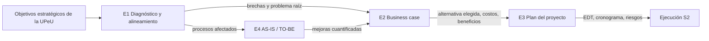
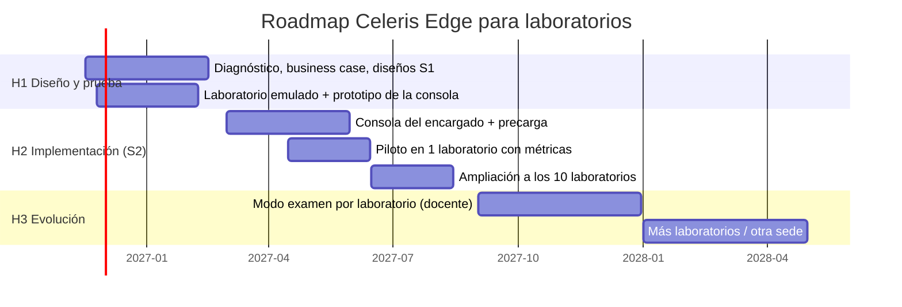
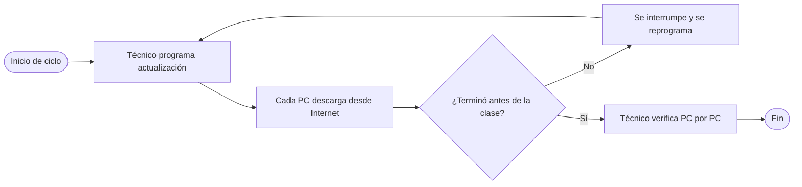
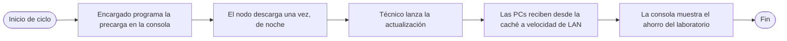

# Celeris Edge — CE01 Gestión de Tecnologías de Información

**Pregunta que responde esta línea:** ¿por qué la universidad debe invertir en una caché de descargas para sus laboratorios, cuánto vale, cómo se gestiona el proyecto y qué procesos mejora?

El problema, el alcance, los actores y los supuestos están en **00 Marco común** (M2, M3, M5). Este documento no los repite: los usa.

**Cambios de la v0.4 que afectan a CE01:** el alcance incluye BYOD y el Wi-Fi de estudiantes (sin descifrado); el FortiGate existente se reconoce como parte del contexto y como alternativa a evaluar (A5); en AWS ya no hay réplica ni NAT permanentes, solo un gateway de acceso remoto y respaldos (≈ US$ 70/mes); el host baja a 12 núcleos y 96 GB. El business case se recalculó (B2.4–B2.5).

## B0. Glosario de gestión

| Término | Significado |
| --- | --- |
| **Cadena de valor** | Actividades primarias y de apoyo con las que la universidad genera valor (Porter adaptado). |
| **FODA / PESTEL** | Análisis interno-externo / análisis del entorno político, económico, social, tecnológico, ecológico y legal. |
| **COBIT 2019** | Marco de gobierno de TI de ISACA; se usa su escala de capacidad 0–5 para medir madurez. |
| **Business case** | Documento que justifica la inversión: problema, alternativas, beneficios, costos y riesgos. |
| **TCO** | Costo total de propiedad: inversión + operación + mantenimiento en el horizonte evaluado. |
| **VAN / TIR / Payback / B/C** | Valor actual neto, tasa interna de retorno, periodo de recuperación, relación beneficio/costo. |
| **COK** | Costo de oportunidad del capital: tasa de descuento del VAN. |
| **EDT / WBS** | Desglose del trabajo en entregables. Regla del 100 %: todo el alcance está en ella y nada fuera de ella. |
| **Línea base / EVM** | Versión aprobada de alcance, cronograma o costo / gestión del valor ganado (PV, EV, AC, CPI, SPI). |
| **RACI** | Responsable, Aprobador, Consultado, Informado. |
| **BPMN 2.0 / AS-IS / TO-BE** | Notación de procesos / proceso actual / proceso propuesto. |
| **Minería de procesos** | Reconstruir el proceso real desde registros con marca de tiempo. |

## B0.1 Cadena de entregables

| Marco de referencia | Uso en el proyecto |
| --- | --- |
| COBIT 2019 | Madurez y objetivos: APO02, APO12, BAI03, DSS01, DSS05, MEA01 |
| PMBOK 8.ª ed. | Acta, EDT, cronograma, costos, riesgos |
| ITIL (v4 / Version 5) | Servicio "Caché de laboratorios" en el catálogo; cambios e incidentes |
| ArchiMate 3.2 | Capa de motivación: objetivo → requisito → componente |

---

## B1. Entregable 1 — Diagnóstico organizacional y alineamiento estratégico (CE0111–CE0115)

### B1.1 Qué evidencia cada código

| Código | Evidencia | Sección |
| --- | --- | --- |
| CE0111 | Diagnóstico organizacional | B1.2–B1.5 |
| CE0112 | Alineamiento estratégico | B1.6 |
| CE0113 | Caso de negocio (resumen) | B2 |
| CE0114 | Roadmap de tecnología | B1.7 |
| CE0115 | Matriz de riesgos estratégicos | B1.8 |

### B1.2 Contexto organizacional (1.1)

**Sector y entorno.** Universidad privada en el altiplano, con conectividad más cara y con menos oferta que en la costa. Los laboratorios de cómputo son el recurso donde más se nota: el software de cada curso y las actualizaciones se descargan ahí.

**Estructura.** Dirección del campus → Facultades → EP Ingeniería de Sistemas. Dirección de Tecnologías de Información (DTI) → Infraestructura, Soporte, Sistemas. Los **encargados de laboratorio** dependen de Soporte o de la facultad [levantar con la DTI].

**Cadena de valor:**

| Tipo | Actividad | Dependencia de los laboratorios |
| --- | --- | --- |
| Primaria | Enseñanza en laboratorios | **Alta**: software, actualizaciones, plataforma virtual |
| Primaria | Investigación | Media: datasets, bibliotecas, modelos |
| Primaria | Admisión y extensión | Baja |
| Apoyo | Infraestructura de TI y soporte | **Alta**: preparación y mantenimiento de los laboratorios |
| Apoyo | Gestión administrativa y financiera | Baja (costo del enlace) |

**Mapa de stakeholders (poder × interés):**

| Stakeholder | Poder | Interés | Estrategia | Qué espera |
| --- | --- | --- | --- | --- |
| Encargados de laboratorio | Medio | **Alto** | Gestionar de cerca | Laboratorios listos a tiempo, sin depender de otros |
| DTI | Alto | Alto | Gestionar de cerca | Menos saturación del enlace, control y seguridad |
| Docentes | Medio | Alto | Mantener informados | Clases sin esperas por descargas |
| Estudiantes (PC institucional y BYOD) | Bajo | Alto | Mantener informados | Velocidad, privacidad; en BYOD, que su equipo no se inspeccione |
| Dirección del campus | Alto | Medio | Mantener satisfecha | Ahorro, imagen |
| Oficial de datos personales | Medio | Medio | Consultar | Cumplimiento de la Ley 29733 |
| ISP, AWS | Medio / bajo | Bajo | Monitorear | Contrato y uso dentro de términos |
| Jurado EPE | Alto | Alto | Gestionar de cerca | Evidencia, coherencia, dominio técnico |

### B1.3 Análisis estratégico (1.2)

**Misión, visión y objetivos estratégicos:** se citan del plan estratégico vigente solo los que el proyecto afecta. Ejemplo: "OE: fortalecer la infraestructura tecnológica para la enseñanza" [confirmar con el documento oficial].

**FODA (a validar con la DTI y los encargados):**

| | Positivo | Negativo |
| --- | --- | --- |
| **Interno** | F1 PCs de laboratorio administradas centralmente. F2 Encargados que conocen qué software pide cada curso. F3 Línea académica de infraestructura y seguridad. | D1 Enlace limitado y caro. D2 Descargas repetidas en cada PC. D3 Preparación manual, PC por PC. D4 Sin medición del desperdicio de ancho de banda. |
| **Externo** | O1 Herramientas libres maduras (OPNsense, Suricata, Wazuh). O2 ESXi gratuito de nuevo desde abril de 2025. O3 Créditos de AWS para estudiantes y emuladores locales gratuitos. O4 La universidad ya opera un FortiGate con FortiGuard: el proyecto se apoya en él en lugar de reemplazarlo. | A1 Más tráfico cifrado (HTTPS, QUIC, ECH) reduce lo que se puede cachear. A2 Cambios de licenciamiento de proveedores. A3 Exigencias del reglamento de datos personales. A4 Uso de IA y búsqueda de respuestas durante exámenes en la red del campus (contexto del modo examen, fuera de S1). |

**PESTEL (factores con efecto real):**

| Factor | Hecho | Efecto |
| --- | --- | --- |
| Legal | Reglamento de la Ley 29733 (D.S. 016-2024-JUS) vigente desde marzo de 2025 | Aviso previo, minimización, evaluación de impacto |
| Tecnológico | ECH (RFC 9849, nov. 2025) y HTTP/3 | Proxy explícito y bloqueo de UDP/443 en laboratorios |
| Económico | Costo por Mbps mayor que en la costa [S-03] | Base del beneficio económico |
| Ecológico | Menos tráfico repetido = menos energía de red | Indicador complementario |

**Factores críticos de éxito:** apoyo de la DTI, que los encargados usen la consola, BHR ≥ 20 %, cero incidentes de privacidad, operación por personal distinto del equipo autor.

### B1.4 Diagnóstico digital / TI (1.3)

**Inventario de sistemas relacionados:** imágenes y herramientas de despliegue de los laboratorios, servicio de actualizaciones (si existe un WSUS o similar), plataforma virtual, **FortiGate con FortiGuard (modelo, licencias, si tiene disco y caché web)**, red Wi-Fi de estudiantes, mesa de ayuda. Se levanta con la DTI (sistema, propietario, usuarios, dependencia de Internet, criticidad).

**Madurez (COBIT 2019, 0–5)** — entrevista estructurada + evidencia:

| Objetivo | Pregunta guía | Actual (medir) | Objetivo |
| --- | --- | --- | --- |
| APO02 Estrategia | ¿Hay un plan de TI que considere los laboratorios? | ? | 3 |
| BAI03 Soluciones | ¿Las soluciones se diseñan con requisitos y pruebas? | ? | 3 |
| DSS01 Operaciones | ¿Se monitorea la capacidad del enlace? ¿Se programan las descargas? | ? | 3 |
| DSS05 Seguridad | ¿Hay detección y respuesta a incidentes en la red de laboratorios? | ? | 3 |
| APO12 Riesgo | ¿Existe registro de riesgos de TI? | ? | 2 |
| MEA01 Desempeño | ¿Se miden indicadores de servicio de los laboratorios? | ? | 3 |

**Brechas** = objetivo − actual (gráfico de radar).

**Problemas operativos a confirmar con datos:** saturación del enlace en horas de clase; descargas que no terminan en una sesión; preparación de un laboratorio que toma horas; el encargado depende de la DTI para cualquier cambio.

### B1.5 Identificación del problema (1.4)

**Enunciado:** 00 M2.1.

**Causas raíz (Ishikawa + 5 porqués):**

| Categoría | Causa | Evidencia |
| --- | --- | --- |
| Tecnología | Más del 90 % del tráfico web es HTTPS; la caché clásica no aplica | Muestra de tráfico por protocolo |
| Proceso | Cada PC descarga sus actualizaciones y su software por separado, en horario de clase | Registro de descargas por laboratorio |
| Personas | El encargado no tiene herramienta ni atribución para decidir qué se reutiliza | Entrevista a encargados |
| Recursos | Ampliar el enlace es un costo recurrente | Cotizaciones del ISP |

**Impacto estratégico:** afecta la calidad de la enseñanza en laboratorios y el costo de conectividad.

**Problema mayor relacionado (fuera de S1):** la integridad de los exámenes (uso de IA, búsqueda de respuestas, intentos de llegar a los sistemas de los docentes). Se registra en el diagnóstico porque orienta el roadmap (B1.7, H3) y porque la segmentación de la v0.4 ya protege las zonas del proyecto del Wi-Fi y de los laboratorios (00 M2.4).

**Justificación de intervención:** el costo de no actuar es pagar más Mbps cada año y perder horas de clase; la alternativa es una inversión única con costo operativo bajo (B2).

### B1.6 Alineamiento estratégico (CE0112)

| Objetivo estratégico | Capacidad requerida | Brecha | Componente Celeris | KPI |
| --- | --- | --- | --- | --- |
| Infraestructura para la enseñanza | Uso eficiente del enlace | D1, D2 | Nodos de caché + coalescencia + precarga | BHR, GB evitados/mes |
| Calidad académica | Laboratorios listos a tiempo | D3 | Precarga programada desde la consola | Minutos para preparar un laboratorio |
| Gestión eficiente | Autonomía de los encargados | D3, D4 | Consola del encargado | Tiempo para habilitar contenido o un laboratorio |
| Seguridad y cumplimiento | Transparencia y control | A3 | Portal de transparencia, detección | % PCs con aviso; escenarios detectados |

Se modela en **Archi** (capa de motivación) para mostrar objetivo → resultado → requisito → componente.

### B1.7 Roadmap de tecnología (CE0114)

### B1.8 Matriz de riesgos estratégicos (CE0115)

Escala 1–5; puntaje = P × I; rojo ≥ 15, ámbar 8–14, verde ≤ 7.

| ID | Riesgo | P | I | Puntaje | Respuesta | Disparador |
| --- | --- | ---: | ---: | ---: | --- | --- |
| RE-01 | El proyecto depende de dos personas | 4 | 5 | **20** | Documentación como código, runbooks, transferencia a la DTI | Un integrante ausente 2 semanas |
| RE-02 | Rechazo por privacidad de la CA | 3 | 5 | **15** | Solo PCs institucionales, portal previo al uso, CA limitada | Quejas formales |
| RE-03 | Más tráfico cifrado reduce lo cacheable | 4 | 3 | 12 | Proxy explícito, medir BHR mensual, priorizar fuentes HTTP | BHR < 15 % tres meses |
| RE-04 | Compromiso de la llave de la CA | 2 | 5 | 10 | Raíz offline, intermedia por nodo, Name Constraints | Alerta de integridad |
| RE-05 | La DTI no aprueba el despliegue | 3 | 4 | 12 | Piloto en un laboratorio, demostración previa en laboratorio emulado | Respuesta negativa |
| RE-06 | Los encargados no adoptan la consola | 3 | 4 | 12 | Validación del prototipo con encargados (CE02 C2.2), capacitación corta | Menos de 1 uso semanal |
| RE-07 | Costos AWS fuera de presupuesto | 2 | 3 | 6 | AWS Budgets, entorno de laboratorio efímero | Gasto > 80 % del mes |
| RE-08 | Software con *certificate pinning* falla | 4 | 2 | 8 | Nunca descifrar por defecto; lista de compatibilidad | Ticket de soporte |
| RE-09 | No hay servidor físico disponible | 3 | 4 | 12 | Laboratorio emulado y AWS efímero para las pruebas de S2 | Sin respuesta de la DTI |
| RE-10 | Cambio de licenciamiento del hipervisor | 3 | 3 | 9 | Diseño agnóstico; Proxmox como equivalente | Aviso del fabricante |
| RE-11 | La DTI no habilita en el FortiGate el NAT 1:1 (VPN, portal) o la exclusión de inspección SSL del nodo [S-29] | 3 | 4 | 12 | Pedido mínimo y documentado; alternativa: VPN de acceso remoto en OPNsense y portal solo interno; demostrar en Modo A | Respuesta negativa de la DTI |
| RE-12 | Compromiso del acceso remoto al panel (EC2-GW) | 2 | 5 | 10 | Segundo factor, acciones críticas solo desde el campus, EC2-GW sin datos y recreable, WAF y límite de intentos | Alerta de fuerza bruta o de WAF |

### B1.9 Rúbrica E1 → evidencia para "Excelente"

| Criterio oficial | Qué presentar |
| --- | --- |
| Análisis del contexto organizacional | Cadena de valor con la dependencia de los laboratorios, stakeholders con estrategia (incluidos los encargados), PESTEL con normas citadas |
| Identificación de brechas estratégicas | Brechas COBIT medidas por entrevista y evidencia, más datos del enlace en hora de clase |
| Alineamiento estratégico del proyecto | Matriz B1.6 y vista ArchiMate, conectadas con 00 M7 |
| Sustentación y defensa técnica | Cada integrante explica cualquier fila y su fuente |

---

## B2. Entregable 2 — Business case (CE0113, CE0124)

### B2.1 Justificación (2.1)

**Problema:** 00 M2.1.

**Objetivos SMART del proyecto** (fuente única; los demás documentos los citan por ID):

| ID | Objetivo | Indicador | Meta | Plazo |
| --- | --- | --- | --- | --- |
| OB-1 | Reducir el tráfico repetido de los laboratorios | BHR; GB evitados/mes | BHR ≥ 25 % [S-04] | 3 meses tras el piloto |
| OB-2 | Acortar la preparación de un laboratorio | Minutos de **descarga** para 40 PCs (la instalación se mide aparte) | −70 % frente al AS-IS | 1 ciclo de preparación |
| OB-3 | Dar autonomía al encargado | Tiempo para habilitar una fuente de contenido o un laboratorio | ≤ 5 min, sin intervención técnica (salvo dominios a descifrar, que aprueba la DTI) | Fin del piloto |
| OB-4 | Cumplir la transparencia | PCs con aviso entregado antes de instalar la CA | 100 % | Antes del piloto |
| OB-5 | Proteger el servicio | Escenarios de abuso planificados que se detectan | ≥ 90 % | Fin de S2 |

**Beneficios esperados:** menos saturación del enlace, laboratorios listos a tiempo, horas técnicas ahorradas, visibilidad del consumo por laboratorio.

### B2.2 Análisis de alternativas (2.2)

Criterios y pesos (validar con la DTI; se puede derivar con AHP):

| Criterio | Peso |
| --- | ---: |
| Eficacia contra descargas repetidas (incluido HTTPS) | 25 % |
| Seguridad y privacidad | 20 % |
| TCO a 3 años | 20 % |
| Autonomía del encargado (facilidad de gestión) | 15 % |
| Soporte y mantenibilidad | 10 % |
| Valor académico | 10 % |

| Alternativa | Eficacia | Seg. | TCO | Autonomía | Soporte | Académico | **Total** |
| --- | ---: | ---: | ---: | ---: | ---: | ---: | ---: |
| A0 Ampliar el ancho de banda | 2 | 3 | 1 | 3 | 5 | 1 | 2,35 |
| A1 Squid + SSL-Bump | 4 | 3 | 4 | 2 | 4 | 2 | 3,30 |
| A2 LanCache (solo HTTP / juegos y actualizaciones) | 2 | 4 | 5 | 2 | 3 | 2 | 3,10 |
| A3 Servidor de actualizaciones del fabricante (WSUS / Delivery Optimization) | 3 | 4 | 4 | 2 | 4 | 1 | 3,15 |
| A5 Caché web del FortiGate existente (si el modelo tiene disco y la función habilitada) | 3 | 3 | 4 | 1 | 4 | 1 | 2,80 |
| **A4 Celeris Edge** | 4 | 5 | 4 | 5 | 2 | 5 | **4,25** |

**Lectura honesta (pensamiento lateral):** A3 resuelve bien las actualizaciones de Windows y es gratuita, pero no cubre instaladores de otros fabricantes ni material de la plataforma virtual, y no da control al encargado. A1 es la alternativa técnica más madura y el **plan de respaldo**: si RE-01 se materializa, la DTI puede migrar a Squid conservando red, CA y SIEM. Una combinación A3 + A4 también es válida y se menciona en la sustentación. A5 se evalúa porque la universidad ya tiene el FortiGate: algunos modelos ofrecen caché web, pero para HTTPS exigen inspección profunda sobre todo el tráfico (incluido el BYOD), no dan control al encargado y cargan al equipo que protege todo el campus. Hay que confirmar el modelo con la DTI antes de descartarla.

### B2.3 Beneficios (2.3)

| Tipo | Beneficio | Cómo se mide | Valor ilustrativo/año |
| --- | --- | --- | --- |
| Cuantificable | Mbps de ampliación diferidos (100 Mbps) | BHR en hora punta × enlace | 100 × US$ 8 × 12 = **US$ 9 600** [S-03] |
| Cuantificable | Horas técnicas ahorradas | Tiempo AS-IS − TO-BE (P1) | 400 × 2 × 0,25 h × US$ 5 = **US$ 1 000** [S-06, S-07] |
| Cualitativo | Clases que empiezan a tiempo | Minutos de clase perdidos por esperas (encuesta a docentes) | — |
| Cualitativo | Autonomía y visibilidad del encargado | Uso de la consola, solicitudes atendidas sin la DTI | — |
| Cualitativo | Capacidad institucional y producto propio | Registro de software, publicaciones | — |

**Indicadores de valor:** GB evitados/mes, BHR por laboratorio, minutos de preparación por laboratorio, costo por GB servido, adopción del proxy (bytes del laboratorio que pasan por la caché ÷ total).

### B2.4 Costos (2.4)

**Inversión inicial (I₀) ilustrativa:** servidor de 12 núcleos y 96 GB US$ 3 800 [S-08] + switch núcleo L2 con 10 GbE US$ 600 + UPS 1,5 kVA US$ 700 + cableado US$ 200 = **US$ 5 300**. Los switches de acceso, el FortiGate y el Wi-Fi son existentes [S-14, S-28, S-29].

**Costos operativos anuales:**

| Concepto | Cálculo | US$/año |
| --- | --- | ---: |
| AWS 24×7 (VPN, EC2-GW t3.micro, 3 IPv4, EBS, S3); sin réplica, sin NAT permanente, sin shield | ≈ US$ 70/mes [S-12] (detalle en CE03 D2.5) | 840 |
| Energía | 400 W × 8 760 h × US$ 0,15 [S-09] | 526 |
| Mantenimiento | 10 % del hardware | 530 |
| **Total OPEX** | | **1 896** |

### B2.5 Evaluación económica (ilustrativa, 3 años, COK 12 % [S-10])

| Indicador | Valor |
| --- | --- |
| Flujo neto anual | 10 600 − 1 896 = **US$ 8 704** |
| VAN (12 %) | 8 704 × 2,4018 − 5 300 = **≈ US$ 15 606** |
| TIR | **≈ 154 %** |
| Payback | **≈ 7,3 meses** |
| B/C | **≈ 2,58** |
| Punto de equilibrio | VAN = 0 si se difieren **≈ 32 Mbps** |

> v0.3: VAN ≈ US$ 13 813, payback ≈ 8,7 meses. La mejora viene de un host más chico y de un AWS sin réplica ni NAT permanentes. Una TIR tan alta indica que la inversión es pequeña frente al beneficio supuesto: la variable que decide es S-03 (costo por Mbps), y por eso el Monte Carlo es obligatorio.

**Sensibilidad (diferenciador):** Monte Carlo de 10 000 iteraciones en Python variando BHR (10–40 %), costo por Mbps (US$ 4–12), adopción del proxy (60–100 %) y costos AWS (±30 %); se reporta la probabilidad de VAN > 0 y un gráfico tornado. Script: `analytics/business_case.py`, con los supuestos de 00 M5.

### B2.6 Riesgos iniciales (2.5)

Se reutilizan RE-01 a RE-12 con su efecto económico (por ejemplo, RE-03 reduce el beneficio en proporción a la caída del BHR; RE-06 reduce OB-2 y OB-3; RE-11 puede obligar a reemplazar EC2-GW por una VPN de acceso remoto, sin cambio de costo relevante).

### B2.7 Rúbrica E2 → evidencia

| Criterio oficial | Qué presentar |
| --- | --- |
| Análisis de alternativas | Matriz ponderada con pesos validados, incluida A3, y la lectura de la alternativa de respaldo |
| Evaluación económica | VAN, TIR, payback, B/C, punto de equilibrio, Monte Carlo |
| Identificación de riesgos | Riesgos con efecto cuantificado y mitigación |
| Sustentación | Por qué A4 gana pese a perder en soporte |

---

## B3. Entregable 3 — Plan de gestión del proyecto (CE0121–CE0125)

Enfoque **híbrido**: predictivo para los entregables académicos con fecha fija; ágil (Scrumban) para construir la consola y el laboratorio.

### B3.1 Acta de constitución (CE0121)

| Campo | Contenido |
| --- | --- |
| Proyecto | Celeris Edge — caché de descargas para laboratorios, administrada por el encargado |
| Sponsor | Dirección de la EP Ingeniería de Sistemas (propuesto); usuario patrocinador: DTI |
| Director del proyecto | Henyelrey Lucio Garcia Chura (propuesto) |
| Líder técnico | Nick Saim Mayta Jara (propuesto) |
| Objetivos | OB-1 a OB-5 |
| Alcance preliminar | 00 M3.1: diseño S1 de las tres líneas, prototipo de la consola, laboratorio emulado; piloto en un laboratorio en S2 |
| Fuera de alcance | 00 M3.2 |
| Restricciones | Dos personas, presupuesto académico, ESXi gratuito (8 vCPU por VM, sin vCenter), cuenta AWS de laboratorio [S-13], FortiGate y Wi-Fi administrados por la DTI [S-28, S-29] |
| Supuestos | 00 M5 |
| Stakeholders | B1.2 |
| Criterios de éxito | Nota ≥ "Logrado" en todos los entregables; OB-1 a OB-5 medidos en el piloto |
| Hitos | H1 entregables S1; H2 piloto en un laboratorio; H3 sustentación final |

### B3.2 RACI

| Paquete | Nick | Henyelrey | DTI | Encargados | Docente |
| --- | :-: | :-: | :-: | :-: | :-: |
| CE01 E1–E4 | C | **R/A** | C | C | I |
| CE02 E1 (SRS, prototipo, C4, UML) | **R/A** | C | C | C | I |
| CE03 E1 Red | C | **R/A** | C | I | I |
| CE03 E2 Centro de datos | **R/A** | C | C | I | I |
| Prototipo de la consola y validación | **R** | C | I | **C** | I |
| Laboratorio demostrable | **R/A** | C | I | I | I |
| Consolidado y sustentación | R | R/A | I | I | C |

Toda pieza la revisa el otro integrante: la sustentación es individual.

### B3.3 EDT / WBS (CE0123)

```mermaid
flowchart TB
  P[0 Celeris Edge EPE]
  P --> G[1 Gestión del proyecto]
  P --> T[2 Gestión de TI]
  P --> S[3 Ingeniería de software]
  P --> I[4 Infraestructura]
  P --> C[5 Prueba de concepto]
  P --> X[6 Cierre y sustentación]
  G --> G1[1.1 Acta] & G2[1.2 Plan] & G3[1.3 Seguimiento] & G4[1.4 Lecciones aprendidas]
  T --> T1[2.1 Diagnóstico] & T2[2.2 Business case] & T3[2.3 Plan de gestión] & T4[2.4 AS-IS/TO-BE]
  S --> S1[3.1 SRS] & S2[3.2 Prototipo de la consola validado] & S3[3.3 C4 + ADR] & S4[3.4 UML] & S5[3.5 Trazabilidad]
  I --> I1[4.1 Diseño de red] & I2[4.2 Diseño de centro de datos] & I3[4.3 Inventario único de red]
  C --> C1[5.1 Nodo de caché + PAC] & C2[5.2 Laboratorio emulado] & C3[5.3 IaC AWS]
  X --> X1[6.1 Ensayos] & X2[6.2 Demo grabada] & X3[6.3 Expediente PDF]
```

**Diccionario (extracto):**

| ID | Paquete | Criterio de aceptación | Resp. | Esfuerzo |
| --- | --- | --- | --- | ---: |
| 3.2 | Prototipo de la consola validado | 10 pantallas (CE02 C2.1), validadas con ≥ 2 encargados, SUS ≥ 75 | Nick | 20 h |
| 4.1 | Diseño de red | 11 secciones de la plantilla, matrices al 100 %, pruebas coherentes con la VPN | Henyelrey | 40 h |
| 4.3 | Inventario único de red | `infra/inventory.yaml` genera las matrices; validador en verde | Nick | 6 h |
| 5.2 | Laboratorio emulado | Levanta con un comando y pasa las pruebas marcadas para Modo L | Nick | 16 h |

### B3.4 Cronograma (CE0123)

Ver 00 M9. **Ruta crítica:** levantamiento con la DTI y los encargados → SRS → diseño de red → diseño de centro de datos → consolidado. Se exporta a Gantt con dependencias e hitos.

### B3.5 Costos y línea base (CE0122, CE0124)

| Rubro | Base | US$ |
| --- | --- | ---: |
| Horas del equipo (costo de oportunidad) | 2 × 12 h/sem × 10 sem × US$ 5 | 1 200 |
| Hardware (si se compra) | B2.4 | 5 300 |
| AWS durante el proyecto | Entorno efímero (≈ US$ 0,08/h) + 1 mes de laboratorio | ≈ 120 |
| Herramientas | Licencias libres o educativas | 0 |
| Reserva de contingencia | 10 % | 662 |
| **Línea base** | | **7 282** |
| Reserva de gestión | 5 % (fuera de la línea base) | 364 |

Control: EVM semanal; alerta si CPI o SPI < 0,9.

### B3.6 Riesgos del proyecto (CE0125)

| ID | Riesgo | P | I | Respuesta | Dueño |
| --- | --- | ---: | ---: | --- | --- |
| RP-01 | Retraso en el levantamiento con la DTI o los encargados | 3 | 4 | Supuestos marcados, validación posterior | Henyelrey |
| RP-02 | Sobrecarga académica en exámenes | 4 | 3 | Holgura de 1 semana | Ambos |
| RP-03 | Datos inconsistentes entre documentos | 3 | 4 | Fuente única (00 M4.1) + validador | Nick |
| RP-04 | Secretos en el repositorio | 2 | 5 | gitleaks en pre-commit y CI | Nick |
| RP-05 | Falla de la demo en la sustentación | 2 | 4 | Laboratorio emulado sin red + video de respaldo | Ambos |
| RP-06 | Recursos AWS olvidados encendidos | 3 | 2 | `destroy` en el runbook, alarma de Budgets | Nick |
| RP-07 | Ramas sin fusionar y choque de IDs entre documentos y repositorio | 4 | 3 | Fusionar en `main` primero; los IDs nuevos se piden en `CAMBIOS-INVENTARIO.md`; manda el repositorio | Ambos |

### B3.7 Gestión ágil

- Scrumban con sprints de 1 semana; la revisión es la reunión con el docente.
- Backlog: épicas = paquetes de la EDT; historias con ID de requisito (REQ-F-xx de CE02).
- Definición de terminado: revisado por el otro integrante, sin secretos, enlazado en la matriz de trazabilidad.
- Métricas: burn-up por entregable, *lead time* de historias.

### B3.8 Rúbrica E3 → evidencia

| Criterio oficial | Evidencia |
| --- | --- |
| Acta | B3.1 con OB SMART, stakeholders y criterios de éxito |
| Alcance | EDT con diccionario y control de cambios (issues `cambio-alcance`) |
| Cronograma | Gantt con dependencias, hitos y ruta crítica |
| Costos | Línea base, reservas, EVM |
| Riesgos | RE y RP con dueño, disparador y seguimiento |
| Ágil | Backlog priorizado, sprints, DoD, métricas |
| Sustentación | Cada integrante defiende el plan |

---

## B4. Entregable 4 — Procesos AS-IS / TO-BE (CE0131–CE0135)

### B4.1 Procesos elegidos (CE0131)

| ID | Proceso | Por qué | Dueño |
| --- | --- | --- | --- |
| **P1** | Actualización masiva de las PCs de un laboratorio | Es la descarga repetida de mayor volumen | Encargado / DTI Soporte |
| **P2** | Preparación de un laboratorio para una clase (el docente pide software o material) | Es donde se pierde tiempo de clase y donde el encargado necesita autonomía | Encargado de laboratorio |

### B4.2 P1 — AS-IS (CE0132)

**Narrativa:** el técnico lanza las actualizaciones laboratorio por laboratorio. Cada PC descarga lo mismo desde Internet, en competencia con las clases. Si el laboratorio se ocupa, se interrumpe y se retoma otro día.

**Indicadores (≥ 30 observaciones o registros):** tiempo por laboratorio separado en descarga e instalación, GB por ciclo, % de PCs al día, interrupciones por ciclo.

**Cálculo ilustrativo (solo descarga):** 40 PCs × 3 GB [S-27] con 150 Mbps disponibles → 120 GB por el enlace → **≈ 1,8 h**.

### B4.3 P1 — TO-BE

**Cálculo ilustrativo (solo descarga):** 3 GB por el enlace + 117 GB por LAN de 1 Gbps → **≈ 18 min**.

### B4.4 P2 — AS-IS y TO-BE

| Etapa | AS-IS | TO-BE |
| --- | --- | --- |
| Solicitud | El docente avisa por mensaje o en persona, a veces el mismo día | El docente registra el pedido; el encargado lo ve en la consola |
| Decisión | El encargado no puede cambiar nada de red; pide a la DTI | El encargado agrega la fuente al catálogo de contenido (≤ 5 min); si requiere descifrar, la DTI aprueba en la consola |
| Descarga | 40 PCs descargan durante la preparación o la clase | Precarga programada la noche anterior |
| Acceso | Todos los laboratorios igual | El encargado habilita el laboratorio y su horario |
| Verificación | PC por PC | La consola muestra el estado de la precarga y el HIT en el laboratorio |
| Cierre | Sin registro | Registro de auditoría y ahorro por laboratorio |

### B4.5 Análisis comparativo (CE0135)

| Indicador | AS-IS | TO-BE | Mejora | Verificación |
| --- | --- | --- | --- | --- |
| Descarga por laboratorio (P1, P2) | ≈ 1,8 h | ≈ 18 min | **−83 %** | Cronometraje + registros de Celeris |
| Tiempo total con instalación | A medir | A medir | A medir | Cronometraje por fase |
| Tráfico WAN por ciclo | 120 GB | 3 GB | **−97,5 %** | Contadores del firewall |
| Tiempo para habilitar contenido o acceso (P2) | Días | ≤ 5 min | — | Auditoría de la consola |
| Calidad (% PCs listas al inicio de la clase) | A medir | ≥ 95 % | — | Consola |
| Costo por ciclo | Horas técnicas × tarifa | Idem | B2.3 | Hoja de cálculo |

**Diferenciador:** el AS-IS se mide, no se supone: minería de procesos (PM4Py) sobre los registros de Celeris y los mensajes de solicitud; el TO-BE se simula en Bizagi con las distribuciones obtenidas.

### B4.6 Rúbrica E4 → evidencia

| Criterio oficial | Evidencia |
| --- | --- |
| Modelado AS-IS | BPMN de P1 y P2 con ineficiencias señaladas e indicadores medidos |
| Propuesta TO-BE | Rediseño con automatizaciones concretas (precarga, catálogo, accesos) y simulación |
| Análisis comparativo | Tabla tiempo, costo y calidad con método de verificación |
| Sustentación | Explicar cada cálculo y su fuente |

## B5. Software recomendado para gestión

| Necesidad | Recomendado | Alternativa | Cuándo cambiar |
| --- | --- | --- | --- |
| Entregables DOCX + PDF | Quarto o plantilla Word | Google Docs | Si el docente pide comentarios en Word |
| Alineamiento | Archi (ArchiMate) | draw.io | Si la DTI usa otra herramienta |
| BPMN con simulación | Bizagi Modeler | Camunda Modeler | Si el TO-BE se ejecutará en un motor de procesos |
| Minería de procesos | PM4Py | Disco, Celonis académico | Licencia académica disponible |
| Gantt, línea base, EVM | ProjectLibre | OpenProject, MS Project | Colaboración web |
| Backlog | GitHub Projects | Jira, Taiga | Equipo más grande |
| Business case | Hoja de cálculo + Python | Solo hoja de cálculo | — |

## B6. Correlación con CE02 y CE03

| Elemento de CE01 | Se concreta en |
| --- | --- |
| OB-1 | CE02 REQ-F-03, F-05, F-25 · CE03 EDGE01/02, F1, F8, T07 |
| OB-2 | CE02 REQ-F-22, F-34 · CE03 T50, T55 |
| OB-3 | CE02 REQ-F-31, F-32, F-33, F-37, RN-07, pantallas P-03, P-04 · CE03 CTRL01, ENC01, EC2-GW, F28–F30, T51–T54 |
| OB-4 | CE02 REQ-F-12, F-30, F-36, RN-05 · CE03 PORTAL01, T15–T18, T56 |
| OB-5 | CE02 REQ-F-11, F-15 · CE03 D1.14, T11, T13, T14, T29, T30, T57, T58 |
| Costos AWS e I₀ | CE03 D2.4–D2.5 (VM, host y costo mensual) |
| RE-11 (FortiGate) | 00 S-29 · CE03 D1.8 (posición frente al FortiGate) |
| P1, P2 TO-BE | CE02 casos de uso CU-03 a CU-06 |
