# Celeris Edge — CE02 Ingeniería de Software

**Sistema a especificar:** Celeris Edge para laboratorios = **nodo de caché** (existe) + **consola del encargado** (nueva) + generador del PAC + portal de transparencia.

El problema, el alcance, los actores y los supuestos están en **00 Marco común**. Los objetivos OB-x vienen de **CE01 B2.1**. Las IP, flujos y pruebas de red vienen de **CE03** y del repositorio (`infra/*.yaml`).

**Cambios de la v0.4 que afectan a CE02:**
- La consola completa (SPA + API + PostgreSQL) vive en CTRL01, en el campus. En AWS solo hay un proxy inverso sin datos (EC2-GW) y respaldos (D-24, D-25).
- Nuevos REQ-F-36 (el Wi-Fi de estudiantes nunca se descifra), REQ-F-37 (acciones críticas solo desde el campus), REQ-RN-11 y CU-11.
- El estado del código se actualizó según las ramas del repositorio: REQ-F-26, F-28 y NF-14 ya están implementados en `e1/matriz-pruebas`.
- El prototipo pasó a las pantallas de C2.1 (prototipo v0.2 en `docs/software/e1/prototipo/`).
- 24/11/2026: se agrega P-11 «Actividad en vivo» como desviación registrada de C2.1, pendiente de que el revisor la acepte (ver nota bajo la tabla). Solo usa los agregados por laboratorio que ya viajan por F10; no agrega requisitos, flujos ni componentes.

**Formato del entregable (rúbrica oficial):** Word/PDF de 20–30 páginas: portada, resumen ejecutivo de 1 página, Sección 1 Requerimientos, Sección 2 Prototipo navegable, Sección 3 Diseño arquitectónico (C4 + ADR), Sección 4 Diseño detallado (UML), anexos (acta de validación, matriz de trazabilidad, diagramas complementarios, evidencia de sustentación).

## C0. Glosario de software

| Término | Significado |
| --- | --- |
| **SRS** | Especificación de requisitos, estructurada según ISO/IEC/IEEE 29148. |
| **RF / RNF / RN** | Requisito funcional / no funcional / regla de negocio. |
| **ISO/IEC 25010:2023** | Modelo de calidad de producto (9 características: desempeño, fiabilidad, seguridad, mantenibilidad, flexibilidad, *safety*, etc.). |
| **MoSCoW** | Prioridad: Must, Should, Could, Won't. |
| **Gherkin** | Criterio de aceptación *Dado / Cuando / Entonces*, ejecutable como prueba. |
| **C4 (C1, C2, C3)** | Vistas de contexto, contenedores y componentes. |
| **ADR** | Registro de una decisión de arquitectura. |
| **RBAC** | Control de acceso basado en roles: lo que cada usuario puede hacer depende de su rol (encargado, administrador DTI, auditor). |
| **Catálogo de contenido** | Lista que mantiene el encargado con las fuentes que se cachean (por ejemplo, "actualizaciones de Windows", "instaladores de JetBrains"), cada una con sus dominios y su modo. |
| **Modo de una fuente** | `cachear` (contenido HTTP o que no necesita descifrarse), `descifrar_y_cachear` (HTTPS autorizado, requiere aprobación de la DTI) o `nunca` (pasa sin tocar). |
| **Arquitectura hexagonal** | El núcleo define interfaces (puertos) y cada tecnología concreta es un adaptador reemplazable. |
| **SUS** | Cuestionario de usabilidad de 10 preguntas; puntaje 0–100, promedio 68. |

## C0.1 Proceso de ingeniería y trazabilidad

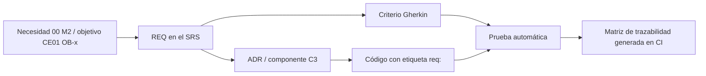

---

## C1. Especificación de requisitos (CE0211)

### C1.1 Actores

| Actor | Tipo | Objetivo | Rol (RBAC) |
| --- | --- | --- | --- |
| Encargado de laboratorio | Humano | Decidir qué se cachea, quién accede y cuándo se precarga; ver el ahorro | `encargado` (de uno o más laboratorios) |
| Administrador DTI | Humano | Operar nodos y CA; aprobar dominios a descifrar | `admin` |
| Usuario de laboratorio | Humano | Descargar rápido; saber qué se descifra | Sin cuenta (usa el proxy y el portal) |
| Usuario BYOD | Humano | Usar el proxy de forma opcional desde el Wi-Fi, sin que su equipo se inspeccione | Sin cuenta |
| Auditor | Humano | Verificar aviso, reportes y cambios | `auditor` (solo lectura) |
| Docente | Humano | Pedir que un software o material esté listo para su clase; a futuro, activar el modo examen (R3) | Registra solicitudes (S, R2) |
| EC2-GW | Sistema (proxy inverso en AWS) | Reenviar a la API las sesiones remotas, autenticándose con su certificado de cliente | Origen `remoto` (REQ-F-37) |
| Origen | Sistema externo | Servir el contenido | — |
| SIEM (Wazuh) | Sistema externo | Recibir eventos de seguridad | — |

### C1.2 Requisitos funcionales

Prioridad MoSCoW. **Ver.**: R1 = prueba de concepto S1; R2 = implementación S2; R3 = trabajo futuro. Los IDs de versiones anteriores se conservan; los retirados por el nuevo alcance se listan en C1.8.

**Nodo de caché (plano de datos)**

| ID | Requisito | Prior. | Ver. | Estado en el repo |
| --- | --- | :-: | :-: | --- |
| REQ-F-01 | Atender como proxy explícito HTTP y HTTPS (`CONNECT`) | M | R1 | Hecho |
| REQ-F-02 | Descifrar TLS solo si el dominio pertenece a una fuente en modo `descifrar_y_cachear` aprobada, no está en `nunca` y el SNI coincide con el `CONNECT` | M | R1 | Hecho (con lista en `config.toml`) |
| REQ-F-03 | Cachear respuestas compartibles según RFC 9111 | M | R1 | Hecho |
| REQ-F-04 | Revalidar copias vencidas (`If-None-Match` / `If-Modified-Since`) | M | R1 | Hecho |
| REQ-F-05 | Coalescer peticiones concurrentes al mismo objeto | M | R1 | Hecho |
| REQ-F-06 | Guardar por SHA-256 y verificar el hash antes de servir | M | R1 | Hecho |
| REQ-F-07 | Normalizar claves de caché (Store-ID, parámetros de rastreo) | M | R1 | Hecho |
| REQ-F-08 | Servir peticiones `Range` (206) desde el objeto completo | S | R2 | Pendiente |
| REQ-F-09 | Respetar un límite de disco expulsando lo menos usado | M | R1 | Hecho |
| REQ-F-10 | Aceptar solo clientes de los rangos de laboratorios habilitados y limitar peticiones por IP | M | R1 | Hecho (rangos en `config.toml`) |
| REQ-F-11 | Bloquear destinos internos (SSRF) y puertos no permitidos | M | R1 | Hecho |
| REQ-F-12 | Publicar el aviso de transparencia generado desde la configuración real | M | R1 | Hecho (servido por el proxy) |
| REQ-F-13 | Exponer métricas Prometheus por laboratorio | M | R2 | Parcial (métricas globales) |
| REQ-F-14 | Enviar eventos de seguridad al SIEM | S | R2 | Parcial (JSONL propio) |
| REQ-F-15 | Detectar uso inusual del proxy por IP | S | R1 | Hecho |
| REQ-F-17 | Aplicar la configuración que publica la consola, solo si su firma es válida, y volver a la anterior si falla | M | R2 | Pendiente |
| REQ-F-18 | Usar una CA intermedia por nodo, limitada por Name Constraints | S | R2 | Parcial (CA única limitada) |
| REQ-F-22 | Ejecutar precargas en la ventana horaria indicada por la consola, con límite de ancho de banda | M | R2 | Pendiente |
| REQ-F-26 | Generar y servir el PAC con los nodos activos y `DIRECT` de respaldo | M | R1 | **Hecho en la rama** `e1/matriz-pruebas` (`src/pac.rs`); falta fusionar en `main` |
| REQ-F-28 | Eliminar `X-Forwarded-For`, `Via` y `Forwarded` antes de enviar al origen | M | R2 | **Hecho en la rama** `e1/matriz-pruebas` (prueba T26 PASA en Modo L) |
| REQ-F-36 | Tratar como `nunca` (passthrough) todo el tráfico que llega desde las redes de origen marcadas como BYOD (WIFI-EST), aunque el dominio esté en una fuente `descifrar_y_cachear` | M | R2 | Pendiente (hoy `never_intercept` es por dominio, no por red de origen) |

**Consola del encargado (plano de control)**

| ID | Requisito | Prior. | Ver. | Estado |
| --- | --- | :-: | :-: | --- |
| REQ-F-19 | Purgar contenido por fuente, URL o prefijo | S | R2 | Pendiente |
| REQ-F-20 | Simular una fuente: "¿esta URL se cachearía? ¿se descifraría?" sin aplicarla | S | R2 | Pendiente |
| REQ-F-24 | Registrar en auditoría todo cambio (quién, qué, cuándo, antes y después) | M | R2 | Pendiente |
| REQ-F-25 | Reportar el ahorro por laboratorio y por fuente (GB evitados, BHR, minutos ahorrados) | M | R2 | Parcial (panel local global) |
| REQ-F-30 | Publicar el portal de transparencia como sitio estático firmado | S | R2 | Pendiente |
| REQ-F-31 | Gestionar el **catálogo de contenido**: crear, editar, activar o desactivar fuentes con sus dominios, categoría y modo | M | R2 | Pendiente (hoy se edita `config.toml`) |
| REQ-F-32 | Gestionar el **acceso por laboratorio**: habilitar o deshabilitar un laboratorio, su rango de IP y su horario | M | R2 | Pendiente |
| REQ-F-33 | Autenticar usuarios de la consola con contraseña + segundo factor y aplicar RBAC por rol y laboratorio | M | R2 | Pendiente (hoy: token único) |
| REQ-F-34 | Programar una **precarga** (lista de URLs o fuente completa, laboratorio, fecha y ventana horaria) y ver su avance | M | R2 | Pendiente |
| REQ-F-35 | Registrar solicitudes de los docentes para preparar un laboratorio y convertirlas en precargas | S | R2 | Pendiente |
| REQ-F-37 | Distinguir el origen de cada sesión (`campus`: ENC01/JMP01; `remoto`: llega por EC2-GW con su certificado de cliente) y rechazar desde `remoto` las acciones críticas: aprobar fuentes a descifrar, rotar llaves, gestionar usuarios, cambiar el perfil BYOD | M | R2 | Pendiente |

### C1.3 Requisitos no funcionales (ISO/IEC 25010:2023)

| ID | Característica | Requisito medible | Verificación |
| --- | --- | --- | --- |
| REQ-NF-01 | Eficiencia de desempeño | Latencia añadida p95 ≤ 5 ms en HIT desde memoria y ≤ 20 ms desde disco, en LAN | k6 / oha |
| REQ-NF-02 | Capacidad | Un nodo de 4 vCPU y 8 GB atiende un laboratorio de 40 PCs descargando a la vez a ≥ 900 Mbps agregados desde caché | iperf3 + prueba de carga |
| REQ-NF-03 | Fiabilidad | La navegación del laboratorio sigue disponible ≥ 99,5 % gracias al segundo nodo y al `DIRECT` del PAC | Tiempo de cambio medido en T09 |
| REQ-NF-04 | Fiabilidad | Tras un corte de energía, ningún objeto corrupto se sirve | kill -9 + verificación de hash |
| REQ-NF-05 | Seguridad | La llave de la CA nunca sale de su nodo; la raíz vive offline | Revisión de diseño |
| REQ-NF-06 | Seguridad | TLS ≥ 1.2 hacia clientes y orígenes | testssl.sh |
| REQ-NF-07 | Privacidad | No se guardan cookies, credenciales, cuerpos ni parámetros de URL; los reportes son por laboratorio, no por persona | Prueba sobre los registros |
| REQ-NF-08 | *Safety* | Ante un error de política, el nodo no descifra (passthrough) | Inyección de fallos |
| REQ-NF-09 | Mantenibilidad | Cobertura ≥ 70 % en política, caché y TLS; `clippy` sin advertencias | CI |
| REQ-NF-10 | Portabilidad | Linux x86_64 y aarch64; imagen OCI multi-arquitectura | CI |
| REQ-NF-12 | Capacidad de interacción | La consola obtiene SUS ≥ 75 con encargados reales; las tareas CU-03 a CU-06 se completan sin ayuda en ≤ 5 min | Prueba de usabilidad |
| REQ-NF-13 | Observabilidad | Cada decisión (HIT, MISS, bypass, rechazo) produce una métrica etiquetada por laboratorio | Revisión de métricas |
| REQ-NF-14 | Seguridad | La API de la consola (F28, F30) y el puerto de administración del nodo solo aceptan TLS; F30 exige además certificado de cliente | Captura de tráfico (CE03 T27); hecho para el puerto 9128 en la rama |
| REQ-NF-15 | Seguridad | Imagen OCI sin usuario root, firmada y con SBOM | `cosign verify` |
| REQ-NF-16 | Fiabilidad | Un cambio en la consola llega a los nodos en ≤ 60 s | Prueba de integración |

### C1.4 Reglas de negocio

| ID | Regla |
| --- | --- |
| REQ-RN-01 | Nunca se guarda una respuesta con `Set-Cookie`, `Cache-Control: private` o `no-store` |
| REQ-RN-02 | Nunca se sirve desde caché una petición con `Authorization` o `Cookie` |
| REQ-RN-03 | El modo `nunca` gana siempre sobre cualquier otra fuente |
| REQ-RN-04 | Un dominio en modo `descifrar_y_cachear` exige una CA que lo cubra; si no la hay, la fuente no se activa |
| REQ-RN-05 | El aviso debe estar publicado y entregado **antes** de instalar la CA y configurar el proxy en una PC |
| REQ-RN-06 | Un encargado solo gestiona los laboratorios que tiene asignados |
| REQ-RN-07 | El encargado puede activar sin aprobación fuentes en modo `cachear`; una fuente en modo `descifrar_y_cachear` queda pendiente hasta que la aprueba un administrador DTI |
| REQ-RN-08 | Una configuración sin firma válida se rechaza en el nodo |
| REQ-RN-09 | Bancos, inicios de sesión y servicios de identidad están en `nunca` por defecto y no se pueden mover a otro modo desde la consola |
| REQ-RN-10 | Una precarga no puede superar el límite de ancho de banda ni salir de la ventana horaria configurada por la DTI |
| REQ-RN-11 | Ninguna configuración puede habilitar el descifrado para redes de origen BYOD; la consola no ofrece esa opción y el nodo la rechaza aunque llegue firmada |

### C1.5 Restricciones

| ID | Restricción | Origen |
| --- | --- | --- |
| RS-01 | Rust estable; nodo sobre Hudsucker + rustls + Hyper + Tokio | D-01, D-02 |
| RS-02 | ESXi gratuito: máximo 8 vCPU por VM | Licencia |
| RS-03 | Ningún secreto en el repositorio | Rúbricas |
| RS-04 | Equipo de dos personas | Proyecto |
| RS-05 | Ley 29733 y su reglamento | Normativa |
| RS-06 | La consola completa (SPA, API y PostgreSQL) corre en CTRL01, en el campus. En AWS solo hay un proxy inverso sin datos (EC2-GW) y respaldos en S3 | D-24, D-25 (Arquitectura v0.4 §1) |

### C1.6 Casos de uso

| ID | Caso de uso | Actor | Requisitos |
| --- | --- | --- | --- |
| CU-01 | Descargar a través de la caché | Usuario | F-01, F-02, F-03, F-05 |
| CU-02 | Consultar qué se descifra y la huella de la CA antes de usar el proxy | Usuario, auditor | F-12, F-30, RN-05 |
| CU-03 | Agregar una fuente al catálogo de contenido | Encargado (+ admin si descifra) | F-31, F-20, F-24, RN-04, RN-07, RN-09 |
| CU-04 | Habilitar un laboratorio y su horario | Encargado | F-32, F-10, F-24, RN-06 |
| CU-05 | Programar una precarga para una clase | Encargado | F-34, F-22, RN-10 |
| CU-06 | Ver el ahorro del laboratorio | Encargado, auditor | F-25 |
| CU-07 | Aprobar una fuente que requiere descifrado | Administrador DTI | F-31, RN-07, F-18 |
| CU-08 | Purgar un contenido | Encargado | F-19 |
| CU-09 | Registrar una solicitud de preparación | Docente | F-35 |
| CU-10 | Revisar la auditoría de cambios | Auditor, admin | F-24 |
| CU-11 | Usar la consola desde fuera del campus | Encargado, admin | F-33, F-37 (las acciones críticas quedan bloqueadas) |

**Historias de usuario principales:**

- *Como encargado, quiero agregar "Instaladores de JetBrains" al catálogo, para que la próxima vez que 40 PCs lo descarguen solo una vaya a Internet.* (CU-03)
- *Como encargado, quiero programar la descarga de un instalador la noche anterior a la clase, para que la clase empiece con todo listo.* (CU-05)
- *Como encargado, quiero habilitar solo el laboratorio 3 en el horario de su curso, para controlar quién usa el servicio.* (CU-04)

**Criterios de aceptación ejecutables (ejemplo):**

```gherkin
# tests/features/catalogo.feature    @REQ-F-31 @REQ-RN-07
Característica: Catálogo de contenido del encargado

  Escenario: Una fuente sin descifrado se activa de inmediato
    Dado que el encargado del laboratorio 3 inició sesión
    Cuando agrega la fuente "Repos de Ubuntu" con el dominio "archive.ubuntu.com" en modo cachear
    Entonces la fuente queda activa
    Y los nodos la aplican en menos de 60 segundos
    Y el cambio queda en la auditoría con su autor

  Escenario: Una fuente que requiere descifrado espera aprobación
    Cuando el encargado agrega "download.jetbrains.com" en modo descifrar_y_cachear
    Entonces la fuente queda "pendiente de aprobación"
    Y el nodo no descifra ese dominio hasta que un administrador DTI la apruebe

# tests/features/precarga.feature    @REQ-F-34 @REQ-F-22 @REQ-RN-10
  Escenario: Precarga en la ventana nocturna
    Dado una precarga del instalador "ide.tar.gz" para el laboratorio 3 entre 00:00 y 05:00
    Cuando llega la ventana
    Entonces el nodo descarga el archivo una sola vez sin superar el límite de ancho de banda
    Y a la mañana siguiente la primera PC del laboratorio 3 recibe un HIT
```

### C1.7 Matriz de requisitos ↔ objetivos (resumen)

| Objetivo (CE01) | Requisitos |
| --- | --- |
| OB-1 Reducir tráfico | F-02, F-03, F-05, F-06, F-25 |
| OB-2 Acortar la preparación | F-22, F-34, F-35, NF-02 |
| OB-3 Autonomía del encargado | F-31, F-32, F-33, F-37, F-20, NF-12, NF-16, RN-06, RN-07 |
| OB-4 Transparencia | F-12, F-30, F-36, RN-05, RN-11, NF-07 |
| OB-5 Proteger el servicio | F-10, F-11, F-15, F-28, F-37, NF-14 |

### C1.8 Requisitos retirados por el nuevo alcance (v0.3)

| ID | Requisito anterior | Motivo |
| --- | --- | --- |
| REQ-F-16 | Enrolamiento mTLS de una flota de nodos | Con dos nodos basta configuración firmada (F-17); flota en trabajo futuro |
| REQ-F-21 | Hash consistente entre nodos y shield | Shield fuera de alcance (D-19) |
| REQ-F-23 | Manifiestos firmados de publishers | Fuera de alcance |
| REQ-F-27 | Honey-URLs | Pasa a CE03 como detección opcional |
| REQ-F-29 | Proxy padre (shield) | Fuera de alcance (D-19). Ya está implementado en la rama (`src/shield.rs`): se conserva desactivado (`upstream_parent` vacío) como trabajo futuro |

---

## C2. Prototipo navegable (CE0212)

### C2.1 Pantallas de la consola y del portal

| # | Pantalla | Rol | Requisitos |
| --- | --- | --- | --- |
| P-01 | Inicio de sesión con segundo factor | Todos | F-33 |
| P-02 | Resumen: ahorro del mes por laboratorio (GB, BHR, minutos), estado de nodos, alertas | Encargado, admin, auditor | F-25, F-13 |
| P-03 | Catálogo de contenido: fuentes, dominios, modo, estado; simulador "¿se cachearía?" | Encargado | F-31, F-20, RN-07, RN-09 |
| P-04 | Laboratorios: habilitar, rango, horario | Encargado | F-32, RN-06 |
| P-05 | Precargas: crear, ventana, avance, resultado | Encargado | F-34, F-22, RN-10 |
| P-06 | Solicitudes de docentes | Encargado | F-35 |
| P-07 | Aprobaciones pendientes (fuentes a descifrar) y certificados (huella, vencimiento) | Admin | RN-07, F-18 |
| P-08 | Auditoría de cambios | Auditor, admin | F-24 |
| P-09 | Portal público: aviso de transparencia | Usuario | F-12, F-30 |
| P-10 | Portal público: instalación de la CA con verificación de huella | Usuario | RN-05 |
| P-11 | Actividad en vivo: peticiones, HIT/MISS/BYPASS y rechazos 403 por laboratorio y por nodo, cada 30 s | Encargado, admin | F-13, NF-13, NF-07 |

**Desviación registrada (P-11, 24/11/2026).** La tabla original tenía 10 pantallas y daba por retirado el «registro en vivo» de la v0.2. P-11 lo reemplaza con estas condiciones: muestra solo lo que el nodo ya envía a CTRL01 por F10 (agregados por laboratorio, Arquitectura v0.4 §8.3); no muestra URL, IP de equipos ni usuarios (REQ-NF-07), y por eso no hay vista por PC; se apoya en REQ-F-13, REQ-NF-13 y CU-06, sin requisitos nuevos. Si el revisor no la acepta, se retira sin afectar a las demás pantallas.

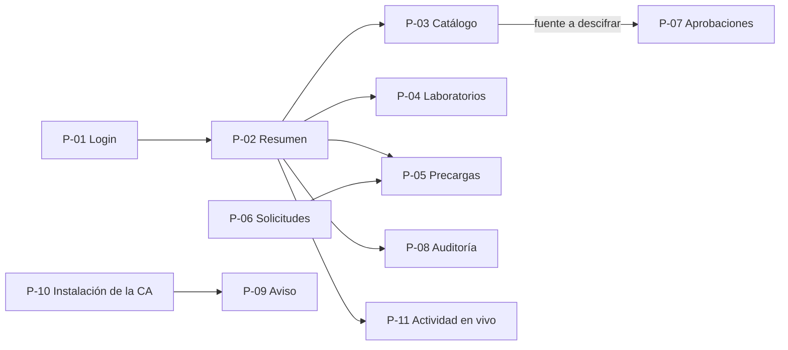

**Herramienta:** Penpot (libre) o Figma (plan educativo). El prototipo usa datos de ejemplo coherentes con CE03 (laboratorios con sus rangos /26, nodos EDGE01/EDGE02).

**Estado en el repositorio:** el prototipo v0.2 (`docs/software/e1/prototipo/`: `celeris-prototipo.pen`, PNG, `navegable.html` y `pantallas.md`) tiene las 11 pantallas de esta tabla. Reemplaza al de la rama `ce02/e1-requerimientos-diseno` (flota, certificados, registro en vivo, detecciones). En P-01 y P-02 se muestra un distintivo "acceso remoto" cuando la sesión llega por EC2-GW, y las acciones críticas aparecen deshabilitadas con el motivo (REQ-F-37).

### C2.2 Validación con stakeholders

- **Participantes:** ≥ 2 encargados de laboratorio (usuarios principales), 1 técnico DTI, 1 docente, 1 estudiante.
- **Tareas:** (1) agregar una fuente sin descifrado; (2) agregar una que requiere descifrado y verla pendiente; (3) habilitar un laboratorio en un horario; (4) programar una precarga; (5) encontrar el ahorro del mes; (6) verificar la huella de la CA desde el portal.
- **Medición:** éxito por tarea, tiempo por tarea (meta ≤ 5 min, REQ-NF-12), SUS ≥ 75.
- **Evidencia:** acta firmada, hallazgos priorizados, cambios aplicados (versión antes/después).

---

## C3. Diseño arquitectónico (CE0213)

### C3.1 C1 — Contexto

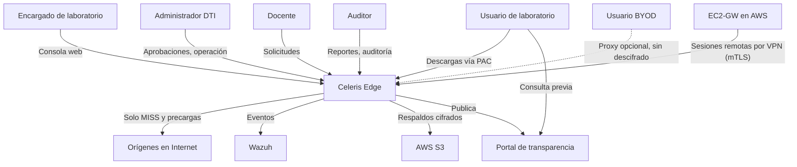

### C3.2 C2 — Contenedores (vista de despliegue)

| Contenedor | Tecnología | Responsabilidad | Despliegue (CE03) |
| --- | --- | --- | --- |
| `celeris-node` | Rust (Hudsucker, rustls, Hyper, Tokio, moka) | Proxy, caché, TLS selectivo, precarga, métricas | EDGE01, EDGE02 |
| `celeris-console` (API) | Rust (axum) | Catálogo, laboratorios, precargas, aprobaciones, reportes, auditoría, firma de configuración, generación del PAC y del portal | CTRL01 |
| Consola web | SPA servida por la API | Interfaz del encargado (P-01 a P-08) | CTRL01 |
| Base de datos | PostgreSQL (local, por socket Unix) | Catálogo, laboratorios, precargas, usuarios, auditoría, KPI diarios | CTRL01; respaldos cifrados en S3 (sin réplica) |
| Portal | Sitio estático firmado | Aviso y huella de la CA (P-09, P-10) | PORTAL01 (Caddy + Coraza) |
| PAC | Servido por el propio nodo (`pac.rs`) | Lista de nodos + `DIRECT` | EDGE01, EDGE02 |
| Gateway de acceso remoto | Caddy + Coraza, sin estado | TLS público, WAF, límite de intentos; reenvía a la API con certificado de cliente | EC2-GW (AWS); no es parte del software del proyecto, se configura con IaC |

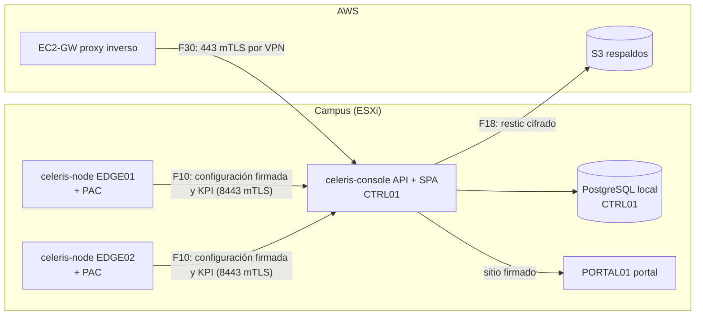

### C3.3 C3 — Componentes

**`celeris-node`:**

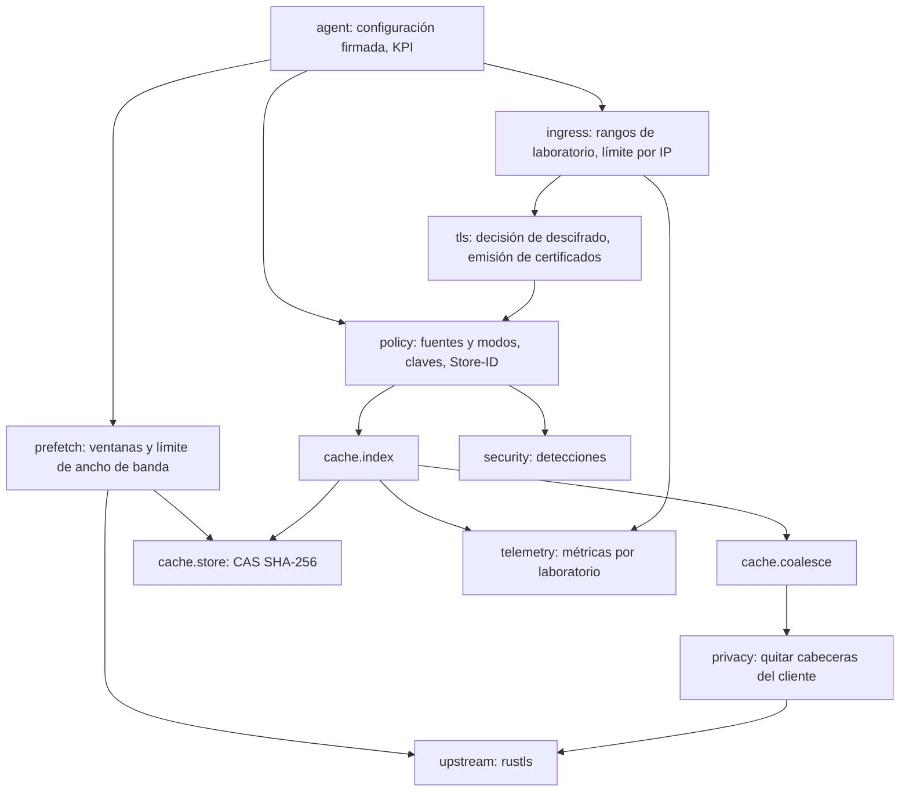

**`celeris-console`:**

| Componente | Responsabilidad | Requisitos |
| --- | --- | --- |
| `auth` | Login, segundo factor, sesiones, RBAC por laboratorio; marca el origen de la sesión (`campus` / `remoto` por el certificado de EC2-GW) y bloquea acciones críticas desde `remoto` | F-33, F-37, RN-06 |
| `catalog` | Fuentes, dominios, modos, simulador, aprobaciones | F-31, F-20, RN-04, RN-07, RN-09 |
| `labs` | Laboratorios, rangos, horarios | F-32 |
| `prefetch` | Precargas y solicitudes | F-34, F-35, RN-10 |
| `publisher` | Compilar y firmar la configuración (incluida la lista de redes BYOD en modo `nunca`), el PAC y el portal | F-17, F-26, F-30, F-36, RN-11 |
| `reports` | KPI por laboratorio y fuente | F-25 |
| `audit` | Registro de cambios solo de inserción | F-24 |

**Del código actual al diseño:**

| Archivo actual | Destino |
| --- | --- |
| `policy.rs`, `config.rs` | `policy` (fuentes y modos en lugar de listas planas) |
| `store.rs`, `coalesce.rs`, `memory.rs` | `cache.*` |
| `ca.rs`, `secure.rs`, `upstream.rs` | `tls`, `upstream` |
| `access.rs`, `clients.rs` | `ingress` (rangos por laboratorio) |
| `detect.rs`, `security.rs` | `security` |
| `stats.rs`, `access_log.rs`, `monitor.rs`, `live.rs` | `telemetry` (etiqueta de laboratorio) |
| `admin.rs`, `panel/` | Se reemplazan por `celeris-console` |
| `notice.rs` | Generación del aviso, reutilizada por `publisher` |

### C3.4 Registro de decisiones (ADR, formato MADR)

La numeración es compartida con CE03.

| ADR | Decisión | Alternativas | Consecuencia |
| --- | --- | --- | --- |
| D-01 | Rust + Tokio para nodo y consola | Go, Python | Seguridad de memoria y rendimiento; curva de aprendizaje alta |
| D-02 | Hudsucker para el proxy con MITM | Squid, mitmproxy | CONNECT + MITM en Rust, ya funcionando en el repositorio |
| D-03 | Almacenamiento direccionado por contenido | Clave por URL | Deduplica el mismo instalador servido desde URLs distintas |
| D-04 | CA raíz offline + intermedia por nodo con Name Constraints | Una CA única | Un nodo comprometido no compromete al otro |
| D-05 | Proxy explícito con PAC por URL fija (GPO) | Proxy transparente, autodescubrimiento WPAD | Funciona con HTTPS y ECH; evita el secuestro de WPAD; `DIRECT` de respaldo |
| D-06 | Bloquear UDP/443 en laboratorios | Permitir QUIC | Las descargas usan TCP y pasan por la caché |
| D-09 | OpenTofu + Ansible | Terraform, scripts | Licencia abierta |
| D-11 | Configuración firmada (ed25519) publicada por la consola | Editar `config.toml` en cada nodo | El encargado cambia sin tocar servidores; el nodo rechaza lo no firmado |
| D-12 | PostgreSQL para la consola, local en CTRL01 | SQLite; base en AWS | Transacciones y tipos ricos; la continuidad es por respaldo en S3 (sin réplica, D-25) |
| D-20 | Catálogo de contenido con tres modos y aprobación DTI solo para descifrar | Una lista única editable por cualquiera; todo por la DTI | Autonomía del encargado sin ceder el control de lo sensible (RN-07) |
| D-21 | Precarga en el nodo, no en un servicio aparte | Servicio de prefetch independiente | Reutiliza caché, coalescencia y verificación de hash; menos piezas |
| D-22 | Ahorro reportado por laboratorio, nunca por persona | Reporte por IP | Cumple minimización de datos; basta para el business case |
| D-24 | Acceso remoto por un proxy inverso en AWS (EC2-GW) a través de la VPN | Publicar la consola en el campus; VPN de acceso remoto; túnel de un tercero | El campus no publica la consola; la API debe distinguir el origen (F-37) |
| D-25 | Frontend, backend y base de la consola en el campus | Backend en AWS; SPA en S3 + CloudFront | El nodo no depende de Internet para su configuración; la llave de firma y los datos quedan en el campus; mismo origen para SPA y API |
| D-27 | BYOD sin descifrado y proxy opcional | Descifrar con CA voluntaria; dejar BYOD fuera | Se cumple la privacidad; el ahorro en BYOD es bajo y se declara así (F-36, RN-11) |

D-15 a D-19, D-23, D-26 y D-28 (portal en DMZ, DMZ dividida, firewall en el camino, laboratorio efímero, shield fuera de alcance, rangos /26, FortiGate, simplificación de servicios) están en CE03.

---

## C4. Diseño detallado (CE0214)

### C4.1 Modelo de dominio

```mermaid
classDiagram
  class Laboratorio { +id +nombre +rango_cidr +horario +habilitado }
  class Usuario { +id +nombre +rol +mfa_activo }
  class Asignacion { +usuario_id +laboratorio_id }
  class Fuente { +id +nombre +categoria +modo +estado }
  class Dominio { +sufijo }
  class Aprobacion { +fuente_id +aprobada_por +fecha }
  class Precarga { +id +laboratorio_id +urls +ventana_inicio +ventana_fin +estado +bytes }
  class Solicitud { +id +docente +laboratorio_id +descripcion +fecha_clase +estado }
  class VersionConfig { +version +firma +publicada_en }
  class Nodo { +id +hostname +version_aplicada +ultimo_contacto }
  class KpiDiario { +fecha +laboratorio_id +bytes_cache +bytes_origen +hits +misses }
  class Cambio { +id +usuario_id +objeto +antes +despues +fecha }
  Usuario "1" --> "*" Asignacion
  Laboratorio "1" --> "*" Asignacion
  Fuente "1" --> "*" Dominio
  Fuente "1" --> "0..1" Aprobacion
  Laboratorio "1" --> "*" Precarga
  Solicitud "0..1" --> "1" Precarga
  VersionConfig "1" --> "*" Nodo
  Laboratorio "1" --> "*" KpiDiario
  Usuario "1" --> "*" Cambio
```

### C4.2 Secuencia — el encargado agrega una fuente que requiere descifrado

```mermaid
sequenceDiagram
  participant E as Encargado
  participant C as celeris-console
  participant A as Administrador DTI
  participant N as Nodos
  E->>C: agregar fuente "download.jetbrains.com", modo descifrar_y_cachear
  C->>C: validar (RN-04, RN-09) y simular sobre registros de ayer
  C-->>E: queda "pendiente de aprobación"
  A->>C: aprobar fuente (solo desde el campus; desde EC2-GW → 403, REQ-F-37)
  C->>C: firmar configuración v43 (ed25519) + auditoría
  N->>C: consultar configuración (cada 30 s)
  C-->>N: v43 firmada
  N->>N: verificar firma, aplicar; si falla, volver a v42
  N-->>C: v43 aplicada
  C-->>E: fuente activa
```

### C4.3 Secuencia — precarga nocturna y HIT en la clase

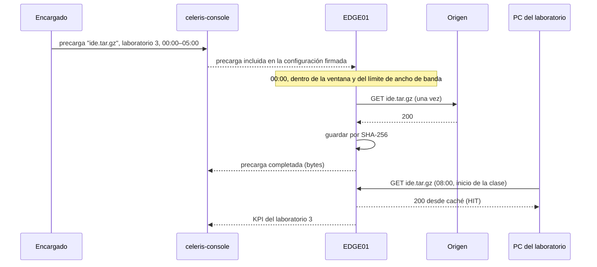

### C4.4 Secuencia — MISS con coalescencia (existente)

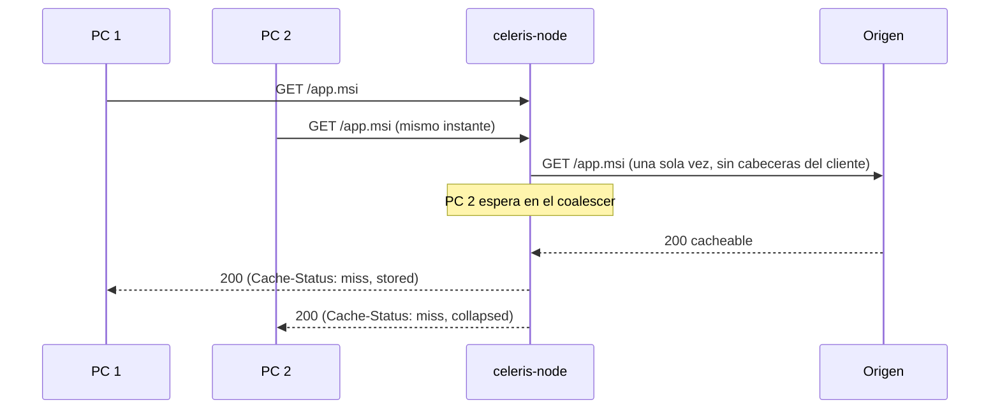

### C4.5 Estados de una fuente del catálogo

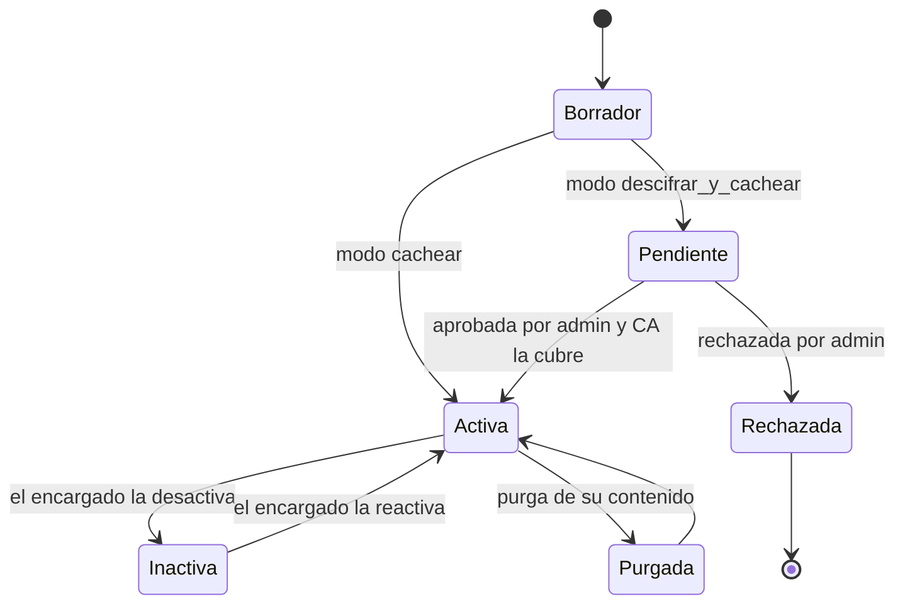

### C4.6 Estados de una precarga

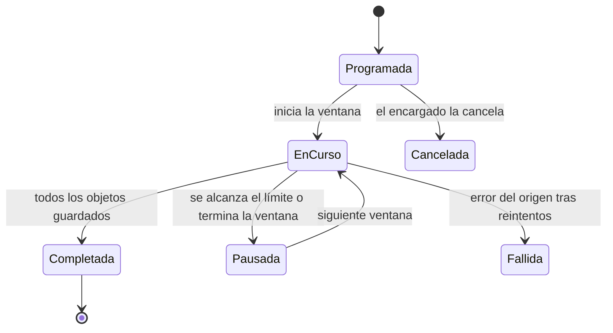

### C4.7 Estados de una entrada de caché

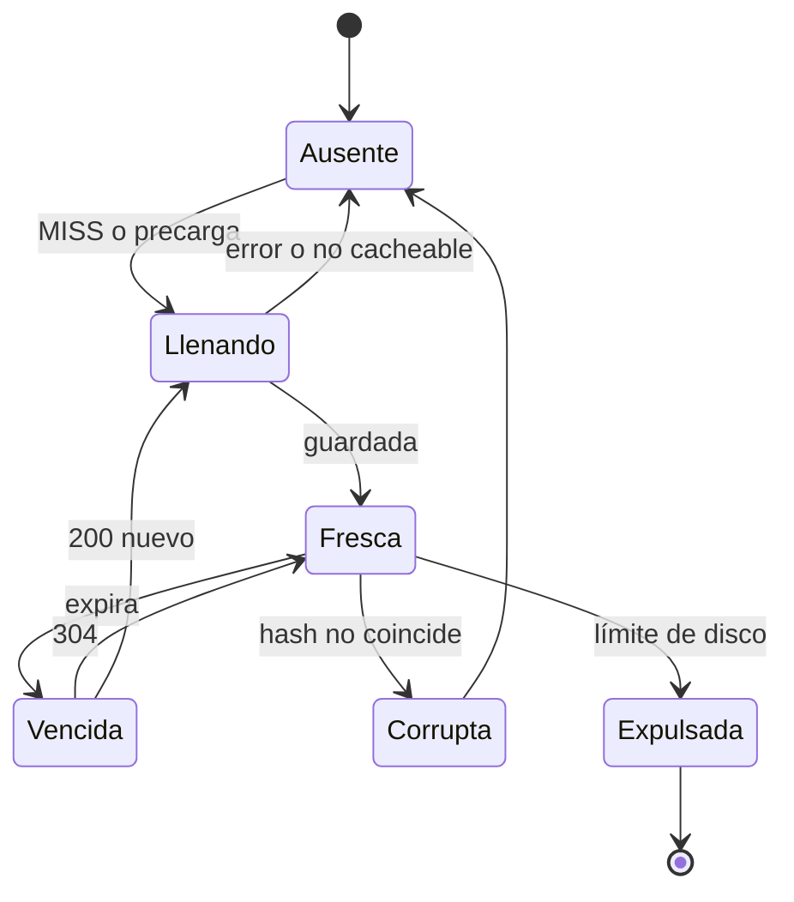

### C4.8 Modelo de datos preliminar (base para CE022 en S2)

| Tabla | Columnas principales | Nota |
| --- | --- | --- |
| `laboratorio` | id, nombre, rango_cidr, horario, habilitado | Rangos de CE03 D1.8 |
| `usuario` | id, nombre, rol, mfa_secret_cifrado | Roles: encargado, admin, auditor |
| `asignacion` | usuario_id, laboratorio_id | RN-06 |
| `fuente` | id, nombre, categoria, modo, estado | |
| `fuente_dominio` | fuente_id, sufijo | |
| `aprobacion` | fuente_id, aprobada_por, fecha, decision | RN-07 |
| `precarga` | id, laboratorio_id, ventana_inicio, ventana_fin, estado, bytes_total | |
| `precarga_item` | precarga_id, url_sin_query, sha256, estado | |
| `solicitud` | id, docente, laboratorio_id, fecha_clase, descripcion, estado, precarga_id | |
| `version_config` | version, contenido, firma, publicada_por, publicada_en | Inmutable |
| `nodo` | id, hostname, version_aplicada, ultimo_contacto | |
| `kpi_diario` | fecha, laboratorio_id, fuente_id, bytes_cache, bytes_origen, hits, misses | Sin datos personales |
| `cambio` | id, usuario_id, accion, objeto, antes, despues, fecha | Solo inserción |

### C4.9 API de la consola (borrador)

| Método | Ruta | Uso | Rol |
| --- | --- | --- | --- |
| POST | `/v1/sesion` | Login con segundo factor | Todos |
| GET/POST/PATCH | `/v1/fuentes` | Catálogo | Encargado |
| POST | `/v1/fuentes/{id}/simular` | ¿Se cachearía? | Encargado |
| POST | `/v1/fuentes/{id}/aprobar` | Aprobar descifrado | Admin, solo origen `campus` (F-37) |
| GET/PATCH | `/v1/laboratorios/{id}` | Habilitar, horario | Encargado asignado |
| GET/POST | `/v1/precargas` | Programar y ver avance | Encargado |
| GET | `/v1/reportes/ahorro?lab=&desde=&hasta=` | Ahorro | Encargado, auditor |
| GET | `/v1/nodos/{id}/config?desde=v` | El nodo descarga la configuración firmada | Nodo (mTLS) |
| POST | `/v1/nodos/{id}/kpi` | El nodo reporta KPI | Nodo (mTLS) |
| GET | `/v1/auditoria` | Cambios | Auditor, admin |

---

## C5. Matriz de trazabilidad (anexo del entregable)

Se genera en CI a partir de etiquetas en Markdown (`REQ-F-31`), Gherkin (`@REQ-F-31`) y Rust (`// req: REQ-F-31`).

| Requisito | Objetivo (CE01) | Caso de uso | Componente | ADR | Pantalla | Prueba | Infraestructura (CE03) |
| --- | --- | --- | --- | --- | --- | --- | --- |
| REQ-F-02 | OB-1, OB-4 | CU-01 | node.tls | D-04, D-05 | P-03 | `intercepcion.feature` | EDGE01/02, F1 |
| REQ-F-05 | OB-1 | CU-01 | node.cache.coalesce | D-03 | — | e2e "20 peticiones, 1 descarga" | EDGE01/02 |
| REQ-F-10 | OB-5 | CU-04 | node.ingress | D-23 | P-04 | T13, T52 | Rangos /26 de LAB |
| REQ-F-22 | OB-2 | CU-05 | node.prefetch | D-21 | P-05 | `precarga.feature`, T50 | F8 |
| REQ-F-25 | OB-1 | CU-06 | console.reports | D-22 | P-02 | `reportes.feature` | F10 |
| REQ-F-26 | OB-2 | CU-01 | node (`pac.rs`), console.publisher | D-05 | — | T09 | EDGE01/02, F3 |
| REQ-F-28 | OB-4 | CU-01 | node.privacy | — | — | `privacidad.feature`, T26 | F8 |
| REQ-F-31 | OB-3 | CU-03, CU-07 | console.catalog | D-20 | P-03, P-07 | `catalogo.feature`, T51 | CTRL01, F28, F10 |
| REQ-F-32 | OB-3 | CU-04 | console.labs | D-20, D-23 | P-04 | T52 | CTRL01, EDGE01/02 |
| REQ-F-33 | OB-3, OB-5 | CU-11 | console.auth | — | P-01 | `auth.feature`, T53 | F28, F29 |
| REQ-F-34 | OB-2 | CU-05 | console.prefetch | D-21 | P-05 | `precarga.feature`, T50 | CTRL01 |
| REQ-F-36 | OB-4 | CU-01 | node.tls, console.publisher | D-27 | — | T56 | WIFI-EST, F31 |
| REQ-F-37 | OB-3, OB-5 | CU-07, CU-11 | console.auth | D-24 | P-01, P-07 | `origen.feature`, T54 | EC2-GW, F30 |
| REQ-NF-14 | OB-5 | — | console API, node admin | — | — | T27 | F28, F30 |

## C6. Software recomendado

| Necesidad | Recomendado | Alternativa | Cuándo cambiar |
| --- | --- | --- | --- |
| Prototipo | Penpot | Figma | Si se necesita prototipado interactivo más rápido |
| C4 | Structurizr DSL | C4-PlantUML, draw.io | Si el docente pide edición manual |
| UML | PlantUML | Mermaid, StarUML | Mermaid para diagramas dentro del Markdown |
| ADR | MADR en `docs/adr/` | Log4brains | Sitio navegable |
| Trazabilidad | OpenFastTrace | Script propio | Si complica el CI |
| Criterios ejecutables | `cucumber` (Rust) | Pruebas de integración | — |
| Calidad | clippy, cargo-deny, cargo-audit, cargo-llvm-cov | SonarQube | S2 (CE024) |
| CI | GitHub Actions | Woodpecker | Autoalojado |

## C7. Rúbrica CE02 E1 → evidencia

| Criterio oficial | Qué presentar para "Excelente" |
| --- | --- |
| Completitud y claridad de requerimientos | C1 completo: RF, RNF por ISO 25010, reglas, restricciones, casos de uso, historias y criterios Gherkin |
| Coherencia requerimientos – prototipos – diseño | Cada pantalla P-xx y cada componente C3 cita sus REQ; el prototipo usa datos coherentes con CE03 |
| Definición de arquitectura | C4 (C1, C2 como vista de despliegue, C3) + ADR, alineados al problema de los laboratorios |
| Modelado del sistema (UML) | Dominio, 3 secuencias, 3 diagramas de estados, modelo de datos y API |
| Trazabilidad de requerimientos | Matriz C5 generada en CI, conectada con CE01 (OB) y CE03 (componentes, flujos, pruebas) |
| Validación con stakeholders | Acta con encargados reales, tareas medidas, SUS y cambios aplicados |
| Sustentación | Cada integrante defiende cualquier requisito, pantalla o decisión |

## C8. Alcance de S2 (para no sobredimensionar ahora)

En S2 la línea evalúa CE022 (datos), CE023 (programación) y CE024 (calidad). El modelo de datos C4.8 es la base de CE022; la consola es el sistema web de CE023; las pruebas Gherkin, el CI y la imagen firmada son la base de CE024. Nada de esto se implementa en S1. REQ-F-26 (PAC), el único R1 que faltaba, ya está implementado en la rama `e1/matriz-pruebas`.
