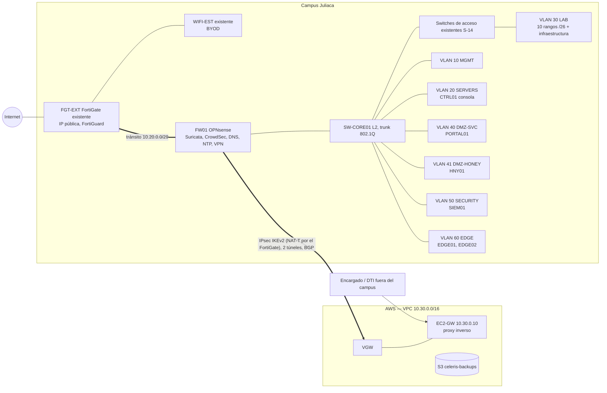

# Celeris Edge — CE03 Infraestructura Tecnológica

Ambos entregables S1 son **diseño, sin implementación**. La implementación corresponde a CE0312–13 y CE0332–33 en S2. La sección D5 explica cómo se demuestra el diseño.

El problema, el alcance y los supuestos están en **00 Marco común**. Los objetivos OB-x vienen de **CE01**; los requisitos REQ-x y los contenedores de software, de **CE02**. El porqué de cada componente y de qué va en la nube está en **`Celeris-Arquitectura-v0.4.md`**.

**Regla de coherencia:** la fuente final de IP, VLAN, componentes, flujos, pruebas, objetivos de diseño (OD), amenazas (AM) y detecciones (DET) es `infra/*.yaml` del repositorio. Este documento describe el estado **v0.4**, que se aplica al inventario con las entradas CI-30…CI-38 (D7). Los IDs del repositorio prevalecen; los nuevos empiezan después del último usado. Un ID retirado no se reutiliza.

**Regla de evidencia de la rúbrica:** "no se evalúa como diseñado aquello que solo se describe de forma genérica". Cada control tiene IP, puerto, regla o prueba.

## D0. Glosario de infraestructura

| Término | Significado |
| --- | --- |
| **VLAN / trunk 802.1Q** | Red virtual de capa 2 / enlace que transporta varias VLAN. |
| **Rango de laboratorio** | Sub-bloque /26 de la VLAN de laboratorios asignado a un laboratorio. Es la unidad con la que el encargado habilita accesos. |
| **DMZ** | Zona para servicios expuestos a Internet. Aquí hay dos: servicios reales (DMZ-SVC) y señuelos (DMZ-HONEY). |
| **Router-on-a-stick** | El firewall enruta entre VLAN por un trunk; todo tráfico entre zonas pasa por una regla. |
| **Red de tránsito** | Red pequeña (/29) que une FW01 con el FortiGate existente. |
| **NAT 1:1 / NAT-T** | El FortiGate traduce la IP pública a FW01 para puertos concretos / IPsec encapsulado en UDP 4500 para cruzar un NAT. |
| **VPC / subred pública y privada** | Red virtual de AWS; es pública si su tabla de rutas apunta a un Internet Gateway. |
| **VGW** | Virtual Private Gateway: extremo AWS de la VPN; usa un túnel a la vez (sin ECMP). |
| **IPsec IKEv2 / BGP** | Túnel cifrado / ruteo dinámico por el túnel. |
| **MTU / MSS clamping** | Tamaño máximo de paquete / ajuste para que el paquete con cabecera IPsec no se fragmente. |
| **Security Group / NACL** | Firewall con estado por instancia / filtro sin estado por subred. |
| **Proxy inverso (EC2-GW)** | Servidor en AWS que recibe el HTTPS del panel y lo reenvía a la consola por la VPN; no guarda datos. |
| **mTLS** | TLS en el que ambos extremos presentan certificado. |
| **WAF / OWASP CRS** | Firewall de aplicación web / reglas libres que usa (Coraza, ModSecurity). |
| **IDS / IPS** | Detecta / además bloquea intrusiones (Suricata). |
| **Honeypot / canary** | Señuelo: cualquier contacto con él es sospechoso. |
| **SIEM** | Plataforma que correlaciona eventos de seguridad (Wazuh). |
| **Defensa en profundidad** | Capas independientes de protección: si una falla, quedan las demás. |
| **Trayecto de los datos** | El camino completo de un dato, tramo por tramo, con su protección. |
| **DNSSEC / NTS** | Validación de respuestas DNS / NTP autenticado. |
| **RA guard / DHCP snooping / DAI** | Controles del switch contra anuncios IPv6, DHCP y ARP falsos. |
| **STRIDE / MITRE ATT&CK** | Modelo de amenazas / catálogo de técnicas de atacantes. |
| **Break-glass** | Acceso de emergencia que funciona aunque caiga el firewall. |
| **vSwitch / port group / NIC teaming** | Switch virtual de ESXi / grupo de puertos con una VLAN / varias NIC para redundancia. |
| **RTO / RPO** | Tiempo máximo de recuperación / pérdida máxima de datos aceptable. |
| **containerlab** | Herramienta que levanta topologías de red con contenedores desde un YAML. |

---

## D1. Entregable 1 — Análisis y Diseño de Red (CE0311)

**Estructura del informe:** la plantilla `docs/fuentes/CE03/S1_E1_Analisis_y_Diseno_de_Red.docx` tiene **11 secciones**. Los 15 contenidos mínimos de la guía caben en ellas.

| Sección del DOCX | Contenido (D1.x) |
| --- | --- |
| 1 Resumen ejecutivo (+ Figura 1.1) | D1.1 |
| 2 Organización y necesidades (2.1, 2.2, 2.3) | D1.2, D1.3, D1.4 |
| 3 Alcance (3.1, 3.2, 3.3) | D1.5 |
| 4 Objetivos | D1.6 |
| 5 Topologías (5.1 general, 5.2 lógica, 5.3 seguridad y zonas, 5.4 VPN, 5.5 flujos, 5.6 componentes) | D1.7–D1.12 |
| 6 Conectividad híbrida (con la matriz de pruebas) | D1.10, D1.16 |
| 7 Seguridad perimetral (7.1 firewall, 7.2 DMZ, 7.3 segmentación) | D1.13, D1.9 |
| 8 Detección | D1.14 |
| 9 Escalabilidad y disponibilidad · 10 Conclusiones · 11 Referencias | D1.15 |

**Productos obligatorios:** informe DOCX + PDF; diagramas draw.io + PNG/PDF (general, lógica, seguridad y zonas, VPN, flujos); matriz de componentes (100 % de lo dibujado); matriz de pruebas planeadas.

### D1.1 Resumen ejecutivo (→ DOCX 1)

- **Proyecto / organización:** Celeris Edge en los laboratorios de cómputo del Campus Juliaca y en el Wi-Fi de estudiantes [S-01, S-26, S-28].
- **Problema de conectividad:** las descargas grandes se repiten en cada PC y saturan el enlace del campus (00 M2).
- **Problema de seguridad:** red de laboratorios plana, sin segmentación respecto de los servicios, sin detección interna y sin forma de que el usuario sepa qué se inspecciona. A esto se suma el riesgo académico de los exámenes (00 M2.4).
- **Topología propuesta:** detrás del FortiGate existente, un firewall OPNsense (FW01) segmenta 7 VLAN. El nodo de caché atiende las descargas desde la LAN; solo los MISS y las precargas salen a Internet, por el FortiGate y su filtro FortiGuard.
- **VPN:** IPsec IKEv2 (AES-256-GCM), dos túneles activo/pasivo con BGP hacia una VPC de AWS. Transporta el panel remoto (EC2-GW → consola) y sus eventos.
- **Zonas:** MGMT, SERVERS, LAB (un rango /26 por laboratorio), DMZ-SVC, DMZ-HONEY, SECURITY, EDGE. El Wi-Fi de estudiantes (BYOD) es una zona externa al FW01, sin descifrado.
- **Riesgos preliminares:** FW01 virtual como punto único de falla; rendimiento de la caché a través de FW01; dependencia de configuraciones del FortiGate [S-29]; exposición del portal, del honeypot y del panel remoto; evasión del proxy (QUIC, DoH, IPv6).
- **Siguientes pasos:** demostración en el laboratorio emulado (D5) y, en S2, implementación y ejecución de la matriz D1.16.

### D1.2 Organización y necesidades de red (→ DOCX 2.1)

| Necesidad | Valor | Fuente |
| --- | --- | --- |
| Equipos institucionales en alcance | 400 PCs en 10 laboratorios de 40 | [S-01, S-26] |
| Equipos personales | BYOD en el Wi-Fi de estudiantes (red de la DTI) | [S-28] |
| Enlace a Internet | 300 Mbps simétricos; IP pública en el FortiGate | [S-02, S-15, S-29] |
| Perímetro existente | FortiGate con FortiGuard (filtrado por categorías) | DTI |
| Descarga típica que se repite | ≈ 3 GB por PC por ciclo | [S-27] |
| Servicios que dependen de la red | Descargas de clase, actualizaciones, consola del encargado, portal, SIEM | Levantamiento |
| Uso de la nube | Acceso remoto al panel sin publicar el campus; respaldos inmutables | Arquitectura v0.4 §1 |
| Disponibilidad esperada | Navegación ≥ 99,5 % (REQ-NF-03) | CE02 |
| Crecimiento | Hasta 16 laboratorios en el mismo /22; más con /21 | D1.15 |

### D1.3 Servicios y procesos críticos (→ DOCX 2.2)

| Proceso (CE01) | Servicio TI | Criticidad |
| --- | --- | --- |
| Clases en laboratorio | Descargas vía caché + DNS + PAC | Alta |
| P1 Actualización masiva | Nodos de caché + precarga | Alta |
| P2 Preparación de laboratorio | Consola del encargado + precarga | Alta |
| Consentimiento informado | Portal de transparencia | Alta (previo al uso) |
| Administración fuera del campus | EC2-GW + VPN | Media |
| Monitoreo de seguridad | Wazuh + Suricata + WAF + honeypots | Media |
| Respaldo | Copia local + S3 | Media |

### D1.4 Partes interesadas (→ DOCX 2.3)

| Parte interesada | Tipo de la plantilla | Interés en la red |
| --- | --- | --- |
| Encargados de laboratorio | Administradores del servicio | Gestionar contenido y accesos de su laboratorio, también desde fuera del campus |
| Estudiantes (PC institucional y BYOD) y docentes | Clientes / usuarios | Descargas rápidas, disponibilidad, privacidad; integridad de los exámenes (futuro) |
| Técnicos de la DTI | Empleados / administradores | Segmentación, operación, FortiGate, seguridad |
| Dirección del campus | Dirección | Costo del enlace, riesgo |
| ISP local | Proveedor / ISP | Enlace, IP fija |
| AWS | Proveedor cloud | Extremo VPN, EC2, S3 |
| Oficial de datos personales; Autoridad Nacional de Protección de Datos Personales | Organismo regulador | Ley 29733 |

### D1.5 Alcance (→ DOCX 3)

- **Declaración:** el diseño comprende la conectividad, el direccionamiento, la segmentación, la seguridad perimetral, la detección y la protección en tránsito de la red de los laboratorios, de los servicios de caché y de su consola, la integración del Wi-Fi de estudiantes como cliente sin descifrado, y la integración por VPN con una VPC de AWS para el acceso remoto y los respaldos.
- **Límites físicos:** rack del servicio (servidor ESXi, switch núcleo, UPS) y sus enlaces con la capa de acceso de los laboratorios y con el FortiGate.
- **Límites tecnológicos:** OPNsense, VLAN y rangos de laboratorio, VPN, Suricata, WAF, honeypots, VPC, subredes, tablas de rutas, EC2, Security Groups, NACL, S3.
- **Límites organizacionales:** la DTI administra el FortiGate, el Wi-Fi y la capa de acceso, y aprueba lo sensible. Cada encargado administra el contenido y los accesos de sus laboratorios desde la consola. El equipo del proyecto opera el piloto.
- **Exclusiones (00 M3.2):** descifrado de BYOD; rediseño del FortiGate, del Wi-Fi y de la capa de acceso [S-14, S-28, S-29]; red administrativa; modo examen; shield en AWS (D-19).

### D1.6 Objetivos medibles del diseño (→ DOCX 4)

IDs del repositorio (`infra/trazabilidad.yaml`). OD-04 cambia de meta (CI-34). OD-11 y OD-12 son nuevos.

| ID | Objetivo | Indicador | Meta | Objetivo del proyecto |
| --- | --- | --- | --- | --- |
| OD-01 | Segmentar por zonas | Servidores del servicio en VLAN dedicadas | 100 % | OB-5 |
| OD-02 | Aislar la gestión | Interfaces de gestión alcanzables solo desde JMP01 | 100 % | OB-5 |
| OD-03 | Rutas alternas de descarga | Rutas por PC | ≥ 3 (EDGE01, EDGE02, DIRECT) | OB-1, OB-2 |
| OD-04 | Resolución DNS confiable | Resolvedor con DNSSEC en FW01; sin dependencia oculta (si FW01 cae, no hay ruteo) | 1 resolvedor validado + `DIRECT` del PAC | OB-2 |
| OD-05 | Enlace híbrido redundante | Túneles / convergencia medida | 2; ≤ 60 s | — |
| OD-06 | Política por defecto | Tráfico entre zonas con regla explícita y registro | 100 % (deny-all en el resto) | OB-5 |
| OD-07 | Protección en tránsito | Flujos con protección o riesgo aceptado documentado | 100 % de D1.11 | OB-4 |
| OD-08 | Servicio expuesto endurecido | Calificación TLS del portal y de EC2-GW; puertos abiertos | ≥ A; solo 80/443 | OB-4 |
| OD-09 | Detección | Escenarios planificados detectados en S2 | ≥ 90 % | OB-5 |
| OD-10 | Adopción del proxy | Bytes de LAB que pasan por la caché | ≥ 90 % en modo gestionado | OB-1 |
| OD-11 | Acceso por laboratorio | Laboratorios con rango propio que el encargado habilita | 10 de 10 | OB-3 |
| OD-12 | Panel remoto sin exponer el campus | Puertos del campus que alcanzan CTRL01 desde Internet | 0 | OB-3, OB-5 |

### D1.7 Topología general (→ DOCX 5.1)

**Para el informe:** la Figura 5.1 muestra todos los componentes de D1.12 con su ID. La Figura 1.1 es una versión de ≤ 12 bloques que cuenta el problema: una descarga entra una vez y se reparte por la LAN.

### D1.8 Topología lógica (→ DOCX 5.2)

#### Posición frente al FortiGate (D-26)

- FW01 se conecta al FortiGate por la red de tránsito **10.20.0.0/29**: FortiGate 10.20.0.1, FW01 10.20.0.2 [S-29].
- El FortiGate conserva la IP pública 203.0.113.10 [S-15] y hace NAT 1:1 hacia 10.20.0.2 **solo** para UDP 500/4500 (IPsec con NAT-T) y TCP 80/443 (portal).
- El FortiGate excluye EDGE01/02 de su inspección SSL profunda, para que el nodo verifique el certificado real del origen [S-29].
- El pedido a la DTI (S-29) incluye, durante la ventana autorizada del señuelo (F24), TCP 22 y 23 hacia 10.20.0.2 (HNY01). Si la DTI lo niega, HNY01 solo ve tráfico interno (CI-60).
- FortiGuard sigue filtrando la salida de los nodos: la caché solo guarda lo que la política institucional ya permite.

#### Plan de direccionamiento

Supernet del proyecto: **10.20.0.0/16** (RFC 1918). AWS: **10.30.0.0/16**. Wi-Fi de estudiantes: red de la DTI, valor provisional **172.16.0.0/16** [S-28]. Sin solapamientos. Convención: VLAN = tercer octeto (excepción: VLAN 30 usa 10.20.32.0/22).

| VLAN | Nombre | Red / CIDR | Gateway | Hosts útiles | Propósito |
| ---: | --- | --- | --- | ---: | --- |
| — | Tránsito | 10.20.0.0/29 | 10.20.0.1 (FortiGate) | 6 | FW01 ↔ FortiGate |
| 10 | MGMT | 10.20.10.0/24 | 10.20.10.1 | 254 | Gestión de ESXi, switch, IPMI, UPS, JMP01; puerto break-glass |
| 20 | SERVERS | 10.20.20.0/24 | 10.20.20.1 | 254 | Consola del encargado (CTRL01) |
| 30 | LAB | 10.20.32.0/22 | 10.20.32.1 | 1 022 | PCs de los 10 laboratorios e infraestructura de laboratorio |
| 40 | DMZ-SVC | 10.20.40.0/24 | 10.20.40.1 | 254 | Portal de transparencia (PORTAL01) |
| 41 | DMZ-HONEY | 10.20.41.0/24 | 10.20.41.1 | 254 | Honeypot (HNY01) |
| 50 | SECURITY | 10.20.50.0/24 | 10.20.50.1 | 254 | Wazuh (SIEM01) |
| 60 | EDGE | 10.20.60.0/24 | 10.20.60.1 | 254 | Nodos de caché |
| 999 | BLACKHOLE | — | — | — | VLAN nativa sin uso; puertos libres apagados |

**Retiradas en v0.4:** VLAN 31 LAB-TEST (KALI01 pasa al rango de infraestructura de LAB), 70 STORAGE y 71 BACKUP (sin NAS ni NFS).

#### Rangos de laboratorio dentro de VLAN 30 (D-23)

| Laboratorio | Rango | Hosts útiles |
| --- | --- | ---: |
| LAB-01 | 10.20.32.0/26 | 62 |
| LAB-02 | 10.20.32.64/26 | 62 |
| LAB-03 | 10.20.32.128/26 | 62 |
| LAB-04 | 10.20.32.192/26 | 62 |
| LAB-05 | 10.20.33.0/26 | 62 |
| LAB-06 | 10.20.33.64/26 | 62 |
| LAB-07 | 10.20.33.128/26 | 62 |
| LAB-08 | 10.20.33.192/26 | 62 |
| LAB-09 | 10.20.34.0/26 | 62 |
| LAB-10 | 10.20.34.64/26 | 62 |
| Reserva | 10.20.34.128/25 | 126 (laboratorios 11 y 12) |
| Infraestructura de laboratorio | 10.20.35.0/24 | ENC01 .10, LABCLI01 .50, KALI01 .60, HNY02 .250 |

El encargado habilita accesos por laboratorio; el nodo lo aplica con `allowed_clients` por rango (REQ-F-10, F-32). Una VLAN por laboratorio daría aislamiento de capa 2 entre laboratorios, pero exige reconfigurar la capa de acceso, que está fuera de alcance [S-14]; queda como opción de H2. Los rangos se entregan por DHCP con reservas.

#### Ruteo

- FW01 enruta entre VLAN (*router-on-a-stick*); todo tráfico entre zonas pasa por una regla registrada (D-17). SW-CORE01 trabaja en capa 2.
- Ruta por defecto de FW01 → 10.20.0.1 (FortiGate). 10.30.0.0/16 se aprende por BGP desde AWS.
- El FortiGate necesita una ruta estática a 10.20.0.0/16 vía 10.20.0.2 para devolver el tráfico del Wi-Fi hacia EDGE y PORTAL01 [S-29].

#### Servicios de red base (D-28)

| Servicio | Diseño | Por qué |
| --- | --- | --- |
| DHCP | Pools y reservas por rango de laboratorio (FW01 o el DHCP de la DTI [S-14]) | Las reservas convierten "solo PCs institucionales" en un control |
| DNS | Unbound en FW01 con DNSSEC, en la interfaz .1 de cada VLAN; hacia arriba por DoT (F25) | Un DNS en otra VM no aportaba redundancia real: si FW01 cae, no hay ruteo entre zonas |
| PAC | `http://pac.celeris.internal/wpad.dat` por GPO, sin autodescubrimiento. Lo sirven EDGE01 y EDGE02 (`pac.rs`, ya implementado), con dos registros A | Evita el secuestro de WPAD; si un nodo cae, el otro sirve el PAC |
| NTP | FW01 (servidor para las zonas); NTS hacia arriba (F25) | Certificados, firma de la configuración y correlación del SIEM dependen de la hora |
| IPv6 | Deshabilitado en LAB con RA guard y DHCPv6 guard | Un cliente IPv6 se saltaría la caché; el VGW no transporta IPv6 |
| DNS cifrado | TCP/UDP 853 bloqueado desde LAB; DoH limitado por GPO | Que el cliente no se salte el DNS ni el PAC |
| Wi-Fi de estudiantes | DNS y DHCP de la DTI; el PAC se publica en el portal (opcional) o por DHCP opción 252 si la DTI lo decide [S-28] | No se rediseña una red ajena |

#### Matriz de comunicación entre zonas

Política por defecto: **denegar y registrar**. ✔ = solo los flujos indicados (D1.11). El retorno de una conexión permitida no se lista (firewall con estado). DNS y NTP (F2) van de todas las zonas internas a FW01 y no se repiten.

| Origen ↓ / Destino → | MGMT | SERVERS | LAB | DMZ-SVC | DMZ-HONEY | SECURITY | EDGE | AWS | Internet |
| --- | :-: | :-: | :-: | :-: | :-: | :-: | :-: | :-: | :-: |
| **MGMT** (JMP01) | — | ✔ F20 | ✔ F20 | ✔ F20 | ✔ F20 | ✔ F20 | ✔ F20 | ✖ | ✔ F27 |
| **SERVERS** (CTRL01) | ✖ | — | ✖ | ✖ | ✖ | ✔ F13 | ✖ | ✖ | ✔ F18 (S3) |
| **LAB** | ✖ | ✔ F28 (solo ENC01) | — | ✔ F5 | ✖ | ✔ F13 (solo HNY02) | ✔ F1, F3 | ✖ | ✔ F6 piloto; ✖ F7 |
| **WIFI-EST** (por el FortiGate) | ✖ | ✖ | ✖ | ✔ F32 | ✖ | ✖ | ✔ F31 | ✖ | Por el FortiGate, como hoy |
| **DMZ-SVC** | ✖ | ✖ | ✖ | — | ✖ | ✔ F13 | ✖ | ✖ | ✖ |
| **DMZ-HONEY** | ✖ | ✖ | ✖ | ✖ | — | ✔ F13 | ✖ | ✖ | ✖ |
| **SECURITY** | ✖ | ✖ | ✖ | ✖ | ✖ | — | ✖ | ✖ | ✔ F26 |
| **EDGE** | ✖ | ✔ F10 | ✖ | ✖ | ✖ | ✔ F13 | — | ✖ | ✔ F8 |
| **AWS** (EC2-GW) | ✖ | ✔ F30 | ✖ | ✖ | ✖ | ✔ F13 | ✖ | — | — |
| **Internet** (por el FortiGate) | ✖ | ✖ | ✖ | ✔ F21 | ✔ F24 (ventana) | ✖ | ✖ | ✔ F29 (solo EC2-GW) | — |

> Notas para la sustentación:
> 1. **El acceso por laboratorio se aplica en dos capas:** el firewall permite F1 desde toda la VLAN 30; el nodo acepta solo los rangos habilitados. Un laboratorio deshabilitado recibe 403 (T52) y, en modo gestionado, tampoco tiene `DIRECT`.
> 2. **Tráfico que el firewall no ve:** el tráfico entre PCs de la misma VLAN se conmuta en capa 2. Lo compensan el canary HNY02, los controles de capa 2 y el firewall de host de cada servidor.
> 3. **Modo piloto vs. gestionado:** en el piloto, F6 (`DIRECT`) queda abierto como *fail-open*, con dueño (DTI), plazo (fin del piloto) y riesgo registrado. F7 se bloquea siempre.
> 4. **Wi-Fi:** FW01 solo ve el tráfico del Wi-Fi que va a EDGE (F31) o a PORTAL01 (F32). El resto de la navegación BYOD sigue por el FortiGate, sin pasar por el proyecto.
> 5. **Exámenes:** desde LAB y Wi-Fi no se llega a CTRL01, MGMT ni SECURITY. Es la base del modo examen futuro (Arquitectura v0.4 §15).
> 6. **FW01 → DMZ-SVC (F33):** el portal no sale a la WAN (D-29, CI-52). FW01 renueva el certificado por ACME y se lo entrega a PORTAL01 por SFTP en TCP 22; el flujo nace en FW01, por eso no es una celda de esta matriz. El FortiGate debe dejar a FW01 llegar a la CA por TCP 443 y 80 [S-31].

### D1.9 Seguridad perimetral y zonas (→ DOCX 5.3, 7.2, 7.3)

#### Defensa en profundidad

| Capa | Control | Detalle |
| --- | --- | --- |
| Perímetro del campus | FortiGate existente con FortiGuard; NAT 1:1 solo para IPsec y portal | D1.8 |
| Perímetro del proyecto | FW01 *deny-all*, Suricata IPS (tránsito, DMZ-SVC y LAB), CrowdSec, filtrado de salida | D1.13 |
| Zona | 7 VLAN, matriz zona × zona, DMZ dividida (D-16), Wi-Fi fuera de FW01 | D1.8 |
| Laboratorio | Rangos /26 habilitados por el encargado; reservas DHCP | D1.8 |
| Capa 2 | DHCP snooping, DAI, IP source guard, RA guard, port-security, BPDU/root guard, storm control, VLAN nativa 999 | Abajo |
| Host | nftables por servidor, endurecimiento CIS | D2 |
| Aplicación | Nodo con ACL, SSRF y puertos limitados; CA con Name Constraints; BYOD siempre passthrough (REQ-F-36); consola con segundo factor, RBAC y acciones críticas solo desde el campus (REQ-F-37); WAF delante del portal y del panel remoto | CE02 |
| Datos en tránsito | Una protección por flujo y por trayecto | D1.11; Arquitectura v0.4 §8 |
| Integridad de la configuración | Firma ed25519 verificada por el nodo | REQ-F-17, RN-08 |
| Detección | Suricata, honeypot, canary, detecciones del nodo, WAF, auditoría de la consola → Wazuh | D1.14 |
| Recuperación | Break-glass, configuración en Git, respaldos locales + S3 inmutable | D2.9 |

#### Zonas y su nivel de confianza

| Zona | Confianza | Regla de diseño |
| --- | --- | --- |
| MGMT | Máxima | Solo JMP01 inicia conexiones, con MFA |
| SERVERS | Alta | No inicia hacia usuarios; la consola solo se alcanza desde ENC01, JMP01 y EC2-GW (mTLS) |
| SECURITY | Alta | Recibe de todos; solo sale a feeds |
| EDGE | Media | Recibe 3128/80 desde LAB y Wi-Fi; sale a Internet y a la consola |
| LAB | Baja | Solo servicios listados |
| WIFI-EST | Muy baja (equipos no administrados) | Solo EDGE (sin descifrado) y portal |
| DMZ-SVC | Baja, expuesta | No inicia hacia zonas internas |
| DMZ-HONEY | Nula | Solo envía al SIEM |
| AWS (EC2-GW) | Baja, expuesta | Solo CTRL01:443 con mTLS y SIEM01 |

#### Puesto del encargado (ENC01) y acceso remoto

- **En el campus:** el encargado usa ENC01 (10.20.35.10), en el rango de infraestructura de LAB, no en MGMT, para no recibir acceso de administración de red. ENC01 solo alcanza CTRL01:443 (F28).
- **Fuera del campus:** entra por EC2-GW (F29). EC2-GW reenvía a CTRL01 por la VPN con su certificado de cliente (F30).
- **Acciones críticas** (aprobar fuentes a descifrar, rotar llaves, gestionar usuarios, cambiar el perfil BYOD): la API solo las acepta con origen `campus` (REQ-F-37).

#### DMZ-SVC: portal de transparencia protegido (D-15)

| Capa | Control | Justificación |
| --- | --- | --- |
| Perímetro | NAT 1:1 en el FortiGate solo 80/443; Suricata IPS inline en FW01; CrowdSec | Superficie mínima |
| WAF | PORTAL01: Caddy + Coraza + OWASP CRS; límite por IP | Bloquea ataques web conocidos |
| TLS | Certificado **público** (ACME), TLS 1.3 con 1.2 de respaldo, HSTS | El usuario aún no instaló la CA del proyecto |
| Contenido | Sitio estático firmado que genera la consola (REQ-F-30); sin base de datos ni login; FS de solo lectura | Lo que no existe no se puede explotar |
| Cabeceras | CSP `default-src 'self'`, `frame-ancestors 'none'`, `nosniff`, `Referrer-Policy` | Defensa en el navegador |
| Salida | Ninguna hacia la WAN: solo el agente Wazuh (F13). El certificado lo renueva FW01 por ACME y lo entrega por SFTP (F33) | No sirve de trampolín |

WAF y sitio en una sola VM (D-28): el contenido es estático y no hay una capa de aplicación que separar.

#### DMZ-HONEY

HNY01 (Cowrie) en VLAN propia; solo envía al SIEM. Publicar sus puertos (F24) requiere autorización escrita de la DTI y una ventana definida, porque atrae tráfico al enlace que el proyecto quiere descongestionar.

#### Break-glass

Puerto de SW-CORE01 en VLAN 10, rotulado y deshabilitado administrativamente. Si FW01 cae, una laptop (10.20.10.250) en ese puerto alcanza ESXi, IPMI y la consola DCUI para restaurar FW01 desde Git (RTO 1 h).

#### Modelo de amenazas (STRIDE)

AM-01…AM-13 son los del repositorio (ajustados a v0.4). AM-14…AM-18 son nuevos.

| ID | Zona / activo | STRIDE | Amenaza | Control | ISO/IEC 27002 | Prueba |
| --- | --- | :-: | --- | --- | --- | --- |
| AM-01 | LAB → proxy | S | Equipo no institucional o de un laboratorio deshabilitado usa la caché | Rangos habilitados + reservas DHCP + port-security | 8.20, 8.22 | T13, T52 |
| AM-02 | LAB | S | Secuestro de WPAD | URL fija del PAC por GPO | 8.20 | T60 |
| AM-03 | LAB | T | DHCP o RA falso | DHCP snooping, RA guard | 8.20 | T23 |
| AM-04 | Proxy | E | Usar el proxy para alcanzar redes internas | SSRF y puertos limitados | 8.22 | T13, T14 |
| AM-05 | Portal | T | Desfiguración o inyección | WAF + sitio estático firmado | 8.23, 8.26 | T17, T18 |
| AM-06 | Portal | D | Saturación de peticiones | Límite por IP, CrowdSec | 8.20 | T15, T32 |
| AM-07 | Orígenes / nube | I | Datos personales hacia Internet o AWS | Quitar cabeceras del cliente (REQ-F-28); KPI solo por laboratorio | 5.14, 8.24 | T26 |
| AM-08 | Administración | I | Token o sesión en claro | TLS obligatorio (REQ-NF-14) | 8.24 | T27 |
| AM-09 | Syslog | I/T | Logs leídos o alterados en tránsito | Syslog TLS 6514 | 8.15, 8.24 | T28 |
| AM-10 | DMZ-HONEY | E | Honeypot comprometido como trampolín | VLAN propia, sin salida | 8.22 | T20, T47 |
| AM-11 | MGMT | E | Acceso administrativo desde LAB o Wi-Fi | MGMT solo desde JMP01 + MFA | 8.2, 8.22 | T06, T34, T57 |
| AM-12 | FW01 | D | Caída del firewall virtual | Break-glass, XML en Git, CARP en H3 | 8.14 | T25 |
| AM-13 | Cualquiera | R | Acciones sin rastro | Registro de denegaciones, auditoría de la consola, NTP/NTS | 8.15, 8.17 | T33 |
| AM-14 | Panel remoto | S/E | Suplantar al encargado desde Internet o ampliar el descifrado con una sesión robada | 2FA, límite de intentos, WAF, acciones críticas solo desde el campus | 5.15, 8.5 | T53, T54 |
| AM-15 | Nodo | T | Configuración alterada en tránsito o inyectada | Firma ed25519; rechazo de lo no firmado o más antiguo | 8.24 | T51 |
| AM-16 | Enlace | D | Precarga satura el enlace en horario de clase | Ventana horaria y límite (REQ-RN-10) | 8.6 | T50 |
| AM-17 | BYOD | I/E | Descifrar tráfico de un equipo personal, o que un equipo personal alcance servidores o laboratorios | REQ-F-36, RN-11; Wi-Fi solo a EDGE y portal | 5.34, 8.22 | T56, T57 |
| AM-18 | EC2-GW | E | Gateway comprometido usado para pivotar al campus | SG y FW01 solo permiten CTRL01:443 con mTLS; sin datos ni llaves en EC2-GW; recreable | 8.22 | T58 |

#### Controles de capa 2 (requisito para la capa de acceso existente)

DHCP snooping y DAI en VLAN 30; IP source guard; RA guard y DHCPv6 guard; port-security; BPDU guard en acceso y root guard en uplinks; storm control; trunks con lista explícita de VLAN; nativa 999. Si un switch no los soporta, se registra como brecha [S-14]. En el Wi-Fi se pide a la DTI aislamiento de clientes [S-28].

### D1.10 VPN híbrida (→ DOCX 5.4 y 6)

**Qué transporta:** el tráfico del panel remoto (F30) y los eventos de EC2-GW al SIEM (F13). No transporta descargas ni respaldos (F18 va por Internet, cifrado en origen).

| Parámetro | Extremo campus | Extremo AWS |
| --- | --- | --- |
| Dispositivo | FW01 OPNsense (IPsec *route-based*, VTI), detrás del FortiGate | Virtual Private Gateway adjunto a la VPC |
| IP pública | 203.0.113.10 en el FortiGate, NAT 1:1 a 10.20.0.2 (UDP 500/4500) [S-15, S-29] | 2 IP asignadas por AWS |
| Identidad IKE | IP pública (203.0.113.10) | — |
| NAT-T | Sí (UDP 4500), porque FW01 está detrás de NAT | Soportado |
| Redes anunciadas | 10.20.0.0/16 | 10.30.0.0/16 |
| Tipo de túnel | IKEv2, **2 túneles activo/pasivo** | El VGW usa un túnel a la vez (sin ECMP) |
| Ruteo | BGP, ASN 65020; túnel 2 con *AS-path prepending* | BGP, ASN 64512 |
| Direcciones internas | 169.254.10.0/30, 169.254.11.0/30 | Idem |
| Temporizadores BGP | keepalive 10 s, hold 30 s | Idem |
| Fase 1 | AES-256-GCM-16, PRF SHA2-384, DH 20, 28 800 s | Idem |
| Fase 2 | AES-256-GCM-16, PFS 20, 3 600 s | Idem |
| DPD | 10 s, *restart* | Idem |
| MTU / MSS | MTU 1400 en VTI; MSS 1360 (NAT-T agrega 8 bytes; el margen alcanza) | — |
| IPv6 | No (el VGW no lo soporta) | — |
| Secretos | Llave precompartida generada por AWS, cifrada con SOPS; nunca en el informe | — |

**Convergencia:** meta ≤ 60 s **medidos** (T05). En el Modo L ya se midieron 22,6 s.

### D1.11 Flujos de información (→ DOCX 5.5)

| # | Origen | Destino | Protocolo · puerto | Propósito | Protección en tránsito |
| ---: | --- | --- | --- | --- | --- |
| F1 | Rangos de laboratorio (VLAN 30) | EDGE01/02 10.20.60.10–11 | TCP 3128 | Descargas vía caché | TLS de extremo a extremo (passthrough) o TLS con la CA limitada en fuentes aprobadas |
| F2 | Zonas internas | FW01 (.1 de cada VLAN) | UDP/TCP 53, UDP 123 | DNS y NTP | DNSSEC en el resolvedor; dentro de la LAN (riesgo aceptado) |
| F3 | LAB | `pac.celeris.internal` (EDGE01, EDGE02) | TCP 80 | PAC | URL fija por GPO; sin cifrar en la LAN (riesgo aceptado) |
| F4 | — | — | — | Reservado | — |
| F5 | LAB | PORTAL01 10.20.40.10 | TCP 443 | Portal de transparencia | TLS 1.3, certificado público |
| F6 | LAB | Internet | TCP 80/443 | `DIRECT` de respaldo (solo piloto) | TLS del sitio |
| F7 | LAB | Internet | UDP 443, TCP/UDP 853, IPv6 | **Bloqueado** | — |
| F8 | EDGE | Internet (vía FortiGate) | TCP 80/443 | MISS y precargas | TLS verificado contra raíces públicas; sin cabeceras del cliente |
| F10 | EDGE | CTRL01 10.20.20.10 | TCP 8443 | Configuración firmada, KPI, estado de precargas | mTLS + firma ed25519 |
| F13 | CTRL01, EDGE01/02, PORTAL01, HNY01, HNY02, EC2-GW | SIEM01 10.20.50.10 | TCP 1514, 1515 | Agentes Wazuh | Cifrado del protocolo Wazuh; desde EC2-GW, además dentro de IPsec |
| F14 | FW01 | SIEM01 | TCP 6514 | Logs del firewall y de Suricata | Syslog sobre TLS |
| F18 | CTRL01 | S3 (Internet, vía FortiGate) | TCP 443 | Respaldo fuera del sitio | restic cifra en origen + HTTPS; el bucket solo acepta la IP pública del campus |
| F20 | JMP01 10.20.10.20 | Hosts listados de cada zona | TCP 22, 443 | Administración DTI (incluye la consola) | SSH con llave + MFA; HTTPS |
| F21 | Internet | PORTAL01 (NAT 1:1 en el FortiGate) | TCP 443; 80 → redirección/ACME | Portal público | TLS 1.3, HSTS |
| ~~F23~~ | ~~PORTAL01~~ | ~~Internet (ACME)~~ | ~~TCP 443~~ | Retirado (CI-52, D-29): PORTAL01 no sale a la WAN | — |
| F24 | Internet | HNY01 10.20.41.20 | TCP 22→2222, 23 | Señuelo (con autorización) | En claro a propósito |
| F25 | FW01 | Internet | TCP 4460, UDP 123, TCP 853 | NTS y DNS hacia arriba | NTS / TLS |
| F26 | SIEM01, FW01 | Internet | TCP 443 | Reglas y feeds | TLS |
| F27 | JMP01 | Internet | TCP 443 | Actualizaciones de la infraestructura (destinos por S-19) | TLS |
| F28 | ENC01 10.20.35.10 | CTRL01 10.20.20.10 | TCP 443 | Consola desde el campus | TLS + segundo factor |
| F29 | Internet | EC2-GW 10.30.0.10 (IP pública de AWS) | TCP 443 | Panel remoto | TLS 1.3, certificado público, HSTS, WAF, segundo factor |
| F30 | EC2-GW 10.30.0.10 | CTRL01 10.20.20.10 | TCP 443 por IPsec | Panel remoto hacia la consola | mTLS (certificado de cliente de EC2-GW) dentro de IPsec |
| F31 | WIFI-EST 172.16.0.0/16 [S-28] | EDGE01/02 | TCP 3128, 80 | Proxy y PAC para BYOD (opcional) | Siempre passthrough (REQ-F-36) |
| F32 | WIFI-EST | PORTAL01 | TCP 443 | Aviso para BYOD | TLS 1.3 |
| F33 | FW01 | PORTAL01 | TCP 22 | Despliegue del certificado del portal por SFTP (ACME en FW01) | SSH; llave dedicada, usuario chroot en la carpeta del certificado |

**Retirados (no se reutilizan):**
- F9: shield (D-19).
- F11, F12: OBS01.
- F15: base de datos en red.
- F16: réplica.
- F17, F19: NAS.
- F22: WAF01 → WEB01.

F25 cambia de origen (SVC01 → FW01).

### D1.12 Matriz de componentes (→ DOCX 5.6)

| Componente | IP planeada | Zona | Función | Criticidad |
| --- | --- | --- | --- | --- |
| FGT-EXT | Pública 203.0.113.10; tránsito 10.20.0.1 | Perímetro del campus | FortiGate existente: FortiGuard, NAT 1:1 (fuera de alcance) | Alta |
| FW01 | Tránsito 10.20.0.2; .1 en cada VLAN | Perímetro del proyecto | Firewall, ruteo, VPN, IPS, DNS, NTP, DHCP | Alta |
| SW-CORE01 | 10.20.10.2 | MGMT | Switch L2, trunk | Alta |
| SW-ACC (existentes) | Según levantamiento [S-14] | LAB | Capa de acceso | Alta (fuera de alcance) |
| BRK01 | Laptop 10.20.10.250 | MGMT | Acceso de emergencia | Media |
| ESX01 (vmk0) | 10.20.10.10 | MGMT | Gestión del hipervisor | Alta |
| IPMI01 | 10.20.10.11 | MGMT | Gestión fuera de banda | Media |
| UPS01 | 10.20.10.40 | MGMT | UPS | Alta |
| JMP01 | 10.20.10.20 | MGMT | Jump host de la DTI; servidor NUT | Media |
| CTRL01 | 10.20.20.10 | SERVERS | Consola del encargado (SPA + API + PostgreSQL local), CA interna, firma de configuración | Alta |
| EDGE01 | 10.20.60.10 | EDGE | Nodo de caché + PAC | Alta |
| EDGE02 | 10.20.60.11 | EDGE | Nodo de caché + PAC (fase 2) | Alta |
| PORTAL01 | 10.20.40.10 | DMZ-SVC | WAF + sitio estático del portal | Alta |
| HNY01 | 10.20.41.20 | DMZ-HONEY | Honeypot | Media |
| SIEM01 | 10.20.50.10 | SECURITY | Wazuh | Alta |
| ENC01 | 10.20.35.10 | LAB (infra) | Puesto del encargado (PC física) | Media |
| LABCLI01 | 10.20.35.50 | LAB (infra) | Cliente de prueba Windows 11 | Baja |
| KALI01 | 10.20.35.60 | LAB (infra) | Pruebas de ataque, apagado fuera de ventanas | Baja |
| HNY02 | 10.20.35.250 | LAB (infra) | Canary interno | Media |
| PCs LAB-01…LAB-10 | Rangos /26 de D1.8 | LAB | PCs de laboratorio (grupo) | Alta (usuarios) |
| WIFI-EST | 172.16.0.0/16 [S-28] | Externa (DTI) | Wi-Fi de estudiantes, BYOD (grupo) | Media (fuera de alcance) |
| VTI1 / VTI2 | 169.254.10.0/30 / 169.254.11.0/30 | Perímetro | Interfaces de los túneles | Alta |
| VGW | — | AWS | Extremo VPN | Alta |
| EC2-GW | 10.30.0.10 (+ IP pública de AWS) | AWS pub-a | Proxy inverso del panel remoto | Media |
| S3 `celeris-backups` | — | AWS | Respaldos con versionado y Object Lock | Alta |
| AWS-VPC, AWS-PUB-A, AWS-APP-A | 10.30.0.0/16, 10.30.0.0/24, 10.30.10.0/24 | AWS | VPC y subredes | Alta / Media / Baja |

**Retirados del inventario:** DB01, OBS01, SVC01, WAF01, WEB01, IDS01, PROBE01, NAS01, ESX01 vmk1, EC2-SHIELD, EC2-CTRLR, NAT01 (permanente), AWS-PUB-B, AWS-APP-B, AWS-DATA-A, AWS-DATA-B.

### D1.13 Firewall: producto, interfaces y política (→ DOCX 7.1)

**Producto:** OPNsense en VM (FW01) con Suricata, CrowdSec y Unbound.

| Interfaz | Conexión | VLAN / red |
| --- | --- | --- |
| WAN | vSwitch1 → vmnic2 (NIC física dedicada) → FortiGate | Tránsito 10.20.0.0/29. Anti-spoofing: se bloquean *bogons* y redes privadas entrantes, **excepto** 10.20.0.0/29, la red del Wi-Fi (172.16.0.0/16, solo hacia F31/F32) y 10.30.0.0/16 por VTI |
| LAN trunk | PG-FW-TRUNK (4095) | 10, 20, 30, 40, 41, 50, 60 |
| VTI1 / VTI2 | IPsec | — |

**Política por defecto:** *deny all* entrante, saliente y entre zonas, con registro.

**Criterio de reglas:**
1. Una regla = un flujo F-xx, con el ID en la descripción.
2. Mínimo privilegio por zona, host (alias) y puerto, sin "any" entre zonas internas.
3. Filtrado de salida por zona.
4. GUI solo desde JMP01, con MFA.
5. Reglas exportadas a Git y revisadas por el otro integrante.
6. Reglas de prueba de KALI01 deshabilitadas por defecto.
7. Revisión mensual de reglas sin uso.
8. Los alias de rangos de laboratorio quedan preparados para el modo examen (H3).

### D1.14 Detección (→ DOCX 8)

IDs del repositorio. DET-02 cambia de tecnología (IDS01 → Suricata de FW01 en la interfaz LAB). DET-10 y DET-11 son nuevos.

| ID | Tecnología | Ubicación | Qué detecta | ATT&CK | Validación |
| --- | --- | --- | --- | --- | --- |
| DET-01 | Suricata IPS (FW01) | Inline en tránsito/WAN y DMZ-SVC | Escaneos, explotación conocida | T1595, T1190 | T15 |
| DET-02 | Suricata IDS (FW01) | Interfaces LAB y SERVERS | Escaneos hacia servidores y gestión, movimiento lateral entre zonas | T1046, T1021 | T29 |
| DET-03 | WAF de PORTAL01 | Delante del portal | SQLi, XSS, escáneres web | T1190 | T18 |
| DET-04 | Cowrie (HNY01) | DMZ-HONEY | Fuerza bruta SSH/Telnet | T1110 | T11 |
| DET-05 | Canary HNY02 | LAB | Escaneo entre PCs (lo que el firewall no ve); búsqueda del equipo del docente | T1046 | T30 |
| DET-06 | Detecciones del nodo | EDGE01/02 | Abuso del proxy, puertos raros, volumen | T1090 | T13, T14 |
| DET-07 | Honey-URLs | EDGE01/02 | Herramientas que recorren rutas que ningún usuario visita | T1595.003 | T31 |
| DET-08 | CrowdSec (FW01) | Tránsito/WAN | IP con comportamiento abusivo conocido | T1110, T1595 | T32 |
| DET-09 | Wazuh | SIEM01 | Correlación de todo lo anterior | — | Alerta nivel ≥ 10 por escenario |
| DET-10 | Auditoría de la consola | CTRL01 | Inicios de sesión fallidos, acciones críticas intentadas desde remoto, cambios fuera de horario | T1078, T1110 | T53, T54 |
| DET-11 | WAF de EC2-GW (Coraza) | AWS | Escaneos y ataques web contra el panel remoto | T1190, T1595 | T53 |

> **Por qué no hay un IDS separado (IDS01):** en un solo host ESXi, un IDS pasivo necesitaba port groups promiscuos de captura. Suricata en las interfaces de FW01 ve todo el tráfico entre zonas, y HNY02 cubre el punto ciego intra-VLAN. Se ahorran 4 vCPU y 8 GB sin perder lo que pide la rúbrica: IDS/IPS y honeypot.

### D1.15 Escalabilidad, conclusiones, hoja de ruta y referencias (→ DOCX 9, 10, 11)

**Escalabilidad:**
- **Laboratorios y nodos:** el /22 admite 16 laboratorios de /26 (hoy 10) y crece a /21 sin renumerar. Más nodos se agregan como EDGE03…n y el PAC los integra.
- **Opciones de H2:** VLAN por laboratorio, 802.1X y QoS (fq_codel y clase baja para precargas).
- **Opciones de H3:** segundo FW01 en CARP; segundo ISP con *gateway group*; modo examen por laboratorio, con alias de FW01 o con un perfil del FortiGate activado por API.
- **Más VPC o más ancho de banda:** VGW → Transit Gateway.

**Disponibilidad:**
- Navegación: `DIRECT` + EDGE02.
- Panel: si cae la VPN o EC2-GW, queda ENC01.
- FW01: break-glass.

**Conclusión (borrador):** el diseño mantiene las descargas repetidas dentro de la LAN y da al encargado control por laboratorio sin darle acceso a la red. Además:
- segmenta el servicio con denegación por defecto;
- incorpora el FortiGate existente en lugar de reemplazarlo;
- aísla el Wi-Fi de estudiantes sin descifrarlo;
- no publica ningún puerto del campus para la consola;
- protege cada tramo del trayecto de los datos o documenta por qué no.

**Hoja de ruta:** laboratorio emulado (D5) → AWS efímero → piloto en un laboratorio con la DTI → ampliación → modo examen.

**Referencias (IEEE):**
- Normas: ISO/IEC 27001:2022; ISO/IEC 27002:2022.
- RFC: 1918, 5737, 4271, 7296, 3948 (NAT-T), 8915, 9849, 9111.
- Documentación de AWS Site-to-Site VPN, OPNsense, Suricata, OWASP CRS, Coraza, Wazuh, MITRE ATT&CK y FortiOS.

### D1.16 Matriz de pruebas planeadas (producto obligatorio)

Fuente: `infra/pruebas.yaml`. Se mantienen los IDs del repositorio; los resultados de la columna "Modo L" son del ensayo del 2026-11-21 (v0.2) y se vuelven a correr con la v0.4.

| # | Prueba | Resultado esperado | Modo L (v0.2) |
| ---: | --- | --- | --- |
| T01 | VPN: desde EC2-GW, `nc -zv -w 5 10.20.20.10 443` por el túnel, sin ICMP (F30, CI-58) | Conexión TCP permitida por la VPN | — (A/H) |
| T02 | AWS → campus: desde EC2-GW, `nc -zv 10.20.20.10 443` y otro puerto | Solo 443 abierto | — (A/H) |
| T03 | DMZ → AWS: `ping 10.30.0.10` desde PORTAL01 y HNY01 | Denegado | — (A/H) |
| T04 | Internet → subred privada AWS | Denegado (sin ruta) | — (A/H) |
| T05 | Falla de un túnel | Continúa por el otro; ≤ 60 s medidos | PASA (22,6 s) |
| T06 | LAB → MGMT | Denegado | PASA |
| T07 | Descarga vía caché | La segunda petición recibe HIT (`Cache-Status`) | PASA |
| T08 | QUIC desde LAB | Bloqueado; usa TCP | PASA |
| T09 | Caída de EDGE01 | El PAC usa EDGE02; con ambos caídos, `DIRECT`; tiempo medido | PASA (8,9 s) |
| T10 | DMZ → LAN: `nc -zv 10.20.35.50 445` desde PORTAL01 y HNY01 | Denegado | PASA |
| T11 | Internet → honeypot en ventana autorizada | Llega a HNY01 y genera alerta | PASA |
| T13 | Abuso del proxy: `CONNECT 10.20.10.10:443` | 403 + detección | PASA |
| T14 | Puerto no permitido: `CONNECT example.com:25` | 403 + evento | PASA |
| T15 | `nmap` externo a 203.0.113.10 | Solo 80 y 443 del portal; CTRL01 no alcanzable | PASA |
| T16 | TLS del portal (`testssl.sh`) | ≥ A; HSTS; sin TLS < 1.2 | PASA (A+, CA de laboratorio) |
| T17 | OWASP ZAP baseline al portal | Sin alertas altas | PASA |
| T18 | SQLi al portal | 403 + alerta Wazuh ≥ 10 | PASA |
| T19 | PORTAL01 no establece conexiones hacia la WAN (TCP/UDP): `curl https://example.com` desde PORTAL01; 0 conexiones establecidas en los contadores de FW01. En el Modo H, la renovación ACME desde FW01 llega a PORTAL01 por F33 | Denegado | PASA |
| T20 | Aislamiento del señuelo: HNY01 → PORTAL01:443 | Denegado | PASA (como HNY01 → WEB01) |
| T21 | MTU del túnel: desde EC2-GW, descarga TCP de CTRL01:443 y `ss -ti` (F30, CI-58) | MSS ≤ 1360 (MTU 1400) y descarga completa, sin cortes | — (A/H) |
| T23 | RA falso desde LAB | Bloqueado por RA guard | — (H) |
| T24 | DNS cifrado (853) desde LAB | Bloqueado | PASA |
| T25 | Break-glass | Con FW01 apagado, la laptop alcanza ESXi e IPMI | — (H) |
| T26 | Privacidad hacia orígenes | La petición saliente no lleva `X-Forwarded-For`, `Via` ni `Forwarded` | PASA |
| T27 | Administración y consola cifradas (F20, F28, F30) | Solo TLS; ningún token en claro | PASA (puerto 9128) |
| T28 | Syslog cifrado FW01 → SIEM01 | Solo TLS en 6514 | PASA |
| T29 | Escaneo de LAB hacia SERVERS detectado por Suricata de FW01 | Alerta en Wazuh | PASA (con IDS01) |
| T30 | Barrido en LAB detectado por HNY02 | Alerta en Wazuh | PASA |
| T31 | Honey-URL en el nodo | Alerta en Wazuh | PASA |
| T32 | CrowdSec bloquea una IP abusiva | Paquetes descartados + alerta | PASA |
| T33 | Toda denegación deja rastro con hora fiable | Registro con hora sincronizada | — (H) |
| T34 | Administración solo desde JMP01 | Desde otras zonas, denegado | — (H) |
| T35 | MGMT → Internet solo 443 (F27) | Otros puertos denegados | PASA |
| T36 | El nodo se autentica ante la consola con su certificado (F10) | Sin certificado, conexión rechazada | — (H) |
| T40 | Respaldo en S3 con Object Lock | No se puede borrar una copia antes de 30 días | — (H) |
| T42 | Hora NTS y DNS cifrado hacia arriba desde FW01 | NTS y DoT activos | — (H) |
| T43 | Actualización de reglas de seguridad | Feeds descargados (F26) | — (H) |
| T45 | Internet → zonas internas | Denegado | PASA |
| T46 | DMZ-SVC → zonas internas, incluido CTRL01:5432 | Denegado | — |
| T47 | DMZ-HONEY → cualquier zona | Denegado | — |
| T49 | Entrega del certificado del portal por F33 (ACME en FW01): F33 abre desde FW01 y no desde otra zona; en el Modo H, el certificado renovado queda en PORTAL01 | Certificado entregado | — |
| **T50** | Precarga 00:00–05:00 con límite de 50 Mbps | Una descarga dentro de la ventana sin pasar el límite; HIT al día siguiente | Nueva |
| **T51** | Cambio del encargado y configuración sin firma | El nodo aplica el cambio en ≤ 60 s y rechaza la no firmada | Nueva |
| **T52** | Laboratorio deshabilitado | 403 para LAB-03; LAB-01 sigue con acceso | Nueva |
| **T53** | Login remoto sin segundo factor y 10 intentos fallidos | Rechazo, bloqueo temporal y alerta | Nueva |
| **T54** | Aprobar una fuente a descifrar entrando por EC2-GW | 403; la misma acción desde JMP01 funciona | Nueva |
| **T55** | 20 clientes piden el mismo instalador a la vez | 1 descarga en el origen; 19 `collapsed` o HIT | Nueva |
| **T56** | BYOD abre un dominio aprobado para descifrar | Recibe el certificado del origen, no el del proyecto | Nueva |
| **T57** | WIFI-EST → CTRL01, MGMT y LAB | Denegado y registrado | Nueva |
| **T58** | Desde EC2-GW, cualquier destino distinto de CTRL01:443 y SIEM01:1514/1515 | Denegado por el SG y por FW01 | Nueva |
| **T59** | Restaurar la consola desde S3 en una EC2 temporal en `app-a` | Consola operativa; RTO ≤ 2 h | Nueva |
| **T60** | Secuestro de WPAD: un equipo de LAB anuncia `wpad` por DNS y DHCP | Las PCs con URL fija por GPO lo ignoran | Nueva |

**Retiradas (no se reutilizan):**
- T12, T41 y T48: STORAGE y NFS.
- T22: SVC01.
- T37: OTLP.
- T38: base de datos en red.
- T39: NAS.
- T44: peering.

### D1.17 Rúbrica CE0311 → evidencia

| # | Criterio (peso) | Evidencia |
| ---: | --- | --- |
| 1 | Contexto y alcance (10 %) | D1.2–D1.5; laboratorios + BYOD, FortiGate existente, exclusiones justificadas |
| 2 | Arquitectura lógica (20 %) | D1.8: tránsito al FortiGate, VLAN, rangos /26, gateways, ruteo, servicios base, matriz zona × zona |
| 3 | VPN híbrida (15 %) | D1.10 (con NAT-T) + T01–T05, T21, y la función real de la VPN (F30) |
| 4 | Seguridad perimetral (20 %) | D1.9 + D1.13: defensa en profundidad, DMZ dividida, portal endurecido, acceso remoto sin exponer el campus, STRIDE AM-01…AM-18, política y criterio de reglas |
| 5 | Detección (10 %) | D1.14: IDS/IPS en FW01, honeypot HNY01, canary HNY02, WAF, auditoría; ATT&CK y validación |
| 6 | Flujos y componentes (10 %) | D1.11 con protección por flujo; D1.12 al 100 % de lo dibujado |
| 7 | Calidad documental (8 %) | 11 secciones de la plantilla, versionado, IDs del repositorio, trazabilidad 00 M7 → OD → F → T |
| 8 | Sustentación (7 %) | Cada integrante justifica cualquier regla, subred o decisión de nube; demo en Modo L |

---

## D2. Entregable 2 — Análisis y Diseño de Centro de Datos Híbrido (CE0331)

**Productos obligatorios:** informe DOCX + PDF; diagramas (topología física on-premise, hipervisor ESXi, VPC/AWS); matriz de componentes y dimensionamiento (100 % de lo dibujado). Plantilla: `docs/fuentes/CE03/S1_E2_Analisis_y_Diseno_de_Centro_de_Datos_Hibrido.docx`.

### D2.1 Resumen y necesidades (contenidos 1–2)

- **Problema:** alojar los nodos de caché, la consola del encargado y la seguridad del servicio con poco presupuesto. Hay que dar acceso remoto seguro al panel y no perder la configuración si falla el sitio.
- **On-premise:** VMware ESXi 8.0U3e gratuito, un host.
- **Cloud:** AWS para lo que el campus no puede hacer solo: recibir conexiones de Internet al panel sin gastar el enlace del campus (EC2-GW) y guardar respaldos fuera del sitio e inmutables (S3).
- **Criterio de reparto (D-25):**
  - En el campus queda lo que debe estar en la LAN para ahorrar enlace (nodos).
  - También queda lo que el nodo necesita para funcionar sin Internet (consola y base).
  - Y lo que maneja datos de uso o llaves (consola, SIEM).
  - En AWS va lo que no tiene datos (gateway) o ya va cifrado en origen (respaldos).
  - **No** se pone caché en AWS (D-19).

### D2.2 Alcance (contenido 3)

Incluye el host ESXi y sus VM, el almacenamiento local, la VPC, las subredes, EC2, SG, NACL y S3. Excluye las PCs de usuario, la alta disponibilidad entre hosts (H3) y el FortiGate.

### D2.3 Objetivos medibles (contenido 4)

| Objetivo | Indicador | Meta |
| --- | --- | --- |
| Dimensionar el host | Recursos asignados vs. requeridos | 100 % cubierto con ≥ 15 % de holgura |
| AWS costo-eficiente | Costo mensual 24×7 | ≤ US$ 75/mes; laboratorio efímero < US$ 0,10/h |
| Disponibilidad | RTO de la consola | ≤ 2 h; navegación ≈ 0 (failover del PAC) |
| Respaldo inmutable | Copias con bloqueo de borrado | 100 % de la base de la consola y de las configuraciones |
| Reproducibilidad | Tiempo para recrear EC2-GW y la VPC | ≤ 15 min |

### D2.4 Arquitectura on-premise (contenidos 5–6)

#### Rack de 12U

| U | Equipo |
| --- | --- |
| 12 | Patch panel 24 puertos |
| 11 | SW-CORE01 (24× 1 GbE + 2–4× SFP+ 10 GbE), con puerto break-glass |
| 10 | Organizador |
| 6–9 | ESX01 (2U) |
| 1–3 | UPS online 1,5 kVA + PDU |

**ESX01 (mínimo):**
- CPU y memoria: 12 núcleos, 96 GB RAM.
- Discos: controladora RAID por hardware; 2× SSD 1,92 TB en RAID 1 (VM y copia local de restic); 2× NVMe 1 TB sin RAID, un datastore de caché por nodo (la caché se reconstruye sola, no se protege).
- Red: 4 NIC (2× 10 GbE trunk, 1× 1 GbE hacia el FortiGate, 1 libre).
- Gestión fuera de banda: iDRAC/iLO.

**Energía:**
- Consumo ≈ 400 W; la UPS da ≈ 15–20 min (confirmar con el fabricante).
- Apagado ordenado con NUT en JMP01: lee UPS01 y apaga por SSH las VM y luego ESXi.
- Orden de arranque: FW01 → CTRL01 → EDGE01/02 → SIEM01 → resto.

#### Hipervisor

| vSwitch | NIC | Port groups | Política |
| --- | --- | --- | --- |
| vSwitch0 | vmnic0 + vmnic1 (puerto virtual de origen) | PG-MGMT (10), PG-SERVERS (20), PG-LAB (30), PG-DMZ-SVC (40), PG-DMZ-HONEY (41), PG-SEC (50), PG-EDGE (60), PG-FW-TRUNK (4095) | Promiscuo, cambios de MAC y transmisiones falsificadas: **rechazar** en todos |
| vSwitch1 | vmnic2 | PG-TRANSITO (hacia el FortiGate) | Solo FW01 |

El vSwitch estándar no soporta LACP (requiere vDS y vCenter); por eso el teaming es por puerto virtual de origen. **v0.4:** sin port groups de captura (no hay IDS01) ni vSwitch de almacenamiento (no hay NAS): ninguna excepción de modo promiscuo.

#### Máquinas virtuales (ninguna supera 8 vCPU)

| VM | Fase | vCPU | RAM (GB) | Disco (GB) | SO | Función | Port group |
| --- | :-: | ---: | ---: | ---: | --- | --- | --- |
| FW01 | F1 | 4 | 8 | 40 | OPNsense | Firewall, VPN, IPS, DNS, NTP | TRANSITO + FW-TRUNK |
| EDGE01 | F1 | 4 | 8 | 40 + 500 caché | Debian 13 | Nodo de caché + PAC | EDGE |
| CTRL01 | F1 | 2 | 8 | 100 | Debian 13 | Consola (SPA + API + PostgreSQL), step-ca | SERVERS |
| SIEM01 | F1 | 4 | 16 | 300 | Ubuntu 24.04 | Wazuh | SEC |
| PORTAL01 | F1 | 1 | 2 | 20 | Debian 13 | WAF + portal estático | DMZ-SVC |
| HNY01 | F1 | 1 | 1 | 20 | Debian 13 | Honeypot | DMZ-HONEY |
| HNY02 | F1 | 1 | 1 | 10 | Debian 13 | Canary | LAB |
| JMP01 | F1 | 2 | 4 | 60 | Debian 13 | Jump host, NUT | MGMT |
| LABCLI01 | F1 | 2 | 4 | 64 | Windows 11 | Cliente de prueba | LAB |
| KALI01 | F1 | 2 | 4 | 80 | Kali Linux | Pruebas de ataque (apagado fuera de ventanas) | LAB |
| **Total F1** | | **23** | **56** | **1 234** | | | |
| EDGE02 | F2 | 4 | 8 | 40 + 500 caché | Debian 13 | Nodo de caché + PAC | EDGE |
| **Total F2** | | **27** | **64** | **1 774** | | | |

ENC01 es una PC física del laboratorio, no una VM. La validación del cliente se hace además en 2–3 PCs reales.

### D2.5 Arquitectura AWS (contenido 7)

#### Región

| Opción | A favor | En contra | Decisión |
| --- | --- | --- | --- |
| us-east-1 | Precio menor; disponible en AWS Academy | Datos fuera de Sudamérica | **Elegida** (laboratorio y producción) |
| sa-east-1 | Datos en Sudamérica | Precio mayor; latencia no necesariamente menor | Alternativa, a confirmar por medición [S-11] |

La región es una variable de OpenTofu (`var.region`). A AWS no llegan datos personales:
- Por EC2-GW pasan sesiones cifradas, sin almacenarse.
- A S3 llegan respaldos cifrados en origen, sin la llave.

#### VPC 10.30.0.0/16

| Subred | CIDR | Tipo | Uso |
| --- | --- | --- | --- |
| pub-a | 10.30.0.0/24 | Pública | EC2-GW 10.30.0.10 |
| app-a | 10.30.10.0/24 | Privada | Vacía; simulacro de recuperación (EC2 temporal + NAT temporal) |
| Reserva | 10.30.128.0/17 | — | Crecimiento |

| Tabla | Destino | Salto |
| --- | --- | --- |
| rt-public | 0.0.0.0/0 | Internet Gateway |
| rt-public, rt-private | 10.20.0.0/16 | VGW (propagada por BGP) |
| rt-private | Prefijo S3 | Gateway Endpoint de S3 (sin costo por hora) |
| rt-private (solo en el simulacro) | 0.0.0.0/0 | Instancia NAT temporal |

#### EC2

| Instancia | Tipo | Subred | Justificación |
| --- | --- | --- | --- |
| EC2-GW | t3.micro + 8 GB gp3 | pub-a | Solo termina TLS, aplica el WAF y reenvía; carga baja. No guarda datos ni llaves de firma |
| EC2-DR (temporal) | t3.small | app-a | Solo durante el simulacro de recuperación (T59); se destruye después |
| NAT-DR (temporal) | t3.micro | pub-a | Solo durante el simulacro, para que EC2-DR instale paquetes; demuestra NAT (rúbrica de S2) |

Administración sin bastion: SSM Session Manager o EC2 Instance Connect; sin puerto 22 público.

#### Security Groups y NACL

| Nombre | Regla principal |
| --- | --- |
| sg-gw | Entrada TCP 443 desde 0.0.0.0/0. Salida: TCP 443 solo a 10.20.20.10; TCP 1514/1515 solo a 10.20.50.10; TCP 443 a Internet (ACME, actualizaciones) |
| sg-dr (simulacro) | Sin entrada desde Internet; salida a S3 (endpoint) y a NAT-DR |
| nacl-public | Denegar TCP 22 y 3389 desde Internet; permitir 443 y el retorno efímero |
| nacl-private | Permitir 10.20.0.0/16 y 10.30.0.0/16 en puertos de servicio y retorno efímero; denegar el resto |

**IAM y costos:**
- Perfil de instancia de EC2-GW sin permisos sobre S3.
- Credencial aparte, solo con `s3:PutObject` en el bucket, con condición de IP de origen = IP pública del campus [S-30]. En AWS Academy, el perfil que provee el laboratorio [S-13].
- MFA en la cuenta, CloudTrail, AWS Budgets al 80 % y etiqueta `Ttl` en los recursos efímeros.
- CloudWatch: métricas básicas de EC2-GW y del estado de los túneles.

#### Costo mensual 24×7 (referencial, us-east-1 [S-12])

| Concepto | Cálculo | US$/mes |
| --- | --- | ---: |
| Site-to-Site VPN | 730 h × 0,05 | 36,50 |
| EC2-GW t3.micro | 730 h × 0,0104 | 7,59 |
| IPv4 públicas (EC2-GW + 2 de túnel) | 3 × 730 h × 0,005 | 10,95 |
| EBS 8 GB gp3 | 8 × 0,08 | 0,64 |
| S3 ≈ 300 GB + solicitudes | 300 × 0,023 + ≈ 1 | 7,90 |
| Transferencia y margen | — | ≈ 6,00 |
| **Total** | | **≈ 70** |

Es el valor que usa el business case (CE01 B2.4). AWS cobra cada IP pública de los túneles de la VPN.

### D2.6 Integración híbrida (contenido 8)

Es la VPN de D1.10, sin cambios: FW01 (detrás del FortiGate, NAT-T) ↔ VGW, activo/pasivo con BGP. Ambos informes usan la misma tabla.

### D2.7 Matriz de componentes del centro de datos (contenido 9)

| Componente | Entorno | Tipo | Función | Criticidad | Recursos |
| --- | --- | --- | --- | --- | --- |
| ESX01 | On-premise | Hipervisor | Virtualización | Alta | 12 núcleos, 96 GB |
| Datastore VM (RAID 1) | On-premise | Almacenamiento | Discos de VM + copia local de restic | Alta | 1,92 TB |
| Datastore caché 1 y 2 | On-premise | Almacenamiento | Caché de EDGE01/02 | Media | 1 TB NVMe c/u |
| SW-CORE01 | On-premise | Red | Switch | Alta | 10 GbE |
| UPS01 | On-premise | Energía | Respaldo eléctrico | Alta | 1,5 kVA |
| VM de D2.4 | On-premise | Cómputo | Ver tabla | Ver tabla | Ver tabla |
| AWS-VPC | AWS | Red virtual | Aislamiento | Alta | 10.30.0.0/16 |
| VGW | AWS | Red | Extremo VPN | Alta | 2 túneles |
| EC2-GW | AWS | Cómputo | Proxy inverso del panel | Media | t3.micro |
| S3 `celeris-backups` | AWS | Almacenamiento | Respaldos con versionado y Object Lock | Alta | ≈ 300 GB |
| EC2-DR, NAT-DR | AWS | Cómputo / red (temporales) | Simulacro de recuperación | Baja | t3.small / t3.micro |

### D2.8 Dimensionamiento (contenido 10)

- **CPU:** 27 vCPU en F2. Las sensibles (FW01, EDGE01/02 = 12 vCPU) van a 2:1, que son 6 núcleos. El resto (15) va a 4:1, que son 3,75. Total ≈ 9,75 núcleos → host de **12 núcleos** (≈ 19 % de margen).
- **RAM:** 64 GB × 1,1 × 1,2 ≈ 84,5 GB → **96 GB**.
- **Disco:** VM sin caché 774 GB × 1,3 ≈ 1 006 GB, más ≈ 200 GB de copia local de restic → RAID 1 de 1,92 TB (≈ 63 %).
- **Caché:** 500 GB por nodo como punto de partida [S-04], que se ajusta con la curva de fallos medida en el piloto. Un ciclo de 3 GB por PC con contenido común ocupa 3 GB, no 120 GB.
- **Red:** un laboratorio de 40 PCs que descarga a la vez necesita ≈ 1 Gbps desde la caché (REQ-NF-02); de ahí los 10 GbE del host. Como los HIT atraviesan FW01 (D-17), en S2 se mide con iperf3 el rendimiento LAB → EDGE con y sin IPS; si FW01 limita, se revisa D-17.
- **SIEM:** ≈ 8 agentes + Suricata + WAF + firewall → 16 GB y 300 GB para ≈ 90 días.
- **AWS:** EC2-GW solo atiende sesiones del panel (pocos usuarios); t3.micro sobra; se vigilan los créditos de CPU.

### D2.9 Disponibilidad y continuidad (contenido 11)

| Servicio | Redundancia | Respaldo | RTO | RPO |
| --- | --- | --- | --- | --- |
| Descargas de los laboratorios | EDGE01 + EDGE02 + `DIRECT` | No aplica | ≈ 0 (medido en T09) | No aplica |
| Contenido en caché | Un datastore por nodo | No se respalda: se reconstruye | 15 min (nodo nuevo desde la imagen) | No aplica |
| Consola del encargado | — | pgBackRest/restic: copia local + S3 | 2 h (T59) | 15 min |
| Panel remoto | ENC01 como alternativa | EC2-GW recreable con OpenTofu | 15 min | Último commit |
| SIEM | — | Snapshots del indexer en el datastore local y semanales en S3 | 4 h | 24 h |
| Portal | — | Se regenera desde la consola | 30 min | Última política |
| Firewall | Break-glass (CARP en H3) | XML en Git | 1 h | Último cambio |
| CA raíz | Offline, Shamir 2 de 3 | Copias cifradas | 1 h | 0 |

**Regla 3-2-1-1-0:**
- 3 copias: original, copia local y S3.
- 2 medios: datastore RAID y almacenamiento de objetos.
- 1 copia fuera del sitio: S3.
- 1 copia inmutable: Object Lock de 30 días.
- 0 errores en la restauración mensual cronometrada.

El respaldo se hace dentro de cada VM con restic, porque ESXi gratuito no permite VADP.

### D2.10 Conclusiones y hoja de ruta (contenido 12)

S2 (CE0332, CE0333):
1. Instalar ESXi y las VM de F1.
2. Crear la VPC, EC2-GW y la VPN con OpenTofu (ya probada en el entorno efímero).
3. Coordinar con la DTI el NAT 1:1 del FortiGate.
4. Desplegar EDGE02.
5. Ejecutar el simulacro de recuperación (T59) y medir el RTO real.

### D2.11 Rúbrica CE0331 → evidencia

| # | Criterio (peso) | Evidencia |
| ---: | --- | --- |
| 1 | Contexto y alcance (8 %) | D2.1–D2.2 con el criterio de reparto (D-25) y D-19 |
| 2 | On-premise ESXi (22 %) | Rack, vSwitches, port groups, teaming, VM |
| 3 | AWS (22 %) | Región, VPC, subredes, rutas, IGW, NAT (temporal), EC2, SG, NACL, IAM, costo |
| 4 | Integración (10 %) | Misma VPN que D1.10, con su función (F30) |
| 5 | Dimensionamiento (12 %) | D2.8 con cálculo |
| 6 | Matriz y trazabilidad (10 %) | D2.7 al 100 %, enlazada con D1.12 y CE02 C3.2 |
| 7 | Continuidad (8 %) | D2.9 con RTO/RPO por servicio, 3-2-1-1-0 y simulacro |
| 8 | Calidad y sustentación (8 %) | Versionado; cada integrante defiende cualquier cifra y por qué la consola no está en la nube |

---

## D3. Decisiones de infraestructura (ADR)

Numeración compartida con CE02 C3.4.

| ADR | Decisión | Alternativas | Consecuencia |
| --- | --- | --- | --- |
| D-15 | Portal estático en DMZ-SVC con WAF y certificado público | Aviso solo vía proxy; S3 + CloudFront | Consentimiento antes del uso; superficie mínima |
| D-16 | DMZ de servicios separada de la de señuelos | Una DMZ | Un señuelo comprometido no alcanza el portal |
| D-17 | Todo tráfico entre zonas pasa por FW01, incluidas las descargas | Interfaz del nodo dentro de la VLAN de laboratorios | Control y registro; riesgo de rendimiento que se mide en S2 |
| D-18 | Laboratorio efímero: misma imagen e IaC en local, AWS y campus | Configuración manual | Reproducible en una cuenta volátil |
| D-19 | Sin caché (shield) en AWS | Shield regional | Un MISS servido desde AWS igual cruza el enlace; el código queda desactivado |
| D-23 | Rango /26 por laboratorio dentro de una VLAN | VLAN por laboratorio | Acceso por laboratorio sin rediseñar la capa de acceso |
| D-24 | Acceso remoto por EC2-GW (proxy inverso) a través de la VPN | DNAT del campus; VPN de acceso remoto; túnel de un tercero | El campus no publica la consola; el ataque consume AWS y no el enlace; la VPN tiene una función real |
| D-25 | Consola completa (SPA, API, base) en el campus | Backend o frontend en AWS | El nodo no depende de Internet; llave de firma y datos en el campus; mismo origen para SPA y API |
| D-26 | FW01 detrás del FortiGate existente (red de tránsito, NAT 1:1, NAT-T) | FW01 con IP pública propia; reemplazar el FortiGate | Respeta lo que la DTI ya opera; FortiGuard sigue filtrando; depende de cambios mínimos en el FortiGate (RE-11) |
| D-27 | BYOD sin descifrado y proxy opcional | Descifrar con CA voluntaria; dejar BYOD fuera | Privacidad; ahorro bajo en BYOD, declarado |
| D-29 | El portal no sale a la WAN: FW01 renueva el certificado por ACME y lo entrega a PORTAL01 por SFTP (F33) | Dejar a PORTAL01 salir por TCP 443 hacia los endpoints ACME (F23) | Un servidor comprometido de la DMZ no tiene salida a Internet y no hay que limitar destinos por FQDN en FW01 (CI-50); FW01 pasa a guardar la cuenta ACME y una llave de entrega (S-31) |
| D-28 | Simplificación: DNS y NTP en FW01, PAC en el nodo, WAF y portal en una VM, sin NAS, sin OBS, sin IDS separado | Mantener SVC01, OBS01, IDS01, NAS01, WAF01 + WEB01 | 7 VM menos en F1 (34 → 23 vCPU) sin perder criterios de la rúbrica |

## D4. Software recomendado

| Necesidad | Recomendado | Alternativa | Cuándo cambiar |
| --- | --- | --- | --- |
| Hipervisor | ESXi 8.0U3e gratuito | Proxmox VE | Si se necesita API para IaC o clúster |
| Firewall / VPN | OPNsense | pfSense CE | Si la DTI ya lo usa |
| IDS/IPS | Suricata (en OPNsense) | Snort 3, Zeek | Zeek para metadatos de red |
| WAF | Caddy + Coraza + OWASP CRS | Nginx + ModSecurity, BunkerWeb | Si se prefiere una solución todo en uno |
| Reputación de IP | CrowdSec | Fail2ban | — |
| Honeypot | Cowrie (+ OpenCanary) | T-Pot | Host dedicado |
| SIEM | Wazuh 4.14 | Security Onion | — |
| Proxy inverso en AWS | Caddy (ACME integrado) | Nginx, ALB + AWS WAF | ALB si se necesita escalar (cuesta ≈ US$ 16+/mes) |
| IaC | OpenTofu + Ansible | Terraform | — |
| Laboratorio emulado | containerlab | GNS3 / EVE-NG | Si se quiere OPNsense real |
| Emulación de APIs AWS | AWS Emulator | Floci, MiniStack | No crea túneles ni prueba seguridad |
| Respaldo | restic + pgBackRest | Veeam | vSphere licenciado |
| Diagramas | draw.io (plugin oficial para Claude Code) | Visio | — |
| Pruebas | nmap, iperf3, testssl.sh, OWASP ZAP, tcpdump, k6 | — | — |

---

## D5. Laboratorio demostrable y despliegue efímero

**Idea central (D-18):** el laboratorio no se conserva, se recrea desde la misma fuente (`infra/inventory.yaml`), la misma imagen de `celeris-node` y el mismo código OpenTofu.

### D5.1 Qué debe demostrar

| Afirmación | Pruebas |
| --- | --- |
| La segunda PC que descarga recibe desde la caché, y 20 a la vez generan una sola descarga | T07, T55 |
| La precarga deja el contenido listo sin saturar el enlace | T50 |
| El encargado controla contenido y acceso por laboratorio | T51, T52 |
| La segmentación niega por defecto | T06, T10, T19, T20, T45–T47 |
| El BYOD nunca se descifra y no alcanza los servidores | T56, T57 |
| La VPN cifra y converge | T01–T05, T21 |
| El panel remoto no expone el campus | T15, T53, T54, T58 |
| El portal está protegido | T15–T18 |
| La detección funciona | T11, T29–T32 |
| La navegación sobrevive a la caída de un nodo | T09 |

### D5.2 Modos

| Modo | Qué es | A favor | En contra | Costo |
| --- | --- | --- | --- | --- |
| **L — Emulación local** | containerlab con las mismas IP; firewall, FortiGate y VGW emulados con Linux | Sin Internet ni cuenta | No es OPNsense, FortiGate ni el VGW real | 0 |
| **A — AWS efímero** | OpenTofu crea la VPC del diseño (EC2-GW) y otra VPC que simula el campus con un EC2 strongSwan; VPN real con VGW | Prueba los servicios reales de AWS | Requiere Internet y una sesión activa | ≈ US$ 0,09/h |
| **A' — AWS sin VGW** | Igual, con strongSwan en ambos extremos | Si la cuenta no habilita la VPN | No demuestra el VGW | ≈ US$ 0,04/h |
| **H — Campus** | FW01 real detrás del FortiGate ↔ VGW | Es el diseño final | Requiere servidor, la DTI y cambios en el FortiGate | Producción |

**Recomendación:**
- S1: el diseño y el Modo L v0.4 con su ensayo.
- S2: Modo A en vivo o grabado.
- Piloto: Modo H.

### D5.3 Modo L (v0.4)

**Cambios respecto del laboratorio actual del repositorio (v0.2):**
- **Se retiran:** `svc01`, `obs01`, `ids01`, `nas01`, `probe01`, `shield01`, `ctrlr-sim` y los bridges de VLAN 31, 70 y 71.
- **Se unen:** `waf01` y `web01` pasan a ser `portal01`.
- **Se agregan:**
  - `fgt-sim`: Linux con nftables que hace de FortiGate (NAT 1:1 y ruta al Wi-Fi), entre `fw01-sim` y `wan-sim`.
  - `byod01`: cliente en un bridge `wifi-sim` 172.16.0.0/16 conectado a `fgt-sim`.
  - `enc01`.
  - `labcli03`: dentro del rango de LAB-03, para T52.
  - `ctrl01`: servidor de configuración firmada de prueba mientras no exista la consola.
  - `origin-sim`: origen con archivos grandes.
  - `gw-sim`: Caddy + Coraza detrás de `vgw-sim`, emulando EC2-GW.

RAM ≈ 5 GB (≈ 13 GB con Wazuh).

| En el diseño | En el Modo L | Equivalencia |
| --- | --- | --- |
| FW01 OPNsense | Linux + nftables generado del inventario + strongSwan + FRR + Suricata + Unbound | Funcional |
| FortiGate | `fgt-sim`: nftables con NAT 1:1 y NAT-T | Funcional (sin FortiGuard) |
| Wi-Fi de estudiantes | Bridge `wifi-sim` + `byod01` | Funcional (sin APs) |
| Port groups | Bridges Linux | Funcional |
| VGW | strongSwan + FRR | Funcional, sin servicio gestionado |
| EC2-GW | `gw-sim` con la misma configuración de Caddy | Mismo producto |
| Orígenes de Internet | `origin-sim` | Permite medir HIT/MISS y la precarga sin Internet real |
| Certificado público | CA de laboratorio | ACME real en Modo A o H |

### D5.4 Modo A

- **VPC `celeris`:** igual a D2.5, con EC2-GW.
- **VPC `onprem-sim` (10.20.0.0/16):** `cgw-sim` (strongSwan + FRR, ASN 65020, IP elástica) que publica un servidor de prueba como CTRL01.
- **Costo ≈ US$ 0,09/h:** VPN 0,05 + 2 t3.micro ≈ 0,021 + 4 IPv4 0,02.
- **Runbook:**
  1. Credenciales temporales solo en el terminal.
  2. `tofu apply` (≈ 10 min).
  3. `make test-aws` (T01–T05, T21, T53, T54, T58).
  4. Failover con `swanctl --terminate`.
  5. `tofu destroy` y verificación.

### D5.5 Imagen de despliegue

Imagen OCI multi-arquitectura de `celeris-node`, sin root, firmada y con SBOM (REQ-NF-15), publicada por el CI (ya existe en la rama `e1/codigo-lab`). cloud-init la arranca en EC2; la misma imagen corre en la laptop y en las VM del campus. Se prefiere a una AMI porque la AMI depende de la región y de la cuenta.

### D5.6 Riesgos del laboratorio

| Riesgo | Respuesta |
| --- | --- |
| La sesión de AWS expira en la demo | Modo L como demo principal; Modo A grabado |
| La cuenta no permite la VPN | Modo A' |
| Recursos olvidados | `destroy`, etiqueta `Ttl`, Budgets |
| Lo emulado se presenta como real | Tabla de equivalencias D5.3 en la presentación |
| Tráfico de ataque fuera del laboratorio | KALI01 y `ext01` solo existen dentro del laboratorio |

## D6. Correlación con CE01 y CE02

| Elemento de CE03 | Viene de / alimenta |
| --- | --- |
| OD-03, T07, T09, T55 | CE01 OB-1, OB-2 · CE02 REQ-F-03, F-05, F-26 |
| OD-11, rangos /26, T52 | CE01 OB-3 · CE02 REQ-F-10, F-32, CU-04 |
| CTRL01, ENC01, F10, F28, T51 | CE01 OB-3 · CE02 `celeris-console`, REQ-F-17, F-31, F-33 |
| EC2-GW, F29, F30, OD-12, T53, T54, T58 | CE01 OB-3, OB-5, RE-12 · CE02 REQ-F-37, CU-11, D-24 |
| WIFI-EST, F31, F32, T56, T57 | CE01 OB-4 · CE02 REQ-F-36, RN-11, D-27 |
| T50 | CE01 OB-2 · CE02 REQ-F-22, F-34, RN-10 |
| PORTAL01, T15–T18 | CE01 OB-4 · CE02 REQ-F-30, RN-05 |
| D1.14, T13, T14, T29–T32 | CE01 OB-5 · CE02 REQ-F-11, F-14, F-15 |
| FGT-EXT (D-26) | CE01 RE-11, A5 · 00 S-29 |
| Costo AWS (D2.5), host (D2.4) | CE01 B2.4 |
| CTRL01, S3, T59 | CE02 C4.8 (modelo de datos), D-12, D-25 |

## D7. Cambios que se aplican al inventario del repositorio

Para registrar en `docs/infra/e1/CAMBIOS-INVENTARIO.md` (las entradas existentes llegan a CI-29):

| CI | Cambio | ADR |
| --- | --- | --- |
| CI-30 | Consola (SPA + API + PostgreSQL) en CTRL01; se retiran DB01 y F15 | D-25 |
| CI-31 | Nuevo EC2-GW (10.30.0.10), F29, F30, sg-gw; se retiran EC2-SHIELD, EC2-CTRLR, NAT01, F9, F16, subredes pub-b, app-b, data-a, data-b | D-24, D-19 |
| CI-32 | FW01 detrás del FortiGate: componente FGT-EXT, red de tránsito 10.20.0.0/29, NAT-T; WAN de FW01 = 10.20.0.2 | D-26 |
| CI-33 | Zona WIFI-EST (172.16.0.0/16, provisional), F31, F32, T56, T57 | D-27 |
| CI-34 | Simplificación: se retiran SVC01, OBS01, IDS01, PROBE01, NAS01, ESX01 vmk1, VLAN 31, 70 y 71, F11, F12, F17, F19, F22; WAF01 + WEB01 → PORTAL01 (10.20.40.10); DNS y NTP en FW01; F25 con origen FW01; OD-04 con meta nueva; DET-02 pasa a FW01 | D-28 |
| CI-35 | ENC01 10.20.35.10 y F28; LABCLI01 → 10.20.35.50; KALI01 → 10.20.35.60; HNY02 → 10.20.35.250; rangos /26 de laboratorio | D-23 |
| CI-36 | Pruebas: se retiran T12, T22, T37, T38, T39, T41, T44, T48; se agregan T50–T60; T01, T02, T20, T21, T29, T42 y T46 cambian de destino | — |
| CI-37 | Supuestos S-26…S-30 | — |
| CI-38 | Trazabilidad: OD-11, OD-12, AM-14…AM-18, DET-10, DET-11; AM-01 y AM-11 suman pruebas; AM-02 pasa a T60 | — |

Cierre del registro (2026-11-23), CI-57…CI-63 del repositorio:

| CI | Cambio | ADR |
| --- | --- | --- |
| CI-57 | Triage de los CI abiertos: obsoletos por la v0.4, resueltos, aplicados y diferidos a CE02/CE0331 | — |
| CI-58 | T01 y T21 pasan de `ping` a pruebas TCP hacia CTRL01:443 por F30; sin flujo ICMP nuevo | — |
| CI-59 | Nuevo supuesto S-32: FQDN del portal (nombre de trabajo `portal.celeris.internal`) | — |
| CI-60 | El pedido a la DTI (S-29) incluye TCP 22 y 23 hacia HNY01 en la ventana del señuelo (F24) | D-16 |
| CI-61 | UPS01 pasa a Alta; NUT intrazona de MGMT sin F-nn | — |
| CI-62 | T25 se ejecuta solo en el Modo H | — |
| CI-63 | Capas de defensa en profundidad de D1.9 en `trazabilidad.yaml` | — |
