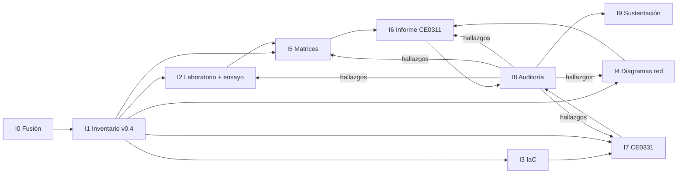

# Prompts para terminar Infraestructura (CE0311 + CE0331) con la v0.4

## 0. Glosario breve

| Término | Qué significa aquí |
| --- | --- |
| **Fuente única** | `infra/inventory.yaml`, `infra/pruebas.yaml`, `infra/trazabilidad.yaml`. Todo dato de red, componente, flujo y prueba sale de ahí. |
| **CI-xx** | Entrada de `docs/infra/e1/CAMBIOS-INVENTARIO.md`. La v0.4 se aplica con CI-30…CI-38 (CE03 D7). |
| **V-xx** | Chequeo del validador (`make validate`): V-01…V-43 inventario y laboratorio, V-50 diagramas, V-60 matriz de componentes, V-70 matriz de pruebas, V-80 informe. |
| **Modo L / A / H** | Laboratorio emulado (containerlab) / AWS efímero / campus real. |
| **Plan Mode** | Modo de Claude Code (Shift+Tab) que propone un plan antes de tocar archivos. |

## 1. Punto de partida y qué falta

**Lo que ya existe (ramas, sobre la v0.2):**

| Rama | Contenido | Estado |
| --- | --- | --- |
| `e1/codigo-lab` | Fuente única, validador, generadores, imagen OCI, laboratorio | Base de todo |
| `e1/matriz-pruebas` | + IaC, PAC, REQ-F-28, TLS en 9128, shield, `Cache-Status`, matriz de pruebas, ensayo L: 31 PASA, 0 FALLA, 1 PARCIAL, 17 NO_APLICA | La más avanzada (Nick) |
| `e1/diagramas` | Diagramas draw.io + V-50…V-56 | Henyelrey |
| `e1/matriz-componentes` | Matriz de componentes + V-60…V-66 | Henyelrey |
| `ce02/e1-requerimientos-diseno` | Prototipo, PlantUML, CI de Rust | Henyelrey (CE02) |

**Lo que falta para terminar Infraestructura S1:**
1. Fusionar todo en `main` (6 conflictos conocidos).
2. Pasar la fuente única a la v0.4 (CI-30…CI-38).
3. Ajustar el laboratorio y el código mínimo que respalda el diseño (REQ-F-36, firma de configuración).
4. Ajustar la IaC (EC2-GW, S3, simulacro de recuperación; sin shield).
5. Regenerar diagramas y matrices.
6. Escribir el **informe CE0311** (no existe aún).
7. Hacer **todo CE0331**: informe, diagramas del centro de datos y matriz de componentes y dimensionamiento.
8. Auditoría y preparación de la sustentación.

## 2. Reparto y orden

| Prompt | Trabajo | Responsable | Depende de | Rama |
| --- | --- | --- | --- | --- |
| I0 | Fusión de ramas en `main` | **Nick** (Henyelrey revisa) | — | `integracion/v0.4` |
| I1 | Fuente única a v0.4 (CI-30…CI-38) + validador | **Nick** | I0 | `v04/inventario` |
| I2 | Laboratorio Modo L v0.4 + código mínimo + ensayo | **Nick** | I1 | `v04/laboratorio` |
| I3 | IaC Modo A v0.4 | **Nick** | I1 | `v04/iac` |
| I4 | Diagramas CE0311 regenerados | **Henyelrey** | I1 | `v04/diagramas-red` |
| I5 | Matrices CE0311 (componentes y pruebas) regeneradas | **Henyelrey** (componentes), **Nick** (pruebas, tras I2) | I1, I2 | `v04/matrices` |
| I6 | Informe CE0311 (DOCX + PDF) | **Henyelrey** | I4, I5 | `v04/informe-red` |
| I7 | CE0331 completo: diagramas, matriz y dimensionamiento, informe | **Nick** | I1, I3 | `v04/centro-datos` |
| I8 | Auditoría de coherencia y rúbrica (sesión nueva) | **Ambos** | I2–I7 | — |
| I9 | Simulacro de sustentación | **Cada uno** | I8 | — |



**Reglas de integración:**
- I0 e I1 se fusionan en `main` antes de empezar el resto.
- Cada prompt trabaja en su rama y abre un PR que revisa el otro integrante.
- Un PR se fusiona solo con `make validate` en verde.
- **Nadie cambia una IP, un flujo o un componente dentro de su artefacto.** Se propone en `CAMBIOS-INVENTARIO.md` y se aplica en `infra/*.yaml`.

## 3. Preparación (una vez)

```bash
git clone https://github.com/Nick-Saim-MJ/Project-Celeris.git && cd Project-Celeris
git fetch --all

# Documentos v0.4 (descárguenlos del proyecto de Claude)
mkdir -p docs/celeris
cp ~/Descargas/Celeris-00-Marco-Comun.md ~/Descargas/Celeris-Arquitectura-v0.4.md \
   ~/Descargas/Celeris-Que-es-el-proyecto.md ~/Descargas/Celeris-CE0*.md docs/celeris/

# Plugin oficial de draw.io en Claude Code (para I4 e I7)
#   /plugin marketplace add jgraph/drawio-mcp
#   /plugin install drawio@drawio
# Exportar a PNG/PDF requiere draw.io Desktop.
```

### 3.1 `CLAUDE.md` v0.4 (lo actualiza I1; reemplaza al actual)

```markdown
# Reglas del proyecto Celeris — Infraestructura (CE0311, CE0331)

## Fuentes de verdad (en este orden)
1. infra/inventory.yaml, infra/pruebas.yaml, infra/trazabilidad.yaml → ÚNICA fuente de IP, VLAN, zonas,
   componentes, flujos, pruebas, OD, AM, DET y rúbrica.
2. docs/celeris/Celeris-CE03-Infraestructura.md (v0.4): D1 red, D2 centro de datos, D3 ADR, D5 laboratorio, D7 cambios.
   docs/celeris/Celeris-Arquitectura-v0.4.md: por qué de cada componente y qué va en la nube.
   docs/celeris/Celeris-00-Marco-Comun.md: alcance, actores, supuestos S-xx y contrato de IDs (M6).
3. docs/fuentes/CE03/: plantillas S1_E1 (red) y S1_E2 (centro de datos) y sus rúbricas (8 criterios cada una).

## Reglas
- Si un documento y infra/*.yaml no coinciden, manda infra/*.yaml. Si el YAML está mal, se corrige por CI-xx.
- No inventes IP, puertos, nombres ni cantidades. Si falta algo, DETENTE y regístralo en
  docs/infra/e1/CAMBIOS-INVENTARIO.md con el siguiente CI libre.
- IDs vigentes: F1–F32 (F4 reservado; F9, F11, F12, F15, F16, F17, F19, F22 retirados), T01–T60
  (T12, T22, T37, T38, T39, T41, T44, T48 retirados), OD-01–OD-12, AM-01–AM-18, DET-01–DET-11, S-01–S-30,
  D-01–D-28, REQ-F-01–F-37. Un ID retirado NUNCA se reutiliza.
- Componentes vigentes (v0.4): FGT-EXT, FW01, SW-CORE01, SW-ACC, BRK01, ESX01, IPMI01, UPS01, JMP01, CTRL01,
  EDGE01, EDGE02, PORTAL01, HNY01, SIEM01, ENC01, LABCLI01, KALI01, HNY02, PCs LAB-01…LAB-10, WIFI-EST,
  VTI1, VTI2, VGW, EC2-GW, S3 celeris-backups, AWS-VPC, AWS-PUB-A, AWS-APP-A (+ EC2-DR y NAT-DR temporales).
  Retirados: DB01, OBS01, SVC01, WAF01, WEB01, IDS01, PROBE01, NAS01, EC2-SHIELD, EC2-CTRLR, NAT01.
- La consola (SPA + API + base) vive en CTRL01 (campus). En AWS solo EC2-GW (sin datos) y S3. No lo cambies.
- El Wi-Fi de estudiantes (BYOD) nunca se descifra.
- Todo supuesto se marca [S-xx]. IP públicas solo de documentación (RFC 5737). Ningún secreto en el repo.
- Regla de evidencia de la rúbrica: nada genérico; cada afirmación tiene IP, puerto, regla, figura o prueba.
- Lo emulado se rotula como emulado (CE03 D5.3). Ninguna prueba NO_APLICA o PARCIAL se reporta como PASA.
- Idioma: español claro, sin relleno.
- Antes de terminar: make validate en verde. No ejecutes `tofu apply`, no crees recursos en AWS y no hagas
  `git push` sin confirmación explícita del usuario.

## Identidad visual (diagramas y XLSX)
Okabe-Ito; el color nunca va solo (nombre de la zona en texto).
MGMT #0072B2 · SERVERS #009E73 · LAB #E69F00 · WIFI-EST #F0E442 · DMZ-SVC #D55E00 · DMZ-HONEY #CC79A7 ·
SECURITY #56B4E9 · EDGE #4D4D4D · FortiGate/tránsito #999999 · AWS: grupos AWS de draw.io.
Criticidad: Alta = borde 3 px + ALTA; Media = 2 px + MEDIA; Baja = 1 px + BAJA.
Flujos: cifrado = continua; sin cifrar con riesgo aceptado = discontinua; bloqueado = punteada + "✖ BLOQUEADO".

## Comandos
make validate · make lab-up / lab-down / test-lab · make tofu-check · make matrices · make diagrams-check ·
make informe (CE0311) · make informe-dc (CE0331) · make release-s1
```

### 3.2 Cómo usar cada prompt

1. Claude Code en la raíz del repo, en la rama del prompt.
2. Activen Plan Mode, peguen el prompt y revisen el plan antes de aprobarlo.
3. Usen `/clear` entre prompts: cada uno es autosuficiente.
4. Al terminar: `make validate`, commit y PR. El push lo hacen ustedes.

---

## I0 — Fusión de ramas en `main`

**Responsable:** Nick, con Henyelrey presente o revisando el PR. **Rama:** `integracion/v0.4`.

```text
Actúa como integrador del repositorio del proyecto Celeris Edge. Hay cinco ramas con trabajo válido que
nunca se fusionaron en main: e1/codigo-lab, e1/matriz-pruebas (contiene a la anterior), e1/diagramas,
e1/matriz-componentes y ce02/e1-requerimientos-diseno. Las ramas de Henyelrey divergen de 9b00fa6.

OBJETIVO: una rama integracion/v0.4 que contenga el trabajo de las cinco, con make validate y los tests en
verde, lista para un PR a main. Todavía NO apliques la v0.4 (eso es I1): integra tal como está.

PASOS:
1. git fetch --all. Crea integracion/v0.4 desde origin/e1/matriz-pruebas.
2. Fusiona en este orden, una por una, con --no-ff: origin/e1/diagramas, origin/e1/matriz-componentes,
   origin/ce02/e1-requerimientos-diseno.
3. Conflictos esperados: .gitattributes, .gitignore, Makefile, docs/infra/e1/CAMBIOS-INVENTARIO.md,
   docs/infra/e1/validacion.md, e2e/origin.py. Reglas para resolverlos:
   - .gitattributes y .gitignore: unión de ambas listas, sin duplicados.
   - Makefile: conserva todos los objetivos de ambas ramas; si dos objetivos tienen el mismo nombre y distinto
     cuerpo, muéstrame ambos y propón la combinación antes de elegir.
   - CAMBIOS-INVENTARIO.md: une las entradas; si dos ramas usaron el mismo CI-xx para cosas distintas,
     renumera la de la rama de Henyelrey al siguiente libre y actualiza sus referencias. Reporta cada cambio.
   - validacion.md: es generado; resuélvelo regenerándolo con make validate, no a mano.
   - e2e/origin.py: compara ambas versiones, conserva las capacidades de las dos y corre e2e/run.sh.
   - src/handler.rs y src/policy.rs (si conflictúan): conserva la lógica de las dos ramas (SNI = CONNECT de
     CE02 y la eliminación de cabeceras y Cache-Status de e1/matriz-pruebas); cargo test debe pasar.
4. Verifica: cargo build, cargo test, cargo clippy -- -D warnings, make validate, make test-gen.
   No corras make lab-up aquí.
5. Escribe docs/infra/INTEGRACION-v0.4.md: qué ramas entraron, cada conflicto y cómo se resolvió, chequeos
   que fallan (si alguno) y por qué.

REGLAS: no borres trabajo de ninguna rama; no cambies datos de infra/*.yaml; no hagas push.

CRITERIOS DE ACEPTACIÓN:
- [ ] Las cinco ramas son ancestros de integracion/v0.4 (git merge-base --is-ancestor).
- [ ] cargo test, clippy y make validate en verde (o fallos explicados en INTEGRACION-v0.4.md).
- [ ] Ningún archivo de entregables/ se perdió (compara la lista con las ramas originales).

AL TERMINAR, repórtame: conflictos resueltos, CI renumerados y comandos que debo ejecutar para el push y el PR.
```

---

## I1 — Fuente única a la v0.4

**Responsable:** Nick. **Rama:** `v04/inventario` (desde `main` ya integrado).

```text
Actúa como arquitecto de redes y responsable de configuración del proyecto Celeris Edge. La arquitectura
cambió a la v0.4 y la fuente única (infra/*.yaml) todavía describe la v0.2. Tu trabajo es aplicar las
entradas CI-30…CI-38 exactamente como están en docs/celeris/Celeris-CE03-Infraestructura.md §D7, sin
rediseñar nada.

LEE PRIMERO: CLAUDE.md actual; docs/celeris/Celeris-CE03-Infraestructura.md completo (D1.8, D1.11, D1.12,
D1.14, D1.16, D2.4, D2.5, D7); docs/celeris/Celeris-Arquitectura-v0.4.md §4–§7 y §12; docs/celeris/
Celeris-00-Marco-Comun.md M5 y M6; infra/*.yaml; docs/infra/e1/CAMBIOS-INVENTARIO.md (llega a CI-29);
infra/validate.py e infra/checks/.

HAZ:
1. Reemplaza CLAUDE.md por el bloque de la sección 3.1 de docs/celeris/Prompts-Infraestructura-v0.4.md.
2. Registra CI-30…CI-38 en CAMBIOS-INVENTARIO.md con el formato de la plantilla del archivo (contexto,
   cambio, motivo, ADR, archivos afectados). Si I0 renumeró algún CI, usa los siguientes libres y avísame.
3. Aplica los cambios en infra/inventory.yaml:
   - zonas: retira LAB-TEST, STORAGE, BACKUP; agrega TRANSITO (10.20.0.0/29) y WIFI-EST (172.16.0.0/16,
     externa, `supuesto: S-28`).
   - componentes: retira DB01, OBS01, SVC01, WAF01, WEB01, IDS01, PROBE01, NAS01, EC2-SHIELD, EC2-CTRLR, NAT01,
     AWS-PUB-B, AWS-APP-B, AWS-DATA-A, AWS-DATA-B y la interfaz vmk1 de ESX01. Agrega FGT-EXT, PORTAL01,
     ENC01, WIFI-EST (grupo), PCs LAB-01…LAB-10 (grupo), EC2-GW, S3 (si no existe), y EC2-DR y NAT-DR con
     estado `temporal`. Cambia la WAN de FW01 a 10.20.0.2, LABCLI01 a 10.20.35.50 y KALI01 a 10.20.35.60.
     Para cada componente nuevo completa por_que, aporta_corto, aporta, si_falla, criticidad, figuras,
     adr y supuestos con el texto de CE03 D1.12 y de la Arquitectura §4 (no inventes).
   - rangos_lab: LAB-01…LAB-10 /26, reserva 10.20.34.128/25, infraestructura 10.20.35.0/24, con `habilitado`.
   - flujos: marca F9, F11, F12, F15, F16, F17, F19, F22 como `estado: retirado` (no los borres). Cambia el
     origen de F25 a FW01 y los destinos de F2/F3 (FW01; EDGE01/02). Agrega F28–F32 con todos sus campos.
   - matriz_esperada: la de CE03 D1.8 v0.4, celda por celda.
   - servicios_base: DNS y NTP en FW01, PAC en EDGE01/02, Wi-Fi según S-28.
   - vpn: agrega nat_t: true, ip_publica_en: FGT-EXT y la identidad IKE.
   - aws: subredes pub-a y app-a, sg-gw, nacl, S3 con Object Lock, recursos temporales del simulacro.
4. En infra/pruebas.yaml: marca T12, T22, T37, T38, T39, T41, T44, T48 como retiradas; cambia los destinos
   de T01, T02, T20, T21, T29, T42 y T46 según CE03 D1.16; agrega T50–T60 con todos sus campos
   (criterio_aprobacion medible, modos, flujos, componentes, OD, AM, criterios de rúbrica).
5. En infra/trazabilidad.yaml: ajusta OD-04 y DET-02; agrega OD-11, OD-12, AM-14…AM-18, DET-10, DET-11;
   actualiza las pruebas de AM-01, AM-02, AM-11; agrega los supuestos S-26…S-30 y las decisiones D-24…D-28.
6. Ajusta el validador:
   - Un ID con estado retirado no puede aparecer como origen/destino de un flujo activo, ni en una figura,
     ni en una prueba vigente.
   - Las IP de WIFI-EST quedan fuera de 10.20.0.0/16 (regla de solapamiento ajustada).
   - Los componentes `temporal` no cuentan como faltantes en figuras permanentes.
   - Ningún flujo permite descifrado con origen WIFI-EST (chequeo de REQ-F-36).
7. make validate en verde. Los chequeos de artefactos (V-50+, V-60+, V-70+) fallarán porque diagramas y
   matrices aún son v0.2: eso es esperado; repórtalos como "pendiente de I4/I5", no los desactives.

REGLAS: transcribe con fidelidad. Si encuentras una contradicción entre CE03 y la Arquitectura v0.4, no
elijas en silencio: regístrala en CAMBIOS-INVENTARIO.md con tu propuesta y márcala `pendiente: true`.

CRITERIOS DE ACEPTACIÓN:
- [ ] Los tres YAML validan contra su esquema; los chequeos V-01…V-43 en verde.
- [ ] La matriz derivada de los flujos coincide con CE03 D1.8 v0.4 al 100 %.
- [ ] Ningún ID retirado se reutiliza ni aparece como vigente.
- [ ] docs/infra/e1/validacion.md regenerado.

AL TERMINAR, repórtame: conteos (zonas, componentes vigentes y retirados, flujos, pruebas), contradicciones
encontradas y chequeos pendientes de otros prompts.
```

---

## I2 — Laboratorio Modo L v0.4, código mínimo y ensayo

**Responsable:** Nick. **Rama:** `v04/laboratorio`.

```text
Actúa como ingeniero de redes y DevSecOps del proyecto Celeris Edge. El laboratorio emulado (lab/, Modo L)
funciona sobre la v0.2. Debes llevarlo a la v0.4, agregar el código mínimo del nodo que el diseño necesita
para que sus afirmaciones se puedan probar, y correr el ensayo completo. CE0311 es DISEÑO: todo esto es
validación previa en un laboratorio emulado, y así se rotula.

LEE PRIMERO: CLAUDE.md; infra/*.yaml (ya en v0.4); docs/celeris/Celeris-CE03-Infraestructura.md D1.8–D1.16
y D5; docs/celeris/Celeris-Arquitectura-v0.4.md §8 (trayecto de los datos); lab/, infra/gen/, tests/network/,
src/.

TRABAJA POR ETAPAS; al final de cada una verifica, haz commit y muéstrame un resumen.

ETAPA 1 — Generadores: que nftables.py, vpn.py, pac.py y lab.py lean la v0.4:
- reglas para F28–F32;
- la WAN de fw01-sim en la red de tránsito;
- NAT-T en strongSwan;
- PAC servido por los nodos;
- allowed_clients con los rangos /26 habilitados.
Actualiza los snapshot tests.

ETAPA 2 — Topología (lab/celeris.clab.yml) según CE03 D5.3:
- Retira svc01, obs01, ids01, nas01, probe01, shield01 y ctrlr-sim, y los bridges de VLAN 31, 70 y 71.
- Une waf01 y web01 en portal01 (Caddy + Coraza + CRS sirviendo el sitio estático).
- Agrega:
  - fgt-sim: nftables con NAT 1:1 de 198.51.100.10 → 10.20.0.2 para UDP 500/4500 y TCP 80/443, y ruta al Wi-Fi;
  - un bridge wifi-sim 172.16.0.0/16 con byod01;
  - enc01, y labcli03 dentro de 10.20.32.128/26;
  - ctrl01 como servidor de configuración firmada de prueba (etapa 3);
  - origin-sim con archivos de 100 MB a 1 GB;
  - gw-sim: Caddy + Coraza detrás de vgw-sim, que reenvía a ctrl01:443 con certificado de cliente.
- Mismas IP que el inventario.
- Si el host no tiene Docker o containerlab, DETENTE y avísame.

ETAPA 3 — Código mínimo del nodo (src/), con `// req:` y pruebas unitarias:
- REQ-F-36: redes de origen BYOD en modo nunca. Configuración `byod_networks` (lista de CIDR). Si la IP del
  cliente pertenece a una de ellas, el nodo hace passthrough aunque el dominio esté en intercept_domains.
  Prueba unitaria + caso e2e.
- REQ-F-17 (mínimo verificable): el nodo puede cargar la configuración desde un archivo firmado (ed25519):
  `config.toml` + `config.toml.sig` + llave pública fijada en el arranque. La recarga se hace por intervalo
  o señal. Si la firma no verifica o la versión es menor que la aplicada, se rechaza, se conserva la anterior
  y se emite un evento de seguridad.
- Llaves de laboratorio generadas al vuelo, fuera del repo.
- No implementes la consola ni la precarga: son CE02/S2.
- cargo test y clippy -D warnings deben pasar.

ETAPA 4 — Pruebas nuevas en tests/network:
- Implementa los casos de T51 (con la firma de la etapa 3), T52, T55, T56, T57, T58 (desde gw-sim) y T60.
- Deja T50, T53 y T54 como NO_APLICA con el motivo "requiere la consola (CE02, S2)" y el modo en que se
  ejecutarán. Nunca los marques PASA.
- Ajusta los casos de T01, T02, T20, T21, T29 y T46 a sus destinos nuevos.
- Retira los casos de las pruebas retiradas.
- T29 debe detectarse con Suricata en fw01-sim (interfaz LAB), no con ids01.

ETAPA 5 — Ensayo: make lab-up, make test-lab. Salidas:
- evidencias/<fecha>-L/ y resultados.json;
- docs/infra/e1/ensayo-laboratorio.md regenerado, con la tabla de equivalencias de CE03 D5.3 y una columna
  "v0.2 → v0.4" para las pruebas que cambiaron.
Mide y reporta T05 (convergencia), T09 (tiempo de cambio) y T55 (descargas en origin-sim).

REGLAS: nada de tráfico fuera del laboratorio; ningún secreto en el repo; no inventes datos fuera de
infra/*.yaml (si falta algo, CI nuevo y detente en esa parte).

CRITERIOS DE ACEPTACIÓN:
- [ ] make lab-up levanta la topología v0.4 y make test-lab produce resultados.json.
- [ ] T51, T52, T55, T56, T57, T58 y T60 tienen resultado medido (PASA o FALLA explicado).
- [ ] Ninguna NO_APLICA o PARCIAL figura como PASA.
- [ ] cargo test/clippy y make validate en verde.

AL TERMINAR, repórtame: PASA/FALLA/PARCIAL/NO_APLICA, mediciones, hallazgos que contradicen el diseño (son
valiosos) y lo que quedó para S2.
```

---

## I3 — IaC del Modo A v0.4

**Responsable:** Nick. **Rama:** `v04/iac`.

```text
Actúa como ingeniero cloud del proyecto Celeris Edge. La IaC en deploy/opentofu/ describe la v0.2 (shield,
réplica, NAT permanente). Llévala a la v0.4 según docs/celeris/Celeris-CE03-Infraestructura.md D2.5 y D5.4.

HAZ:
1. Módulos:
   - aws-vpc: subredes pub-a 10.30.0.0/24 y app-a 10.30.10.0/24, IGW, rt-public, rt-private con Gateway
     Endpoint de S3, propagación de rutas del VGW, nacl-public y nacl-private.
   - aws-vpn: VGW, customer gateway con la IP pública del FortiGate (var), 2 túneles con los parámetros de
     D1.10, BGP; sin cambios de fondo.
   - aws-gw (nuevo): EC2-GW t3.micro en pub-a, sg-gw según D2.5, cloud-init que instala Caddy + Coraza + CRS
     y configura el reenvío a var.ctrl01 (10.20.20.10:443) con certificado de cliente leído de SSM Parameter
     Store o de una variable sensible (nunca en el repo), agente Wazuh hacia 10.20.50.10.
   - aws-backup (nuevo): bucket S3 con versionado, Object Lock (modo compliance, 30 días, configurable),
     cifrado SSE, política que solo acepta escrituras desde var.ip_publica_campus, y una política IAM de solo
     s3:PutObject para el respaldo (con variable para usar el perfil de AWS Academy, S-13).
   - aws-dr (nuevo, desactivado por defecto con var.simulacro = false): EC2-DR en app-a y NAT-DR en pub-a,
     solo para el simulacro T59.
   - onprem-sim: ajústalo para que cgw-sim publique un servidor de prueba como CTRL01.
   - aws-shield: retíralo de envs/demo; conserva el módulo en deploy/opentofu/modules/_retirados/ con un
     README que cite D-19.
2. envs/demo: var.region (us-east-1), etiquetas Proyecto/Ttl, AWS Budgets al 80 %, outputs que usa
   tests/network para el Modo A (T01–T05, T21, T53, T54, T58, T59).
3. tofu fmt -check, tofu validate y make tofu-check en verde. Si el AWS Emulator está instalado, ejecuta
   tofu plan contra él y guarda la salida en evidencias/<fecha>-A-plan/. NO ejecutes apply ni plan contra
   una cuenta real.
4. docs/infra/e1/runbook-modo-A.md con el runbook de CE03 D5.4, el costo por hora (≈ US$ 0,09) y el
   procedimiento del simulacro de recuperación (T59) con cronómetro.

CRITERIOS DE ACEPTACIÓN:
- [ ] tofu validate y make tofu-check en verde; ningún secreto en el repo (gitleaks).
- [ ] Ningún recurso permanente fuera de D2.5 (EC2-GW, VGW, S3, VPC); los del simulacro detrás de la variable.
- [ ] Los SG coinciden con sg-gw de D2.5 (chequeo en el validador si es posible).

AL TERMINAR, repórtame: recursos por módulo, costo estimado por hora y por mes, y lo que no se pudo validar
sin cuenta.
```

---

## I4 — Diagramas de red CE0311 regenerados

**Responsable:** Henyelrey. **Rama:** `v04/diagramas-red`. Requiere el plugin de draw.io.

```text
Actúa como arquitecto de redes y diseñador de información. Los diagramas de entregables/CE0311/diagramas/
son de la v0.2. Regenera las 7 figuras con la v0.4 usando el plugin de draw.io, conservando el método
existente (celeris_id en cada objeto, validación V-50…V-56).

LEE PRIMERO: CLAUDE.md; infra/*.yaml (v0.4); docs/celeris/Celeris-CE03-Infraestructura.md D1.7–D1.14;
docs/celeris/Celeris-Arquitectura-v0.4.md §3–§8; la plantilla S1_E1 (qué debe mostrar cada figura);
infra/checks/v50_diagramas.py.

FIGURAS:
- FIG-1.1 ejecutiva (≤ 12 bloques): debe contar el problema. 40 PCs → EDGE01 → una sola descarga por el
  FortiGate a Internet; la consola en el campus; AWS solo con EC2-GW y S3; el Wi-Fi como cliente sin descifrado.
- FIG-5.1 general:
  - Internet, FGT-EXT, la red de tránsito y FW01;
  - las 7 VLAN como contenedores con sus componentes, y WIFI-EST;
  - la VPC con pub-a (EC2-GW) y app-a (vacía, "simulacro"), S3, VGW y los 2 túneles.
- FIG-5.2 lógica:
  - cada VLAN con CIDR, gateway y hosts útiles;
  - los 10 rangos /26 y el rango de infraestructura dentro de VLAN 30;
  - la red de tránsito 10.20.0.0/29;
  - la ruta por defecto al FortiGate y 10.30.0.0/16 por BGP;
  - servicios base: DNS y NTP en FW01, PAC en EDGE01/02;
  - las subredes y tablas de rutas de AWS.
- FIG-5.3 seguridad y zonas:
  - zonas por nivel de confianza, incluidas WIFI-EST y AWS;
  - los controles: FortiGuard, deny-all de FW01, Suricata, CrowdSec, WAF de PORTAL01, WAF de EC2-GW,
    DMZ-SVC separada de DMZ-HONEY, HNY01, HNY02, auditoría de la consola, SIEM01;
  - AM-01…AM-18 en el punto donde se mitigan;
  - una franja de defensa en profundidad con las capas de CE03 D1.9.
- FIG-5.4 VPN:
  - FW01 con VTI1/VTI2 y sus /30, detrás del FortiGate con NAT 1:1 y NAT-T (UDP 4500);
  - el VGW, túnel activo y túnel de respaldo, ASN y prepending, redes anunciadas;
  - parámetros criptográficos (sin secretos), MTU/MSS y DPD;
  - qué viaja por la VPN: F30 y F13 desde EC2-GW;
  - sg-gw.
- FIG-5.5a flujos de usuarios, encargado y servicios: F1–F8, F10, F21, F23, F28–F32.
- FIG-5.5b flujos de gestión, seguridad, respaldo y nube: F13, F14, F18, F20, F24–F27.
  Los flujos retirados no se dibujan.

CRITERIO CENTRAL (igual que antes):
- cada componente con 3 líneas (ID · nombre / IP / rol);
- criticidad visible sin color;
- propiedades celeris_id, ip, zona, criticidad, por_que, aporta, si_falla, flujos, pruebas;
- panel lateral "Qué aporta y qué pasa si falla";
- leyenda y bloque de título con versión del inventario y commit.
Agrega a FIG-1.1 y FIG-5.1 una nota visible: "La consola no está en la nube: ver D-25".

EXPORTACIÓN: .drawio + PNG (escala 3) + PDF vectorial con el XML embebido.

VALIDACIÓN: actualiza V-50…V-56 si hace falta:
- ningún componente o flujo retirado en las figuras;
- WIFI-EST y FGT-EXT presentes donde el inventario lo indica.
make diagrams-check y make validate en verde.

AL TERMINAR, repórtame la cobertura componente × figura y lo que registraste como faltante.
```

---

## I5 — Matrices CE0311 regeneradas

**Responsables:** Henyelrey (componentes) y Nick (pruebas, después de I2). **Rama:** `v04/matrices`.

```text
Actúa como analista de configuración y de pruebas del proyecto Celeris Edge. Regenera las dos matrices del
Entregable CE0311 con los generadores existentes (infra/gen/xlsx_componentes.py e infra/gen/xlsx_pruebas.py),
ya sobre la fuente única v0.4.

MATRIZ DE COMPONENTES (entregables/CE0311/Matriz_Componentes_Red_v<versión>.xlsx):
- Filas 1 a 1 con los componentes vigentes. Hoja nueva "Retirados en v0.4" con ID, motivo y CI.
- La columna "Estado" admite `temporal` (EC2-DR, NAT-DR) y `existente/fuera de alcance` (FGT-EXT, SW-ACC,
  WIFI-EST).
- Las columnas "Por qué existe", "Qué aporta" y "Si falla" deben coincidir con la Arquitectura v0.4 §4. Si el
  YAML es más pobre, corrige el YAML por CI, no el XLSX.
- Cobertura componente × figura con la salida de I4.

MATRIZ DE PRUEBAS (entregables/CE0311/Matriz_Pruebas_Conectividad_v<versión>.xlsx):
- Filas = pruebas vigentes (T01–T60 sin las retiradas). Hoja "Retiradas en v0.4".
- La columna de ensayo emulado se llena desde el último evidencias/*-L/resultados.json de I2.
- Hoja "Segmentación" derivada de la matriz zona × zona v0.4, con WIFI-EST y AWS.
- Hoja "Trayecto de los datos": por cada trayecto de la Arquitectura §8 (descarga, cambio del encargado,
  eventos, respaldos, aviso), los tramos, su protección y la prueba que lo verifica.

VALIDACIÓN: V-60+ y V-70+ en verde; fórmulas recalculadas con LibreOffice headless sin #REF!, #VALUE! ni #NAME?.

AL TERMINAR, repórtame: componentes vigentes y retirados, pruebas vigentes, cobertura por dimensión y
pruebas con FALLA en el ensayo con su causa.
```

---

## I6 — Informe CE0311 (DOCX + PDF)

**Responsable:** Henyelrey. **Rama:** `v04/informe-red`. Se cierra cuando I4 e I5 estén fusionados.

```text
Actúa como ingeniero de redes y redactor técnico. Produce el Informe de Análisis y Diseño de Red (CE0311,
S1, E1) del proyecto Celeris Edge en DOCX y PDF, apuntando al nivel 4 en los 8 criterios de la rúbrica.

LEE PRIMERO: CLAUDE.md; docs/fuentes/CE03/S1_E1_Analisis_y_Diseno_de_Red.docx y Rubrica_S1_E1_Diseno_de_Red.xlsx;
infra/*.yaml; docs/celeris/Celeris-CE03-Infraestructura.md D1 completo; docs/celeris/Celeris-Arquitectura-v0.4.md;
docs/celeris/Celeris-00-Marco-Comun.md M2 y M3; docs/infra/e1/ensayo-laboratorio.md; infra/checks/v80_docx.py.

ESTRUCTURA: las 11 secciones de la plantilla, con sus subsecciones, figuras y tablas, en el mismo orden
(mapeo en CE03 D1). Antes de la sección 1: portada, control de versiones y glosario. Anexos:
- A: Matriz zona × zona completa.
- B: STRIDE AM-01…AM-18.
- C: Trazabilidad necesidad → OD → D-xx → componente → F → T → R.
- D: Supuestos.
- E: Validación en laboratorio emulado (rotulada como emulada).
- F: Por qué la consola no está en la nube (resumen de D-24 y D-25, una página).

CONSTRUCCIÓN (reproducible):
1. Contenido por sección en docs/infra/e1/informe/NN-seccion.md, redactado como informe (no copies frases
   de guía). Cada párrafo justifica una decisión y cita su evidencia (figura, tabla, flujo, prueba).
2. docs/infra/e1/build_informe.py (python-docx) que:
   - parte de una COPIA de la plantilla oficial;
   - reemplaza el texto guía;
   - llena TODAS las tablas de red desde infra/*.yaml (nunca a mano), con columnas de ID;
   - inserta los PNG de I4 con su pie oficial y una frase de qué observar;
   - agrega tabla de contenidos, numeración y control de versiones (versión del inventario + commit).
3. PDF con LibreOffice headless. make informe hace todo.
4. Chequeos V-80+:
   - 11 secciones;
   - sin texto guía;
   - todos los IDs vigentes presentes y ningún ID retirado;
   - cada IP del DOCX coincide con el inventario;
   - 7 figuras insertadas;
   - cifras repetidas coherentes;
   - evidencias por criterio.
5. Abre el DOCX y léelo de verdad: debe entenderse sin los documentos guía.

PUNTOS QUE EL JURADO VA A PREGUNTAR (deben estar respondidos en el texto):
- Por qué FW01 detrás del FortiGate y no reemplazarlo.
- Qué va en la nube y por qué la consola no.
- Cómo se protege cada tramo del trayecto de los datos.
- Por qué el Wi-Fi no se descifra.
- Dónde está el honeypot y qué detecta.
- Qué pasa si cae FW01, EDGE01 o la VPN.

ESTILO: español formal y claro, tercera persona, sin relleno. Supuestos [S-xx]. Portada con ambos autores;
"[COMPLETAR: docente/curso]" si no se sabe.

CRITERIOS DE ACEPTACIÓN:
- [ ] make informe genera DOCX y PDF desde cero.
- [ ] V-80+ en verde.
- [ ] docs/infra/e1/autoevaluacion-informe.md con nivel estimado por criterio, página de evidencia y lo que
      falta para el nivel 4.

AL TERMINAR, repórtame: páginas, figuras, pendientes [COMPLETAR] y criterios bajo nivel 4 con la razón.
```

---

## I7 — CE0331 completo: centro de datos híbrido

**Responsable:** Nick. **Rama:** `v04/centro-datos`.

```text
Actúa como arquitecto de centro de datos híbrido del proyecto Celeris Edge. Produce el Entregable 2 de S1
(CE0331, Análisis y Diseño de Centro de Datos Híbrido): diagramas, matriz de componentes y dimensionamiento,
e informe DOCX + PDF, apuntando al nivel 4 en los 8 criterios de su rúbrica.

LEE PRIMERO: CLAUDE.md; docs/fuentes/CE03/S1_E2_Analisis_y_Diseno_de_Centro_de_Datos_Hibrido.docx y
Rubrica_S1_E2_Diseno_Centro_de_Datos.xlsx (léelos completos: estructura, tablas y figuras pedidas);
infra/*.yaml; docs/celeris/Celeris-CE03-Infraestructura.md D2 completo, D1.10, D3 y D5;
docs/celeris/Celeris-Arquitectura-v0.4.md §1, §4, §10, §11; deploy/opentofu/ (ya en v0.4 por I3).

ETAPA 1 — Datos: si el inventario no tiene lo que CE0331 necesita, agrégalo por CI-xx en un archivo nuevo
infra/centro_datos.yaml, referenciado desde inventory.yaml:
- host ESX01 (CPU, RAM, discos, NIC);
- datastores;
- vSwitches y port groups;
- VM con vCPU/RAM/disco/SO/fase/port group;
- rack;
- energía;
- recursos AWS con tipo y costo;
- RTO/RPO por servicio.
Todo según CE03 D2.4–D2.9. Agrega chequeos V-90+:
- ninguna VM supera 8 vCPU;
- la suma de vCPU/RAM/disco coincide con las tablas;
- holgura ≥ 15 %;
- cada VM existe como componente del inventario y viceversa;
- cada servicio tiene RTO y RPO.

ETAPA 2 — Diagramas (plugin de draw.io, mismo método que CE0311: celeris_id, panel "qué aporta y qué pasa
si falla", leyenda, bloque de título), en entregables/CE0331/diagramas/:
- DC-1 Topología física: rack de 12U, ESX01 con sus 4 NIC, SW-CORE01, UPS01, el enlace al FortiGate y el
  puerto break-glass.
- DC-2 Hipervisor ESXi: vSwitch0 (teaming) y vSwitch1, port groups con VLAN, cada VM en su port group con
  vCPU/RAM, datastores (RAID 1 y los 2 NVMe de caché).
- DC-3 AWS:
  - VPC, pub-a con EC2-GW y app-a vacía ("simulacro");
  - IGW, VGW, tablas de rutas, Gateway Endpoint de S3, S3 con Object Lock;
  - SG y NACL;
  - los recursos temporales del simulacro en línea punteada.
- DC-4 Integración híbrida: la misma VPN de FIG-5.4 (reutiliza el archivo, no lo redibujes) y qué viaja por ella.
- DC-5 Continuidad: flujo del respaldo (CTRL01 → copia local + S3) y de la restauración (T59).
Exporta a .drawio + PNG + PDF y agrega la validación al estilo de V-50.

ETAPA 3 — Matriz de componentes y dimensionamiento (entregables/CE0331/Matriz_Componentes_DC_v<versión>.xlsx),
generada con un script nuevo infra/gen/xlsx_centro_datos.py (reutiliza xlsx_comun.py):
- "Componentes": 100 % de lo dibujado en DC-1…DC-3, con entorno, tipo, función, criticidad, recursos, por qué
  existe y si falla.
- "Máquinas virtuales": la tabla de D2.4 con totales por fórmula.
- "Dimensionamiento": cálculo de núcleos (2:1 y 4:1), RAM (× 1,1 × 1,2), disco (× 1,3 + copia local) con
  fórmulas visibles y el margen resultante.
- "AWS y costo": recursos, cantidad, precio unitario [S-12] y total mensual con fórmulas (≈ US$ 70).
- "Continuidad": RTO/RPO por servicio y regla 3-2-1-1-0.
- "Trazabilidad": criterio de la rúbrica → hoja/figura/sección.
Recalcula con LibreOffice headless sin errores.

ETAPA 4 — Informe (DOCX + PDF), con el mismo método que el informe de red:
- Markdown en docs/infra/e2/informe/.
- Script docs/infra/e2/build_informe.py sobre una COPIA de la plantilla S1_E2.
- Tablas generadas desde infra/*.yaml y centro_datos.yaml; figuras DC-1…DC-5.
- make informe-dc.
El informe debe dejar claro:
- el criterio de reparto campus/nube (D-25) y por qué no hay caché en AWS (D-19);
- por qué ESXi gratuito y sus límites (8 vCPU, sin vCenter, sin VADP → respaldo dentro de la VM);
- por qué no hay NAT permanente y cómo se demuestra NAT en el simulacro;
- el costo mensual y el del laboratorio efímero;
- RTO/RPO por servicio.
Chequeos V-95+ al estilo de V-80.

CRITERIOS DE ACEPTACIÓN:
- [ ] make informe-dc genera DOCX y PDF; V-90+ y V-95+ en verde.
- [ ] La VPN y los componentes compartidos son idénticos a los del informe de red (mismos IDs, IP y parámetros).
- [ ] docs/infra/e2/autoevaluacion-informe.md con nivel estimado por criterio.

AL TERMINAR, repórtame: páginas, figuras, cifras de dimensionamiento, costo AWS y criterios bajo nivel 4.
```

---

## I8 — Auditoría de coherencia y rúbrica

**Responsables:** ambos, en una **sesión nueva** de Claude Code (sin contexto previo), con todo fusionado en `main`.

```text
Actúa como jurado evaluador exigente del EPE y como auditor de calidad. No conoces el proyecto: evalúa solo
lo que hay en el repositorio. No corrijas: reporta.

INSUMOS:
- docs/fuentes/CE03/: plantillas y rúbricas S1_E1 y S1_E2;
- infra/*.yaml;
- entregables/CE0311/ y entregables/CE0331/ (informes DOCX/PDF, diagramas, matrices);
- evidencias/, docs/infra/, docs/celeris/.

Usa subagentes en paralelo, uno por artefacto (informe de red, informe de centro de datos, diagramas,
matrices, laboratorio y código, IaC), y después cruza sus resultados.

REVISA:
1. Coherencia cruzada: cada IP, VLAN, CIDR, puerto, ID de componente, flujo y prueba es idéntico en los dos
   informes, los diagramas, las matrices y el inventario. Cuenta y compara totales. Verifica tú mismo 20 datos
   al azar extrayendo el texto de los PDF y el XML de los .drawio.
2. Restos de la v0.2: busca DB01, OBS01, SVC01, WAF01, WEB01, IDS01, PROBE01, NAS01, EC2-SHIELD, EC2-CTRLR,
   NAT01, VLAN 31/70/71, F9, F11, F12, F15, F16, F17, F19, F22, T12, T22, T37, T38, T39, T41, T44 y T48 en
   cualquier artefacto vigente. Cada aparición fuera de una sección de "retirados" es un hallazgo.
3. Completitud frente a cada plantilla: secciones, subsecciones, figuras y tablas.
4. Rúbrica: para cada criterio de cada entregable, cita la evidencia concreta (página, figura, hoja, celda)
   que cumple cada parte del descriptor de nivel 4. Estima el nivel (0–4), el puntaje y la nota sobre 20.
5. Rigor técnico:
   - gateways y máscaras;
   - rutas imposibles;
   - NAT-T detrás del FortiGate;
   - MTU con NAT-T;
   - flujos que la matriz deniega;
   - pruebas que no prueban lo que dicen;
   - VPN activo/activo con VGW;
   - puntos únicos de falla no declarados;
   - "implementado" sobre algo emulado;
   - descifrado posible desde WIFI-EST;
   - EC2-GW con más acceso que CTRL01:443.
6. Seguridad del repositorio (gitleaks) y honestidad (supuestos marcados, NO_APLICA nunca como PASA).

ENTREGA docs/infra/AUDITORIA-S1.md con:
- puntaje estimado por criterio y entregable;
- hallazgos numerados con severidad (bloqueante / importante / menor), ubicación, por qué importa para la
  rúbrica y qué prompt (I2–I7) lo corrige;
- 12 preguntas probables del jurado con la evidencia para responderlas.
```

**Ciclo de corrección:** cada responsable abre su prompt con los hallazgos que le tocan ("Corrige H-03 y H-07 de `docs/infra/AUDITORIA-S1.md` respetando CLAUDE.md"), corre `make validate` y repite I8 hasta que no queden bloqueantes. Al final: `make release-s1`, que copia la versión final a `entregables/CE0311/vX.Y/` y `entregables/CE0331/vX.Y/`.

---

## I9 — Simulacro de sustentación individual

**Cada integrante por separado.** El criterio 8 de ambas rúbricas evalúa que cada uno responda sin depender del otro.

```text
Actúa como jurado de sustentación del EPE de Ingeniería de Sistemas. Lee infra/*.yaml, los informes de
entregables/CE0311/ y entregables/CE0331/, y docs/infra/AUDITORIA-S1.md. Hazme preguntas UNA POR UNA, sin
darme la respuesta. Mezcla:
- memoria: ¿qué IP tiene EC2-GW?, ¿qué rango tiene LAB-03?
- justificación: ¿por qué la consola no está en AWS?, ¿por qué no hay IDS separado?
- escenario: ¿qué pasa si cae la VPN durante una clase?, ¿y si el FortiGate inspecciona el TLS del nodo?
- seguridad: ¿cómo se protege un cambio del encargado desde su casa hasta el nodo?, ¿cómo sabes que un
  celular del Wi-Fi nunca se descifra?
- crítica: ¿por qué no ECMP?, ¿el honeypot no consume el enlace que quieren ahorrar?
- costos: ¿cuánto cuesta AWS al mes y por qué cobra las IP de los túneles?
Después de cada respuesta, califícala con el descriptor de nivel 4 del criterio 8, corrígeme con la evidencia
exacta (sección, figura, prueba) y anota mis temas débiles. Tras 15 preguntas, dame el resumen de temas a repasar.
```

---

## 4. Definición de terminado de Infraestructura S1

| Producto | Criterio | Prompt |
| --- | --- | --- |
| Informe CE0311 DOCX + PDF | 11 secciones, tablas del inventario, V-80+ en verde | I6 |
| Diagramas CE0311 | 7 figuras v0.4, V-50+ en verde | I4 |
| Matriz de componentes CE0311 | 100 % de lo dibujado, V-60+ | I5 |
| Matriz de pruebas CE0311 | Coherente con VPN y segmentación, ensayo v0.4, V-70+ | I5 (tras I2) |
| Informe CE0331 DOCX + PDF | Estructura de la plantilla S1_E2, V-95+ | I7 |
| Diagramas CE0331 | DC-1…DC-5 | I7 |
| Matriz de componentes y dimensionamiento CE0331 | 100 % de lo dibujado, fórmulas, V-90+ | I7 |
| Respaldo de rigor | Modo L v0.4 con evidencias; IaC validada | I2, I3 |
| Coherencia total | `make validate` en `main` y AUDITORIA-S1.md sin bloqueantes | I8 |
| Sustentación | Ambos con I9 completado | I9 |
